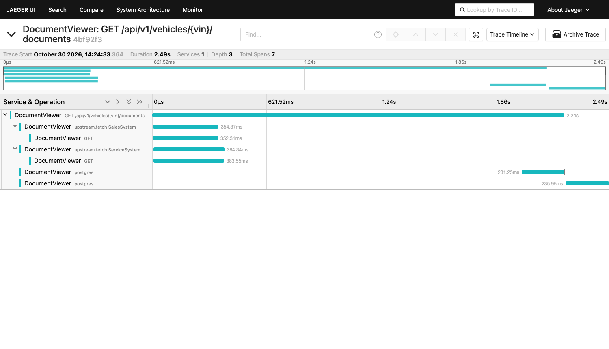

# Unified Document Viewer

**Keyloop Technical Assessment — Scenario D** (Domain: Operate)

A vehicle's documents live in two systems of record that grew up independently. This
service answers one question with one request: *given a VIN, what documents exist for
this vehicle, and where did each one come from?*

It fans out to both systems **in parallel**, normalises two unrelated payload shapes
into one model, and — the part that matters — keeps working when one of them doesn't.

| | |
|---|---|
| **Layer implemented** | Backend: RESTful API + persistent database |
| **Layer stubbed** | Client: committed [`openapi.json`](openapi.json), [`requests.http`](requests.http), cURL examples below |
| **Stack** | .NET 9 (`net9.0`), ASP.NET Core Minimal APIs, EF Core + Npgsql on Supabase PostgreSQL, Polly v8, Serilog, OpenTelemetry |
| **Tests** | 108 — 65 unit, 43 integration (xUnit, Shouldly, NSubstitute, WireMock.Net, Testcontainers) |

**Read next:** [System Design Document](docs/system-design.md) for the architecture and
the reasoning · [Code Guide](docs/code-guide.md) for a tour of the source · the
[AI Collaboration Narrative](#ai-collaboration-narrative) below.

---

## Quickstart

### Prerequisites

- [.NET SDK 9.0](https://dotnet.microsoft.com/download/dotnet/9.0) — `dotnet --version` should print `9.0.x`
- Docker (for the two mock upstream services, and for the integration tests)
- A Supabase or PostgreSQL database — **optional**, see [Running without a database](#running-without-a-database)

### Run it

```bash
# 1. Start the two mocked systems of record (ports 5101 and 5102)
docker compose up -d --build

# 2. Run the API (port 5080)
dotnet run --project src/DocumentViewer.Api --urls http://localhost:5080
```

```bash
# 3. Ask it a question
curl -s http://localhost:5080/api/v1/vehicles/1HGCM82633A004352/documents | jq
```

You should see seven documents — four from the Sales system, three from the Service
system — each tagged with its `sourceSystem`, and `"partial": false`.

### Test it

```bash
dotnet test
```

The integration tests start their own throwaway PostgreSQL container via Testcontainers
and their own stub upstreams via WireMock.Net, so they need Docker but **not** a
Supabase account and **not** `docker compose up`. Expect roughly three minutes:
several tests deliberately wait on timeouts, and integration test collections run
sequentially on purpose (see [Tests](#tests)).

---

## Configuration

Everything is configurable; nothing needs configuring to run the demo.

| Setting | Default | What it does |
|---|---|---|
| `Upstreams:SalesSystem:BaseAddress` | `http://localhost:5101` | Sales system of record |
| `Upstreams:ServiceSystem:BaseAddress` | `http://localhost:5102` | Service system of record |
| `Upstreams:CircuitBreakerMinimumThroughput` | `5` | Calls needed in the sampling window before a breaker can open |
| `ConnectionStrings:Default` | *(none)* | Runtime database. Supabase: the **transaction pooler**, port `6543` |
| `ConnectionStrings:Migrations` | *(none)* | Migrations only. Supabase: the **direct/session** connection, port `5432` |
| `HealthChecks:DatabaseTimeoutMs` | `5000` | How long readiness waits for the database |
| `OTEL_EXPORTER_OTLP_ENDPOINT` | *(none)* | Set it to export traces and metrics; otherwise they go to the console |

### Connecting a database

Two connection strings, because they are not interchangeable: Supabase's transaction-mode
pooler (`6543`) is right for runtime but does not support the session-level features EF
Core migrations need, so migrations use the direct connection (`5432`).

Supply them as environment variables — never commit them:

```bash
export ConnectionStrings__Default='Host=…pooler.supabase.com;Port=6543;Database=postgres;Username=…;Password=…;Ssl Mode=Require'
export ConnectionStrings__Migrations='Host=…pooler.supabase.com;Port=5432;Database=postgres;Username=…;Password=…;Ssl Mode=Require'

dotnet tool restore
dotnet ef database update \
  --project src/DocumentViewer.Infrastructure \
  --startup-project src/DocumentViewer.Api
```

Then `/health/ready` returns `200`, and the stale-cache fallback below becomes live.

### Running without a database

Supported, and the default. With no connection string the service answers document
searches exactly as before — it simply has no cache and writes no audit trail, and
`/health/ready` says so while still returning `200`. Readiness means *"I can do my
job"*, and without a cache it still can.

---

## The API

```
GET /api/v1/vehicles/{vin}/documents
```

| Outcome | Status |
|---|---|
| At least one source produced documents (live or cached) | `200` — `partial: true` if any source is not `ok` |
| VIN fails validation (length, illegal `I`/`O`/`Q`, ISO 3779 check digit) | `400` + `ProblemDetails` |
| Every source failed and nothing was cached | `503` + `Retry-After: 30` |
| Valid VIN, no documents anywhere | `200` with `documents: []` — not `404` |

```json
{
  "vin": "1HGCM82633A004352",
  "retrievedAt": "2026-10-31T07:42:11.183Z",
  "partial": true,
  "documents": [
    {
      "id": "service:91001",
      "sourceSystem": "ServiceSystem",
      "documentType": "JobCard",
      "title": "Job card #91001 — annual service",
      "issuedAt": "2026-03-15T00:00:00+00:00",
      "sizeBytes": 148213,
      "downloadUrl": "https://service.mock/docs/91001"
    }
  ],
  "sources": [
    { "system": "SalesSystem",   "status": "ok",     "documentCount": 4, "durationMs": 182 },
    { "system": "ServiceSystem", "status": "stale",  "documentCount": 3, "durationMs": 5004,
      "error": { "reason": "Timeout", "message": "…" } }
  ]
}
```

`status` is `ok` (live), `stale` (the source failed; cached documents served instead) or
`failed` (the source failed and nothing was cached). Returning `200` for a partial
result rather than a `5xx` is a deliberate decision, argued in
[§5.1 of the design document](docs/system-design.md).

Health: `/health/live` (process) · `/health/ready` (database) · `/health/upstream`
(informational, never fails). OpenAPI at `/openapi/v1.json`; the committed
[`openapi.json`](openapi.json) is the client contract.

### Request collection

[`requests.http`](requests.http) covers every path; the same calls as cURL:

```bash
BASE=http://localhost:5080
VIN=1HGCM82633A004352

# happy path — both sources
curl -s "$BASE/api/v1/vehicles/$VIN/documents" | jq '{partial, count: (.documents|length), sources: [.sources[] | {system, status}]}'

# invalid VIN (check digit altered) -> 400
curl -s -o /dev/null -w '%{http_code}\n' "$BASE/api/v1/vehicles/1HGCM82633A004353/documents"

# valid VIN with no documents -> 200 and an empty list
curl -s "$BASE/api/v1/vehicles/WAUZZZ8V1JA003421/documents" | jq '.documents | length'

# correlation: send your own id and get it back
curl -s -D- -o /dev/null -H 'X-Correlation-Id: my-trace-123' "$BASE/api/v1/vehicles/$VIN/documents" | grep -i correlation
```

---

## Seeing it degrade

This is the scenario's whole point, so it is a first-class feature rather than something
to describe in prose. Both mock upstreams expose a chaos switch. Every number below was
measured, not estimated.

```bash
BASE=http://localhost:5080
VIN=1HGCM82633A004352
show() { curl -s "$BASE/api/v1/vehicles/$VIN/documents" \
  | jq -c '{partial, count:(.documents|length), sources:[.sources[]|{system,status,reason:.error.reason}]}'; }
```

**One system down — the other keeps working.**

```bash
curl -s -XPOST localhost:5102/admin/chaos -H 'content-type: application/json' -d '{"mode":"fail"}'
show
# 200 · partial: true · 4 documents · Sales "ok", Service "failed" (HttpError)
# With a database connected, Service reads "stale" and its cached documents are
# included, for 7 documents instead of 4.
```

**The circuit breaker, visible.** Keep calling and the failing source stops being
contacted at all:

```bash
for i in 1 2 3 4 5 6; do show; done
# the reason changes from "HttpError" to "CircuitOpen", and those calls return
# in milliseconds — the breaker is refusing to waste 5s on a system it knows is down
```

**Both systems down — now it is honest about failing.**

```bash
curl -s -XPOST localhost:5101/admin/chaos -H 'content-type: application/json' -d '{"mode":"fail"}'
curl -s -o /dev/null -w '%{http_code} retry-after=%header{retry-after}\n' "$BASE/api/v1/vehicles/$VIN/documents"
# 503 retry-after=30
```

**Slow instead of broken — the timeout budget holds.** Reset first and give the breakers
their 15 seconds to close, or you will measure the breaker instead of the timeout:

```bash
for p in 5101 5102; do curl -s -XPOST localhost:$p/admin/chaos -H 'content-type: application/json' -d '{"mode":"normal"}'; done
sleep 16
curl -s -XPOST localhost:5102/admin/chaos -H 'content-type: application/json' -d '{"mode":"slow","delayMs":8000}'
time show
# ~5.9s, not 8 · partial: true · Service "failed" (Timeout)
# The whole-request budget is 6s and it holds: a slow source cannot hold the response
# past it, and Sales' four documents still arrive.
```

**A bad record does not poison the source.**

```bash
curl -s -XPOST localhost:5102/admin/chaos -H 'content-type: application/json' -d '{"mode":"normal"}'
sleep 16
curl -s -XPOST localhost:5102/admin/chaos -H 'content-type: application/json' -d '{"mode":"garbage"}'
show
# 200 · partial: false · Service "ok" with 0 documents
```

`garbage` returns well-formed JSON whose record is missing its title. The normaliser skips
that record and the source still reports `ok` — [assumption #7](docs/system-design.md): a
single unusable record is not a reason to fail an entire system of record. Genuinely
unparseable JSON is a different outcome (`InvalidPayload`) and is covered by
`Malformed_upstream_payload_reports_InvalidPayload_not_500`.

```bash
# put everything back
for p in 5101 5102; do curl -s -XPOST localhost:$p/admin/chaos -H 'content-type: application/json' -d '{"mode":"normal"}'; done
```

`mode` is `normal`, `slow` (with `delayMs`), `fail` (`503`) or `garbage`.

---

## How it is put together

```
src/
  DocumentViewer.Domain/          Vin, VehicleDocument, SourceSystem, UpstreamResult<T> — no dependencies
  DocumentViewer.Application/     parallel aggregation, partial-result rules, source abstraction
  DocumentViewer.Infrastructure/  typed HTTP clients + resilience, normalisers, EF Core, cache, audit
  DocumentViewer.Api/             endpoint, status mapping, middleware, observability, health
mocks/
  MockSalesApi/                   stands in for the Sales system — its own schema, plus chaos
  MockServiceApi/                 stands in for the Service system — a deliberately different schema
tests/
  DocumentViewer.UnitTests/       VIN, normalisers, client error mapping, aggregation rules
  DocumentViewer.IntegrationTests/ endpoint, persistence, observability, resilience
```

The one idea worth knowing before reading the code: **an upstream failure is a return
value, not an exception.**

```csharp
public abstract record UpstreamResult<T>
{
    public sealed record Ok(T Value, TimeSpan Duration) : UpstreamResult<T>;
    public sealed record Failed(UpstreamFailure Failure, TimeSpan Duration) : UpstreamResult<T>;
}
```

`await Task.WhenAll(sales, service)` rethrows the first faulted task and **discards the
other one's completed result** — which would silently destroy the partial-result
behaviour this whole service is built around, and only when an upstream is down. Because
every source returns an `UpstreamResult` instead of throwing, `Task.WhenAll` can never
throw and the aggregator always sees exactly one outcome per source.

[`docs/code-guide.md`](docs/code-guide.md) walks the source file by file.

---

## Tests

```bash
dotnet test                                                   # everything
dotnet test tests/DocumentViewer.UnitTests                    # 65, ~5s
dotnet test tests/DocumentViewer.IntegrationTests             # 43, ~2m45s
dotnet test --filter FullyQualifiedName~Resilience            # the reliability rules
```

| Group | Count | What it pins |
|---|---|---|
| `VinTests` | 13 | Length, illegal `I`/`O`/`Q`, ISO 3779 check digit (including the `X` remainder-10 branch), whitespace and lowercase input, and that a `Vin` cannot be formatted into a log line raw |
| Normalisers | 18 | Kilobytes vs bytes, epoch-millis vs ISO date, nested vs flat URL, unknown enum values kept rather than dropped, malformed records skipped rather than thrown, and a size too large to represent reported as unknown rather than as a negative number |
| `DocumentSourceClientTests` | 12 | Every upstream failure maps to the right `UpstreamFailureReason`, and the response body is bounded in both size and time |
| `NpgsqlConnectionHardeningTests` | 8 | Pool-warmth and connect-timeout defaults are applied, and never override what the operator set |
| `DocumentAggregationServiceTests` | 14 | Merge, ordering with nulls last, partial flag, stale fallback, a throwing source not losing its sibling's result, parallelism, cache writes outliving the request, and a hung database being unable to discard a healthy source's documents |
| `VehicleDocumentsEndpointTests` | 9 | Status mapping and `ProblemDetails` |
| Persistence | 12 | Round-trip, expiry, concurrent upserts, audit, and that an unreachable or absent database never breaks a read |
| `ObservabilityTests` | 10 | Correlation propagation, two overlapping upstream spans, no raw VIN in any log line, health-check semantics, client cancellation, and a guard that the stubs actually deliver documents |
| `UpstreamResilienceTests` | 10 | The reliability rules below |
| `TimeoutAccountingTests` | 1 | A whole-request timeout is counted and audited — the one outcome where the user got nothing is the one that most needs recording |
| `OpenApiContractTests` | 1 | Every property the committed contract marks `required` is actually present in a real response |

Three things about these tests are deliberate and worth a reviewer's attention:

**The parallelism test measures.** Requirement #2 says the backend must call both systems
in parallel. Nothing short of a clock proves that, so both stubs delay one second and the
whole request must finish in under 1.6s — sequential calls would take at least two.

**The database tests point at a black hole.** A closed port is refused instantly, which
would prove nothing about timeouts. These tests point the database at a `TcpListener`
that accepts the connection and then never answers — which is what a cold managed pooler
looks like from the client's side.

**Integration collections do not run in parallel.** Five tests assert on elapsed time.
Run alongside sibling test classes, CPU contention pushed a deliberately *healthy*
upstream past its 2s per-attempt timeout, and the suite failed on a correct `503`. Latency
assertions and parallel execution do not mix; `xunit.runner.json` turns it off.

### Reliability rules, and the test that holds each one

| Rule | Value | Test |
|---|---|---|
| Per-attempt timeout | 2 s | `One_upstream_timing_out_returns_200_partial_within_the_total_budget` |
| Total per upstream | 5 s | same |
| Whole request | 6 s | same |
| Retry, transient only | 2, exponential + jitter | `Transient_500_is_retried_and_succeeds_on_the_second_attempt` |
| Never retry other `4xx` | — | `Client_error_responses_are_never_retried(404, 400)` |
| Circuit breaker, per upstream | 0.5 ratio / 30 s / 15 s | `Repeated_failures_open_the_circuit_and_subsequent_calls_fail_fast` |
| Breakers are isolated | — | `Open_circuit_on_one_source_does_not_affect_the_other_source` |
| Upstream body size limit | 4 MiB | `Reports_a_body_that_never_stops_arriving_as_an_invalid_payload` |
| Upstream body read budget | 2 s | `Reports_a_body_that_trickles_past_its_budget_as_a_timeout` |
| Cache TTL | 15 min | `Get_returns_null_for_expired_entry` |
| Failures are never cached | — | `Failed_source_results_are_never_written_to_cache` |

---

## Observability

Serilog writes structured JSON to stdout. Every request-scoped line carries
`CorrelationId` and `TraceId`, and, where relevant, `SourceSystem` and `VinHash`.
(Startup, pool warm-up and background audit lines have no request to belong to and so
carry neither.)

**A VIN is treated as personal data.** No log line contains one. Logs carry `VinHash`
(first 12 hex of SHA-256) plus the last six characters — enough for support to correlate
a complaint without the log store becoming a PII store. The full VIN exists only in the
`search_audit` table, behind database access control. `Vin.ToString()` returns the masked
form, so an accidental interpolation cannot leak it, and a test asserts no log line
contains a raw VIN even on the degraded path — where a third-party retry logger was
found leaking it inside a `Uri` object.

OpenTelemetry exports traces and metrics; one request produces a parent span with two
**sibling** upstream spans whose intervals overlap, which is the clearest available proof
that the fan-out is real:



Six metrics under the `DocumentViewer` meter: aggregation duration, upstream duration and
result per system, partial-response count, cache lookup outcomes, and circuit state. The
partial-response counter is the one a naive implementation cannot produce at all — it is
only measurable because partial results are modelled rather than thrown away.

---

## AI Collaboration Narrative

GenAI wrote most of the code in this repository. The interesting question is not whether
it can — it can — but whether the engineer directing it can tell correct output from
plausible output. What follows is the honest record, including the places the AI was
wrong and how that was caught.

The full log is in [`docs/ai-collaboration/`](docs/ai-collaboration/): `prompts.md` has
the prompt sequence and why it was ordered that way, `review-log.md` has every finding
with its reasoning. The implementation plan the AI worked from is at
[`docs/superpowers/plans/`](docs/superpowers/plans/).

### Strategy: never ask for code first

Each phase asked the model to extract, to score, to attack, or to justify — and only then
to produce. Code generated before the problem is pinned down is code that has to be
thrown away.

1. **Extract, do not interpret.** Parse the brief into requirements, keeping the per-scenario
   acceptance criteria separate from the cross-cutting requirements in "The Challenge
   Structure". That separation is what made step 3 possible.
2. **Score the options against an explicit rubric** — implementation complexity, risk of
   scope overrun, and how much substance each scenario leaves for a design document.
   Scenario A has more technical depth, but its concurrency problem is easy to ship
   subtly wrong; Scenario D's reliability concerns are intrinsic rather than bolted on.
3. **Attack the choice.** *"Re-read Part 2 adversarially. What does Scenario D fail to
   satisfy by construction?"* This produced the single most valuable finding of the design
   phase: a persistent database is **mandatory** for a backend submission, and Scenario D
   is pure read-only aggregation that generates no data of its own. That reshaped the
   design and became assumption #1.
4. **Attack my own design.** *"Here is the fan-out design. Find the bug."* → the
   `Task.WhenAll` defect described above.
5. **Justify every technology, including the rejects.** Forcing a rejected alternative for
   every row of the stack table is what surfaced the FluentAssertions licence problem and
   the question of where integration tests should point.
6. **Design document, then plan, then code.** The model implemented against a specification
   and a task-by-task plan that I own, rather than inventing one as it went. Every task was
   test-first, with the failing test watched before the implementation existed.

### Verification: how the AI's output was actually checked

- **Every task ran red-to-green.** A test that passes the moment it is written proves nothing.
- **The suite was run against reality, not just against itself.** This is where the serious
  findings came from — see below.
- **Every test was interrogated with one question: what production change would make this
  fail?** One readiness test could not answer it and was rewritten (I-9).
- **Deviations from the plan were recorded as rulings**, with what each costs if wrong, in
  the ledger at [`docs/ai-collaboration/implementation-ledger.md`](docs/ai-collaboration/implementation-ledger.md).

### What the AI got wrong

A representative selection; the full list is in
[`review-log.md`](docs/ai-collaboration/review-log.md) (D-1…D-7 design, I-1…I-12
implementation).

| # | What the AI produced | What was changed | Why it mattered |
|---|---|---|---|
| D-3 | `await Task.WhenAll(sales, service)` | `UpstreamResult<T>`; failure became a return value | Rethrows the first fault and discards the sibling's completed result — breaking partial results, and only when an upstream is down |
| D-4 | FluentAssertions in the test stack | Shouldly | FluentAssertions v8 is no longer free for commercial use. A dependency that cannot ship is not a dependency |
| D-5 | A `5xx`/`207` for a partial result | `200` + `partial` + per-source `sources[]` | Many clients discard the body on a `5xx`, throwing away documents the service successfully retrieved |
| I-1 | `dotnet add package … --no-restore`, leaving floating `Version="*"` | Pinned `9.0.*` versions | A wildcard resolved a `net10.0`-only package and broke the build; it also makes builds unreproducible |
| I-3 | `AddHttpClient<IDocumentSource, T>()` with `AddStandardResilienceHandler()` defaults | Named each pipeline; `Retry.Delay` 200ms; configurable breaker throughput | Unnamed registrations keyed **both** clients under `IDocumentSource`, sharing one base address and one circuit breaker — destroying the per-upstream isolation the design is built on. The default 2s retry delay also made a second retry impossible inside a 5s budget |
| I-6 | Logging only `VinHash`, with a Serilog enricher scrubbing string properties | Enricher extended to recurse through `ScalarValue`/`StructureValue`/`SequenceValue`/`DictionaryValue`, plus a matching span processor | Polly's retry logger stores the outbound URL as a `Uri` object, not a string, so the raw VIN leaked into the logs — on the degraded path, which is exactly when the logs get read |
| I-8 | A complete, green, 73-test implementation | Pool warm-up; writes detached from the request token; readiness budget enforced by racing | Against **live Supabase** the stale-cache fallback was dead and readiness returned `503`. Cache writes ran on the request's cancellation token, which is cancelled the instant the response is sent, so nothing was ever cached. Testcontainers connects in under a millisecond, so no test could see it |
| I-9 | A readiness test pointing at a closed port | A black-hole `TcpListener`, plus a generous-budget test | The test passed before *and* after the fix. A test that cannot fail is worse than no test: it reports safety it never checked |
| I-11 | `AddDocumentSources` reading `Upstreams:*:BaseAddress` at registration time | Reads resolve from `IServiceProvider` per client | It captured `appsettings.json` and silently ignored every later source — so a deployment setting an upstream address by environment variable would have been ignored |

### The lesson worth keeping

**A green test suite describes the environment the suite runs in.** Seventy-three tests
passed, the endpoint demonstrated correctly, and the headline feature of the scenario was
dead in production, because PostgreSQL in a local container answers in under a millisecond
and a managed cross-region pooler does not. Finding I-8 came from running the thing
against real infrastructure and reading the logs — not from more tests. The tests written
*afterwards* keep it fixed; they could not have found it.

The corollary is how the AI was used best: not as a code generator to be reviewed by
reading diffs, but as an adversary pointed at my own decisions, with every answer verified
against something real.

---

## What is deliberately not built

Choices, not omissions — each with its reasoning in
[§9 of the design document](docs/system-design.md): authentication and authorisation
(belongs at the gateway), document content download (a different problem with different
security properties), pagination (tens of documents per vehicle, not thousands),
cross-source deduplication (a document in both systems **is** two records, and
requirement #3 asks that each one's source be clear), and the frontend (the brief asks
for one layer, and requirement #2 names the backend).
