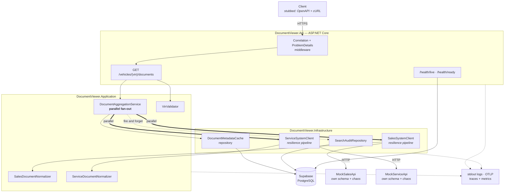
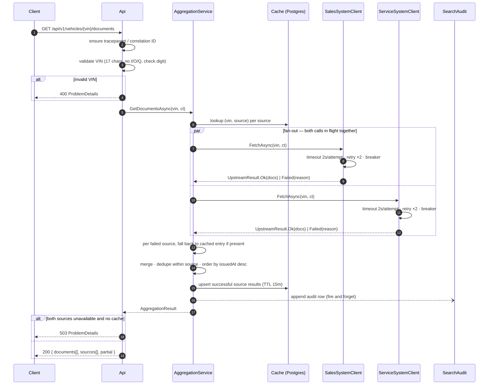

# Unified Document Viewer — System Design Document

**Keyloop Technical Assessment — Scenario D (Domain: Operate)**

| | |
|---|---|
| **Author** | _TODO: your name_ |
| **Date** | 2026-10-29 |
| **Version** | 1.0 (pre-implementation) |
| **Implemented layer** | Backend (RESTful API + persistent database) |
| **Stubbed layer** | Client — OpenAPI contract, `requests.http`, cURL examples |

---

## 1. Problem Statement

A dealership's documents for a single vehicle are scattered across two systems of
record that grew up independently: a **Sales System** (purchase orders, finance
agreements, registration paperwork) and a **Service System** (job cards, inspection
reports, warranty claims). Today a user must log into both, search both, and mentally
merge the results.

This service provides **one request, one answer**: given a VIN, return every document
for that vehicle from both systems as a single consolidated list, each entry clearly
attributed to its source.

### Acceptance criteria (from the brief)

| # | Requirement | Where it is satisfied |
|---|---|---|
| 1 | Unified search by VIN | `GET /api/v1/vehicles/{vin}/documents` (§5) |
| 2 | Backend makes **parallel** requests to two mocked external APIs | `DocumentAggregationService` (§4.2), proven by a timing test (§8) |
| 3 | Single consolidated list, source clearly indicated per document | `sourceSystem` on every document + `sources[]` metadata (§5.2) |

---

## 2. Design Principles

The brief asks for scalability, performance, reliability, maintainability and
observability. Those words translate into four concrete principles that every
decision in this document can be traced back to:

1. **A degraded answer beats no answer.** One source being down must not make the
   endpoint useless. Partial results are a first-class, explicitly-modelled outcome —
   never an exception that escapes.
2. **The caller is never left guessing.** If data is missing, incomplete or stale, the
   response says so per source. The client decides how to present that.
3. **Upstream systems are untrusted and isolated.** Each gets its own timeout budget,
   its own retry policy and its own circuit breaker. A failure cannot propagate
   sideways.
4. **Every request is explainable after the fact.** One correlation ID ties the API
   log line, both upstream spans, the audit row and the metrics together.

---

## 3. Architecture



### 3.1 Component responsibilities

| Component | Responsibility | Deliberately NOT responsible for |
|---|---|---|
| **DocumentViewer.Api** | HTTP edge. Route, bind, validate VIN, map outcome → status code, emit RFC 9457 `ProblemDetails`, expose OpenAPI + health. | Any knowledge of how many upstreams exist or how they fail. |
| **DocumentViewer.Application** | The business rules: fan out to all registered sources in parallel, collect successes *and* failures, merge, order, decide `partial`. | HTTP, SQL, retries, serialisation. |
| **DocumentViewer.Domain** | `Vin` value object, `VehicleDocument`, `SourceSystem`, `UpstreamResult<T>`. Zero dependencies. | Anything with an `I/O` boundary. |
| **DocumentViewer.Infrastructure** | Typed `HttpClient` per upstream with its resilience pipeline; per-source normalizers; EF Core persistence for cache + audit. | Deciding what a partial result *means*. |
| **MockSalesApi** / **MockServiceApi** | Stand in for the real systems of record, each with a **genuinely different** payload shape, plus a chaos endpoint to inject latency and failures on demand. | Being realistic beyond shape and failure behaviour. |

Two mocks are deployed as **real HTTP processes**, not in-process fakes. That is a
deliberate cost: it is the only way the parallel fan-out, the timeouts and the circuit
breakers are exercised over a real socket rather than against a stub that cannot be
slow.

### 3.2 Why this shape

Four projects rather than one is proportionate here for one reason: `Application`
depends on an `IDocumentSource` abstraction, not on `HttpClient`. That is what makes
"add a third system of record" a matter of registering one more client, and what makes
the partial-failure rules unit-testable without a network.

---

## 4. Data Flow

### 4.1 Request lifecycle



### 4.2 The parallel fan-out — and the trap in it

The naive implementation is wrong in a way that silently destroys requirement #3:

```csharp
// WRONG — if either task faults, WhenAll rethrows and the other
// source's successfully-fetched documents are lost.
var results = await Task.WhenAll(sales, service);
```

Every source call is therefore wrapped so that **failure is a return value, not an
exception**:

```csharp
public abstract record UpstreamResult<T>
{
    public sealed record Ok(T Value, TimeSpan Duration)             : UpstreamResult<T>;
    public sealed record Failed(UpstreamFailure Reason, TimeSpan Duration) : UpstreamResult<T>;
}
```

`IDocumentSource.FetchAsync` catches at its own boundary and returns `Failed`. With
that in place `Task.WhenAll` can never throw, and the aggregator always sees one
outcome per source. The timing test in §8 is what proves the two calls genuinely
overlap rather than merely *looking* concurrent.

### 4.3 Cache fallback and source status

The cache is keyed **per `(vin, sourceSystem)`**, not per request. This is what lets a
healthy source be served live while a sick one is served from cache in the same
response. Each source reports one of three states:

| `status` | Meaning | Cache written? |
|---|---|---|
| `ok` | Live fetch succeeded | yes, TTL 15 min |
| `stale` | Live fetch failed, a cached entry was served instead | no |
| `failed` | Live fetch failed and no cached entry exists | no |

Failures are **never** cached. Caching a failure turns a one-second upstream blip into
a fifteen-minute outage.

---

## 5. API Contract

### 5.1 Endpoint

```
GET /api/v1/vehicles/{vin}/documents
```

| Outcome | Status | Notes |
|---|---|---|
| At least one source produced data (live or cached) | `200` | `partial: true` when any source is not `ok` |
| VIN fails validation | `400` | `ProblemDetails`, `type: .../invalid-vin` |
| All sources `failed` | `503` | `Retry-After` header set |
| Valid VIN, no documents anywhere | `200` | `documents: []` — **not** 404; the vehicle may legitimately have none |

Returning `200` for a partial result rather than a `5xx` is the central API decision in
this design. The brief does not specify it. The rationale: the user's goal is to see the
documents that exist, and a `5xx` would make a client's error handling discard data it
successfully received. The `sources[]` block exists so that choice costs the client no
information.

### 5.2 Response

```json
{
  "vin": "1HGCM82633A004352",
  "retrievedAt": "2026-10-29T10:42:11.183Z",
  "partial": true,
  "documents": [
    {
      "id": "sales:PO-88213",
      "sourceSystem": "SalesSystem",
      "documentType": "PurchaseOrder",
      "title": "Purchase order PO-88213",
      "issuedAt": "2026-03-04T00:00:00Z",
      "sizeBytes": 148213,
      "downloadUrl": "https://sales.mock/documents/PO-88213"
    }
  ],
  "sources": [
    { "system": "SalesSystem",   "status": "ok",     "documentCount": 4, "durationMs": 182 },
    { "system": "ServiceSystem", "status": "failed", "documentCount": 0, "durationMs": 5004,
      "error": { "reason": "Timeout", "message": "Total request timeout of 5s elapsed" } }
  ]
}
```

`id` is namespaced by source (`sales:`, `service:`) because the two systems assign
identifiers independently and their key spaces can collide.

### 5.3 Upstream schema divergence

Normalisation is only meaningful if the two upstreams genuinely disagree. The mocks are
built to disagree:

| Unified field | Sales System | Service System |
|---|---|---|
| identifier | `documentId` (string, `"PO-88213"`) | `id` (integer, `88213`) |
| type | `docType` (`"PURCHASE_ORDER"`) | `category` (`"job-card"`) |
| title | `description` | `name` |
| issued date | `createdDate` (`"2026-03-04"`, ISO date, dealer-local) | `timestamp` (epoch **milliseconds**, UTC) |
| size | `fileSizeKb` (kilobytes) | `bytes` |
| link | `url` | `links.self` (nested) |
| envelope | `{ "documents": [...] }` | `{ "data": { "items": [...] }, "meta": {...} }` |

Each difference is a real normalisation bug waiting to happen — unit-tested per
normalizer in Task 3: kilobytes vs bytes, epoch-millis vs ISO date, nested envelope,
and unknown enum values mapping to `Unknown` rather than throwing.

---

## 6. Technology Choices

| Choice | Why | Alternative considered, and why not |
|---|---|---|
| **.NET 9** (`net9.0`) + ASP.NET Core Minimal APIs | Matches Keyloop's enterprise stack, and is the SDK pinned for this exercise (9.0.320). Minimal APIs keep the HTTP edge small enough to read on one screen. **Support status, stated deliberately:** .NET 9 is an STS release, currently in maintenance, end-of-life 2026-11-10. A production service would target **.NET 10 (LTS, supported to Nov 2028)**; nothing in this design is version-specific, so that migration is a single `TargetFramework` change in `Directory.Build.props` and a re-run of the test suite. | MVC controllers — more ceremony than one endpoint needs. .NET Framework 4.8 — Windows-only and frozen. .NET Core 3.1 — out of support since Dec 2022, and without Minimal APIs, `Microsoft.Extensions.Http.Resilience` or current OpenTelemetry packages, none of §7 or §8 would be achievable as designed. |
| **`IHttpClientFactory`** + typed clients | Correct socket/DNS lifetime management; the idiomatic seam for per-upstream policy. | A `static HttpClient` — no per-upstream policy isolation, stale DNS. |
| **`Microsoft.Extensions.Http.Resilience`** (Polly v8) | Timeout, retry and circuit breaker as one declarative pipeline per client, with built-in telemetry. | Hand-rolled `CancellationTokenSource` + loops — all the bugs, none of the metrics. |
| **Supabase PostgreSQL** + EF Core / Npgsql | Managed Postgres, no local Docker needed to run the app; real SQL engine so the schema and indexes are honest. | SQLite — would run anywhere, but the index and concurrency story stops being credible. |
| **Serilog** → structured JSON on stdout | Log aggregators consume JSON; stdout is the container contract. | Default `ILogger` console — unstructured, unqueryable. |
| **OpenTelemetry** (traces + metrics, OTLP) | Vendor-neutral; ASP.NET Core / HttpClient / Npgsql instrumentation is off-the-shelf; the two parallel upstream spans become *visible*. | Metrics only — would not show the fan-out, which is the whole point of the scenario. |
| **xUnit + Shouldly + NSubstitute** | Standard, fast. Shouldly rather than FluentAssertions, whose v8 licence is no longer free for commercial use — a dependency that cannot ship is not a dependency. | FluentAssertions — licence risk. |
| **WireMock.Net** (integration tests) | Lets a test script a slow or broken upstream deterministically, which is exactly what the resilience rules need proving against. | Hitting the real mock services from tests — non-deterministic, no failure injection. |
| **Testcontainers for PostgreSQL** | Integration tests get a real Postgres per run, with no network dependency on Supabase and no shared-state flakiness. | Testing against Supabase — slow, networked, and a failing test could corrupt demo data. |
| **Two standalone mock services** | The fan-out, timeouts and breakers are exercised over real sockets, and latency/failure can be injected live during the demo. | In-process fakes — cannot be slow, cannot be partially down. |

---

## 7. Observability Strategy

### 7.1 Logging

Serilog writes structured JSON to stdout. Every line carries `CorrelationId`,
`TraceId`, `SpanId`, and — where relevant — `SourceSystem` and `VinHash`.

A correlation middleware honours an inbound W3C `traceparent` or `X-Correlation-Id`,
generates one when absent, propagates it to both upstream calls via a
`DelegatingHandler`, and echoes it on the response. One ID therefore links the API log
line, both upstream spans, the audit row and the client's own record.

**A VIN is personal data** — it identifies a vehicle and, in practice, its owner. No
log line contains a raw VIN. Logs carry `VinHash` (first 12 hex of SHA-256) plus the
last 6 characters, which is enough for support to correlate a complaint without the
log store becoming a PII store. The `SearchAudit` table holds the full VIN, because
there it is the business record and sits behind database access control.

Levels: `Information` for one request-completed line per request; `Warning` for a
degraded source; `Error` only for faults this service is responsible for — an upstream
timeout is expected operation, not an error, and paging on it would train the on-call
to ignore alerts.

### 7.2 Metrics

Exposed via a `Meter` named `DocumentViewer` over OTLP.

| Metric | Type | Tags | Question it answers |
|---|---|---|---|
| `documentviewer.aggregation.duration` | histogram | `outcome` | Are we inside our p95 latency SLO? |
| `documentviewer.upstream.duration` | histogram | `system` | Which system of record is slow? |
| `documentviewer.upstream.result` | counter | `system`, `status` | Which one is unreliable, and how? |
| `documentviewer.response.partial` | counter | — | How often do users see an incomplete answer? |
| `documentviewer.cache.lookup` | counter | `result` | Is the cache earning its complexity? |
| `documentviewer.circuit.state` | gauge | `system` | Is a breaker currently open? |

`documentviewer.response.partial` is the metric that matters most, and it is the one a
naive implementation cannot produce at all: it is only measurable because partial
results are modelled explicitly rather than thrown away as exceptions.

### 7.3 Tracing

One `ActivitySource` per layer. A single request produces a parent span with two
**sibling** upstream spans whose intervals overlap — a trace waterfall is the clearest
available proof that requirement #2 is actually met, and a screenshot of it belongs in
the submission.

### 7.4 Health checks

| Endpoint | Checks | Used by |
|---|---|---|
| `/health/live` | process is up | container restart policy |
| `/health/ready` | Postgres reachable | load-balancer rotation |
| `/health/upstream` | both upstreams, **informational** | dashboards only |

`/health/ready` deliberately excludes the upstreams. If it did not, both systems of
record going down would pull every instance of this service out of rotation — and the
service would stop serving the cached documents it is still perfectly able to serve.
Readiness means "I can do my job", and with warm cache and partial results, it can.

### 7.5 Service level objectives

| SLO | Target | Measured from |
|---|---|---|
| Availability of the aggregate endpoint (non-`5xx`) | ≥ 99.9% | `aggregation.duration{outcome}` |
| p95 latency | < 1.5 s | `aggregation.duration` |
| Requests served complete (not partial) | ≥ 99% | `response.partial` ÷ total |

Availability is defined over *this service's* behaviour, not the upstreams': returning a
documented partial result counts as success. That is the design paying off — the SLO
can only be stated this way because degradation is a modelled outcome.

---

## 8. Reliability and Performance

### 8.1 Timeout budget

| Scope | Budget |
|---|---|
| Per attempt, per upstream | 2 s |
| Total per upstream, incl. retries | 5 s |
| Whole request | 6 s |

The per-upstream total is below the whole-request budget, so a sick source cannot hold
the response hostage; because the two calls are concurrent, the slowest source sets the
latency, not the sum.

### 8.2 Retry policy

Two retries, exponential backoff with jitter, **only** on transient conditions
(`5xx`, `408`, `429`, timeouts, socket errors). `4xx` is never retried — a `404` means
the vehicle is unknown to that system, and retrying it just multiplies load against an
upstream that is already answering correctly.

### 8.3 Circuit breaker

One breaker **per upstream**: 50% failure ratio over a 30 s window, 15 s break. While a
breaker is open that source fails fast into the cache-fallback path, so a sick system
of record costs ~0 ms instead of 5 s. Shared state between the two breakers would let
one failing system degrade the other — the isolation is the point.

### 8.4 Persistence

```
search_audit                           document_metadata_cache
  id            bigserial PK             vin             varchar(17)  ┐ PK
  vin           varchar(17)              source_system   smallint     ┘
  correlation_id uuid                    payload         jsonb
  searched_at   timestamptz              document_count  int
  duration_ms   int                      fetched_at      timestamptz
  partial       boolean                  expires_at      timestamptz
  source_report jsonb

  idx (vin, searched_at desc)            idx (expires_at)  -- eviction sweep
```

**Why a database at all.** The brief requires a persistent database, and Scenario D is
read-only aggregation — it generates no obvious data. Rather than add a table for the
sake of it, the two tables chosen each answer a real question:

- `search_audit` — who looked at which vehicle's documents, when, and whether they saw
  a complete answer. Access to vehicle records is auditable in automotive retail, and
  this table is also the only durable record of *user-visible* degradation.
- `document_metadata_cache` — makes the cache-fallback behaviour in §4.3 possible and
  cuts repeat load on the systems of record.

This is an assumption, recorded in §10.

The audit write is fire-and-forget behind its own `try/catch`: observability must
never be the reason a user's request fails. Supabase's transaction-mode pooler (port
6543) is used at runtime; EF Core migrations run against the direct connection (5432),
because the pooler does not support the session-level features migrations need.

### 8.5 Scaling path

The API holds no per-request state, so it scales horizontally behind a load balancer.
The next bottlenecks, in the order they would appear: the cache table (→ Redis, same
repository interface), audit write volume (→ batched or outbox), and upstream rate
limits (→ per-source concurrency bulkheads, already the natural extension of the
per-source pipelines).

---

## 9. Non-Goals

Explicitly out of scope, and why — these are choices, not omissions:

| Not built | Why |
|---|---|
| Authentication / authorisation | Not in the acceptance criteria. In production this belongs at the API gateway; the design is unaffected by adding it. |
| Document content proxying / download | The brief asks for a *list* of documents. Streaming bytes is a different problem with different reliability and security properties. |
| Pagination | Documents per vehicle is tens, not thousands. Adding it now would be speculative; the response envelope leaves room for it. |
| Cross-source deduplication | A document in both systems **is** two records in two systems, and requirement #3 asks that each entry's source be clear. Collapsing them would destroy information. Deduplication happens only *within* a source, by external ID. |
| Frontend | The brief requires one layer; the backend is where Scenario D's substance lives (requirement #2 names the backend explicitly). The client is stubbed with an OpenAPI contract and cURL examples. |
| Write operations on documents | Read-only by scenario definition. |

---

## 10. Assumptions

The brief notes requirements may be ambiguous. Each ambiguity found, and the call made:

| # | Ambiguity | Decision | Rationale |
|---|---|---|---|
| 1 | A persistent database is required, but the scenario stores nothing | `search_audit` + `document_metadata_cache` | Both answer real operational questions rather than existing to satisfy the requirement (§8.4). |
| 2 | Status code when one source fails | `200` + `partial: true` + per-source `sources[]` | The user's goal is the documents that *do* exist; `5xx` would make clients discard good data (§5.1). |
| 3 | Status code when both fail | `503` + `Retry-After` | Nothing was delivered and the condition is transient. |
| 4 | Valid VIN with no documents | `200` with `documents: []` | The vehicle exists; "no documents" is a valid answer, not a missing resource. |
| 5 | Is a VIN personal data? | Treated as PII | VIN → owner is a short hop. Hashed in logs, full value only in the access-controlled audit table (§7.1). |
| 6 | Same document in both systems | Not deduplicated across sources | Requirement #3 asks for the source of each document; collapsing loses that. |
| 7 | Unknown document type from an upstream | Mapped to `Unknown`, document still returned | Dropping a document because its type is unrecognised is worse than showing it with an unknown type. |
| 8 | Serving stale cached data on upstream failure | Allowed, flagged `status: "stale"` | Old documents are still useful; silently presenting them as fresh would not be. |
| 9 | VIN check-digit validation | Enforced (position 9, excluding `I`/`O`/`Q`) | Rejecting a typo at the edge is cheaper than two upstream round trips returning nothing. |
| 10 | Runtime version | Built on .NET 9 (`net9.0`), with the LTS migration path documented in §6 | .NET 9 reaches end-of-life 2026-11-10. Recording the constraint and the one-line route to .NET 10 LTS is better than leaving a reviewer to discover it. |

---

## 11. GenAI in the Design Phase

GenAI was used as a design collaborator throughout this phase, under a simple rule:
**the AI proposes, the engineer disposes.** Every output below was accepted, rejected
or rewritten deliberately.

**1. Requirement extraction and scenario selection.** The brief was parsed and all four
scenarios were scored against a deliberately explicit rubric — implementation
complexity, risk of scope overrun, and how much substance each left to discuss in this
document. Scenario A (the scheduler) scored highest on technical depth but carried a
concurrency and resource-allocation problem that is easy to ship subtly wrong, which is
exactly where a reviewer would probe. Scenario D scored best on signal per unit of
effort: modest implementation, and the reliability concerns the brief asks about are
intrinsic to it rather than bolted on. That trade-off was the decisive judgement, and it
was mine, not the model's.

**2. Surfacing a buried requirement.** The AI was asked to re-read Part 2 adversarially
and report any requirement that Scenario D does not naturally satisfy. It found the one
that matters: *"use a persistent database"* is mandatory for a backend submission, and
Scenario D is pure read-only aggregation with nothing to store. That single finding
reshaped §8.4 and produced assumption #1. The model identified the gap; choosing
*audit + cache* over a token table — and being able to justify why each earns its
place — was a design decision.

**3. Adversarial review of my own design.** The draft fan-out was submitted to the model
with one instruction: find the failure mode. It identified that `Task.WhenAll` rethrows
the first exception and discards the sibling task's completed result — which would have
silently broken the partial-result behaviour that §2 is built on, in a way that only
shows up when an upstream is down. The `UpstreamResult<T>` design in §4.2 is the direct
answer to that review, and the timing and partial-failure tests exist so the fix cannot
regress.

**4. Options surfaced and rejected.** The design dialogue generated more candidates
than survived. A message queue between the API and the upstreams was rejected: this is a
synchronous read, and a queue would add latency and operational surface for no benefit.
Caching failure responses alongside successes was rejected: it converts a one-second
upstream blip into a fifteen-minute outage. Including the upstreams in `/health/ready`
was rejected for the reason given in §7.4 — it would pull instances out of rotation
while they are still able to serve cached documents. Each of these is recorded with its
reasoning so a reviewer can argue with the judgement rather than guess at it.

**5. What GenAI was not allowed to decide.** The API contract, the status-code
semantics, the timeout budget, the PII treatment of VINs, and every entry in §10 are
engineering decisions recorded with their rationale, so that a reviewer can disagree
with the reasoning rather than merely with the output.

The equivalent narrative for the *implementation* phase — including the specific
AI-generated defects caught in review — is in the repository `README.md`.

---

## 12. Repository Layout

```
KeyloopDocumentViewer.sln
├─ src/
│  ├─ DocumentViewer.Api/              HTTP edge, DI, middleware, OpenAPI, health
│  ├─ DocumentViewer.Application/      aggregation, normalizers, VIN validation
│  ├─ DocumentViewer.Infrastructure/   HTTP clients + resilience, EF Core, cache, audit
│  └─ DocumentViewer.Domain/           Vin, VehicleDocument, SourceSystem, UpstreamResult
├─ mocks/
│  ├─ MockSalesApi/                    minimal API — Sales schema + chaos endpoint
│  └─ MockServiceApi/                  minimal API — Service schema + chaos endpoint
├─ tests/
│  ├─ DocumentViewer.UnitTests/        VIN, normalizers, aggregation rules
│  └─ DocumentViewer.IntegrationTests/ WireMock upstreams + Testcontainers Postgres
├─ docs/
│  ├─ system-design.md                 this document
│  └─ ai-collaboration/                prompts and review notes
├─ openapi.json                        generated, committed — the client stub contract
├─ requests.http                       executable request collection
└─ README.md                           build / run / test + AI collaboration narrative
```
