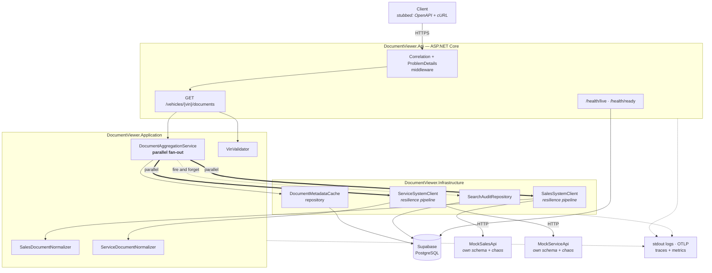
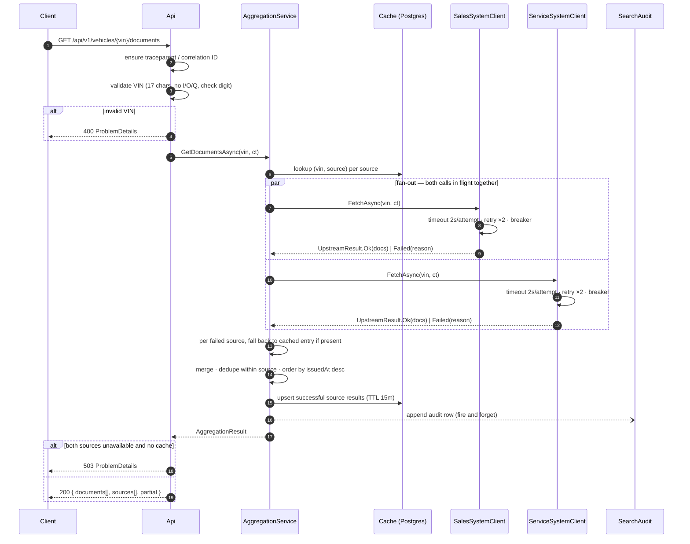

# Unified Document Viewer — Tài liệu tiếng Việt (bản hợp nhất)

**Keyloop Technical Assessment — Scenario D (Domain: Operate)**

Đây là bản dịch tiếng Việt, hợp nhất ba tài liệu kỹ thuật của dự án thành một bản đọc
liền mạch:

| Phần | Dịch từ | Trả lời câu hỏi | Đọc khi |
|---|---|---|---|
| **Phần I** | [`system-design.md`](system-design.md) | **Vì sao** — kiến trúc, đánh đổi, giả định, phạm vi loại trừ | Trước khi muốn phản biện một quyết định thiết kế |
| **Phần II** | [`code-guide.md`](code-guide.md) | **Định hướng** — tour mã nguồn 10 phút | Vừa clone repo về |
| **Phần III** | [`developer-guide.md`](developer-guide.md) | **Tra cứu** — file, luồng, con số, cách mở rộng | Sắp sửa đổi code |

> **Lưu ý về tính thẩm quyền:** ba file tiếng Anh là bản gốc và là bản nộp cho Keyloop.
> Bản tiếng Việt này để đọc hiểu nhanh. Nếu có khác biệt, **bản tiếng Anh là bản đúng**.
> Mọi tên lớp, tên file, tên test, tên cấu hình và đoạn code đều giữ nguyên tiếng Anh vì
> chúng là định danh trong mã nguồn.

| | |
|---|---|
| **Tác giả** | _TODO: điền tên anh_ |
| **Ngày** | 2026-10-29, sửa 2026-10-31, bản dịch 2026-11-01 |
| **Phiên bản** | 2.0 (đã đối chiếu với phần hiện thực) |
| **Tầng đã hiện thực** | Backend (RESTful API + database bền vững) |
| **Tầng để stub** | Client — hợp đồng OpenAPI, `requests.http`, ví dụ cURL |

---
---

# PHẦN I — TÀI LIỆU THIẾT KẾ HỆ THỐNG

## I.1. Phát biểu bài toán

Tài liệu của một chiếc xe tại đại lý bị phân mảnh trong **hai hệ thống nguồn** phát
triển độc lập nhau:

- **Sales System** — đơn mua (purchase order), hợp đồng tài chính (finance agreement),
  giấy tờ đăng ký (registration paperwork).
- **Service System** — phiếu công việc (job card), biên bản kiểm tra (inspection
  report), yêu cầu bảo hành (warranty claim).

Hiện tại người dùng phải đăng nhập cả hai hệ thống, tìm kiếm ở cả hai, rồi **tự ghép kết
quả trong đầu**.

Service này cung cấp **một request, một câu trả lời**: cho một VIN, trả về toàn bộ tài
liệu của xe đó từ cả hai hệ thống dưới dạng **một danh sách hợp nhất duy nhất**, mỗi
phần tử ghi rõ nó đến từ nguồn nào.

### Tiêu chí nghiệm thu (lấy từ đề bài)

| # | Yêu cầu | Được thỏa mãn ở đâu |
|---|---|---|
| 1 | Tìm kiếm hợp nhất theo VIN | `GET /api/v1/vehicles/{vin}/documents` (§I.5) |
| 2 | Backend gọi **song song** tới hai API ngoài đã được mock | `DocumentAggregationService` (§I.4.2), được chứng minh bằng một test đo thời gian (§I.8) |
| 3 | Một danh sách hợp nhất, mỗi tài liệu chỉ rõ nguồn | Trường `sourceSystem` trên mỗi tài liệu + metadata `sources[]` (§I.5.2) |

---

## I.2. Các nguyên tắc thiết kế

Đề bài yêu cầu khả năng mở rộng (scalability), hiệu năng (performance), độ tin cậy
(reliability), khả năng bảo trì (maintainability) và khả năng quan sát (observability).
Những từ đó được chuyển thành **bốn nguyên tắc cụ thể** mà mọi quyết định trong tài liệu
này đều có thể truy ngược về:

1. **Một câu trả lời suy giảm vẫn tốt hơn không có câu trả lời nào.** Một nguồn chết
   không được phép làm endpoint trở nên vô dụng. Kết quả một phần (partial result) là
   một **kết cục được mô hình hóa tường minh**, hạng nhất — chứ không bao giờ là một
   exception lọt ra ngoài.
2. **Người gọi không bao giờ phải đoán.** Nếu dữ liệu thiếu, không đầy đủ, hay đã cũ,
   response nói rõ điều đó **theo từng nguồn**. Client tự quyết định cách trình bày.
3. **Hệ thống upstream là không đáng tin và bị cô lập.** Mỗi upstream có ngân sách
   timeout riêng, chính sách retry riêng, circuit breaker riêng. Một lỗi không thể lan
   ngang sang nguồn khác.
4. **Mọi request đều giải thích được sau khi đã xảy ra.** Một correlation ID duy nhất
   buộc chặt dòng log của API, hai span upstream, dòng audit trong DB và các metric lại
   với nhau.

---

## I.3. Kiến trúc



### I.3.1 Trách nhiệm từng thành phần

| Thành phần | Trách nhiệm | **Cố ý KHÔNG** chịu trách nhiệm |
|---|---|---|
| **DocumentViewer.Api** | Biên HTTP. Định tuyến, bind, validate VIN, map kết cục → status code, phát `ProblemDetails` theo RFC 9457, expose OpenAPI + health. | Mọi hiểu biết về việc có bao nhiêu upstream, hay chúng lỗi kiểu gì. |
| **DocumentViewer.Application** | Nghiệp vụ: fan-out song song tới mọi source đã đăng ký, thu cả thành công **lẫn** thất bại, merge, sắp xếp, quyết định cờ `partial`. | HTTP, SQL, retry, serialisation. |
| **DocumentViewer.Domain** | `Vin` (value object), `VehicleDocument`, `SourceSystem`, `UpstreamResult<T>`. **Không phụ thuộc gì cả.** | Bất cứ thứ gì có biên I/O. |
| **DocumentViewer.Infrastructure** | `HttpClient` có kiểu cho từng upstream kèm resilience pipeline; normalizer theo từng nguồn; EF Core cho cache + audit. | Quyết định một kết quả một phần **có nghĩa là gì**. |
| **MockSalesApi** / **MockServiceApi** | Đóng thế hai hệ thống nguồn thật, mỗi cái có hình dạng payload **thực sự khác nhau**, cộng một endpoint chaos để tiêm độ trễ và lỗi theo yêu cầu. | Giống thật ở mức nào khác ngoài hình dạng dữ liệu và hành vi lỗi. |

Hai mock được triển khai như **tiến trình HTTP thật**, không phải fake in-process. Đó là
một cái giá phải trả có chủ ý: chỉ có như vậy thì fan-out song song, timeout và circuit
breaker mới được thực thi qua socket thật, thay vì thử trên một stub **không thể chậm
được**.

### I.3.2 Vì sao chia như vậy

Bốn project thay vì một là tương xứng ở đây vì **một lý do duy nhất**: `Application` phụ
thuộc vào abstraction `IDocumentSource`, không phụ thuộc `HttpClient`. Chính điều đó làm
cho "thêm hệ thống nguồn thứ ba" chỉ còn là việc đăng ký thêm một client, và làm cho các
luật xử lý lỗi một phần có thể unit-test được mà không cần mạng.

---

## I.4. Luồng dữ liệu

### I.4.1 Vòng đời một request



### I.4.2 Fan-out song song — và cái bẫy nằm trong đó

Cách hiện thực ngây thơ **sai** theo một kiểu âm thầm phá hủy yêu cầu #3:

```csharp
// SAI — nếu một trong hai task fault, WhenAll ném lại exception
// và kết quả đã lấy được thành công của nguồn còn lại bị mất trắng.
var results = await Task.WhenAll(sales, service);
```

Vì vậy mọi lời gọi source đều được bọc lại sao cho **thất bại là một giá trị trả về,
không phải một exception**:

```csharp
public abstract record UpstreamResult<T>
{
    public sealed record Ok(T Value, TimeSpan Duration)             : UpstreamResult<T>;
    public sealed record Failed(UpstreamFailure Reason, TimeSpan Duration) : UpstreamResult<T>;
}
```

`IDocumentSource.FetchAsync` bắt exception tại biên của chính nó và trả về `Failed`. Với
thiết kế đó, `Task.WhenAll` **không bao giờ có thể throw**, và bộ tổng hợp luôn nhìn
thấy đúng một kết cục cho mỗi nguồn. Test đo thời gian ở §I.8 là thứ **chứng minh** hai
lời gọi thực sự chồng lấn nhau, chứ không phải chỉ *trông như* đồng thời.

### I.4.3 Cache fallback và trạng thái từng nguồn

Cache được khóa theo **từng cặp `(vin, sourceSystem)`**, không phải theo từng request.
Chính điều này cho phép: trong **cùng một response**, nguồn khỏe được phục vụ dữ liệu
sống, còn nguồn đang bệnh được phục vụ từ cache. Mỗi nguồn báo một trong ba trạng thái:

| `status` | Ý nghĩa | Có ghi cache? |
|---|---|---|
| `ok` | Lấy dữ liệu sống thành công | Có, TTL 15 phút |
| `stale` | Lấy sống thất bại, đã phục vụ bằng dữ liệu cache | Không |
| `failed` | Lấy sống thất bại và **không** có dữ liệu cache | Không |

**Thất bại thì KHÔNG BAO GIỜ được cache.** Cache một thất bại sẽ biến một cú hụt hơi một
giây của upstream thành **một sự cố mười lăm phút**.

---

## I.5. Hợp đồng API

### I.5.1 Endpoint

```
GET /api/v1/vehicles/{vin}/documents
```

| Kết cục | Status | Ghi chú |
|---|---|---|
| Ít nhất một nguồn cho ra dữ liệu (sống hoặc cache) | `200` | `partial: true` khi có bất kỳ nguồn nào không phải `ok` |
| VIN không hợp lệ | `400` | `ProblemDetails`, `type: .../invalid-vin` |
| Tất cả các nguồn đều `failed` | `503` | Có set header `Retry-After` |
| VIN hợp lệ nhưng không có tài liệu ở đâu cả | `200` | `documents: []` — **không phải 404**; xe có thể hợp lý là không có tài liệu nào |

Việc trả `200` cho kết quả một phần thay vì `5xx` là **quyết định API trung tâm** của
thiết kế này. Đề bài không chỉ định điều đó. Lý do: mục tiêu của người dùng là **xem
những tài liệu đang có**, và một `5xx` sẽ khiến phần xử lý lỗi của client **ném đi chính
dữ liệu mà nó đã nhận được thành công**. Khối `sources[]` tồn tại để lựa chọn này không
làm client mất một chút thông tin nào.

### I.5.2 Response

```json
{
  "vin": "1HGCM82633A004352",
  "retrievedAt": "2026-10-29T10:42:11.183Z",
  "partial": true,
  "documents": [
    {
      "id": "sales:PO-88213",
      "sourceSystem": "SalesSystem",
      "documentType": "PurchaseOrder",
      "title": "Purchase order PO-88213",
      "issuedAt": "2026-03-04T00:00:00Z",
      "sizeBytes": 148213,
      "downloadUrl": "https://sales.mock/documents/PO-88213"
    }
  ],
  "sources": [
    { "system": "SalesSystem",   "status": "ok",     "documentCount": 4, "durationMs": 182 },
    { "system": "ServiceSystem", "status": "failed", "documentCount": 0, "durationMs": 5004,
      "error": { "reason": "Timeout", "message": "Total request timeout of 5s elapsed" } }
  ]
}
```

`id` được đặt tiền tố theo nguồn (`sales:`, `service:`) vì hai hệ thống **cấp định danh
độc lập nhau** và không gian khóa của chúng có thể trùng.

### I.5.3 Sự khác biệt schema giữa hai upstream

Việc chuẩn hóa (normalisation) chỉ có ý nghĩa nếu hai upstream **thực sự bất đồng**. Hai
mock được xây để bất đồng:

| Trường hợp nhất | Sales System | Service System |
|---|---|---|
| định danh | `documentId` (string, `"PO-88213"`) | `id` (số nguyên, `88213`) |
| loại | `docType` (`"PURCHASE_ORDER"`) | `category` (`"job-card"`) |
| tiêu đề | `description` | `name` |
| ngày phát hành | `createdDate` (`"2026-03-04"`, ISO date, giờ địa phương của đại lý) | `timestamp` (epoch **milli giây**, UTC) |
| kích thước | `fileSizeKb` (kilobyte) | `bytes` |
| liên kết | `url` | `links.self` (lồng nhau) |
| phong bì dữ liệu | `{ "documents": [...] }` | `{ "data": { "items": [...] }, "meta": {...} }` |

Mỗi dòng khác biệt là **một bug chuẩn hóa đang chờ xảy ra** — và mỗi dòng đều được
unit-test theo từng normalizer ở Task 3: kilobyte so với byte, epoch-millis so với ISO
date, phong bì lồng nhau, và giá trị enum lạ thì map về `Unknown` chứ không throw.

---

## I.6. Lựa chọn công nghệ

| Lựa chọn | Vì sao | Phương án đã cân nhắc, và vì sao không chọn |
|---|---|---|
| **.NET 9** (`net9.0`) + ASP.NET Core Minimal APIs | Khớp stack doanh nghiệp của Keyloop, và là SDK được ghim cho bài này (9.0.320). Minimal APIs giữ biên HTTP nhỏ đủ để đọc hết trên một màn hình. **Tình trạng hỗ trợ, nói rõ có chủ ý:** .NET 9 là bản STS, hiện đang maintenance, **hết hạn hỗ trợ 2026-11-10**. Một service production sẽ nhắm **.NET 10 (LTS, hỗ trợ tới 11/2028)**; không có gì trong thiết kế này phụ thuộc phiên bản, nên việc chuyển chỉ là **đổi một dòng `TargetFramework`** trong `Directory.Build.props` rồi chạy lại bộ test. | MVC controller — nhiều nghi thức hơn mức một endpoint cần. .NET Framework 4.8 — chỉ Windows và đã đóng băng. .NET Core 3.1 — hết hỗ trợ từ 12/2022, và không có Minimal APIs, `Microsoft.Extensions.Http.Resilience` hay các package OpenTelemetry hiện tại, nên §I.7 và §I.8 sẽ không thể làm được như thiết kế. |
| **`IHttpClientFactory`** + typed client | Quản lý đúng vòng đời socket/DNS; là đường may đúng chuẩn để gắn policy riêng cho từng upstream. | `static HttpClient` — không cô lập policy theo upstream, DNS bị cũ. |
| **`Microsoft.Extensions.Http.Resilience`** (Polly v8) | Timeout, retry và circuit breaker gộp thành một pipeline khai báo cho từng client, kèm telemetry sẵn có. | Tự viết `CancellationTokenSource` + vòng lặp — nhận đủ bug, không được metric nào. |
| **Supabase PostgreSQL** + EF Core / Npgsql | Postgres có quản lý, không cần Docker cục bộ để chạy app; engine SQL thật nên schema và index là trung thực. | SQLite — chạy được mọi nơi, nhưng câu chuyện index và concurrency mất tính tin cậy. |
| **Serilog** → JSON có cấu trúc ra stdout | Hệ thống thu log tiêu thụ JSON; stdout là hợp đồng của container. | `ILogger` console mặc định — không cấu trúc, không truy vấn được. |
| **OpenTelemetry** (trace + metric, OTLP) | Trung lập nhà cung cấp; instrumentation cho ASP.NET Core / HttpClient / Npgsql có sẵn; hai span upstream song song **trở nên nhìn thấy được**. | Chỉ dùng metric — sẽ không cho thấy fan-out, mà đó lại là toàn bộ điểm chính của scenario. |
| **xUnit + Shouldly + NSubstitute** | Chuẩn mực, nhanh. Chọn Shouldly thay vì FluentAssertions vì licence v8 của FluentAssertions không còn miễn phí cho mục đích thương mại — **một dependency không thể ship được thì không phải là dependency**. | FluentAssertions — rủi ro licence. |
| **WireMock.Net** (integration test) | Cho phép test dàn dựng một upstream chậm hoặc hỏng một cách tất định, đúng thứ cần để chứng minh các luật resilience. | Gọi thẳng mock service thật từ test — không tất định, không tiêm lỗi được. |
| **Testcontainers for PostgreSQL** | Integration test có Postgres thật cho mỗi lần chạy, không phụ thuộc mạng tới Supabase và không bị flaky vì state dùng chung. | Test trên Supabase — chậm, cần mạng, và một test lỗi có thể làm hỏng dữ liệu demo. |
| **Hai mock service độc lập** | Fan-out, timeout và breaker được thực thi qua socket thật, và có thể tiêm độ trễ/lỗi **ngay trong lúc demo**. | Fake in-process — không thể chậm, không thể "chết một nửa". |

---

## I.7. Chiến lược observability

### I.7.1 Logging

Serilog ghi JSON có cấu trúc ra stdout. Mỗi dòng đều mang `CorrelationId`, `TraceId`,
`SpanId`, và — nơi nào liên quan — `SourceSystem` cùng `VinHash`.

Một middleware correlation sẽ tôn trọng `traceparent` (chuẩn W3C) hoặc
`X-Correlation-Id` từ request vào, tự sinh nếu không có, truyền tiếp xuống cả hai lời
gọi upstream qua một `DelegatingHandler`, và dội lại trên response. Nhờ đó **một ID duy
nhất** nối dòng log của API, hai span upstream, dòng audit và bản ghi của chính client.

**VIN là dữ liệu cá nhân** — nó định danh một chiếc xe và trên thực tế là cả chủ xe.
**Không dòng log nào chứa VIN thô.** Log mang `VinHash` (12 hex đầu của SHA-256) cộng 6
ký tự cuối, đủ để bộ phận hỗ trợ đối chiếu một khiếu nại mà không biến kho log thành kho
PII. Bảng `SearchAudit` giữ VIN đầy đủ, vì ở đó nó là **bản ghi nghiệp vụ** và nằm sau
cơ chế kiểm soát truy cập của database.

Mức log: `Information` cho một dòng "request đã xong" mỗi request; `Warning` cho một
nguồn bị suy giảm; `Error` **chỉ** cho những lỗi mà service này phải chịu trách nhiệm —
một upstream timeout là **vận hành bình thường**, không phải lỗi, và báo động vì nó sẽ
huấn luyện đội on-call phớt lờ cảnh báo.

### I.7.2 Metric

Phát qua một `Meter` tên `DocumentViewer` qua OTLP.

| Metric | Loại | Tag | Câu hỏi nó trả lời |
|---|---|---|---|
| `documentviewer.aggregation.duration` | histogram | `outcome` | Chúng ta có nằm trong SLO độ trễ p95 không? |
| `documentviewer.upstream.duration` | histogram | `system` | Hệ thống nguồn nào đang chậm? |
| `documentviewer.upstream.result` | counter | `system`, `status` | Hệ thống nào không đáng tin, và theo kiểu nào? |
| `documentviewer.response.partial` | counter | — | Người dùng nhận câu trả lời không đầy đủ với tần suất nào? |
| `documentviewer.cache.lookup` | counter | `result` | Cache có đáng với độ phức tạp nó mang lại không? |
| `documentviewer.circuit.state` | gauge | `system` | Có breaker nào đang mở không? |

`documentviewer.response.partial` là metric quan trọng nhất, và cũng là metric mà **một
hiện thực ngây thơ không thể sinh ra được**: nó chỉ đo được vì kết quả một phần được mô
hình hóa tường minh, thay vì bị ném đi dưới dạng exception.

### I.7.3 Tracing

Một `ActivitySource` cho mỗi tầng. Một request sinh ra một span cha cùng **hai span
upstream ngang hàng** có khoảng thời gian chồng lấn — biểu đồ waterfall của trace là
bằng chứng rõ ràng nhất có thể có rằng yêu cầu #2 thực sự được thỏa mãn, và một ảnh chụp
nó nên nằm trong bài nộp.


### I.7.4 Health check

| Endpoint | Kiểm tra gì | Ai dùng |
|---|---|---|
| `/health/live` | tiến trình còn sống | chính sách restart của container |
| `/health/ready` | Postgres có với tới được | việc đưa/rút instance khỏi load balancer |
| `/health/upstream` | cả hai upstream, **chỉ để tham khảo** | chỉ dashboard |

`/health/ready` **cố ý loại trừ các upstream**. Nếu không, việc cả hai hệ thống nguồn
chết sẽ rút **mọi instance** của service này khỏi vòng phục vụ — và service sẽ ngừng
phục vụ chính những tài liệu trong cache mà nó vẫn hoàn toàn đủ sức phục vụ. Readiness
nghĩa là "tôi làm được việc của tôi", và với cache nóng cùng kết quả một phần, nó làm
được.

Cùng lý lẽ đó dẫn tới một phân biệt thứ hai, được thêm vào trong lúc hiện thực: một
database **vắng mặt do cấu hình** báo `Healthy` kèm ghi chú rằng persistence đã tắt, vì
chạy không có cache và audit là **một cấu hình được hỗ trợ** và service vẫn trả lời được
truy vấn tài liệu. Một database **đã được cấu hình nhưng không với tới được** thì báo
`Unhealthy`. Ngân sách readiness là cấu hình được (`HealthChecks:DatabaseTimeoutMs`, mặc
định 5 giây) và được thực thi bằng cách **đua (race) probe** chứ không phải hủy nó —
Npgsql không quan sát cancellation token một cách đáng tin trong lúc đang mở kết nối vật
lý, nên một ngân sách dựa trên cancel đã bị **âm thầm phớt lờ** khi chạy thật với
Supabase.

### I.7.5 Mục tiêu mức dịch vụ (SLO)

| SLO | Mục tiêu | Đo từ |
|---|---|---|
| Khả dụng của endpoint tổng hợp (không `5xx`) | ≥ 99,9% | `aggregation.duration{outcome}` |
| Độ trễ p95 | < 1,5 s | `aggregation.duration` |
| Request được phục vụ đầy đủ (không partial) | ≥ 99% | `response.partial` ÷ tổng |

Khả dụng được định nghĩa trên hành vi của **chính service này**, không phải của các
upstream: trả về một kết quả một phần đã được tài liệu hóa **được tính là thành công**.
Đó là lúc thiết kế trả lãi — SLO chỉ có thể phát biểu theo cách này vì sự suy giảm là
một kết cục được mô hình hóa.

---

## I.8. Độ tin cậy và hiệu năng

### I.8.1 Ngân sách timeout

| Phạm vi | Ngân sách |
|---|---|
| Mỗi lần thử, mỗi upstream | 2 s |
| Tổng cho mỗi upstream, gồm cả retry | 5 s |
| Toàn bộ request | 6 s |

Tổng cho mỗi upstream **nhỏ hơn** ngân sách toàn request, nên một nguồn bệnh không thể
bắt giữ response làm con tin; và vì hai lời gọi là đồng thời, **nguồn chậm nhất quyết
định độ trễ, không phải tổng hai nguồn**.

### I.8.2 Chính sách retry

Hai lần retry, backoff lũy thừa có jitter, **chỉ** với các điều kiện tạm thời
(`5xx`, `408`, `429`, timeout, lỗi socket). `4xx` **không bao giờ** được retry — một
`404` nghĩa là xe đó không tồn tại trong hệ thống ấy, và retry chỉ nhân tải lên một
upstream vốn đang trả lời **đúng**.

### I.8.3 Circuit breaker

Một breaker **cho mỗi upstream**: tỉ lệ lỗi 50% trong cửa sổ 30 giây, mở 15 giây. Khi
một breaker đang mở, nguồn đó **fail nhanh** vào nhánh cache-fallback, nên một hệ thống
nguồn bệnh chỉ tốn ~0 ms thay vì 5 giây. Dùng chung state giữa hai breaker sẽ cho phép
một hệ thống lỗi làm suy giảm hệ thống kia — **sự cô lập chính là điểm chính**.

### I.8.4 Lưu trữ bền vững

```
search_audit                           document_metadata_cache
  id            bigserial PK             vin             varchar(17)  ┐ PK
  vin           varchar(17)              source_system   smallint     ┘
  correlation_id varchar(128)                    payload         jsonb
  searched_at   timestamptz              document_count  int
  duration_ms   int                      fetched_at      timestamptz
  partial       boolean                  expires_at      timestamptz
  source_report jsonb

  idx (vin, searched_at desc)            idx (expires_at)  -- cho job dọn cache (chưa làm; xem §I.9)
```

**Vì sao lại cần database.** Đề bài yêu cầu một database bền vững, nhưng Scenario D là
tổng hợp chỉ-đọc — nó **không sinh ra dữ liệu hiển nhiên nào**. Thay vì thêm một bảng
cho có, hai bảng được chọn mỗi bảng trả lời một câu hỏi thật:

- `search_audit` — ai đã xem tài liệu của xe nào, lúc nào, và họ có nhận được câu trả
  lời đầy đủ hay không. Việc truy cập bản ghi phương tiện là thứ **phải kiểm toán được**
  trong bán lẻ ô tô, và bảng này cũng là **bản ghi bền vững duy nhất về sự suy giảm mà
  người dùng thực sự nhìn thấy**.
- `document_metadata_cache` — làm cho hành vi cache-fallback ở §I.4.3 trở nên khả thi và
  giảm tải lặp lại lên các hệ thống nguồn.

Đây là một giả định, được ghi lại ở §I.10.

Việc ghi audit là **fire-and-forget** nằm trong `try/catch` riêng: observability không
bao giờ được là nguyên nhân làm request của người dùng thất bại. Pooler chế độ
transaction của Supabase (cổng **6543**) được dùng lúc runtime; migration của EF Core
chạy qua kết nối trực tiếp (**5432**), vì pooler không hỗ trợ các tính năng mức session
mà migration cần.

**Ba quyết định hiện thực mà mục này ban đầu không lường tới**, tất cả đều do chạy thật
với một pooler có quản lý thay vì một container cục bộ:

1. **Luôn giữ một kết nối nóng.** `NpgsqlConnectionHardening` điền
   `Minimum Pool Size=1`, `Connection Idle Lifetime=300` và `Timeout=15` vào những chỗ
   người vận hành chưa set, và một `DatabaseWarmupService` mở một kết nối ngay sau khi
   khởi động. Không có điều này, **thao tác database đầu tiên** phải trả toàn bộ cái giá
   bắt tay TLS + tra cứu tenant của pooler + SASL — **tính bằng giây**, qua liên
   vùng — trong khi mọi ngân sách theo thao tác dưới đây được thiết kế như thể nó tính
   bằng milli giây.
2. **Đọc và ghi có ngân sách khác nhau.** Một lần đọc cache nằm trên đường đi của
   response và được **1500 ms**, quá đó thì "cache miss" là một câu trả lời chấp nhận
   được. Một lần ghi cache xảy ra **sau** response và được **8 giây**, vì nó phải có khả
   năng hoàn tất trên một kết nối lạnh. Ghi audit cũng được 8 giây.
3. **Các lệnh ghi KHÔNG dùng cancellation token của request.** Token đó bị hủy **ngay
   khoảnh khắc response được gửi đi**. Truyền nó vào một lệnh ghi cache có nghĩa là một
   lệnh ghi liên vùng **luôn bị hủy giữa lúc bắt tay**, nên cache **vĩnh viễn rỗng** và
   nhánh stale-fallback ở §I.4.3 là **code không thể chạm tới** — trong khi **mọi test
   vẫn xanh**, bởi vì một container PostgreSQL cục bộ kết nối trong dưới một milli giây.
   Việc xử lý cache còn được cấp thêm một ngân sách **1 giây trên đường đi của
   response**, quá đó thì phần đọc hoàn tất và phần ghi tự chạy nốt: một database nhận
   kết nối rồi **không bao giờ trả lời** không được phép giữ lệnh đọc của người dùng.

### I.8.5 Hướng mở rộng quy mô

API không giữ state theo request, nên nó mở rộng ngang được phía sau một load balancer.
Các điểm nghẽn tiếp theo, theo thứ tự chúng sẽ xuất hiện: bảng cache (→ Redis, cùng một
interface repository), lượng ghi audit (→ ghi theo lô hoặc outbox), và rate limit của
upstream (→ bulkhead giới hạn đồng thời theo từng nguồn, vốn là phần mở rộng tự nhiên
của các pipeline theo nguồn đã có).

---

## I.9. Phạm vi loại trừ (Non-Goals)

Những thứ **cố ý** nằm ngoài phạm vi, và vì sao — đây là **lựa chọn**, không phải thiếu
sót:

| Không làm | Vì sao |
|---|---|
| Xác thực / phân quyền | Không nằm trong tiêu chí nghiệm thu. Trong production việc này thuộc API gateway; thiết kế không bị ảnh hưởng khi thêm vào. |
| Proxy / tải nội dung tài liệu | Đề bài yêu cầu một **danh sách** tài liệu. Truyền byte là bài toán khác với các đặc tính tin cậy và bảo mật khác. |
| Phân trang | Số tài liệu mỗi xe là **hàng chục**, không phải hàng nghìn. Thêm bây giờ là đầu cơ; phong bì response đã chừa chỗ cho nó. |
| Loại trùng giữa các nguồn | Một tài liệu có ở cả hai hệ thống **thực sự là** hai bản ghi ở hai hệ thống, và yêu cầu #3 đòi mỗi phần tử phải rõ nguồn. Gộp chúng lại sẽ **phá hủy thông tin**. Loại trùng chỉ xảy ra **trong cùng một nguồn**, theo ID ngoài. |
| Frontend | Đề bài yêu cầu một tầng; backend là nơi phần thực chất của Scenario D nằm (yêu cầu #2 gọi tên backend một cách tường minh). Client được stub bằng hợp đồng OpenAPI và ví dụ cURL. |
| Thao tác ghi lên tài liệu | Chỉ-đọc theo định nghĩa của scenario. |

---

## I.10. Các giả định

Đề bài có nói rằng yêu cầu có thể nhập nhằng. Dưới đây là **từng chỗ nhập nhằng đã tìm
ra, và quyết định đã chọn**:

| # | Chỗ nhập nhằng | Quyết định | Lý do |
|---|---|---|---|
| 1 | Yêu cầu database bền vững, nhưng scenario không lưu gì | `search_audit` + `document_metadata_cache` | Cả hai trả lời câu hỏi vận hành thật, thay vì tồn tại chỉ để thỏa yêu cầu (§I.8.4). |
| 2 | Status code khi **một** nguồn lỗi | `200` + `partial: true` + `sources[]` theo từng nguồn | Mục tiêu của người dùng là những tài liệu **đang có**; `5xx` sẽ khiến client ném đi dữ liệu tốt (§I.5.1). |
| 3 | Status code khi **cả hai** lỗi | `503` + `Retry-After` | Không có gì được giao, và tình trạng là tạm thời. |
| 4 | VIN hợp lệ nhưng không có tài liệu | `200` với `documents: []` | Xe tồn tại; "không có tài liệu" là một câu trả lời hợp lệ, không phải tài nguyên bị thiếu. |
| 5 | VIN có phải dữ liệu cá nhân? | Coi là PII | Từ VIN tới chủ xe là một bước rất ngắn. Hash trong log, giá trị đầy đủ chỉ nằm trong bảng audit có kiểm soát truy cập (§I.7.1). |
| 6 | Cùng một tài liệu ở cả hai hệ thống | **Không** loại trùng giữa các nguồn | Yêu cầu #3 đòi biết nguồn của từng tài liệu; gộp lại sẽ mất điều đó. |
| 7 | Loại tài liệu lạ từ upstream | Map về `Unknown`, **vẫn trả tài liệu đó** | Bỏ một tài liệu chỉ vì không nhận ra loại của nó còn tệ hơn là trả nó ra với loại "chưa biết". |
| 8 | Phục vụ dữ liệu cache cũ khi upstream lỗi | Cho phép, gắn cờ `status: "stale"` | Tài liệu cũ vẫn hữu ích; nhưng **âm thầm** trình bày chúng như dữ liệu mới thì không. |
| 9 | Kiểm tra check-digit của VIN | Có thực thi (vị trí 9, loại trừ `I`/`O`/`Q`) | Chặn một lỗi gõ ngay ở biên rẻ hơn hai vòng gọi upstream để rồi chẳng nhận được gì. |
| 10 | Phiên bản runtime | Xây trên .NET 9 (`net9.0`), kèm lộ trình chuyển LTS ghi ở §I.6 | .NET 9 hết hỗ trợ 2026-11-10. Ghi lại ràng buộc này cùng con đường một dòng sang .NET 10 LTS tốt hơn là để người review tự phát hiện. |
| 11 | Readiness khi **không** cấu hình database | `Healthy`, kèm ghi chú persistence đã tắt | Chạy không cache và audit là cấu hình được hỗ trợ và service vẫn làm được việc của nó; §I.7.4 định nghĩa readiness là **năng lực**, không phải **kiểm kê**. Một database đã cấu hình mà không với tới được thì **vẫn fail** readiness. |

---

## I.11. GenAI trong giai đoạn thiết kế

GenAI được dùng như một **cộng sự thiết kế** trong suốt giai đoạn này, theo một nguyên
tắc đơn giản: **AI đề xuất, kỹ sư quyết định.** Mọi đầu ra dưới đây đều được chấp nhận,
từ chối hoặc viết lại một cách có chủ ý.

**1. Trích xuất yêu cầu và chọn scenario.** Đề bài được phân tích và cả bốn scenario
được chấm điểm theo một rubric tường minh có chủ ý — độ phức tạp hiện thực, nguy cơ phình
phạm vi, và mỗi scenario để lại bao nhiêu chất liệu để bàn trong tài liệu này. Scenario A
(bộ lập lịch) đạt điểm cao nhất về độ sâu kỹ thuật nhưng mang theo một bài toán
concurrency và phân bổ tài nguyên **rất dễ ship sai một cách tinh vi**, mà đó lại chính
là chỗ người review sẽ chọc vào. Scenario D đạt điểm tốt nhất về **tín hiệu trên mỗi đơn
vị công sức**: hiện thực vừa phải, và những lo ngại về độ tin cậy mà đề bài hỏi tới là
**nội tại** của nó chứ không phải gắn thêm vào. Sự đánh đổi đó là phán đoán quyết định,
và nó là của tôi, không phải của mô hình.

**2. Làm lộ ra một yêu cầu bị chôn vùi.** AI được yêu cầu đọc lại Phần 2 theo kiểu
**đối kháng** và báo cáo bất cứ yêu cầu nào mà Scenario D **không tự nhiên thỏa mãn**.
Nó tìm ra đúng cái quan trọng: *"phải dùng một database bền vững"* là bắt buộc với một
bài nộp backend, mà Scenario D lại là tổng hợp chỉ-đọc thuần, **không có gì để lưu**.
Phát hiện duy nhất đó đã định hình lại §I.8.4 và sinh ra giả định #1. Mô hình chỉ ra
khoảng trống; còn việc **chọn audit + cache** thay vì một bảng cho có — và có thể biện
giải vì sao mỗi bảng đáng tồn tại — là một quyết định thiết kế.

**3. Review đối kháng chính thiết kế của tôi.** Bản nháp fan-out được đưa cho mô hình
kèm một chỉ thị duy nhất: **tìm chế độ lỗi**. Nó phát hiện rằng `Task.WhenAll` ném lại
exception đầu tiên và **ném đi kết quả đã hoàn thành của task song song** — điều này sẽ
âm thầm phá vỡ hành vi kết quả một phần mà cả §I.2 được xây trên đó, theo một cách **chỉ
lộ ra khi một upstream thực sự chết**. Thiết kế `UpstreamResult<T>` ở §I.4.2 là câu trả
lời trực tiếp cho lần review đó, và các test về thời gian cùng lỗi một phần tồn tại để
bản sửa ấy không thể hồi quy.

**4. Những phương án đã nêu ra và bị loại.** Cuộc đối thoại thiết kế sinh ra nhiều ứng
viên hơn số còn sống sót. Một message queue giữa API và các upstream **bị loại**: đây là
một lệnh đọc đồng bộ, và queue sẽ thêm độ trễ cùng bề mặt vận hành mà không đem lại lợi
ích. Cache cả response lỗi bên cạnh response thành công **bị loại**: nó biến một cú hụt
hơi một giây của upstream thành một sự cố mười lăm phút. Đưa upstream vào
`/health/ready` **bị loại** vì lý do nêu ở §I.7.4 — nó sẽ rút instance khỏi vòng phục vụ
trong khi chúng vẫn còn phục vụ được tài liệu từ cache. Mỗi phương án đều được ghi lại
kèm lý lẽ, để người review có thể **tranh luận với phán đoán** thay vì phải đoán nó là
gì.

**5. Những gì GenAI KHÔNG được phép quyết.** Hợp đồng API, ngữ nghĩa status code, ngân
sách timeout, cách xử lý VIN như PII, và từng dòng trong §I.10 đều là **quyết định kỹ
thuật** được ghi lại kèm lý lẽ, để người review có thể không đồng ý với **lập luận** chứ
không chỉ với **đầu ra**.

Phần tường thuật tương đương cho giai đoạn **hiện thực** — bao gồm các defect cụ thể do
AI sinh ra bị bắt trong review — nằm trong `README.md` của repo.

---

## I.12. Cấu trúc repository

```
KeyloopDocumentViewer.sln
├─ src/
│  ├─ DocumentViewer.Api/              biên HTTP, DI, middleware, OpenAPI, health
│  ├─ DocumentViewer.Application/      tổng hợp, normalizer, validate VIN
│  ├─ DocumentViewer.Infrastructure/   HTTP client + resilience, EF Core, cache, audit
│  └─ DocumentViewer.Domain/           Vin, VehicleDocument, SourceSystem, UpstreamResult
├─ mocks/
│  ├─ MockSalesApi/                    minimal API — schema Sales + endpoint chaos
│  └─ MockServiceApi/                  minimal API — schema Service + endpoint chaos
├─ tests/
│  ├─ DocumentViewer.UnitTests/        VIN, normalizer, luật tổng hợp
│  └─ DocumentViewer.IntegrationTests/ upstream WireMock + Postgres Testcontainers
├─ docs/
│  ├─ system-design.md                 tài liệu thiết kế (bản gốc tiếng Anh)
│  ├─ tai-lieu-tieng-viet.md           tài liệu này
│  └─ ai-collaboration/                prompt và ghi chú review
├─ openapi.json                        sinh tự động, đã commit — hợp đồng cho client stub
├─ requests.http                       bộ request chạy được ngay
└─ README.md                           build / run / test + tường thuật cộng tác với AI
```

---
---

# PHẦN II — HƯỚNG DẪN ĐỌC MÃ NGUỒN

Một tour mã nguồn dành cho người vừa clone repo này về, trong khoảng mười phút. Nó giải
thích **vì sao từng mảnh tồn tại và điều gì sẽ vỡ nếu thiếu nó**.

Phần tra cứu đầy đủ — bề mặt công khai của từng file, luồng request truy qua các lời gọi
hàm thật, mọi ngân sách và giới hạn gom trong một bảng, cùng các "công thức" mở rộng
service — nằm ở **Phần III**. Lý lẽ thiết kế ở **Phần I**. Bản ghi những gì AI làm sai
nằm trong [`ai-collaboration/review-log.md`](ai-collaboration/review-log.md).

Đọc theo đúng thứ tự dưới đây. Mỗi mục nói rõ **xem ở đâu** và **cần để ý gì**.

---

## II.0. Một ý tưởng duy nhất giải thích tất cả phần còn lại

Mọi thứ trong codebase này đều suy ra từ một quyết định duy nhất: **một thất bại của
upstream là một giá trị trả về, không phải một exception.**

`src/DocumentViewer.Domain/UpstreamResult.cs`

```csharp
public abstract record UpstreamResult<T>
{
    public sealed record Ok(T Value, TimeSpan Duration) : UpstreamResult<T>;
    public sealed record Failed(UpstreamFailure Failure, TimeSpan Duration) : UpstreamResult<T>;
}
```

Cách hiện thực hiển nhiên của "gọi hai hệ thống song song" là
`await Task.WhenAll(sales, service)`. Nó **ném lại exception của task đầu tiên** và
**ném đi kết quả đã hoàn thành của task còn lại**. Vì toàn bộ scenario này nói về việc
**vẫn hữu ích khi một hệ thống chết**, đúng một dòng đó sẽ phá hủy cả tính năng — và chỉ
phá khi một upstream thực sự chết, tức là **không bao giờ xảy ra trong lúc demo**.

Vì mỗi source trả về một `UpstreamResult` thay vì throw, `Task.WhenAll` **không bao giờ
có thể throw**, và bộ tổng hợp luôn nhận đúng một kết cục cho mỗi nguồn. Hai test giữ
điều này: một test nơi source trả về `Failed`, và một test nơi source **throw dù hợp
đồng không cho phép**.

---

## II.1. Domain — `src/DocumentViewer.Domain/`

Không phụ thuộc vào bất cứ thứ gì. Nếu một type ở đây cần database hay `HttpClient`, nó
đang nằm sai project.

| File | Cần để ý |
|---|---|
| `Vin.cs` | Là một **value object**, không phải `string`. `TryParse` trim và chuyển chữ hoa **trước khi** validate, bắt buộc 17 ký tự, loại bỏ `I`/`O`/`Q`, và kiểm tra check digit theo ISO 3779 ở vị trí 9 — bao gồm cả nhánh `X` khi số dư bằng 10. **`ToString()` trả về dạng đã che (masked)**, nên một lần lỡ viết `$"…{vin}…"` trong câu log **không thể làm lộ dữ liệu cá nhân**. `Hash12` và `Masked` là hai thứ log được phép mang. |
| `VehicleDocument.cs` | Mô hình hợp nhất mà cả hai hệ thống chuẩn hóa về. `IssuedAt` và `SizeBytes` là nullable vì **một upstream hợp lý là không có chúng**, và bỏ một tài liệu vì thiếu ngày sẽ tệ hơn là hiển thị nó không có ngày. |
| `SourceSystem.cs`, `DocumentType.cs` | `DocumentType.Unknown = 0` là **có chủ ý**: một loại lạ từ upstream map về `Unknown` và tài liệu **vẫn được trả về**. Ẩn một tài liệu chỉ vì phân loại của nó mới là một thất bại tệ hơn việc hiển thị nó với loại "chưa biết". |
| `UpstreamResult.cs`, `UpstreamFailure.cs` | Xem §II.0. `UpstreamFailureReason` chính là thứ làm cho trường `sources[].error.reason` trong response có ý nghĩa. |

**Bắt đầu từ đây:** `Vin.cs` và 13 test của nó là ví dụ nhỏ rõ ràng nhất cho thấy
codebase này được test theo cách nào.

---

## II.2. Application — `src/DocumentViewer.Application/`

Nghiệp vụ, không hề biết gì về HTTP, SQL hay retry.

### `Sources/IDocumentSource.cs`

```csharp
public interface IDocumentSource
{
    SourceSystem System { get; }
    Task<UpstreamResult<IReadOnlyList<VehicleDocument>>> FetchAsync(Vin vin, CancellationToken ct);
}
```

Đây là **đường may** làm cho "thêm hệ thống nguồn thứ ba" chỉ còn là việc đăng ký thêm
một client, và làm cho các luật xử lý lỗi một phần unit-test được mà không cần mạng. Để
ý kiểu trả về: **một hiện thực mà throw là đang vi phạm hợp đồng của nó.**

### `Aggregation/DocumentAggregationService.cs`

Trái tim của service. Đọc nó theo **bốn lượt**:

1. **Fan-out.** Mỗi source đã đăng ký được chiếu thành một task **đã chứa `try`/`catch`
   của chính nó**, rồi `Task.WhenAll`. Một source throw dù hợp đồng không cho phép sẽ bị
   bắt ở đây và chuyển thành `Failed(Unknown)` — "dây lưng cộng dây treo" cho đúng cái
   quyết định mà cả thiết kế đặt lên.

2. **Nhánh thất bại.** Với mỗi source lỗi, cache được tra. Có dữ liệu → thành `Stale`
   kèm tài liệu từ cache; không có → vẫn là `Failed`. Đây chính là thứ làm một hệ thống
   nguồn bệnh **suy giảm một cách duyên dáng** thay vì biến mất.

3. **Các ngân sách.** Hai con số đáng hiểu:
   - `CacheOperationBudget` (**1 giây**) giới hạn **đường đi của response** chờ cache bao
     lâu. Quá đó, phần đọc hoàn tất và việc xử lý cache tự chạy nốt. Từng có lúc một
     database **nhận kết nối TCP rồi không bao giờ trả lời** đã bắt giữ toàn bộ lệnh đọc
     tài liệu làm con tin.
   - `TryCacheUpsertAsync` truyền **`CancellationToken.None`**, không phải token của
     request. Nhìn thì **tưởng là sai**, mà lại là **dòng quan trọng nhất trong file**:
     token của request bị hủy ngay khoảnh khắc response được gửi, và một lệnh ghi liên
     vùng mất nhiều thời gian hơn phần đời còn lại của request. Truyền `ct` vào có nghĩa
     là **không có gì được cache cả**, nên nhánh stale ở trên **không bao giờ có thể kích
     hoạt** — trong khi **mọi test vẫn xanh**. Repository tự áp ngân sách ghi riêng của
     nó thay thế.

4. **Sắp xếp và cờ partial.** Tài liệu được sắp theo `IssuedAt` giảm dần, các giá trị
   null xuống cuối, phá thế bằng `Id` để kết quả **ổn định**. `Partial` là true khi **bất
   kỳ** báo cáo nguồn nào không phải `Ok` — bao gồm cả `Stale`, vì dữ liệu cũ là thứ
   client **xứng đáng được biết**.

### `Aggregation/AggregationResult.cs`, `SourceReport.cs`

`AllSourcesFailed` là thứ tầng API map sang `503`. `SourceReport` là lý do client **không
bao giờ phải đoán**: một dòng cho mỗi nguồn, kèm trạng thái, số lượng, thời gian và lỗi.

### `Persistence/`, `Observability/`

Chỉ có interface (`IDocumentCacheRepository`, `ISearchAuditRepository`,
`IAggregationMetrics`). Chúng nằm ở đây, **không** nằm trong Infrastructure, vì
`Application` **định nghĩa những gì nó cần** và Infrastructure **cung cấp**.

---

## II.3. Infrastructure — `src/DocumentViewer.Infrastructure/`

### `Sources/Sales/`, `Sources/Service/`

Mỗi upstream có một bộ contract (`*Contracts.cs`), một normaliser và một typed client.

Hai schema **bất đồng có chủ ý**, bởi chuẩn hóa chỉ có nghĩa nếu có gì đó để chuẩn hóa:

| Trường hợp nhất | Sales | Service |
|---|---|---|
| định danh | `documentId` — string `"PO-88213"` | `id` — số nguyên `88213` |
| loại | `docType` `"PURCHASE_ORDER"` | `category` `"job-card"` |
| ngày phát hành | `createdDate` `"2026-03-04"` (ISO date) | `timestamp` `1772582400000` (epoch **ms**) |
| kích thước | `fileSizeKb` — **kilobyte** | `bytes` |
| liên kết | `url` (phẳng) | `links.self` (lồng) |
| phong bì | `{ documents: [...] }` | `{ data: { items: [...] }, meta: {...} }` |

**Mỗi dòng là một bug đang chờ xảy ra, và mỗi dòng đều có test.** `id` được đặt tiền tố
khi đi ra (`sales:` / `service:`) vì hai hệ thống cấp định danh độc lập và không gian
khóa có thể trùng.

### `Sources/UpstreamClientExecutor.cs`

Nơi luật "không bao giờ throw" được **thực thi**. Mỗi loại exception map sang một lý do:
`TimeoutRejectedException` và `TaskCanceledException` → `Timeout`;
`BrokenCircuitException` → `CircuitOpen`; status không thành công → `HttpError` kèm mã;
`JsonException` → `InvalidPayload`. **Việc người gọi hủy request thì được ném lại
(rethrow)**, nhờ đó một client ngắt kết nối **phân biệt được** với một upstream lỗi — đó
không phải lỗi của upstream và không được tính vào tài khoản của nó.

### `DependencyInjection.cs`

Hai điều cần để ý:

- **Mỗi client đều được đặt tên** (`"SalesSystem"`, `"ServiceSystem"`). Một
  `AddHttpClient<IDocumentSource, T>()` **không tên** sẽ khóa cả hai registration dưới
  cùng khóa `IDocumentSource`, nên chúng **dùng chung một base address và chung MỘT
  circuit breaker** — âm thầm phá hủy chính sự cô lập theo upstream mà thiết kế đặt lên.
- **Cấu hình được đọc từ `IServiceProvider`, bên trong các delegate** — tuyệt đối không
  chụp lại lúc đăng ký. Một lần đọc "háo hức" sẽ chụp lại đúng những gì
  `appsettings.json` nói và **phớt lờ mọi nguồn cấu hình thêm vào sau đó**, nên một lần
  triển khai đặt địa chỉ upstream qua biến môi trường sẽ **bị bỏ qua trong im lặng**.

Resilience cho mỗi client: **2 giây** mỗi lần thử, **5 giây** tổng, **2 lần retry** với
backoff lũy thừa và jitter, chỉ với điều kiện tạm thời, và circuit breaker ở tỉ lệ lỗi
**0,5** trong cửa sổ **30 giây** với thời gian mở **15 giây**. Độ trễ retry được set
**tường minh 200 ms**: mức mặc định 2 giây cộng với timeout 2 giây mỗi lần thử **không
thể nhồi nổi lần retry thứ hai** vào trong ngân sách 5 giây.

### `Persistence/`

| File | Vì sao nó tồn tại |
|---|---|
| `DocumentViewerDbContext.cs`, `Entities/` | Hai bảng. `search_audit` ghi ai đã xem tài liệu của xe nào và họ có thấy câu trả lời đầy đủ hay không. `document_metadata_cache` khóa theo **`(vin, source_system)`** — không phải theo request — đó là thứ cho phép nguồn khỏe được phục vụ sống trong khi nguồn bệnh được phục vụ từ cache **trong cùng một response**. |
| `DocumentCacheRepository.cs` | Upsert dùng `ON CONFLICT (vin, source_system) DO UPDATE` bằng SQL thô thay vì change tracker của EF, nên các writer đồng thời **hội tụ** thay vì xung đột. **Hai ngân sách, không phải một:** **1500 ms** cho *đọc* vì đọc nằm trên đường đi của response, và **8 giây** cho *ghi* vì ghi xảy ra sau đó và phải sống nổi qua một kết nối liên vùng lạnh. Cả hai thao tác **tự nuốt lỗi của mình** và log ở mức `Warning` — cache là một tối ưu hóa, **không bao giờ là lý do để một lệnh đọc thất bại**. |
| `SearchAuditRepository.cs` | Fire-and-forget từ endpoint, bên trong `try`/`catch` riêng. Observability không bao giờ được là lý do request của người dùng thất bại. |
| `NpgsqlConnectionHardening.cs` | Áp `Minimum Pool Size=1`, `Connection Idle Lifetime=300`, `Timeout=15` vào connection string của người vận hành — **chỉ điền chỗ trống, không bao giờ ghi đè giá trị họ đã set**. Một kết nối nóng nghĩa là **không request nào của người dùng phải trả giá bắt tay TLS + tra cứu tenant của pooler + SASL**. Để ý chỗ tinh vi mà nó phải lách qua: `NpgsqlConnectionStringBuilder.ContainsKey` trả lời câu hỏi *"đây có phải một keyword tôi biết không"*, **không phải** *"người vận hành có set nó không"*, nên các khóa đã-được-cấp phải đọc từ một `DbConnectionStringBuilder` thuần. |
| `DatabaseWarmupService.cs` | Là một `BackgroundService`, **có chủ ý** — một thao tác warm-up chặn khởi động sẽ biến "database không với tới được" thành "service không boot nổi", trong khi service này **bắt buộc phải tiếp tục phục vụ tài liệu từ cache khi database chết**. Lỗi chỉ được log, không làm gì thêm. |

### `Observability/`

`AggregationMetrics` sở hữu sáu instrument. `CorrelationPropagationHandler` là một
`DelegatingHandler` gắn trên **cả hai** typed client, nhờ đó **một correlation ID trải
suốt** dòng log của API, cả hai lời gọi upstream, và dòng audit.

---

## II.4. API — `src/DocumentViewer.Api/`

### `Endpoints/VehicleDocumentsEndpoint.cs`

**Mỏng có chủ ý.** Nó parse VIN, gọi service tổng hợp, và map một kết cục sang một status
code:

| Kết cục | Status |
|---|---|
| `Vin.TryParse` thất bại | `400` + `ProblemDetails`, `type: …/invalid-vin` |
| `AllSourcesFailed` | `503` + `Retry-After: 30` |
| mọi trường hợp khác | `200`, với `partial` lấy từ các báo cáo nguồn |

Nó cũng thực thi ngân sách **6 giây** cho toàn request bằng một `CancellationTokenSource`
liên kết, và phóng lệnh ghi audit với `CancellationToken.None` để nó **không bị giết khi
response hoàn tất**.

Để ý thứ **không có** ở đây: không hề biết có bao nhiêu upstream, hay chúng lỗi kiểu gì.

### `Observability/`

| File | Cần để ý |
|---|---|
| `LoggingSetup.cs` | Serilog ra stdout dạng JSON. `VinRedactingLogEnricher` **đệ quy** qua `ScalarValue`, `StructureValue`, `SequenceValue` và `DictionaryValue` — bởi vì một logger retry của thư viện thứ ba đã lưu URL gửi đi dưới dạng **object `Uri`**, không phải string, và **làm lộ một VIN thô vào log trên nhánh suy giảm**. Có một test khẳng định không dòng log nào chứa VIN thô. |
| `TelemetrySetup.cs` | Trace và metric. Span cha cộng hai span upstream **ngang hàng** là bằng chứng rõ nhất rằng fan-out là thật. |
| `HealthChecks.cs` | Ba phân biệt đáng đọc kỹ. `/health/ready` **chỉ** kiểm tra database — nếu nó kiểm tra cả upstream, việc cả hai hệ thống nguồn chết sẽ rút mọi instance khỏi vòng phục vụ, và service sẽ ngừng phục vụ chính những tài liệu trong cache mà nó vẫn hoàn toàn đủ sức phục vụ. Một database **vắng mặt** do cấu hình là `Healthy` (chạy không persistence là được hỗ trợ); một database **đã cấu hình mà không với tới được** thì không. Và ngân sách readiness được thực thi bằng cách **đua** probe chứ không phải hủy nó, vì Npgsql không quan sát cancellation token đáng tin trong lúc đang mở kết nối vật lý. |
| `CorrelationIdMiddleware.cs` | Tôn trọng `traceparent` (W3C), rồi `X-Correlation-Id`, rồi mới tự sinh; dội lại trên response. |

### `Program.cs`

**Ba mươi dòng.** Nếu composition root phình quá một màn hình, nghĩa là có thứ gì đáng
thuộc về một module đã **rò rỉ** vào đó.

---

## II.5. Mock — `mocks/`

Hai minimal API độc lập, chạy bằng `docker compose`, **không phải** fake in-process. Đó
là cái giá có chủ ý: chỉ như vậy thì fan-out song song, timeout và circuit breaker mới
được thực thi qua socket thật, thay vì trên một stub **không thể chậm được**.

Mỗi mock expose `POST /admin/chaos` với `mode`: `normal`, `slow` (kèm `delayMs`), `fail`
(`503`), hoặc `garbage` (`200` với payload không đọc được). Đây là thứ làm cho sự suy
giảm **có thể trình diễn trực tiếp** thay vì chỉ được mô tả bằng văn xuôi — xem mục
*Seeing it degrade* trong README.

---

## II.6. Test — `tests/`

`DocumentViewer.UnitTests` nhanh và thuần: VIN, normaliser, map lỗi của client, luật tổng
hợp, hardening connection string. `DocumentViewer.IntegrationTests` chạy **ứng dụng
thật**.

Ba fixture đáng biết:

| Fixture | Nó mua được gì |
|---|---|
| `Fixtures/WireMockUpstreamFixture.cs` | Upstream dàn dựng được theo từng test — chậm, hỏng, hoặc trả lời bằng rác — **và nó đếm số request**, đó là cách duy nhất để chứng minh một `404` **đã không bị retry**. |
| `Persistence/PostgresContainerFixture.cs` | Một PostgreSQL thật cho mỗi lần chạy, qua Testcontainers. Không phụ thuộc mạng tới Supabase, không state dùng chung, và không có nguy cơ một test lỗi làm hỏng dữ liệu demo. |
| Black-hole listener trong `DatabaseWarmupTests` | Một `TcpListener` **nhận kết nối rồi không bao giờ trả lời**. Một cổng đóng thì bị từ chối ngay lập tức và **không chứng minh được gì** về timeout; cái này mới là hình ảnh của một pooler có quản lý đang lạnh, nhìn từ phía client. |

Và một quyết định cấu hình: `xunit.runner.json` đặt
`parallelizeTestCollections: false`. Có **năm test khẳng định về thời gian trôi qua**, và
sự tranh chấp CPU từ các test class chạy song song đã đẩy một upstream **cố ý khỏe mạnh**
vượt quá timeout 2 giây mỗi lần thử — **sản phẩm thì đúng, cái sai là bộ khung chạy
test**. Khẳng định về độ trễ và chạy song song **không đi cùng nhau được**.

---

## II.7. Nếu anh đổi một thứ, đây là test sẽ nói cho anh biết

| Thay đổi | Test phải fail |
|---|---|
| Làm fan-out thành tuần tự | `Parallel_fan_out_takes_roughly_one_upstream_latency_not_two` |
| Dùng `Task.WhenAll` trần trên các source | `A_throwing_source_does_not_lose_the_sibling_source_result` |
| Retry một `4xx` | `Client_error_responses_are_never_retried` |
| Dùng chung một resilience pipeline cho cả hai client | `Open_circuit_on_one_source_does_not_affect_the_other_source` |
| Truyền token của request vào lệnh ghi cache | `Cache_writes_outlive_the_request_and_never_hold_the_response` |
| Log VIN thô ở bất cứ đâu | `No_log_line_contains_the_raw_vin` |
| Thêm upstream vào `/health/ready` | `Health_ready_returns_200_when_both_upstreams_are_down` |
| `await` cache trên đường đi của response | `A_database_that_accepts_but_never_answers_does_not_hold_up_a_document_read` |
| Hardcode ngân sách readiness | `Readiness_budget_comes_from_configuration_not_a_hardcoded_two_seconds` |
| Đọc body upstream không giới hạn kích thước | `Reports_a_body_that_never_stops_arriving_as_an_invalid_payload` |
| Đọc body upstream không giới hạn thời gian | `Reports_a_body_that_trickles_past_its_budget_as_a_timeout` |
| Nhân kilobyte với 1024 không kiểm tra tràn | `Reports_a_size_it_cannot_represent_as_unknown_rather_than_a_negative_number` |
| Cache một lần fetch thất bại | `Failed_source_results_are_never_written_to_cache` |

Nếu anh tạo được một thay đổi mà **không test nào trong số này phát hiện ra**, đó là một
khoảng trống của bộ test và đáng được báo lại.

---
---

# PHẦN III — SỔ TAY TRA CỨU CHO LẬP TRÌNH VIÊN

Tài liệu tra cứu để làm việc **bên trong** codebase này: mọi thứ nằm ở đâu, được và
không được phụ thuộc vào cái gì, một request **thực sự** chảy qua code như thế nào, mọi
con số service này thực thi và thực thi ở đâu, cùng các công thức cho những thay đổi anh
có khả năng cao sẽ được yêu cầu làm.

---

## III.1. Bản đồ solution

```
KeyloopDocumentViewer.sln
├─ src/
│  ├─ DocumentViewer.Domain/          7 file    — từ vựng. Không phụ thuộc gì cả.
│  ├─ DocumentViewer.Application/     9 file    — nghiệp vụ. Chỉ phụ thuộc Domain.
│  ├─ DocumentViewer.Infrastructure/ 20 file    — thế giới bên ngoài. Phụ thuộc Application.
│  └─ DocumentViewer.Api/             8 file    — biên HTTP. Phụ thuộc Application + Infrastructure.
├─ mocks/
│  ├─ MockSalesApi/                   đóng thế hệ thống nguồn Sales
│  └─ MockServiceApi/                 đóng thế hệ thống nguồn Service
└─ tests/
   ├─ DocumentViewer.UnitTests/       65 test, ~5 giây, không cần Docker
   └─ DocumentViewer.IntegrationTests/ 43 test, ~2 phút, cần Docker
```

### Luật phụ thuộc

```
Api ──────► Infrastructure ──┐
 │                           ├──► Application ──► Domain
 └───────────────────────────┘
```

Ba luật, và lý do từng luật tồn tại:

1. **`Domain` không tham chiếu gì cả.** Nếu một type ở đây cần `DbContext` hay
   `HttpClient`, nó đang nằm sai project. Đây chính là thứ giữ cho `Vin` và
   `UpstreamResult<T>` **test được mà không cần setup gì cả**.
2. **`Application` không được biết về HTTP, SQL, JSON hay Polly.** Nó phụ thuộc vào
   `IDocumentSource`, `IDocumentCacheRepository`, `ISearchAuditRepository` và
   `IAggregationMetrics` — tất cả đều **do chính nó định nghĩa**. Đây chính là thứ làm
   cho các luật xử lý lỗi một phần — phần khó nhất của service — **unit-test được mà
   không cần mạng hay database**.
3. **`Api` không chứa nghiệp vụ.** Nó parse một VIN, gọi một service, map một kết cục
   sang một status code. Nó **không biết có bao nhiêu upstream**.

Nếu một thay đổi khiến anh muốn phá một trong ba luật này, đó là **tín hiệu về thay đổi
đó**, không phải tín hiệu về cái luật.

---

## III.2. Các lệnh dùng hằng ngày

```bash
source ./env.sh                  # .NET 9 SDK từ ổ đĩa ngoài (riêng của tác giả; xem phần prerequisites trong README)

dotnet build KeyloopDocumentViewer.sln
dotnet test                      # tất cả; integration test cần Docker đang chạy
dotnet test tests/DocumentViewer.UnitTests                      # vòng lặp nhanh, ~5 giây
dotnet test --filter FullyQualifiedName~Resilience               # nhóm luật độ tin cậy
dotnet test --filter FullyQualifiedName~VinTests                 # một nhóm

docker compose up -d --build     # hai mock hệ thống nguồn, ở :5101 và :5102
dotnet run --project src/DocumentViewer.Api --urls http://localhost:5080
```

Migration (cần kết nối **trực tiếp**, cổng 5432 — **không phải** pooler):

```bash
dotnet tool restore
export ConnectionStrings__Migrations='Host=…;Port=5432;…'
dotnet ef migrations add <Name> -p src/DocumentViewer.Infrastructure -s src/DocumentViewer.Api
dotnet ef database update       -p src/DocumentViewer.Infrastructure -s src/DocumentViewer.Api
```

`DesignTimeDbContextFactory` là thứ làm cho `dotnet ef` chạy được **không cần boot host**.

### Debug một request

```bash
# theo dõi một request từ đầu tới cuối: correlation id buộc mọi dòng log lại với nhau
curl -s -H 'X-Correlation-Id: debug-1' localhost:5080/api/v1/vehicles/1HGCM82633A004352/documents | jq
# rồi grep stdout của API theo id đó
```

Set `OTEL_EXPORTER_OTLP_ENDPOINT` để gửi trace tới một collector; nếu không set, trace và
metric ra console, **xen lẫn** với JSON của Serilog (đã ghi nhận là một điểm thô — xem
§III.12).

---

## III.3. Tham chiếu cấu hình

Mọi khóa, giá trị mặc định, và điều gì vỡ nếu set sai.

| Khóa | Mặc định | Ghi chú |
|---|---|---|
| `Upstreams:SalesSystem:BaseAddress` | `http://localhost:5101` | Được phân giải **mỗi lần tạo client**, không phải lúc khởi động — xem §III.11 |
| `Upstreams:ServiceSystem:BaseAddress` | `http://localhost:5102` | như trên |
| `Upstreams:CircuitBreakerMinimumThroughput` | `5` | Số lời gọi cần có trong cửa sổ 30 giây trước khi một breaker **được phép** mở. Giá trị nhỏ hơn 2 bị bỏ qua |
| `ConnectionStrings:Default` | *(không có)* | Dùng lúc runtime. Supabase: **transaction pooler, cổng 6543**. **Không có cũng là một cấu hình được hỗ trợ** |
| `ConnectionStrings:Migrations` | *(không có)* | Chỉ cho `dotnet ef`. Supabase: **direct/session, cổng 5432** |
| `HealthChecks:DatabaseTimeoutMs` | `5000` | Ngân sách readiness. Giá trị ≤ 0 bị bỏ qua |
| `OTEL_EXPORTER_OTLP_ENDPOINT` | *(không có)* | Không set → dùng exporter ra console |

**Vì sao cần hai connection string.** Pooler chế độ transaction của Supabase ghép kênh
(multiplex) các kết nối và **không hỗ trợ** các tính năng mức session mà migration của EF
Core cần. Dùng một string cho cả hai nghĩa là: hoặc migration fail, hoặc runtime giữ một
session connection **cho mỗi request**.

**Hardening connection string.** Bất cứ gì anh cấp đều đi qua
`NpgsqlConnectionHardening`, nó điền `Timeout=15`, `Minimum Pool Size=1` và
`Connection Idle Lifetime=300` **chỉ ở những chỗ anh chưa tự set**. Trong ba cái đó,
`Minimum Pool Size` là cái **thực sự đổi hành vi** của Npgsql (mặc định của nó là 0); hai
cái còn lại **ghim** đúng giá trị mặc định hiện tại của Npgsql, để một thay đổi trong
tương lai không thể âm thầm nới rộng ngân sách bắt tay mà service này đang phụ thuộc vào.
Một lưu ý: **một keyword lạ ở bất cứ đâu trong string sẽ làm
`NpgsqlConnectionStringBuilder` throw**, và khi đó string được truyền qua **y nguyên** —
bao gồm cả việc **không có kết nối nóng**.

---

## III.4. Một request thực sự chảy như thế nào

### III.4.1 Đường đi thuận lợi

```
CorrelationIdMiddleware          traceparent → X-Correlation-Id → tự sinh; set CorrelationContext
  └─ VehicleDocumentsEndpoint.HandleAsync
       ├─ Vin.TryParse(vin)                                  400 + ProblemDetails nếu thất bại
       ├─ budgetCts = linked(RequestAborted) + CancelAfter(6s)
       ├─ DocumentAggregationService.GetDocumentsAsync
       │    ├─ với mỗi IDocumentSource  ──┐  Task.WhenAll trên các task đã bọc
       │    │    └─ SalesSystemClient / ServiceSystemClient
       │    │         └─ UpstreamClientExecutor.ExecuteAsync
       │    │              ├─ httpClient.GetAsync(…, ResponseHeadersRead, ct)   ← Polly KẾT THÚC Ở ĐÂY
       │    │              ├─ Content-Length > 4 MiB?            → InvalidPayload
       │    │              ├─ bodyCts = linked(ct) + CancelAfter(2s)
       │    │              ├─ BoundedStream(4 MiB) + DeserializeAsync
       │    │              └─ normalizer.Normalize(payload)      → UpstreamResult.Ok | .Failed
       │    ├─ với mỗi source Failed: TryCacheGetWithinBudgetAsync (1s)   → Stale | Failed
       │    ├─ các lệnh ghi cache, phóng với CancellationToken.None, đua với 1s
       │    ├─ sắp theo IssuedAt giảm dần (null xuống cuối), rồi tới Id
       │    └─ metrics.RecordAggregation / RecordPartial
       ├─ FireAndForgetAudit(…, CancellationToken.None)
       └─ 200 | 503
```

Hai chỗ trong chuỗi đó **phản trực giác và là có chủ ý**:

- **Ngân sách của Polly kết thúc ở response header.**
  `HttpCompletionOption.ResponseHeadersRead` nghĩa là pipeline **trả về trước khi body
  tới**, nên body phải có **giới hạn kích thước riêng** và **ngân sách 2 giây riêng**.
  Không có chúng, một body được nhỏ giọt chỉ bị giới hạn bởi timeout toàn request — và
  từng có lúc nó **không bị giới hạn bởi bất cứ gì**, treo vô hạn.
- **Lệnh ghi cache và ghi audit dùng `CancellationToken.None`.** Token của request bị
  hủy **ngay khoảnh khắc response được gửi**. Truyền nó vào nghĩa là một lệnh ghi liên
  vùng **luôn bị hủy giữa lúc bắt tay** và **không có gì từng được cache**.

### III.4.2 Khi một nguồn chết

Giống hệt cho tới khi fan-out trả về. `UpstreamResult.Failed` của nguồn lỗi đưa bộ tổng
hợp sang tra cache: có dữ liệu → thành `SourceStatus.Stale` và tài liệu của nó được merge
vào; không có → vẫn `Failed`. `partial` là true trong **cả hai** trường hợp. Response
**vẫn là `200`** — xem §I.5.1 để biết vì sao chọn vậy, và §III.9 để biết client nhìn thấy
gì.

### III.4.3 Khi cả hai nguồn chết

Mọi báo cáo đều là `Failed`, nên `AggregationResult.AllSourcesFailed` là true và endpoint
trả `503` kèm `Retry-After: 30`. Đường đi này **có** được đếm metric và **có** được ghi
audit. Đường đi timeout toàn request cũng vậy, nó trả cùng status nhưng với
`ProblemDetails.type` khác.

---

## III.5. Tham chiếu theo file

### `DocumentViewer.Domain` — từ vựng

| File | Bề mặt công khai | Cần để ý |
|---|---|---|
| `Vin.cs` | `Vin.TryParse(string?, out Vin, out VinError)`, `.Value`, `.Hash12`, `.Masked` | Trim và chuyển chữ hoa **trước khi** validate. **`ToString()` trả về `Masked`** nên một lần lỡ nội suy chuỗi không thể làm lộ PII |
| `VinError.cs` | `None, Empty, InvalidLength, IllegalCharacter, InvalidCheckDigit` | Map sang nội dung chi tiết của `400` |
| `VehicleDocument.cs` | `record(Id, SourceSystem, DocumentType, Title, IssuedAt?, SizeBytes?, DownloadUrl?)` | Ba thành viên nullable; chúng **bị bỏ khỏi JSON**, đó là lý do hợp đồng OpenAPI **không được** đánh dấu chúng là required |
| `SourceSystem.cs` | `SalesSystem = 1, ServiceSystem = 2` | Giá trị tường minh: chúng **được lưu xuống DB** dưới dạng `smallint` |
| `DocumentType.cs` | `Unknown = 0, PurchaseOrder, FinanceAgreement, RegistrationDocument, JobCard, InspectionReport, WarrantyClaim` | `Unknown = 0` là **có chủ ý** — một loại lạ từ upstream **vẫn giữ được tài liệu** |
| `UpstreamResult.cs` | `UpstreamResult<T>.Ok(Value, Duration)` / `.Failed(Failure, Duration)` | Ý tưởng duy nhất mà cả codebase được xây trên đó |
| `UpstreamFailure.cs` | `UpstreamFailure(Reason, Message, StatusCode?)`, `UpstreamFailureReason { Timeout, CircuitOpen, HttpError, InvalidPayload, Unknown }` | Lộ ra tới client qua `sources[].error.reason` |

### `DocumentViewer.Application` — nghiệp vụ

| File | Bề mặt công khai | Cần để ý |
|---|---|---|
| `Sources/IDocumentSource.cs` | `SourceSystem System`, `FetchAsync(Vin, CancellationToken)` | **Kiểu trả về chính là hợp đồng**: một hiện thực mà throw là đang phá nó |
| `Aggregation/DocumentAggregationService.cs` | `GetDocumentsAsync(Vin, CancellationToken)` | 252 dòng, **file lớn nhất solution** và là file nên đọc đầu tiên |
| `Aggregation/AggregationResult.cs` | `record(Vin, RetrievedAt, Partial, Documents, Sources)`, `.AllSourcesFailed` | `AllSourcesFailed` là **thứ duy nhất** tầng API rẽ nhánh theo |
| `Aggregation/SourceReport.cs` | `SourceStatus { Ok, Stale, Failed }`, `SourceReport(System, Status, DocumentCount, DurationMs, Error?)` | `SourceStatus` serialise ra chữ thường qua `JsonStringEnumMemberName` |
| `Persistence/IDocumentCacheRepository.cs` | `GetAsync`, `UpsertAsync(…, TimeSpan ttl, …)`, `CachedSourceDocuments` | Khóa theo `(vin, source)`, **không bao giờ** theo request |
| `Persistence/ISearchAuditRepository.cs` | `AppendAsync(SearchAuditEntry, …)` | Các hiện thực **phải tự nuốt lỗi của mình** |
| `Observability/IAggregationMetrics.cs` | `RecordAggregation`, `RecordUpstream`, `RecordPartial`, `RecordCacheLookup` | Định nghĩa ở đây để `Application` đo được **mà không tham chiếu OpenTelemetry** |
| `Observability/DocumentViewerTelemetry.cs` | `ActivitySource`, `CorrelationContext` | `CorrelationContext.Current` là cách log enricher tìm ra id |

### `DocumentViewer.Infrastructure` — thế giới bên ngoài

| File | Cần để ý |
|---|---|
| `DependencyInjection.cs` | `AddDocumentSources()`, `AddPersistence()`. Cả hai client đều **có tên**; cấu hình được phân giải từ `IServiceProvider` **bên trong** các delegate |
| `Sources/UpstreamClientExecutor.cs` | Nơi luật "không bao giờ throw" được thực thi, và nơi các giới hạn body nằm. Mọi loại exception map sang một `UpstreamFailureReason`; việc người gọi hủy thì được **ném lại** |
| `Sources/BoundedStream.cs` | Wrapper chỉ-đọc, throw `UpstreamBodyTooLargeException` khi vượt 4 MiB. Thực thi **trong lúc đọc**, vì một response chunked **không khai báo độ dài** |
| `Sources/Sales/*`, `Sources/Service/*` | Contract, normaliser và typed client cho mỗi upstream. Hai schema bất đồng có chủ ý — xem §III.6 |
| `Persistence/DocumentViewerDbContext.cs` | Map sang snake_case, payload `jsonb`, hai index |
| `Persistence/DocumentCacheRepository.cs` | SQL thô `ON CONFLICT … DO UPDATE`. **Hai ngân sách:** 1500 ms cho đọc (trên đường response), 8 giây cho ghi (sau response, phải sống nổi qua kết nối lạnh) |
| `Persistence/SearchAuditRepository.cs` | Ngân sách 8 giây, nuốt mọi lỗi |
| `Persistence/NpgsqlConnectionHardening.cs` | §III.3. Đọc các khóa **đã được cấp** từ một `DbConnectionStringBuilder` thuần, vì `NpgsqlConnectionStringBuilder.ContainsKey` trả lời một câu hỏi khác |
| `Persistence/DatabaseWarmupService.cs` | Là `BackgroundService`, nên một database không với tới được **không thể làm service không boot nổi** |
| `Observability/AggregationMetrics.cs` | Sáu instrument ở §I.7 |
| `Observability/CorrelationPropagationHandler.cs` | `DelegatingHandler` trên cả hai client |
| `DefaultNoOpServices.cs` | Cache/audit rỗng (no-op) dùng khi không cấu hình connection string |

### `DocumentViewer.Api` — biên HTTP

| File | Cần để ý |
|---|---|
| `Program.cs` | 30 dòng. Nếu nó phình quá một màn hình, có thứ gì đã rò rỉ vào đó |
| `Endpoints/VehicleDocumentsEndpoint.cs` | Parse VIN, ngân sách 6 giây, kết cục → status, ghi audit |
| `Contracts/DocumentsResponse.cs` | Hình dạng trên dây. Thành viên nullable **bị bỏ đi**, không phải để null |
| `Contracts/OptionalPropertySchemaTransformer.cs` | Giữ `openapi.json` trung thực bằng cách suy ra tính optional **từ chính các record**. Phải là **schema** transformer, vì `document.Components.Schemas` **vẫn là null** khi các document transformer chạy |
| `Middleware/CorrelationIdMiddleware.cs` | `traceparent` → `X-Correlation-Id` → tự sinh; dội lại trên response |
| `Observability/LoggingSetup.cs` | 278 dòng, phần lớn là `VinRedactingLogEnricher`, nó đệ quy qua `ScalarValue` / `StructureValue` / `SequenceValue` / `DictionaryValue` — một logger retry của thư viện thứ ba đã lưu URL dưới dạng object `Uri` và làm lộ một VIN |
| `Observability/TelemetrySetup.cs` | Trace + metric, OTLP hoặc console |
| `Observability/HealthChecks.cs` | Ba endpoint, ba phân biệt có chủ ý — xem §III.8 |

---

## III.6. Hai schema upstream

Chuẩn hóa chỉ có nghĩa nếu có gì đó để chuẩn hóa:

| Hợp nhất | Sales | Service |
|---|---|---|
| `Id` | `documentId` — string | `id` — số nguyên |
| `DocumentType` | `docType` `"PURCHASE_ORDER"` | `category` `"job-card"` |
| `Title` | `description` | `name` |
| `IssuedAt` | `createdDate` `"2026-03-04"` | `timestamp` epoch **milli giây** |
| `SizeBytes` | `fileSizeKb` — **kilobyte** | `bytes` |
| `DownloadUrl` | `url` — phẳng | `links.self` — lồng |
| phong bì | `{ documents: [...] }` | `{ data: { items: [...] }, meta: {...} }` |

Mỗi dòng đều có test. **Hai dòng dễ làm sai theo kiểu chạm tới cả client:**

- **Kilobyte.** `fileSizeKb * 1024` là phép toán **không kiểm tra tràn trên dữ liệu không
  đáng tin**. Một giá trị lớn hơn `long.MaxValue / 1024` sẽ báo kích thước là **không
  biết** thay vì một số **âm**, và tài liệu **vẫn được trả về**.
- **Thiếu tiêu đề.** Bản ghi đó bị **bỏ qua** và nguồn **vẫn là `ok`**. Một bản ghi không
  dùng được **không phải lý do** để làm thất bại cả một hệ thống nguồn.

---

## III.7. Mọi con số gom về một chỗ

| Cái gì | Giá trị | Thực thi ở | Test |
|---|---|---|---|
| Timeout mỗi lần thử, mỗi upstream | 2 s | `DependencyInjection` (Polly) | `One_upstream_timing_out…` |
| Tổng mỗi upstream | 5 s | `DependencyInjection` (Polly) | như trên |
| Toàn request | 6 s | `VehicleDocumentsEndpoint` | như trên |
| Số lần retry upstream | 2, lũy thừa + jitter, chỉ lỗi tạm thời | `DependencyInjection` | `Transient_500_is_retried…` / `Client_error_responses_are_never_retried` |
| Độ trễ retry | 200 ms | `DependencyInjection` | — (mặc định 2 s **không thể** nhồi hai lần retry vào 5 s) |
| Circuit breaker | tỉ lệ 0,5 / cửa sổ 30 s / mở 15 s, **mỗi upstream một cái** | `DependencyInjection` | `Repeated_failures_open_the_circuit…` / `Open_circuit_on_one_source…` |
| Throughput tối thiểu của breaker | 5 (cấu hình được) | `DependencyInjection` | — |
| Kích thước body upstream | 4 MiB | `UpstreamClientExecutor` + `BoundedStream` | `Reports_a_body_that_never_stops_arriving…` |
| Thời gian đọc body upstream | 2 s | `UpstreamClientExecutor` | `Reports_a_body_that_trickles_past_its_budget…` |
| Đọc cache, trên đường response | 1500 ms | `DocumentCacheRepository` | — |
| Xử lý cache, trên đường response | 1 s | `DocumentAggregationService` | `A_database_that_accepts_but_never_answers…` |
| Ghi cache | 8 s | `DocumentCacheRepository` | `Cache_writes_outlive_the_request…` |
| Ghi audit | 8 s | `SearchAuditRepository` | — |
| TTL của cache | 15 phút | `DocumentAggregationService` | `Get_returns_null_for_expired_entry` |
| Ngân sách readiness | 5 s (cấu hình được) | `HealthChecks` | `Readiness_budget_comes_from_configuration…` |
| Warm-up database | 20 s | `DatabaseWarmupService` | — |

Sáu metric, dưới meter `DocumentViewer`:

```
documentviewer.aggregation.duration   histogram  {outcome}
documentviewer.upstream.duration      histogram  {system}
documentviewer.upstream.result        counter    {system, status}
documentviewer.response.partial       counter
documentviewer.cache.lookup           counter    {result: hit|miss|error|timeout}
documentviewer.circuit.state          gauge      {system}
```

---

## III.8. Health check

| Endpoint | Kiểm tra | Fail khi nào |
|---|---|---|
| `/health/live` | tiến trình | không bao giờ, miễn là nó còn chạy |
| `/health/ready` | **chỉ** database | một database đã được cấu hình mà không với tới được |
| `/health/upstream` | cả hai upstream, chỉ tham khảo | không bao giờ — luôn `200` kèm body theo từng nguồn |

Ba phân biệt đáng đọc code để hiểu:

1. **Readiness loại trừ các upstream.** Nếu không, việc cả hai hệ thống nguồn chết sẽ rút
   mọi instance khỏi vòng phục vụ — và service sẽ ngừng phục vụ chính những tài liệu
   trong cache mà nó vẫn hoàn toàn đủ sức phục vụ.
2. **Một database vắng mặt là `Healthy`.** Chạy không cache và audit là một cấu hình được
   hỗ trợ. Một database **đã cấu hình mà không với tới được** thì không.
3. **Ngân sách được thực thi bằng cách ĐUA probe, không phải HỦY nó.** Npgsql không quan
   sát cancellation token một cách đáng tin trong lúc đang mở kết nối vật lý, nên một
   ngân sách dựa trên cancel đã bị âm thầm phớt lờ. Để ý **thứ tự trong code**:
   `cts.Cancel()` xảy ra **trước** khi `using` dispose nó, nhờ đó một lệnh `Register` tới
   muộn từ Npgsql sẽ chạy **inline** thay vì throw. **Thứ tự đó là chịu lực.**

---

## III.9. Client nhìn thấy gì, với mọi chế độ lỗi

| Điều kiện | Status | `partial` | `sources[].status` | `error.reason` |
|---|---|---|---|---|
| Cả hai nguồn trả lời | `200` | `false` | `ok`, `ok` | — |
| VIN hợp lệ, không có tài liệu ở đâu cả | `200` | `false` | `ok`, `ok` | — |
| Một nguồn trả `5xx` | `200` | `true` | `ok`, `failed` | `HttpError` |
| Một nguồn trả `4xx` | `200` | `true` | `ok`, `failed` | `HttpError` |
| Một nguồn timeout | `200` | `true` | `ok`, `failed` | `Timeout` |
| Breaker của một nguồn đang mở | `200` | `true` | `ok`, `failed` | `CircuitOpen` |
| Một nguồn trả body không parse được | `200` | `true` | `ok`, `failed` | `InvalidPayload` |
| Một nguồn trả body > 4 MiB | `200` | `true` | `ok`, `failed` | `InvalidPayload` |
| Một nguồn lỗi, cache có dữ liệu | `200` | `true` | `ok`, `stale` | lỗi của lần gọi sống |
| Một bản ghi của một nguồn thiếu tiêu đề | `200` | `false` | `ok`, `ok` | — (bản ghi bị bỏ qua) |
| Cả hai nguồn lỗi, không có gì trong cache | `503` | — | `ProblemDetails`, `Retry-After: 30` | — |
| Ngân sách toàn request hết | `503` | — | `ProblemDetails` (`…/request-timeout`) | — |
| VIN không hợp lệ | `400` | — | `ProblemDetails` (`…/invalid-vin`) | — |
| Client tự ngắt kết nối | *(không có response)* | — | không log mức `Error`, không ghi audit | — |
| Database không với tới được | như trên, không bị ảnh hưởng | — | `stale` trở thành **bất khả** | — |

---

## III.10. Công thức mở rộng

### Thêm hệ thống nguồn thứ ba

1. `Sources/Warranty/WarrantyContracts.cs` — các record khớp payload của nó.
2. `WarrantyDocumentNormalizer : IDocumentNormalizer<WarrantyDocumentsResponse>` — map
   sang `VehicleDocument`, đặt tiền tố cho id (`warranty:{id}`), loại lạ → `Unknown`,
   bản ghi thiếu tiêu đề → bỏ qua.
3. `WarrantySystemClient : IDocumentSource` — ủy thác cho `UpstreamClientExecutor`.
4. Thêm `SourceSystem.WarrantySystem = 3` (giá trị tường minh: nó **được lưu xuống DB**).
5. Đăng ký trong `AddDocumentSources` với **named client riêng** và **resilience pipeline
   riêng**. **PHẢI đặt cho nó một cái tên khác** nếu không nó sẽ dùng chung base address
   và chung circuit breaker với một client khác.
6. Thêm `Upstreams:WarrantySystem:BaseAddress` vào `appsettings.json`.

**Không có gì trong `Application` hay `Api` phải đổi:** bộ tổng hợp lặp trên
`IEnumerable<IDocumentSource>`, và `sources[]` chỉ nhiều thêm một phần tử.

### Thêm một loại tài liệu

Thêm thành viên vào `DocumentType` (**tuyệt đối không đánh số lại các giá trị cũ** —
chúng được lưu trong payload của cache), rồi map chuỗi của upstream trong normaliser
tương ứng. Những chuỗi chưa map **đã** rơi về `Unknown`, nên quên bước hai sẽ làm **mất
loại, không mất tài liệu**.

### Đổi một ngân sách

Mọi giá trị đều ở §III.7 kèm file sở hữu nó. Đổi ở đó, rồi chạy test ghi bên cạnh — có
vài test khẳng định về thời gian trôi qua và chúng sẽ cho anh biết nếu các ngân sách đã
trở nên **mâu thuẫn nhau** (ví dụ: một độ trễ retry không thể nhồi nổi vào trong tổng).

### Thêm một metric

Thêm method vào `IAggregationMetrics`, hiện thực trong `AggregationMetrics`, gọi từ
`Application`. Bản no-op trong `DefaultNoOpServices` tồn tại để một host **cấu hình chưa
đủ** vẫn chạy được. Giữ tên instrument dưới tiền tố `documentviewer.`.

---

## III.11. Các bất biến KHÔNG được phá

Mỗi điều dưới đây **đã từng bị phá ít nhất một lần** trong lịch sử repo này, và mỗi điều
giờ đều có một test canh giữ. §II.7 liệt kê test nào bắt điều nào.

1. **Không `IDocumentSource` nào được phép throw.** Thất bại là một
   `UpstreamResult.Failed`. Một `Task.WhenAll` trần trên các source có throw sẽ **ném đi
   công việc đã hoàn thành của các source còn lại**.
2. **Cache không bao giờ được throw vào bộ tổng hợp** — **kể cả khi bị cancel**. Đây
   chính là thất bại #1 đến bằng một con đường khác: một exception lọt ra từ lệnh đọc
   cache đã **ném đi tài liệu của một nguồn khỏe mạnh** và biến một `200` thành một `503`
   rỗng.
3. **Lệnh ghi cache và audit KHÔNG được dùng cancellation token của request.** Nó bị hủy
   khi response được gửi.
4. **Tuyệt đối không log VIN thô.** Dùng `Vin.Hash12` và `Vin.Masked`. `ToString()` **đã**
   là dạng che; rủi ro nằm ở các logger của thư viện thứ ba, đó là lý do enricher phải
   **đệ quy**.
5. **Phân giải cấu hình từ `IServiceProvider`, không phải lúc đăng ký.** Một lần đọc háo
   hức sẽ chụp lại `appsettings.json` và **phớt lờ biến môi trường**.
6. **Mỗi upstream có named client riêng và resilience pipeline riêng.** State dùng chung
   giữa các breaker cho phép một hệ thống lỗi làm suy giảm hệ thống kia.
7. **Tuyệt đối không retry một `4xx` không-tạm-thời.** Upstream **đang trả lời đúng**.
8. **Tuyệt đối không cache một thất bại.** Nó biến một cú hụt hơi một giây thành một sự cố
   dài bằng cả TTL.
9. **`TargetFramework` được khai báo đúng một lần**, trong `Directory.Build.props`. Đó
   chính là thứ làm cho việc chuyển sang .NET 10 LTS là **thay đổi một dòng**.
10. **Khẳng định về độ trễ và chạy test song song không đi cùng nhau được.** Các test
    collection của integration chạy **tuần tự** (`xunit.runner.json`); có năm test đo
    thời gian trôi qua.

---

## III.12. Xử lý sự cố

| Triệu chứng | Nguyên nhân có thể | Xem ở đâu |
|---|---|---|
| `/health/ready` trả `503` | Connection string đã được cấu hình nhưng database không với tới được, hoặc cú bắt tay chậm hơn `HealthChecks:DatabaseTimeoutMs` | dòng log của health check `postgres`; thử kết nối trực tiếp bằng `dotnet ef migrations list` |
| Mọi thứ chạy được, nhưng **không nguồn nào từng là `stale`** | Không cấu hình database, hoặc các lệnh ghi cache đang thất bại | grep log tìm `Cache upsert failed` / `Cache writes … exceeded` |
| Tài liệu trả về rỗng từ một nguồn vốn trả `200` | Tên trường trong payload không khớp contract, nên **mọi bản ghi đều bị bỏ qua** | test của normaliser; chính lỗi này từng làm **chín test xanh** trên các response rỗng |
| Một integration test chỉ fail khi chạy cùng các test khác | Một khẳng định về độ trễ gặp tranh chấp CPU | `xunit.runner.json`; thêm một request warm-up trước khi bấm đồng hồ |
| Một test **xanh dù có hay không có bản fix** | Khẳng định đang khớp với giá trị mặc định của thư viện, hoặc chế độ lỗi bị **từ chối ngay lập tức** thay vì treo | tự hỏi **"thay đổi gì ở production sẽ làm test này fail?"** — nếu không có câu trả lời, **viết lại test** |
| Các lời gọi upstream đi tới chỗ không ngờ tới | Cấu hình được đọc lúc đăng ký thay vì mỗi lần tạo client | `DependencyInjection.BaseAddress(sp, …)` |
| Console đầy output trace xen lẫn | Không set `OTEL_EXPORTER_OTLP_ENDPOINT`, nên exporter console dùng chung stdout với Serilog | `TelemetrySetup`; điểm thô đã biết, đã ghi là một minor được hoãn |

---

## III.13. Các quyết định được ghi ở đâu

| Tài liệu | Nội dung |
|---|---|
| [`system-design.md`](system-design.md) §10 (= §I.10 ở trên) | 11 giả định — mọi chỗ nhập nhằng trong đề bài, và quyết định đã chọn |
| [`system-design.md`](system-design.md) §9 (= §I.9 ở trên) | 6 phạm vi loại trừ — những gì cố ý không làm, và vì sao |
| [`ai-collaboration/review-log.md`](ai-collaboration/review-log.md) | 22 entry: 7 ở giai đoạn thiết kế, 15 ở giai đoạn hiện thực — mọi defect tìm ra, đã sửa gì, vì sao nó quan trọng |
| [`ai-collaboration/implementation-ledger.md`](ai-collaboration/implementation-ledger.md) | Mọi phán quyết đưa ra trong lúc chạy plan, kèm giá phải trả nếu nó sai |
| [`superpowers/plans/`](superpowers/plans/) | Bản plan theo từng task mà phần hiện thực đã đi theo |

Nếu anh đang định đổi một thứ gì mà **không tìm thấy lý lẽ**, hãy mặc định rằng **đã từng
có một lý lẽ** và tìm trong review log **trước khi** gạt bỏ nó.

---
---

## Phụ lục — Thuật ngữ đối chiếu

| Tiếng Anh | Dùng trong tài liệu này | Ghi chú |
|---|---|---|
| upstream / system of record | hệ thống upstream / hệ thống nguồn | Sales System và Service System |
| fan-out | fan-out (gọi song song) | Giữ nguyên vì là tên kỹ thuật |
| partial result | kết quả một phần | Cờ `partial` trong response |
| stale | dữ liệu cũ (`stale`) | Giữ nguyên giá trị enum |
| degraded | suy giảm | Trạng thái vẫn phục vụ được nhưng không đầy đủ |
| circuit breaker | circuit breaker | Giữ nguyên |
| budget | ngân sách (thời gian) | Giới hạn thời gian cho một thao tác |
| correlation ID | correlation ID | Giữ nguyên |
| PII | dữ liệu cá nhân / PII | VIN được coi là PII |
| fire-and-forget | phóng rồi quên (fire-and-forget) | Ghi audit không chờ kết quả |
| seam | đường may | Điểm chèn abstraction để test/mở rộng |
| invariant | bất biến | Điều kiện không được phá |
| normaliser | normaliser / bộ chuẩn hóa | Chuyển schema upstream về mô hình hợp nhất |
