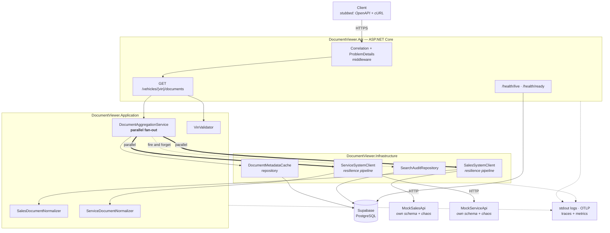
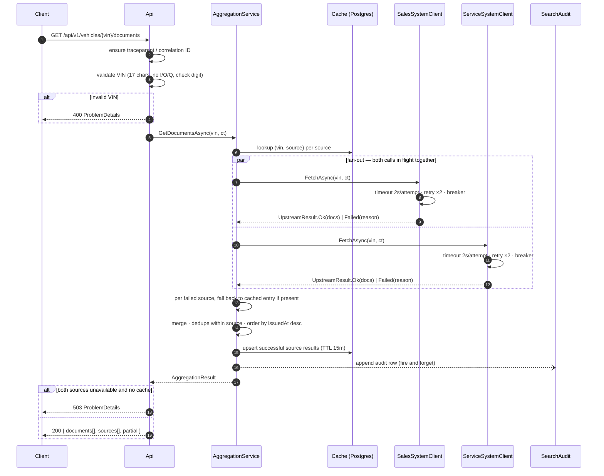
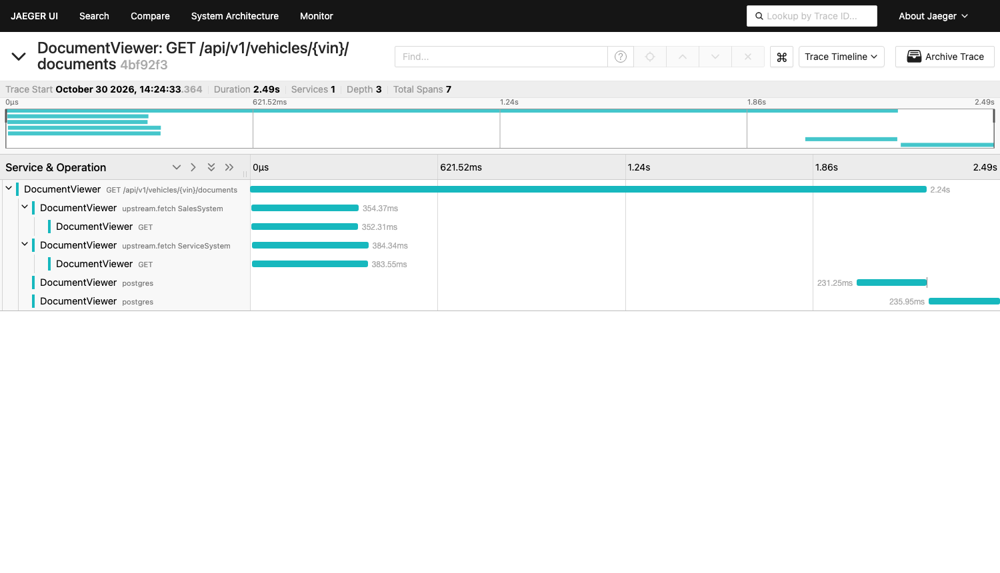

# Unified Document Viewer — Tài liệu tiếng Việt (bản hợp nhất)

**Keyloop Technical Assessment — Scenario D (Domain: Operate)**

Đây là bản dịch tiếng Việt, hợp nhất ba tài liệu kỹ thuật của dự án thành một bản đọc
liền mạch:

| Phần | Dịch từ | Trả lời câu hỏi | Đọc khi |
|---|---|---|---|
| **Phần I** | [`system-design.md`](system-design.md) | **Vì sao** — kiến trúc, đánh đổi, giả định, phạm vi loại trừ | Trước khi muốn phản biện một quyết định thiết kế |
| **Phần II** | [`code-guide.md`](code-guide.md) | **Định hướng** — tour mã nguồn 10 phút | Vừa clone repo về |
| **Phần III** | [`developer-guide.md`](developer-guide.md) | **Tra cứu** — file, luồng, con số, cách mở rộng | Sắp sửa đổi code |
| **Phần IV** | [`../README.md`](../README.md) | **Chạy nó** — quickstart, cấu hình, API, xem nó suy giảm, bộ test, tường thuật cộng tác với AI | Muốn chạy được trên máy mình |
| **Phần V** | [`ai-collaboration/review-log.md`](ai-collaboration/review-log.md) | **Bằng chứng** — 22 entry: AI đề xuất gì, em đổi gì, vì sao quan trọng | Muốn biết AI đã sai ở đâu |
| **Phần VI** | [`ai-collaboration/prompts.md`](ai-collaboration/prompts.md) | **Chiến lược** — chuỗi prompt và vì sao theo thứ tự đó | Muốn hiểu cách điều khiển AI |
| **Phần VII** | [`ai-collaboration/implementation-ledger.md`](ai-collaboration/implementation-ledger.md) | **Phán quyết** — mọi quyết định khi chạy plan, kèm giá phải trả nếu sai | Muốn kiểm tra các quyết định thay mình |
| **Phần VIII** | [`superpowers/plans/2026-10-29-scenario-d-document-viewer.md`](superpowers/plans/2026-10-29-scenario-d-document-viewer.md) | **Plan** — 9 task TDD, kèm ghi chú ở mọi chỗ plan khác với code cuối | Muốn biết thiết kế đã lường sai những gì |

**Đây là bộ đầy đủ: cả 8 tài liệu tiếng Anh của repo đều đã được dịch.**

> **Lưu ý về tính thẩm quyền:** ba file tiếng Anh là bản gốc và là bản nộp cho Keyloop.
> Bản tiếng Việt này để đọc hiểu nhanh. Nếu có khác biệt, **bản tiếng Anh là bản đúng**.
> Mọi tên lớp, tên file, tên test, tên cấu hình và đoạn code đều giữ nguyên tiếng Anh vì
> chúng là định danh trong mã nguồn.

| | |
|---|---|
| **Tác giả** | Pham Gia Khiem |
| **Ngày** | 2026-10-29, sửa 2026-10-31, bản dịch 2026-11-01 |
| **Phiên bản** | 2.0 (đã đối chiếu với phần hiện thực) |
| **Tầng đã hiện thực** | Backend (RESTful API + database bền vững) |
| **Tầng để stub** | Client — hợp đồng OpenAPI, `requests.http`, ví dụ cURL |

---
---

# PHẦN I — TÀI LIỆU THIẾT KẾ HỆ THỐNG

## I.1. Phát biểu bài toán

Tài liệu của một chiếc xe tại đại lý bị phân mảnh trong **hai hệ thống nguồn** phát
triển độc lập nhau:

- **Sales System** — đơn mua (purchase order), hợp đồng tài chính (finance agreement),
  giấy tờ đăng ký (registration paperwork).
- **Service System** — phiếu công việc (job card), biên bản kiểm tra (inspection
  report), yêu cầu bảo hành (warranty claim).

Hiện tại người dùng phải đăng nhập cả hai hệ thống, tìm kiếm ở cả hai, rồi **tự ghép kết
quả trong đầu**.

Service này cung cấp **một request, một câu trả lời**: cho một VIN, trả về toàn bộ tài
liệu của xe đó từ cả hai hệ thống dưới dạng **một danh sách hợp nhất duy nhất**, mỗi
phần tử ghi rõ nó đến từ nguồn nào.

### Tiêu chí nghiệm thu (lấy từ đề bài)

| # | Yêu cầu | Được thỏa mãn ở đâu |
|---|---|---|
| 1 | Tìm kiếm hợp nhất theo VIN | `GET /api/v1/vehicles/{vin}/documents` (§I.5) |
| 2 | Backend gọi **song song** tới hai API ngoài đã được mock | `DocumentAggregationService` (§I.4.2), được chứng minh bằng một test đo thời gian (§I.8) |
| 3 | Một danh sách hợp nhất, mỗi tài liệu chỉ rõ nguồn | Trường `sourceSystem` trên mỗi tài liệu + metadata `sources[]` (§I.5.2) |

---

## I.2. Các nguyên tắc thiết kế

Đề bài yêu cầu khả năng mở rộng (scalability), hiệu năng (performance), độ tin cậy
(reliability), khả năng bảo trì (maintainability) và khả năng quan sát (observability).
Những từ đó được chuyển thành **bốn nguyên tắc cụ thể** mà mọi quyết định trong tài liệu
này đều có thể truy ngược về:

1. **Một câu trả lời suy giảm vẫn tốt hơn không có câu trả lời nào.** Một nguồn chết
   không được phép làm endpoint trở nên vô dụng. Kết quả một phần (partial result) là
   một **kết cục được mô hình hóa tường minh**, hạng nhất — chứ không bao giờ là một
   exception lọt ra ngoài.
2. **Người gọi không bao giờ phải đoán.** Nếu dữ liệu thiếu, không đầy đủ, hay đã cũ,
   response nói rõ điều đó **theo từng nguồn**. Client tự quyết định cách trình bày.
3. **Hệ thống upstream là không đáng tin và bị cô lập.** Mỗi upstream có ngân sách
   timeout riêng, chính sách retry riêng, circuit breaker riêng. Một lỗi không thể lan
   ngang sang nguồn khác.
4. **Mọi request đều giải thích được sau khi đã xảy ra.** Một correlation ID duy nhất
   buộc chặt dòng log của API, hai span upstream, dòng audit trong DB và các metric lại
   với nhau.

---

## I.3. Kiến trúc



### I.3.1 Trách nhiệm từng thành phần

| Thành phần | Trách nhiệm | **Cố ý KHÔNG** chịu trách nhiệm |
|---|---|---|
| **DocumentViewer.Api** | Biên HTTP. Định tuyến, bind, validate VIN, map kết cục → status code, phát `ProblemDetails` theo RFC 9457, expose OpenAPI + health. | Mọi hiểu biết về việc có bao nhiêu upstream, hay chúng lỗi kiểu gì. |
| **DocumentViewer.Application** | Nghiệp vụ: fan-out song song tới mọi source đã đăng ký, thu cả thành công **lẫn** thất bại, merge, sắp xếp, quyết định cờ `partial`. | HTTP, SQL, retry, serialisation. |
| **DocumentViewer.Domain** | `Vin` (value object), `VehicleDocument`, `SourceSystem`, `UpstreamResult<T>`. **Không phụ thuộc gì cả.** | Bất cứ thứ gì có biên I/O. |
| **DocumentViewer.Infrastructure** | `HttpClient` có kiểu cho từng upstream kèm resilience pipeline; normalizer theo từng nguồn; EF Core cho cache + audit. | Quyết định một kết quả một phần **có nghĩa là gì**. |
| **MockSalesApi** / **MockServiceApi** | Đóng thế hai hệ thống nguồn thật, mỗi cái có hình dạng payload **thực sự khác nhau**, cộng một endpoint chaos để tiêm độ trễ và lỗi theo yêu cầu. | Giống thật ở mức nào khác ngoài hình dạng dữ liệu và hành vi lỗi. |

Hai mock được triển khai như **tiến trình HTTP thật**, không phải fake in-process. Đó là
một cái giá phải trả có chủ ý: chỉ có như vậy thì fan-out song song, timeout và circuit
breaker mới được thực thi qua socket thật, thay vì thử trên một stub **không thể chậm
được**.

### I.3.2 Vì sao chia như vậy

Bốn project thay vì một là tương xứng ở đây vì **một lý do duy nhất**: `Application` phụ
thuộc vào abstraction `IDocumentSource`, không phụ thuộc `HttpClient`. Chính điều đó làm
cho "thêm hệ thống nguồn thứ ba" chỉ còn là việc đăng ký thêm một client, và làm cho các
luật xử lý lỗi một phần có thể unit-test được mà không cần mạng.

---

## I.4. Luồng dữ liệu

### I.4.1 Vòng đời một request



### I.4.2 Fan-out song song — và cái bẫy nằm trong đó

Cách hiện thực ngây thơ **sai** theo một kiểu âm thầm phá hủy yêu cầu #3:

```csharp
// SAI — nếu một trong hai task fault, WhenAll ném lại exception
// và kết quả đã lấy được thành công của nguồn còn lại bị mất trắng.
var results = await Task.WhenAll(sales, service);
```

Vì vậy mọi lời gọi source đều được bọc lại sao cho **thất bại là một giá trị trả về,
không phải một exception**:

```csharp
public abstract record UpstreamResult<T>
{
    public sealed record Ok(T Value, TimeSpan Duration)             : UpstreamResult<T>;
    public sealed record Failed(UpstreamFailure Reason, TimeSpan Duration) : UpstreamResult<T>;
}
```

`IDocumentSource.FetchAsync` bắt exception tại biên của chính nó và trả về `Failed`. Với
thiết kế đó, `Task.WhenAll` **không bao giờ có thể throw**, và bộ tổng hợp luôn nhìn
thấy đúng một kết cục cho mỗi nguồn. Test đo thời gian ở §I.8 là thứ **chứng minh** hai
lời gọi thực sự chồng lấn nhau, chứ không phải chỉ *trông như* đồng thời.

### I.4.3 Cache fallback và trạng thái từng nguồn

Cache được khóa theo **từng cặp `(vin, sourceSystem)`**, không phải theo từng request.
Chính điều này cho phép: trong **cùng một response**, nguồn khỏe được phục vụ dữ liệu
sống, còn nguồn đang bệnh được phục vụ từ cache. Mỗi nguồn báo một trong ba trạng thái:

| `status` | Ý nghĩa | Có ghi cache? |
|---|---|---|
| `ok` | Lấy dữ liệu sống thành công | Có, TTL 15 phút |
| `stale` | Lấy sống thất bại, đã phục vụ bằng dữ liệu cache | Không |
| `failed` | Lấy sống thất bại và **không** có dữ liệu cache | Không |

**Thất bại thì KHÔNG BAO GIỜ được cache.** Cache một thất bại sẽ biến một cú hụt hơi một
giây của upstream thành **một sự cố mười lăm phút**.

---

## I.5. Hợp đồng API

### I.5.1 Endpoint

```
GET /api/v1/vehicles/{vin}/documents
```

| Kết cục | Status | Ghi chú |
|---|---|---|
| Ít nhất một nguồn cho ra dữ liệu (sống hoặc cache) | `200` | `partial: true` khi có bất kỳ nguồn nào không phải `ok` |
| VIN không hợp lệ | `400` | `ProblemDetails`, `type: .../invalid-vin` |
| Tất cả các nguồn đều `failed` | `503` | Có set header `Retry-After` |
| VIN hợp lệ nhưng không có tài liệu ở đâu cả | `200` | `documents: []` — **không phải 404**; xe có thể hợp lý là không có tài liệu nào |

Việc trả `200` cho kết quả một phần thay vì `5xx` là **quyết định API trung tâm** của
thiết kế này. Đề bài không chỉ định điều đó. Lý do: mục tiêu của người dùng là **xem
những tài liệu đang có**, và một `5xx` sẽ khiến phần xử lý lỗi của client **ném đi chính
dữ liệu mà nó đã nhận được thành công**. Khối `sources[]` tồn tại để lựa chọn này không
làm client mất một chút thông tin nào.

### I.5.2 Response

```json
{
  "vin": "1HGCM82633A004352",
  "retrievedAt": "2026-10-29T10:42:11.183Z",
  "partial": true,
  "documents": [
    {
      "id": "sales:PO-88213",
      "sourceSystem": "SalesSystem",
      "documentType": "PurchaseOrder",
      "title": "Purchase order PO-88213",
      "issuedAt": "2026-03-04T00:00:00Z",
      "sizeBytes": 148213,
      "downloadUrl": "https://sales.mock/documents/PO-88213"
    }
  ],
  "sources": [
    { "system": "SalesSystem",   "status": "ok",     "documentCount": 4, "durationMs": 182 },
    { "system": "ServiceSystem", "status": "failed", "documentCount": 0, "durationMs": 5004,
      "error": { "reason": "Timeout", "message": "Total request timeout of 5s elapsed" } }
  ]
}
```

`id` được đặt tiền tố theo nguồn (`sales:`, `service:`) vì hai hệ thống **cấp định danh
độc lập nhau** và không gian khóa của chúng có thể trùng.

### I.5.3 Sự khác biệt schema giữa hai upstream

Việc chuẩn hóa (normalisation) chỉ có ý nghĩa nếu hai upstream **thực sự bất đồng**. Hai
mock được xây để bất đồng:

| Trường hợp nhất | Sales System | Service System |
|---|---|---|
| định danh | `documentId` (string, `"PO-88213"`) | `id` (số nguyên, `88213`) |
| loại | `docType` (`"PURCHASE_ORDER"`) | `category` (`"job-card"`) |
| tiêu đề | `description` | `name` |
| ngày phát hành | `createdDate` (`"2026-03-04"`, ISO date, giờ địa phương của đại lý) | `timestamp` (epoch **milli giây**, UTC) |
| kích thước | `fileSizeKb` (kilobyte) | `bytes` |
| liên kết | `url` | `links.self` (lồng nhau) |
| phong bì dữ liệu | `{ "documents": [...] }` | `{ "data": { "items": [...] }, "meta": {...} }` |

Mỗi dòng khác biệt là **một bug chuẩn hóa đang chờ xảy ra** — và mỗi dòng đều được
unit-test theo từng normalizer ở Task 3: kilobyte so với byte, epoch-millis so với ISO
date, phong bì lồng nhau, và giá trị enum lạ thì map về `Unknown` chứ không throw.

---

## I.6. Lựa chọn công nghệ

| Lựa chọn | Vì sao | Phương án đã cân nhắc, và vì sao không chọn |
|---|---|---|
| **.NET 9** (`net9.0`) + ASP.NET Core Minimal APIs | Khớp stack doanh nghiệp của Keyloop, và là SDK được ghim cho bài này (9.0.320). Minimal APIs giữ biên HTTP nhỏ đủ để đọc hết trên một màn hình. **Tình trạng hỗ trợ, nói rõ có chủ ý:** .NET 9 là bản STS, hiện đang maintenance, **hết hạn hỗ trợ 2026-11-10**. Một service production sẽ nhắm **.NET 10 (LTS, hỗ trợ tới 11/2028)**; không có gì trong thiết kế này phụ thuộc phiên bản, nên việc chuyển chỉ là **đổi một dòng `TargetFramework`** trong `Directory.Build.props` rồi chạy lại bộ test. | MVC controller — nhiều nghi thức hơn mức một endpoint cần. .NET Framework 4.8 — chỉ Windows và đã đóng băng. .NET Core 3.1 — hết hỗ trợ từ 12/2022, và không có Minimal APIs, `Microsoft.Extensions.Http.Resilience` hay các package OpenTelemetry hiện tại, nên §I.7 và §I.8 sẽ không thể làm được như thiết kế. |
| **`IHttpClientFactory`** + typed client | Quản lý đúng vòng đời socket/DNS; là đường may đúng chuẩn để gắn policy riêng cho từng upstream. | `static HttpClient` — không cô lập policy theo upstream, DNS bị cũ. |
| **`Microsoft.Extensions.Http.Resilience`** (Polly v8) | Timeout, retry và circuit breaker gộp thành một pipeline khai báo cho từng client, kèm telemetry sẵn có. | Tự viết `CancellationTokenSource` + vòng lặp — nhận đủ bug, không được metric nào. |
| **Supabase PostgreSQL** + EF Core / Npgsql | Postgres có quản lý, không cần Docker cục bộ để chạy app; engine SQL thật nên schema và index là trung thực. | SQLite — chạy được mọi nơi, nhưng câu chuyện index và concurrency mất tính tin cậy. |
| **Serilog** → JSON có cấu trúc ra stdout | Hệ thống thu log tiêu thụ JSON; stdout là hợp đồng của container. | `ILogger` console mặc định — không cấu trúc, không truy vấn được. |
| **OpenTelemetry** (trace + metric, OTLP) | Trung lập nhà cung cấp; instrumentation cho ASP.NET Core / HttpClient / Npgsql có sẵn; hai span upstream song song **trở nên nhìn thấy được**. | Chỉ dùng metric — sẽ không cho thấy fan-out, mà đó lại là toàn bộ điểm chính của scenario. |
| **xUnit + Shouldly + NSubstitute** | Chuẩn mực, nhanh. Chọn Shouldly thay vì FluentAssertions vì licence v8 của FluentAssertions không còn miễn phí cho mục đích thương mại — **một dependency không thể ship được thì không phải là dependency**. | FluentAssertions — rủi ro licence. |
| **WireMock.Net** (integration test) | Cho phép test dàn dựng một upstream chậm hoặc hỏng một cách tất định, đúng thứ cần để chứng minh các luật resilience. | Gọi thẳng mock service thật từ test — không tất định, không tiêm lỗi được. |
| **Testcontainers for PostgreSQL** | Integration test có Postgres thật cho mỗi lần chạy, không phụ thuộc mạng tới Supabase và không bị flaky vì state dùng chung. | Test trên Supabase — chậm, cần mạng, và một test lỗi có thể làm hỏng dữ liệu demo. |
| **Hai mock service độc lập** | Fan-out, timeout và breaker được thực thi qua socket thật, và có thể tiêm độ trễ/lỗi **ngay trong lúc demo**. | Fake in-process — không thể chậm, không thể "chết một nửa". |

---

## I.7. Chiến lược observability

### I.7.1 Logging

Serilog ghi JSON có cấu trúc ra stdout. Mỗi dòng đều mang `CorrelationId`, `TraceId`,
`SpanId`, và — nơi nào liên quan — `SourceSystem` cùng `VinHash`.

Một middleware correlation sẽ tôn trọng `traceparent` (chuẩn W3C) hoặc
`X-Correlation-Id` từ request vào, tự sinh nếu không có, truyền tiếp xuống cả hai lời
gọi upstream qua một `DelegatingHandler`, và dội lại trên response. Nhờ đó **một ID duy
nhất** nối dòng log của API, hai span upstream, dòng audit và bản ghi của chính client.

**VIN là dữ liệu cá nhân** — nó định danh một chiếc xe và trên thực tế là cả chủ xe.
**Không dòng log nào chứa VIN thô.** Log mang `VinHash` (12 hex đầu của SHA-256) cộng 6
ký tự cuối, đủ để bộ phận hỗ trợ đối chiếu một khiếu nại mà không biến kho log thành kho
PII. Bảng `SearchAudit` giữ VIN đầy đủ, vì ở đó nó là **bản ghi nghiệp vụ** và nằm sau
cơ chế kiểm soát truy cập của database.

Mức log: `Information` cho một dòng "request đã xong" mỗi request; `Warning` cho một
nguồn bị suy giảm; `Error` **chỉ** cho những lỗi mà service này phải chịu trách nhiệm —
một upstream timeout là **vận hành bình thường**, không phải lỗi, và báo động vì nó sẽ
huấn luyện đội on-call phớt lờ cảnh báo.

### I.7.2 Metric

Phát qua một `Meter` tên `DocumentViewer` qua OTLP.

| Metric | Loại | Tag | Câu hỏi nó trả lời |
|---|---|---|---|
| `documentviewer.aggregation.duration` | histogram | `outcome` | Chúng ta có nằm trong SLO độ trễ p95 không? |
| `documentviewer.upstream.duration` | histogram | `system` | Hệ thống nguồn nào đang chậm? |
| `documentviewer.upstream.result` | counter | `system`, `status` | Hệ thống nào không đáng tin, và theo kiểu nào? |
| `documentviewer.response.partial` | counter | — | Người dùng nhận câu trả lời không đầy đủ với tần suất nào? |
| `documentviewer.cache.lookup` | counter | `result` | Cache có đáng với độ phức tạp nó mang lại không? |
| `documentviewer.circuit.state` | gauge | `system` | Có breaker nào đang mở không? |

`documentviewer.response.partial` là metric quan trọng nhất, và cũng là metric mà **một
hiện thực ngây thơ không thể sinh ra được**: nó chỉ đo được vì kết quả một phần được mô
hình hóa tường minh, thay vì bị ném đi dưới dạng exception.

### I.7.3 Tracing

Một `ActivitySource` cho mỗi tầng. Một request sinh ra một span cha cùng **hai span
upstream ngang hàng** có khoảng thời gian chồng lấn — biểu đồ waterfall của trace là
bằng chứng rõ ràng nhất có thể có rằng yêu cầu #2 thực sự được thỏa mãn, và một ảnh chụp
nó nên nằm trong bài nộp.



### I.7.4 Health check

| Endpoint | Kiểm tra gì | Ai dùng |
|---|---|---|
| `/health/live` | tiến trình còn sống | chính sách restart của container |
| `/health/ready` | Postgres có với tới được | việc đưa/rút instance khỏi load balancer |
| `/health/upstream` | cả hai upstream, **chỉ để tham khảo** | chỉ dashboard |

`/health/ready` **cố ý loại trừ các upstream**. Nếu không, việc cả hai hệ thống nguồn
chết sẽ rút **mọi instance** của service này khỏi vòng phục vụ — và service sẽ ngừng
phục vụ chính những tài liệu trong cache mà nó vẫn hoàn toàn đủ sức phục vụ. Readiness
nghĩa là "tôi làm được việc của tôi", và với cache nóng cùng kết quả một phần, nó làm
được.

Cùng lý lẽ đó dẫn tới một phân biệt thứ hai, được thêm vào trong lúc hiện thực: một
database **vắng mặt do cấu hình** báo `Healthy` kèm ghi chú rằng persistence đã tắt, vì
chạy không có cache và audit là **một cấu hình được hỗ trợ** và service vẫn trả lời được
truy vấn tài liệu. Một database **đã được cấu hình nhưng không với tới được** thì báo
`Unhealthy`. Ngân sách readiness là cấu hình được (`HealthChecks:DatabaseTimeoutMs`, mặc
định 5 giây) và được thực thi bằng cách **đua (race) probe** chứ không phải hủy nó —
Npgsql không quan sát cancellation token một cách đáng tin trong lúc đang mở kết nối vật
lý, nên một ngân sách dựa trên cancel đã bị **âm thầm phớt lờ** khi chạy thật với
Supabase.

### I.7.5 Mục tiêu mức dịch vụ (SLO)

| SLO | Mục tiêu | Đo từ |
|---|---|---|
| Khả dụng của endpoint tổng hợp (không `5xx`) | ≥ 99,9% | `aggregation.duration{outcome}` |
| Độ trễ p95 | < 1,5 s | `aggregation.duration` |
| Request được phục vụ đầy đủ (không partial) | ≥ 99% | `response.partial` ÷ tổng |

Khả dụng được định nghĩa trên hành vi của **chính service này**, không phải của các
upstream: trả về một kết quả một phần đã được tài liệu hóa **được tính là thành công**.
Đó là lúc thiết kế trả lãi — SLO chỉ có thể phát biểu theo cách này vì sự suy giảm là
một kết cục được mô hình hóa.

---

## I.8. Độ tin cậy và hiệu năng

### I.8.1 Ngân sách timeout

| Phạm vi | Ngân sách |
|---|---|
| Mỗi lần thử, mỗi upstream | 2 s |
| Tổng cho mỗi upstream, gồm cả retry | 5 s |
| Toàn bộ request | 6 s |

Tổng cho mỗi upstream **nhỏ hơn** ngân sách toàn request, nên một nguồn bệnh không thể
bắt giữ response làm con tin; và vì hai lời gọi là đồng thời, **nguồn chậm nhất quyết
định độ trễ, không phải tổng hai nguồn**.

### I.8.2 Chính sách retry

Hai lần retry, backoff lũy thừa có jitter, **chỉ** với các điều kiện tạm thời
(`5xx`, `408`, `429`, timeout, lỗi socket). `4xx` **không bao giờ** được retry — một
`404` nghĩa là xe đó không tồn tại trong hệ thống ấy, và retry chỉ nhân tải lên một
upstream vốn đang trả lời **đúng**.

### I.8.3 Circuit breaker

Một breaker **cho mỗi upstream**: tỉ lệ lỗi 50% trong cửa sổ 30 giây, mở 15 giây. Khi
một breaker đang mở, nguồn đó **fail nhanh** vào nhánh cache-fallback, nên một hệ thống
nguồn bệnh chỉ tốn ~0 ms thay vì 5 giây. Dùng chung state giữa hai breaker sẽ cho phép
một hệ thống lỗi làm suy giảm hệ thống kia — **sự cô lập chính là điểm chính**.

### I.8.4 Lưu trữ bền vững

```
search_audit                           document_metadata_cache
  id            bigserial PK             vin             varchar(17)  ┐ PK
  vin           varchar(17)              source_system   smallint     ┘
  correlation_id varchar(128)                    payload         jsonb
  searched_at   timestamptz              document_count  int
  duration_ms   int                      fetched_at      timestamptz
  partial       boolean                  expires_at      timestamptz
  source_report jsonb

  idx (vin, searched_at desc)            idx (expires_at)  -- cho job dọn cache (chưa làm; xem §I.9)
```

**Vì sao lại cần database.** Đề bài yêu cầu một database bền vững, nhưng Scenario D là
tổng hợp chỉ-đọc — nó **không sinh ra dữ liệu hiển nhiên nào**. Thay vì thêm một bảng
cho có, hai bảng được chọn mỗi bảng trả lời một câu hỏi thật:

- `search_audit` — ai đã xem tài liệu của xe nào, lúc nào, và họ có nhận được câu trả
  lời đầy đủ hay không. Việc truy cập bản ghi phương tiện là thứ **phải kiểm toán được**
  trong bán lẻ ô tô, và bảng này cũng là **bản ghi bền vững duy nhất về sự suy giảm mà
  người dùng thực sự nhìn thấy**.
- `document_metadata_cache` — làm cho hành vi cache-fallback ở §I.4.3 trở nên khả thi và
  giảm tải lặp lại lên các hệ thống nguồn.

Đây là một giả định, được ghi lại ở §I.10.

Việc ghi audit là **fire-and-forget** nằm trong `try/catch` riêng: observability không
bao giờ được là nguyên nhân làm request của người dùng thất bại. Pooler chế độ
transaction của Supabase (cổng **6543**) được dùng lúc runtime; migration của EF Core
chạy qua kết nối trực tiếp (**5432**), vì pooler không hỗ trợ các tính năng mức session
mà migration cần.

**Ba quyết định hiện thực mà mục này ban đầu không lường tới**, tất cả đều do chạy thật
với một pooler có quản lý thay vì một container cục bộ:

1. **Luôn giữ một kết nối nóng.** `NpgsqlConnectionHardening` điền
   `Minimum Pool Size=1`, `Connection Idle Lifetime=300` và `Timeout=15` vào những chỗ
   người vận hành chưa set, và một `DatabaseWarmupService` mở một kết nối ngay sau khi
   khởi động. Không có điều này, **thao tác database đầu tiên** phải trả toàn bộ cái giá
   bắt tay TLS + tra cứu tenant của pooler + SASL — **tính bằng giây**, qua liên
   vùng — trong khi mọi ngân sách theo thao tác dưới đây được thiết kế như thể nó tính
   bằng milli giây.
2. **Đọc và ghi có ngân sách khác nhau.** Một lần đọc cache nằm trên đường đi của
   response và được **1500 ms**, quá đó thì "cache miss" là một câu trả lời chấp nhận
   được. Một lần ghi cache xảy ra **sau** response và được **8 giây**, vì nó phải có khả
   năng hoàn tất trên một kết nối lạnh. Ghi audit cũng được 8 giây.
3. **Các lệnh ghi KHÔNG dùng cancellation token của request.** Token đó bị hủy **ngay
   khoảnh khắc response được gửi đi**. Truyền nó vào một lệnh ghi cache có nghĩa là một
   lệnh ghi liên vùng **luôn bị hủy giữa lúc bắt tay**, nên cache **vĩnh viễn rỗng** và
   nhánh stale-fallback ở §I.4.3 là **code không thể chạm tới** — trong khi **mọi test
   vẫn xanh**, bởi vì một container PostgreSQL cục bộ kết nối trong dưới một milli giây.
   Việc xử lý cache còn được cấp thêm một ngân sách **1 giây trên đường đi của
   response**, quá đó thì phần đọc hoàn tất và phần ghi tự chạy nốt: một database nhận
   kết nối rồi **không bao giờ trả lời** không được phép giữ lệnh đọc của người dùng.

### I.8.5 Hướng mở rộng quy mô

API không giữ state theo request, nên nó mở rộng ngang được phía sau một load balancer.
Các điểm nghẽn tiếp theo, theo thứ tự chúng sẽ xuất hiện: bảng cache (→ Redis, cùng một
interface repository), lượng ghi audit (→ ghi theo lô hoặc outbox), và rate limit của
upstream (→ bulkhead giới hạn đồng thời theo từng nguồn, vốn là phần mở rộng tự nhiên
của các pipeline theo nguồn đã có).

---

## I.9. Phạm vi loại trừ (Non-Goals)

Những thứ **cố ý** nằm ngoài phạm vi, và vì sao — đây là **lựa chọn**, không phải thiếu
sót:

| Không làm | Vì sao |
|---|---|
| Xác thực / phân quyền | Không nằm trong tiêu chí nghiệm thu. Trong production việc này thuộc API gateway; thiết kế không bị ảnh hưởng khi thêm vào. |
| Proxy / tải nội dung tài liệu | Đề bài yêu cầu một **danh sách** tài liệu. Truyền byte là bài toán khác với các đặc tính tin cậy và bảo mật khác. |
| Phân trang | Số tài liệu mỗi xe là **hàng chục**, không phải hàng nghìn. Thêm bây giờ là đầu cơ; phong bì response đã chừa chỗ cho nó. |
| Loại trùng giữa các nguồn | Một tài liệu có ở cả hai hệ thống **thực sự là** hai bản ghi ở hai hệ thống, và yêu cầu #3 đòi mỗi phần tử phải rõ nguồn. Gộp chúng lại sẽ **phá hủy thông tin**. Loại trùng chỉ xảy ra **trong cùng một nguồn**, theo ID ngoài. |
| Frontend | Đề bài yêu cầu một tầng; backend là nơi phần thực chất của Scenario D nằm (yêu cầu #2 gọi tên backend một cách tường minh). Client được stub bằng hợp đồng OpenAPI và ví dụ cURL. |
| Thao tác ghi lên tài liệu | Chỉ-đọc theo định nghĩa của scenario. |

---

## I.10. Các giả định

Đề bài có nói rằng yêu cầu có thể nhập nhằng. Dưới đây là **từng chỗ nhập nhằng đã tìm
ra, và quyết định đã chọn**:

| # | Chỗ nhập nhằng | Quyết định | Lý do |
|---|---|---|---|
| 1 | Yêu cầu database bền vững, nhưng scenario không lưu gì | `search_audit` + `document_metadata_cache` | Cả hai trả lời câu hỏi vận hành thật, thay vì tồn tại chỉ để thỏa yêu cầu (§I.8.4). |
| 2 | Status code khi **một** nguồn lỗi | `200` + `partial: true` + `sources[]` theo từng nguồn | Mục tiêu của người dùng là những tài liệu **đang có**; `5xx` sẽ khiến client ném đi dữ liệu tốt (§I.5.1). |
| 3 | Status code khi **cả hai** lỗi | `503` + `Retry-After` | Không có gì được giao, và tình trạng là tạm thời. |
| 4 | VIN hợp lệ nhưng không có tài liệu | `200` với `documents: []` | Xe tồn tại; "không có tài liệu" là một câu trả lời hợp lệ, không phải tài nguyên bị thiếu. |
| 5 | VIN có phải dữ liệu cá nhân? | Coi là PII | Từ VIN tới chủ xe là một bước rất ngắn. Hash trong log, giá trị đầy đủ chỉ nằm trong bảng audit có kiểm soát truy cập (§I.7.1). |
| 6 | Cùng một tài liệu ở cả hai hệ thống | **Không** loại trùng giữa các nguồn | Yêu cầu #3 đòi biết nguồn của từng tài liệu; gộp lại sẽ mất điều đó. |
| 7 | Loại tài liệu lạ từ upstream | Map về `Unknown`, **vẫn trả tài liệu đó** | Bỏ một tài liệu chỉ vì không nhận ra loại của nó còn tệ hơn là trả nó ra với loại "chưa biết". |
| 8 | Phục vụ dữ liệu cache cũ khi upstream lỗi | Cho phép, gắn cờ `status: "stale"` | Tài liệu cũ vẫn hữu ích; nhưng **âm thầm** trình bày chúng như dữ liệu mới thì không. |
| 9 | Kiểm tra check-digit của VIN | Có thực thi (vị trí 9, loại trừ `I`/`O`/`Q`) | Chặn một lỗi gõ ngay ở biên rẻ hơn hai vòng gọi upstream để rồi chẳng nhận được gì. |
| 10 | Phiên bản runtime | Xây trên .NET 9 (`net9.0`), kèm lộ trình chuyển LTS ghi ở §I.6 | .NET 9 hết hỗ trợ 2026-11-10. Ghi lại ràng buộc này cùng con đường một dòng sang .NET 10 LTS tốt hơn là để người review tự phát hiện. |
| 11 | Readiness khi **không** cấu hình database | `Healthy`, kèm ghi chú persistence đã tắt | Chạy không cache và audit là cấu hình được hỗ trợ và service vẫn làm được việc của nó; §I.7.4 định nghĩa readiness là **năng lực**, không phải **kiểm kê**. Một database đã cấu hình mà không với tới được thì **vẫn fail** readiness. |

---

## I.11. GenAI trong giai đoạn thiết kế

GenAI được dùng như một **cộng sự thiết kế** trong suốt giai đoạn này, theo một nguyên
tắc đơn giản: **AI đề xuất, kỹ sư quyết định.** Mọi đầu ra dưới đây đều được chấp nhận,
từ chối hoặc viết lại một cách có chủ ý.

**1. Trích xuất yêu cầu và chọn scenario.** Đề bài được phân tích và cả bốn scenario
được chấm điểm theo một rubric tường minh có chủ ý — độ phức tạp hiện thực, nguy cơ phình
phạm vi, và mỗi scenario để lại bao nhiêu chất liệu để bàn trong tài liệu này. Scenario A
(bộ lập lịch) đạt điểm cao nhất về độ sâu kỹ thuật nhưng mang theo một bài toán
concurrency và phân bổ tài nguyên **rất dễ ship sai một cách tinh vi**, mà đó lại chính
là chỗ người review sẽ chọc vào. Scenario D đạt điểm tốt nhất về **tín hiệu trên mỗi đơn
vị công sức**: hiện thực vừa phải, và những lo ngại về độ tin cậy mà đề bài hỏi tới là
**nội tại** của nó chứ không phải gắn thêm vào. Sự đánh đổi đó là phán đoán quyết định,
và nó là của tôi, không phải của mô hình.

**2. Làm lộ ra một yêu cầu bị chôn vùi.** AI được yêu cầu đọc lại Phần 2 theo kiểu
**đối kháng** và báo cáo bất cứ yêu cầu nào mà Scenario D **không tự nhiên thỏa mãn**.
Nó tìm ra đúng cái quan trọng: *"phải dùng một database bền vững"* là bắt buộc với một
bài nộp backend, mà Scenario D lại là tổng hợp chỉ-đọc thuần, **không có gì để lưu**.
Phát hiện duy nhất đó đã định hình lại §I.8.4 và sinh ra giả định #1. Mô hình chỉ ra
khoảng trống; còn việc **chọn audit + cache** thay vì một bảng cho có — và có thể biện
giải vì sao mỗi bảng đáng tồn tại — là một quyết định thiết kế.

**3. Review đối kháng chính thiết kế của tôi.** Bản nháp fan-out được đưa cho mô hình
kèm một chỉ thị duy nhất: **tìm chế độ lỗi**. Nó phát hiện rằng `Task.WhenAll` ném lại
exception đầu tiên và **ném đi kết quả đã hoàn thành của task song song** — điều này sẽ
âm thầm phá vỡ hành vi kết quả một phần mà cả §I.2 được xây trên đó, theo một cách **chỉ
lộ ra khi một upstream thực sự chết**. Thiết kế `UpstreamResult<T>` ở §I.4.2 là câu trả
lời trực tiếp cho lần review đó, và các test về thời gian cùng lỗi một phần tồn tại để
bản sửa ấy không thể hồi quy.

**4. Những phương án đã nêu ra và bị loại.** Cuộc đối thoại thiết kế sinh ra nhiều ứng
viên hơn số còn sống sót. Một message queue giữa API và các upstream **bị loại**: đây là
một lệnh đọc đồng bộ, và queue sẽ thêm độ trễ cùng bề mặt vận hành mà không đem lại lợi
ích. Cache cả response lỗi bên cạnh response thành công **bị loại**: nó biến một cú hụt
hơi một giây của upstream thành một sự cố mười lăm phút. Đưa upstream vào
`/health/ready` **bị loại** vì lý do nêu ở §I.7.4 — nó sẽ rút instance khỏi vòng phục vụ
trong khi chúng vẫn còn phục vụ được tài liệu từ cache. Mỗi phương án đều được ghi lại
kèm lý lẽ, để người review có thể **tranh luận với phán đoán** thay vì phải đoán nó là
gì.

**5. Những gì GenAI KHÔNG được phép quyết.** Hợp đồng API, ngữ nghĩa status code, ngân
sách timeout, cách xử lý VIN như PII, và từng dòng trong §I.10 đều là **quyết định kỹ
thuật** được ghi lại kèm lý lẽ, để người review có thể không đồng ý với **lập luận** chứ
không chỉ với **đầu ra**.

Phần tường thuật tương đương cho giai đoạn **hiện thực** — bao gồm các defect cụ thể do
AI sinh ra bị bắt trong review — nằm trong `README.md` của repo.

---

## I.12. Cấu trúc repository

```
KeyloopDocumentViewer.sln
├─ src/
│  ├─ DocumentViewer.Api/              biên HTTP, DI, middleware, OpenAPI, health
│  ├─ DocumentViewer.Application/      tổng hợp, normalizer, validate VIN
│  ├─ DocumentViewer.Infrastructure/   HTTP client + resilience, EF Core, cache, audit
│  └─ DocumentViewer.Domain/           Vin, VehicleDocument, SourceSystem, UpstreamResult
├─ mocks/
│  ├─ MockSalesApi/                    minimal API — schema Sales + endpoint chaos
│  └─ MockServiceApi/                  minimal API — schema Service + endpoint chaos
├─ tests/
│  ├─ DocumentViewer.UnitTests/        VIN, normalizer, luật tổng hợp
│  └─ DocumentViewer.IntegrationTests/ upstream WireMock + Postgres Testcontainers
├─ docs/
│  ├─ system-design.md                 tài liệu thiết kế (bản gốc tiếng Anh)
│  ├─ tai-lieu-tieng-viet.md           tài liệu này
│  └─ ai-collaboration/                prompt và ghi chú review
├─ openapi.json                        sinh tự động, đã commit — hợp đồng cho client stub
├─ requests.http                       bộ request chạy được ngay
└─ README.md                           build / run / test + tường thuật cộng tác với AI
```

---
---

# PHẦN II — HƯỚNG DẪN ĐỌC MÃ NGUỒN

Một tour mã nguồn dành cho người vừa clone repo này về, trong khoảng mười phút. Nó giải
thích **vì sao từng mảnh tồn tại và điều gì sẽ vỡ nếu thiếu nó**.

Phần tra cứu đầy đủ — bề mặt công khai của từng file, luồng request truy qua các lời gọi
hàm thật, mọi ngân sách và giới hạn gom trong một bảng, cùng các "công thức" mở rộng
service — nằm ở **Phần III**. Lý lẽ thiết kế ở **Phần I**. Bản ghi những gì AI làm sai
nằm trong [`ai-collaboration/review-log.md`](ai-collaboration/review-log.md).

Đọc theo đúng thứ tự dưới đây. Mỗi mục nói rõ **xem ở đâu** và **cần để ý gì**.

---

## II.0. Một ý tưởng duy nhất giải thích tất cả phần còn lại

Mọi thứ trong codebase này đều suy ra từ một quyết định duy nhất: **một thất bại của
upstream là một giá trị trả về, không phải một exception.**

`src/DocumentViewer.Domain/UpstreamResult.cs`

```csharp
public abstract record UpstreamResult<T>
{
    public sealed record Ok(T Value, TimeSpan Duration) : UpstreamResult<T>;
    public sealed record Failed(UpstreamFailure Failure, TimeSpan Duration) : UpstreamResult<T>;
}
```

Cách hiện thực hiển nhiên của "gọi hai hệ thống song song" là
`await Task.WhenAll(sales, service)`. Nó **ném lại exception của task đầu tiên** và
**ném đi kết quả đã hoàn thành của task còn lại**. Vì toàn bộ scenario này nói về việc
**vẫn hữu ích khi một hệ thống chết**, đúng một dòng đó sẽ phá hủy cả tính năng — và chỉ
phá khi một upstream thực sự chết, tức là **không bao giờ xảy ra trong lúc demo**.

Vì mỗi source trả về một `UpstreamResult` thay vì throw, `Task.WhenAll` **không bao giờ
có thể throw**, và bộ tổng hợp luôn nhận đúng một kết cục cho mỗi nguồn. Hai test giữ
điều này: một test nơi source trả về `Failed`, và một test nơi source **throw dù hợp
đồng không cho phép**.

---

## II.1. Domain — `src/DocumentViewer.Domain/`

Không phụ thuộc vào bất cứ thứ gì. Nếu một type ở đây cần database hay `HttpClient`, nó
đang nằm sai project.

| File | Cần để ý |
|---|---|
| `Vin.cs` | Là một **value object**, không phải `string`. `TryParse` trim và chuyển chữ hoa **trước khi** validate, bắt buộc 17 ký tự, loại bỏ `I`/`O`/`Q`, và kiểm tra check digit theo ISO 3779 ở vị trí 9 — bao gồm cả nhánh `X` khi số dư bằng 10. **`ToString()` trả về dạng đã che (masked)**, nên một lần lỡ viết `$"…{vin}…"` trong câu log **không thể làm lộ dữ liệu cá nhân**. `Hash12` và `Masked` là hai thứ log được phép mang. |
| `VehicleDocument.cs` | Mô hình hợp nhất mà cả hai hệ thống chuẩn hóa về. `IssuedAt` và `SizeBytes` là nullable vì **một upstream hợp lý là không có chúng**, và bỏ một tài liệu vì thiếu ngày sẽ tệ hơn là hiển thị nó không có ngày. |
| `SourceSystem.cs`, `DocumentType.cs` | `DocumentType.Unknown = 0` là **có chủ ý**: một loại lạ từ upstream map về `Unknown` và tài liệu **vẫn được trả về**. Ẩn một tài liệu chỉ vì phân loại của nó mới là một thất bại tệ hơn việc hiển thị nó với loại "chưa biết". |
| `UpstreamResult.cs`, `UpstreamFailure.cs` | Xem §II.0. `UpstreamFailureReason` chính là thứ làm cho trường `sources[].error.reason` trong response có ý nghĩa. |

**Bắt đầu từ đây:** `Vin.cs` và 13 test của nó là ví dụ nhỏ rõ ràng nhất cho thấy
codebase này được test theo cách nào.

---

## II.2. Application — `src/DocumentViewer.Application/`

Nghiệp vụ, không hề biết gì về HTTP, SQL hay retry.

### `Sources/IDocumentSource.cs`

```csharp
public interface IDocumentSource
{
    SourceSystem System { get; }
    Task<UpstreamResult<IReadOnlyList<VehicleDocument>>> FetchAsync(Vin vin, CancellationToken ct);
}
```

Đây là **đường may** làm cho "thêm hệ thống nguồn thứ ba" chỉ còn là việc đăng ký thêm
một client, và làm cho các luật xử lý lỗi một phần unit-test được mà không cần mạng. Để
ý kiểu trả về: **một hiện thực mà throw là đang vi phạm hợp đồng của nó.**

### `Aggregation/DocumentAggregationService.cs`

Trái tim của service. Đọc nó theo **bốn lượt**:

1. **Fan-out.** Mỗi source đã đăng ký được chiếu thành một task **đã chứa `try`/`catch`
   của chính nó**, rồi `Task.WhenAll`. Một source throw dù hợp đồng không cho phép sẽ bị
   bắt ở đây và chuyển thành `Failed(Unknown)` — "dây lưng cộng dây treo" cho đúng cái
   quyết định mà cả thiết kế đặt lên.

2. **Nhánh thất bại.** Với mỗi source lỗi, cache được tra. Có dữ liệu → thành `Stale`
   kèm tài liệu từ cache; không có → vẫn là `Failed`. Đây chính là thứ làm một hệ thống
   nguồn bệnh **suy giảm một cách duyên dáng** thay vì biến mất.

3. **Các ngân sách.** Hai con số đáng hiểu:
   - `CacheOperationBudget` (**1 giây**) giới hạn **đường đi của response** chờ cache bao
     lâu. Quá đó, phần đọc hoàn tất và việc xử lý cache tự chạy nốt. Từng có lúc một
     database **nhận kết nối TCP rồi không bao giờ trả lời** đã bắt giữ toàn bộ lệnh đọc
     tài liệu làm con tin.
   - `TryCacheUpsertAsync` truyền **`CancellationToken.None`**, không phải token của
     request. Nhìn thì **tưởng là sai**, mà lại là **dòng quan trọng nhất trong file**:
     token của request bị hủy ngay khoảnh khắc response được gửi, và một lệnh ghi liên
     vùng mất nhiều thời gian hơn phần đời còn lại của request. Truyền `ct` vào có nghĩa
     là **không có gì được cache cả**, nên nhánh stale ở trên **không bao giờ có thể kích
     hoạt** — trong khi **mọi test vẫn xanh**. Repository tự áp ngân sách ghi riêng của
     nó thay thế.

4. **Sắp xếp và cờ partial.** Tài liệu được sắp theo `IssuedAt` giảm dần, các giá trị
   null xuống cuối, phá thế bằng `Id` để kết quả **ổn định**. `Partial` là true khi **bất
   kỳ** báo cáo nguồn nào không phải `Ok` — bao gồm cả `Stale`, vì dữ liệu cũ là thứ
   client **xứng đáng được biết**.

### `Aggregation/AggregationResult.cs`, `SourceReport.cs`

`AllSourcesFailed` là thứ tầng API map sang `503`. `SourceReport` là lý do client **không
bao giờ phải đoán**: một dòng cho mỗi nguồn, kèm trạng thái, số lượng, thời gian và lỗi.

### `Persistence/`, `Observability/`

Chỉ có interface (`IDocumentCacheRepository`, `ISearchAuditRepository`,
`IAggregationMetrics`). Chúng nằm ở đây, **không** nằm trong Infrastructure, vì
`Application` **định nghĩa những gì nó cần** và Infrastructure **cung cấp**.

---

## II.3. Infrastructure — `src/DocumentViewer.Infrastructure/`

### `Sources/Sales/`, `Sources/Service/`

Mỗi upstream có một bộ contract (`*Contracts.cs`), một normaliser và một typed client.

Hai schema **bất đồng có chủ ý**, bởi chuẩn hóa chỉ có nghĩa nếu có gì đó để chuẩn hóa:

| Trường hợp nhất | Sales | Service |
|---|---|---|
| định danh | `documentId` — string `"PO-88213"` | `id` — số nguyên `88213` |
| loại | `docType` `"PURCHASE_ORDER"` | `category` `"job-card"` |
| ngày phát hành | `createdDate` `"2026-03-04"` (ISO date) | `timestamp` `1772582400000` (epoch **ms**) |
| kích thước | `fileSizeKb` — **kilobyte** | `bytes` |
| liên kết | `url` (phẳng) | `links.self` (lồng) |
| phong bì | `{ documents: [...] }` | `{ data: { items: [...] }, meta: {...} }` |

**Mỗi dòng là một bug đang chờ xảy ra, và mỗi dòng đều có test.** `id` được đặt tiền tố
khi đi ra (`sales:` / `service:`) vì hai hệ thống cấp định danh độc lập và không gian
khóa có thể trùng.

### `Sources/UpstreamClientExecutor.cs`

Nơi luật "không bao giờ throw" được **thực thi**. Mỗi loại exception map sang một lý do:
`TimeoutRejectedException` và `TaskCanceledException` → `Timeout`;
`BrokenCircuitException` → `CircuitOpen`; status không thành công → `HttpError` kèm mã;
`JsonException` → `InvalidPayload`. **Việc người gọi hủy request thì được ném lại
(rethrow)**, nhờ đó một client ngắt kết nối **phân biệt được** với một upstream lỗi — đó
không phải lỗi của upstream và không được tính vào tài khoản của nó.

### `DependencyInjection.cs`

Hai điều cần để ý:

- **Mỗi client đều được đặt tên** (`"SalesSystem"`, `"ServiceSystem"`). Một
  `AddHttpClient<IDocumentSource, T>()` **không tên** sẽ khóa cả hai registration dưới
  cùng khóa `IDocumentSource`, nên chúng **dùng chung một base address và chung MỘT
  circuit breaker** — âm thầm phá hủy chính sự cô lập theo upstream mà thiết kế đặt lên.
- **Cấu hình được đọc từ `IServiceProvider`, bên trong các delegate** — tuyệt đối không
  chụp lại lúc đăng ký. Một lần đọc "háo hức" sẽ chụp lại đúng những gì
  `appsettings.json` nói và **phớt lờ mọi nguồn cấu hình thêm vào sau đó**, nên một lần
  triển khai đặt địa chỉ upstream qua biến môi trường sẽ **bị bỏ qua trong im lặng**.

Resilience cho mỗi client: **2 giây** mỗi lần thử, **5 giây** tổng, **2 lần retry** với
backoff lũy thừa và jitter, chỉ với điều kiện tạm thời, và circuit breaker ở tỉ lệ lỗi
**0,5** trong cửa sổ **30 giây** với thời gian mở **15 giây**. Độ trễ retry được set
**tường minh 200 ms**: mức mặc định 2 giây cộng với timeout 2 giây mỗi lần thử **không
thể nhồi nổi lần retry thứ hai** vào trong ngân sách 5 giây.

### `Persistence/`

| File | Vì sao nó tồn tại |
|---|---|
| `DocumentViewerDbContext.cs`, `Entities/` | Hai bảng. `search_audit` ghi ai đã xem tài liệu của xe nào và họ có thấy câu trả lời đầy đủ hay không. `document_metadata_cache` khóa theo **`(vin, source_system)`** — không phải theo request — đó là thứ cho phép nguồn khỏe được phục vụ sống trong khi nguồn bệnh được phục vụ từ cache **trong cùng một response**. |
| `DocumentCacheRepository.cs` | Upsert dùng `ON CONFLICT (vin, source_system) DO UPDATE` bằng SQL thô thay vì change tracker của EF, nên các writer đồng thời **hội tụ** thay vì xung đột. **Hai ngân sách, không phải một:** **1500 ms** cho *đọc* vì đọc nằm trên đường đi của response, và **8 giây** cho *ghi* vì ghi xảy ra sau đó và phải sống nổi qua một kết nối liên vùng lạnh. Cả hai thao tác **tự nuốt lỗi của mình** và log ở mức `Warning` — cache là một tối ưu hóa, **không bao giờ là lý do để một lệnh đọc thất bại**. |
| `SearchAuditRepository.cs` | Fire-and-forget từ endpoint, bên trong `try`/`catch` riêng. Observability không bao giờ được là lý do request của người dùng thất bại. |
| `NpgsqlConnectionHardening.cs` | Áp `Minimum Pool Size=1`, `Connection Idle Lifetime=300`, `Timeout=15` vào connection string của người vận hành — **chỉ điền chỗ trống, không bao giờ ghi đè giá trị họ đã set**. Một kết nối nóng nghĩa là **không request nào của người dùng phải trả giá bắt tay TLS + tra cứu tenant của pooler + SASL**. Để ý chỗ tinh vi mà nó phải lách qua: `NpgsqlConnectionStringBuilder.ContainsKey` trả lời câu hỏi *"đây có phải một keyword tôi biết không"*, **không phải** *"người vận hành có set nó không"*, nên các khóa đã-được-cấp phải đọc từ một `DbConnectionStringBuilder` thuần. |
| `DatabaseWarmupService.cs` | Là một `BackgroundService`, **có chủ ý** — một thao tác warm-up chặn khởi động sẽ biến "database không với tới được" thành "service không boot nổi", trong khi service này **bắt buộc phải tiếp tục phục vụ tài liệu từ cache khi database chết**. Lỗi chỉ được log, không làm gì thêm. |

### `Observability/`

`AggregationMetrics` sở hữu sáu instrument. `CorrelationPropagationHandler` là một
`DelegatingHandler` gắn trên **cả hai** typed client, nhờ đó **một correlation ID trải
suốt** dòng log của API, cả hai lời gọi upstream, và dòng audit.

---

## II.4. API — `src/DocumentViewer.Api/`

### `Endpoints/VehicleDocumentsEndpoint.cs`

**Mỏng có chủ ý.** Nó parse VIN, gọi service tổng hợp, và map một kết cục sang một status
code:

| Kết cục | Status |
|---|---|
| `Vin.TryParse` thất bại | `400` + `ProblemDetails`, `type: …/invalid-vin` |
| `AllSourcesFailed` | `503` + `Retry-After: 30` |
| mọi trường hợp khác | `200`, với `partial` lấy từ các báo cáo nguồn |

Nó cũng thực thi ngân sách **6 giây** cho toàn request bằng một `CancellationTokenSource`
liên kết, và phóng lệnh ghi audit với `CancellationToken.None` để nó **không bị giết khi
response hoàn tất**.

Để ý thứ **không có** ở đây: không hề biết có bao nhiêu upstream, hay chúng lỗi kiểu gì.

### `Observability/`

| File | Cần để ý |
|---|---|
| `LoggingSetup.cs` | Serilog ra stdout dạng JSON. `VinRedactingLogEnricher` **đệ quy** qua `ScalarValue`, `StructureValue`, `SequenceValue` và `DictionaryValue` — bởi vì một logger retry của thư viện thứ ba đã lưu URL gửi đi dưới dạng **object `Uri`**, không phải string, và **làm lộ một VIN thô vào log trên nhánh suy giảm**. Có một test khẳng định không dòng log nào chứa VIN thô. |
| `TelemetrySetup.cs` | Trace và metric. Span cha cộng hai span upstream **ngang hàng** là bằng chứng rõ nhất rằng fan-out là thật. |
| `HealthChecks.cs` | Ba phân biệt đáng đọc kỹ. `/health/ready` **chỉ** kiểm tra database — nếu nó kiểm tra cả upstream, việc cả hai hệ thống nguồn chết sẽ rút mọi instance khỏi vòng phục vụ, và service sẽ ngừng phục vụ chính những tài liệu trong cache mà nó vẫn hoàn toàn đủ sức phục vụ. Một database **vắng mặt** do cấu hình là `Healthy` (chạy không persistence là được hỗ trợ); một database **đã cấu hình mà không với tới được** thì không. Và ngân sách readiness được thực thi bằng cách **đua** probe chứ không phải hủy nó, vì Npgsql không quan sát cancellation token đáng tin trong lúc đang mở kết nối vật lý. |
| `CorrelationIdMiddleware.cs` | Tôn trọng `traceparent` (W3C), rồi `X-Correlation-Id`, rồi mới tự sinh; dội lại trên response. |

### `Program.cs`

**Ba mươi dòng.** Nếu composition root phình quá một màn hình, nghĩa là có thứ gì đáng
thuộc về một module đã **rò rỉ** vào đó.

---

## II.5. Mock — `mocks/`

Hai minimal API độc lập, chạy bằng `docker compose`, **không phải** fake in-process. Đó
là cái giá có chủ ý: chỉ như vậy thì fan-out song song, timeout và circuit breaker mới
được thực thi qua socket thật, thay vì trên một stub **không thể chậm được**.

Mỗi mock expose `POST /admin/chaos` với `mode`: `normal`, `slow` (kèm `delayMs`), `fail`
(`503`), hoặc `garbage` (`200` với payload không đọc được). Đây là thứ làm cho sự suy
giảm **có thể trình diễn trực tiếp** thay vì chỉ được mô tả bằng văn xuôi — xem mục
*Seeing it degrade* trong README.

---

## II.6. Test — `tests/`

`DocumentViewer.UnitTests` nhanh và thuần: VIN, normaliser, map lỗi của client, luật tổng
hợp, hardening connection string. `DocumentViewer.IntegrationTests` chạy **ứng dụng
thật**.

Ba fixture đáng biết:

| Fixture | Nó mua được gì |
|---|---|
| `Fixtures/WireMockUpstreamFixture.cs` | Upstream dàn dựng được theo từng test — chậm, hỏng, hoặc trả lời bằng rác — **và nó đếm số request**, đó là cách duy nhất để chứng minh một `404` **đã không bị retry**. |
| `Persistence/PostgresContainerFixture.cs` | Một PostgreSQL thật cho mỗi lần chạy, qua Testcontainers. Không phụ thuộc mạng tới Supabase, không state dùng chung, và không có nguy cơ một test lỗi làm hỏng dữ liệu demo. |
| Black-hole listener trong `DatabaseWarmupTests` | Một `TcpListener` **nhận kết nối rồi không bao giờ trả lời**. Một cổng đóng thì bị từ chối ngay lập tức và **không chứng minh được gì** về timeout; cái này mới là hình ảnh của một pooler có quản lý đang lạnh, nhìn từ phía client. |

Và một quyết định cấu hình: `xunit.runner.json` đặt
`parallelizeTestCollections: false`. Có **năm test khẳng định về thời gian trôi qua**, và
sự tranh chấp CPU từ các test class chạy song song đã đẩy một upstream **cố ý khỏe mạnh**
vượt quá timeout 2 giây mỗi lần thử — **sản phẩm thì đúng, cái sai là bộ khung chạy
test**. Khẳng định về độ trễ và chạy song song **không đi cùng nhau được**.

---

## II.7. Nếu anh đổi một thứ, đây là test sẽ nói cho anh biết

| Thay đổi | Test phải fail |
|---|---|
| Làm fan-out thành tuần tự | `Parallel_fan_out_takes_roughly_one_upstream_latency_not_two` |
| Dùng `Task.WhenAll` trần trên các source | `A_throwing_source_does_not_lose_the_sibling_source_result` |
| Retry một `4xx` | `Client_error_responses_are_never_retried` |
| Dùng chung một resilience pipeline cho cả hai client | `Open_circuit_on_one_source_does_not_affect_the_other_source` |
| Truyền token của request vào lệnh ghi cache | `Cache_writes_outlive_the_request_and_never_hold_the_response` |
| Log VIN thô ở bất cứ đâu | `No_log_line_contains_the_raw_vin` |
| Thêm upstream vào `/health/ready` | `Health_ready_returns_200_when_both_upstreams_are_down` |
| `await` cache trên đường đi của response | `A_database_that_accepts_but_never_answers_does_not_hold_up_a_document_read` |
| Hardcode ngân sách readiness | `Readiness_budget_comes_from_configuration_not_a_hardcoded_two_seconds` |
| Đọc body upstream không giới hạn kích thước | `Reports_a_body_that_never_stops_arriving_as_an_invalid_payload` |
| Đọc body upstream không giới hạn thời gian | `Reports_a_body_that_trickles_past_its_budget_as_a_timeout` |
| Nhân kilobyte với 1024 không kiểm tra tràn | `Reports_a_size_it_cannot_represent_as_unknown_rather_than_a_negative_number` |
| Cache một lần fetch thất bại | `Failed_source_results_are_never_written_to_cache` |

Nếu anh tạo được một thay đổi mà **không test nào trong số này phát hiện ra**, đó là một
khoảng trống của bộ test và đáng được báo lại.

---
---

# PHẦN III — SỔ TAY TRA CỨU CHO LẬP TRÌNH VIÊN

Tài liệu tra cứu để làm việc **bên trong** codebase này: mọi thứ nằm ở đâu, được và
không được phụ thuộc vào cái gì, một request **thực sự** chảy qua code như thế nào, mọi
con số service này thực thi và thực thi ở đâu, cùng các công thức cho những thay đổi anh
có khả năng cao sẽ được yêu cầu làm.

---

## III.1. Bản đồ solution

```
KeyloopDocumentViewer.sln
├─ src/
│  ├─ DocumentViewer.Domain/          7 file    — từ vựng. Không phụ thuộc gì cả.
│  ├─ DocumentViewer.Application/     9 file    — nghiệp vụ. Chỉ phụ thuộc Domain.
│  ├─ DocumentViewer.Infrastructure/ 20 file    — thế giới bên ngoài. Phụ thuộc Application.
│  └─ DocumentViewer.Api/             8 file    — biên HTTP. Phụ thuộc Application + Infrastructure.
├─ mocks/
│  ├─ MockSalesApi/                   đóng thế hệ thống nguồn Sales
│  └─ MockServiceApi/                 đóng thế hệ thống nguồn Service
└─ tests/
   ├─ DocumentViewer.UnitTests/       65 test, ~5 giây, không cần Docker
   └─ DocumentViewer.IntegrationTests/ 43 test, ~2 phút, cần Docker
```

### Luật phụ thuộc

```
Api ──────► Infrastructure ──┐
 │                           ├──► Application ──► Domain
 └───────────────────────────┘
```

Ba luật, và lý do từng luật tồn tại:

1. **`Domain` không tham chiếu gì cả.** Nếu một type ở đây cần `DbContext` hay
   `HttpClient`, nó đang nằm sai project. Đây chính là thứ giữ cho `Vin` và
   `UpstreamResult<T>` **test được mà không cần setup gì cả**.
2. **`Application` không được biết về HTTP, SQL, JSON hay Polly.** Nó phụ thuộc vào
   `IDocumentSource`, `IDocumentCacheRepository`, `ISearchAuditRepository` và
   `IAggregationMetrics` — tất cả đều **do chính nó định nghĩa**. Đây chính là thứ làm
   cho các luật xử lý lỗi một phần — phần khó nhất của service — **unit-test được mà
   không cần mạng hay database**.
3. **`Api` không chứa nghiệp vụ.** Nó parse một VIN, gọi một service, map một kết cục
   sang một status code. Nó **không biết có bao nhiêu upstream**.

Nếu một thay đổi khiến anh muốn phá một trong ba luật này, đó là **tín hiệu về thay đổi
đó**, không phải tín hiệu về cái luật.

---

## III.2. Các lệnh dùng hằng ngày

```bash
source ./env.sh                  # .NET 9 SDK từ ổ đĩa ngoài (riêng của tác giả; xem phần prerequisites trong README)

dotnet build KeyloopDocumentViewer.sln
dotnet test                      # tất cả; integration test cần Docker đang chạy
dotnet test tests/DocumentViewer.UnitTests                      # vòng lặp nhanh, ~5 giây
dotnet test --filter FullyQualifiedName~Resilience               # nhóm luật độ tin cậy
dotnet test --filter FullyQualifiedName~VinTests                 # một nhóm

docker compose up -d --build     # hai mock hệ thống nguồn, ở :5101 và :5102
dotnet run --project src/DocumentViewer.Api --urls http://localhost:5080
```

Migration (cần kết nối **trực tiếp**, cổng 5432 — **không phải** pooler):

```bash
dotnet tool restore
export ConnectionStrings__Migrations='Host=…;Port=5432;…'
dotnet ef migrations add <Name> -p src/DocumentViewer.Infrastructure -s src/DocumentViewer.Api
dotnet ef database update       -p src/DocumentViewer.Infrastructure -s src/DocumentViewer.Api
```

`DesignTimeDbContextFactory` là thứ làm cho `dotnet ef` chạy được **không cần boot host**.

### Debug một request

```bash
# theo dõi một request từ đầu tới cuối: correlation id buộc mọi dòng log lại với nhau
curl -s -H 'X-Correlation-Id: debug-1' localhost:5080/api/v1/vehicles/1HGCM82633A004352/documents | jq
# rồi grep stdout của API theo id đó
```

Set `OTEL_EXPORTER_OTLP_ENDPOINT` để gửi trace tới một collector; nếu không set, trace và
metric ra console, **xen lẫn** với JSON của Serilog (đã ghi nhận là một điểm thô — xem
§III.12).

---

## III.3. Tham chiếu cấu hình

Mọi khóa, giá trị mặc định, và điều gì vỡ nếu set sai.

| Khóa | Mặc định | Ghi chú |
|---|---|---|
| `Upstreams:SalesSystem:BaseAddress` | `http://localhost:5101` | Được phân giải **mỗi lần tạo client**, không phải lúc khởi động — xem §III.11 |
| `Upstreams:ServiceSystem:BaseAddress` | `http://localhost:5102` | như trên |
| `Upstreams:CircuitBreakerMinimumThroughput` | `5` | Số lời gọi cần có trong cửa sổ 30 giây trước khi một breaker **được phép** mở. Giá trị nhỏ hơn 2 bị bỏ qua |
| `ConnectionStrings:Default` | *(không có)* | Dùng lúc runtime. Supabase: **transaction pooler, cổng 6543**. **Không có cũng là một cấu hình được hỗ trợ** |
| `ConnectionStrings:Migrations` | *(không có)* | Chỉ cho `dotnet ef`. Supabase: **direct/session, cổng 5432** |
| `HealthChecks:DatabaseTimeoutMs` | `5000` | Ngân sách readiness. Giá trị ≤ 0 bị bỏ qua |
| `OTEL_EXPORTER_OTLP_ENDPOINT` | *(không có)* | Không set → dùng exporter ra console |

**Vì sao cần hai connection string.** Pooler chế độ transaction của Supabase ghép kênh
(multiplex) các kết nối và **không hỗ trợ** các tính năng mức session mà migration của EF
Core cần. Dùng một string cho cả hai nghĩa là: hoặc migration fail, hoặc runtime giữ một
session connection **cho mỗi request**.

**Hardening connection string.** Bất cứ gì anh cấp đều đi qua
`NpgsqlConnectionHardening`, nó điền `Timeout=15`, `Minimum Pool Size=1` và
`Connection Idle Lifetime=300` **chỉ ở những chỗ anh chưa tự set**. Trong ba cái đó,
`Minimum Pool Size` là cái **thực sự đổi hành vi** của Npgsql (mặc định của nó là 0); hai
cái còn lại **ghim** đúng giá trị mặc định hiện tại của Npgsql, để một thay đổi trong
tương lai không thể âm thầm nới rộng ngân sách bắt tay mà service này đang phụ thuộc vào.
Một lưu ý: **một keyword lạ ở bất cứ đâu trong string sẽ làm
`NpgsqlConnectionStringBuilder` throw**, và khi đó string được truyền qua **y nguyên** —
bao gồm cả việc **không có kết nối nóng**.

---

## III.4. Một request thực sự chảy như thế nào

### III.4.1 Đường đi thuận lợi

```
CorrelationIdMiddleware          traceparent → X-Correlation-Id → tự sinh; set CorrelationContext
  └─ VehicleDocumentsEndpoint.HandleAsync
       ├─ Vin.TryParse(vin)                                  400 + ProblemDetails nếu thất bại
       ├─ budgetCts = linked(RequestAborted) + CancelAfter(6s)
       ├─ DocumentAggregationService.GetDocumentsAsync
       │    ├─ với mỗi IDocumentSource  ──┐  Task.WhenAll trên các task đã bọc
       │    │    └─ SalesSystemClient / ServiceSystemClient
       │    │         └─ UpstreamClientExecutor.ExecuteAsync
       │    │              ├─ httpClient.GetAsync(…, ResponseHeadersRead, ct)   ← Polly KẾT THÚC Ở ĐÂY
       │    │              ├─ Content-Length > 4 MiB?            → InvalidPayload
       │    │              ├─ bodyCts = linked(ct) + CancelAfter(2s)
       │    │              ├─ BoundedStream(4 MiB) + DeserializeAsync
       │    │              └─ normalizer.Normalize(payload)      → UpstreamResult.Ok | .Failed
       │    ├─ với mỗi source Failed: TryCacheGetWithinBudgetAsync (1s)   → Stale | Failed
       │    ├─ các lệnh ghi cache, phóng với CancellationToken.None, đua với 1s
       │    ├─ sắp theo IssuedAt giảm dần (null xuống cuối), rồi tới Id
       │    └─ metrics.RecordAggregation / RecordPartial
       ├─ FireAndForgetAudit(…, CancellationToken.None)
       └─ 200 | 503
```

Hai chỗ trong chuỗi đó **phản trực giác và là có chủ ý**:

- **Ngân sách của Polly kết thúc ở response header.**
  `HttpCompletionOption.ResponseHeadersRead` nghĩa là pipeline **trả về trước khi body
  tới**, nên body phải có **giới hạn kích thước riêng** và **ngân sách 2 giây riêng**.
  Không có chúng, một body được nhỏ giọt chỉ bị giới hạn bởi timeout toàn request — và
  từng có lúc nó **không bị giới hạn bởi bất cứ gì**, treo vô hạn.
- **Lệnh ghi cache và ghi audit dùng `CancellationToken.None`.** Token của request bị
  hủy **ngay khoảnh khắc response được gửi**. Truyền nó vào nghĩa là một lệnh ghi liên
  vùng **luôn bị hủy giữa lúc bắt tay** và **không có gì từng được cache**.

### III.4.2 Khi một nguồn chết

Giống hệt cho tới khi fan-out trả về. `UpstreamResult.Failed` của nguồn lỗi đưa bộ tổng
hợp sang tra cache: có dữ liệu → thành `SourceStatus.Stale` và tài liệu của nó được merge
vào; không có → vẫn `Failed`. `partial` là true trong **cả hai** trường hợp. Response
**vẫn là `200`** — xem §I.5.1 để biết vì sao chọn vậy, và §III.9 để biết client nhìn thấy
gì.

### III.4.3 Khi cả hai nguồn chết

Mọi báo cáo đều là `Failed`, nên `AggregationResult.AllSourcesFailed` là true và endpoint
trả `503` kèm `Retry-After: 30`. Đường đi này **có** được đếm metric và **có** được ghi
audit. Đường đi timeout toàn request cũng vậy, nó trả cùng status nhưng với
`ProblemDetails.type` khác.

---

## III.5. Tham chiếu theo file

### `DocumentViewer.Domain` — từ vựng

| File | Bề mặt công khai | Cần để ý |
|---|---|---|
| `Vin.cs` | `Vin.TryParse(string?, out Vin, out VinError)`, `.Value`, `.Hash12`, `.Masked` | Trim và chuyển chữ hoa **trước khi** validate. **`ToString()` trả về `Masked`** nên một lần lỡ nội suy chuỗi không thể làm lộ PII |
| `VinError.cs` | `None, Empty, InvalidLength, IllegalCharacter, InvalidCheckDigit` | Map sang nội dung chi tiết của `400` |
| `VehicleDocument.cs` | `record(Id, SourceSystem, DocumentType, Title, IssuedAt?, SizeBytes?, DownloadUrl?)` | Ba thành viên nullable; chúng **bị bỏ khỏi JSON**, đó là lý do hợp đồng OpenAPI **không được** đánh dấu chúng là required |
| `SourceSystem.cs` | `SalesSystem = 1, ServiceSystem = 2` | Giá trị tường minh: chúng **được lưu xuống DB** dưới dạng `smallint` |
| `DocumentType.cs` | `Unknown = 0, PurchaseOrder, FinanceAgreement, RegistrationDocument, JobCard, InspectionReport, WarrantyClaim` | `Unknown = 0` là **có chủ ý** — một loại lạ từ upstream **vẫn giữ được tài liệu** |
| `UpstreamResult.cs` | `UpstreamResult<T>.Ok(Value, Duration)` / `.Failed(Failure, Duration)` | Ý tưởng duy nhất mà cả codebase được xây trên đó |
| `UpstreamFailure.cs` | `UpstreamFailure(Reason, Message, StatusCode?)`, `UpstreamFailureReason { Timeout, CircuitOpen, HttpError, InvalidPayload, Unknown }` | Lộ ra tới client qua `sources[].error.reason` |

### `DocumentViewer.Application` — nghiệp vụ

| File | Bề mặt công khai | Cần để ý |
|---|---|---|
| `Sources/IDocumentSource.cs` | `SourceSystem System`, `FetchAsync(Vin, CancellationToken)` | **Kiểu trả về chính là hợp đồng**: một hiện thực mà throw là đang phá nó |
| `Aggregation/DocumentAggregationService.cs` | `GetDocumentsAsync(Vin, CancellationToken)` | 252 dòng, **file lớn nhất solution** và là file nên đọc đầu tiên |
| `Aggregation/AggregationResult.cs` | `record(Vin, RetrievedAt, Partial, Documents, Sources)`, `.AllSourcesFailed` | `AllSourcesFailed` là **thứ duy nhất** tầng API rẽ nhánh theo |
| `Aggregation/SourceReport.cs` | `SourceStatus { Ok, Stale, Failed }`, `SourceReport(System, Status, DocumentCount, DurationMs, Error?)` | `SourceStatus` serialise ra chữ thường qua `JsonStringEnumMemberName` |
| `Persistence/IDocumentCacheRepository.cs` | `GetAsync`, `UpsertAsync(…, TimeSpan ttl, …)`, `CachedSourceDocuments` | Khóa theo `(vin, source)`, **không bao giờ** theo request |
| `Persistence/ISearchAuditRepository.cs` | `AppendAsync(SearchAuditEntry, …)` | Các hiện thực **phải tự nuốt lỗi của mình** |
| `Observability/IAggregationMetrics.cs` | `RecordAggregation`, `RecordUpstream`, `RecordPartial`, `RecordCacheLookup` | Định nghĩa ở đây để `Application` đo được **mà không tham chiếu OpenTelemetry** |
| `Observability/DocumentViewerTelemetry.cs` | `ActivitySource`, `CorrelationContext` | `CorrelationContext.Current` là cách log enricher tìm ra id |

### `DocumentViewer.Infrastructure` — thế giới bên ngoài

| File | Cần để ý |
|---|---|
| `DependencyInjection.cs` | `AddDocumentSources()`, `AddPersistence()`. Cả hai client đều **có tên**; cấu hình được phân giải từ `IServiceProvider` **bên trong** các delegate |
| `Sources/UpstreamClientExecutor.cs` | Nơi luật "không bao giờ throw" được thực thi, và nơi các giới hạn body nằm. Mọi loại exception map sang một `UpstreamFailureReason`; việc người gọi hủy thì được **ném lại** |
| `Sources/BoundedStream.cs` | Wrapper chỉ-đọc, throw `UpstreamBodyTooLargeException` khi vượt 4 MiB. Thực thi **trong lúc đọc**, vì một response chunked **không khai báo độ dài** |
| `Sources/Sales/*`, `Sources/Service/*` | Contract, normaliser và typed client cho mỗi upstream. Hai schema bất đồng có chủ ý — xem §III.6 |
| `Persistence/DocumentViewerDbContext.cs` | Map sang snake_case, payload `jsonb`, hai index |
| `Persistence/DocumentCacheRepository.cs` | SQL thô `ON CONFLICT … DO UPDATE`. **Hai ngân sách:** 1500 ms cho đọc (trên đường response), 8 giây cho ghi (sau response, phải sống nổi qua kết nối lạnh) |
| `Persistence/SearchAuditRepository.cs` | Ngân sách 8 giây, nuốt mọi lỗi |
| `Persistence/NpgsqlConnectionHardening.cs` | §III.3. Đọc các khóa **đã được cấp** từ một `DbConnectionStringBuilder` thuần, vì `NpgsqlConnectionStringBuilder.ContainsKey` trả lời một câu hỏi khác |
| `Persistence/DatabaseWarmupService.cs` | Là `BackgroundService`, nên một database không với tới được **không thể làm service không boot nổi** |
| `Observability/AggregationMetrics.cs` | Sáu instrument ở §I.7 |
| `Observability/CorrelationPropagationHandler.cs` | `DelegatingHandler` trên cả hai client |
| `DefaultNoOpServices.cs` | Cache/audit rỗng (no-op) dùng khi không cấu hình connection string |

### `DocumentViewer.Api` — biên HTTP

| File | Cần để ý |
|---|---|
| `Program.cs` | 30 dòng. Nếu nó phình quá một màn hình, có thứ gì đã rò rỉ vào đó |
| `Endpoints/VehicleDocumentsEndpoint.cs` | Parse VIN, ngân sách 6 giây, kết cục → status, ghi audit |
| `Contracts/DocumentsResponse.cs` | Hình dạng trên dây. Thành viên nullable **bị bỏ đi**, không phải để null |
| `Contracts/OptionalPropertySchemaTransformer.cs` | Giữ `openapi.json` trung thực bằng cách suy ra tính optional **từ chính các record**. Phải là **schema** transformer, vì `document.Components.Schemas` **vẫn là null** khi các document transformer chạy |
| `Middleware/CorrelationIdMiddleware.cs` | `traceparent` → `X-Correlation-Id` → tự sinh; dội lại trên response |
| `Observability/LoggingSetup.cs` | 278 dòng, phần lớn là `VinRedactingLogEnricher`, nó đệ quy qua `ScalarValue` / `StructureValue` / `SequenceValue` / `DictionaryValue` — một logger retry của thư viện thứ ba đã lưu URL dưới dạng object `Uri` và làm lộ một VIN |
| `Observability/TelemetrySetup.cs` | Trace + metric, OTLP hoặc console |
| `Observability/HealthChecks.cs` | Ba endpoint, ba phân biệt có chủ ý — xem §III.8 |

---

## III.6. Hai schema upstream

Chuẩn hóa chỉ có nghĩa nếu có gì đó để chuẩn hóa:

| Hợp nhất | Sales | Service |
|---|---|---|
| `Id` | `documentId` — string | `id` — số nguyên |
| `DocumentType` | `docType` `"PURCHASE_ORDER"` | `category` `"job-card"` |
| `Title` | `description` | `name` |
| `IssuedAt` | `createdDate` `"2026-03-04"` | `timestamp` epoch **milli giây** |
| `SizeBytes` | `fileSizeKb` — **kilobyte** | `bytes` |
| `DownloadUrl` | `url` — phẳng | `links.self` — lồng |
| phong bì | `{ documents: [...] }` | `{ data: { items: [...] }, meta: {...} }` |

Mỗi dòng đều có test. **Hai dòng dễ làm sai theo kiểu chạm tới cả client:**

- **Kilobyte.** `fileSizeKb * 1024` là phép toán **không kiểm tra tràn trên dữ liệu không
  đáng tin**. Một giá trị lớn hơn `long.MaxValue / 1024` sẽ báo kích thước là **không
  biết** thay vì một số **âm**, và tài liệu **vẫn được trả về**.
- **Thiếu tiêu đề.** Bản ghi đó bị **bỏ qua** và nguồn **vẫn là `ok`**. Một bản ghi không
  dùng được **không phải lý do** để làm thất bại cả một hệ thống nguồn.

---

## III.7. Mọi con số gom về một chỗ

| Cái gì | Giá trị | Thực thi ở | Test |
|---|---|---|---|
| Timeout mỗi lần thử, mỗi upstream | 2 s | `DependencyInjection` (Polly) | `One_upstream_timing_out…` |
| Tổng mỗi upstream | 5 s | `DependencyInjection` (Polly) | như trên |
| Toàn request | 6 s | `VehicleDocumentsEndpoint` | như trên |
| Số lần retry upstream | 2, lũy thừa + jitter, chỉ lỗi tạm thời | `DependencyInjection` | `Transient_500_is_retried…` / `Client_error_responses_are_never_retried` |
| Độ trễ retry | 200 ms | `DependencyInjection` | — (mặc định 2 s **không thể** nhồi hai lần retry vào 5 s) |
| Circuit breaker | tỉ lệ 0,5 / cửa sổ 30 s / mở 15 s, **mỗi upstream một cái** | `DependencyInjection` | `Repeated_failures_open_the_circuit…` / `Open_circuit_on_one_source…` |
| Throughput tối thiểu của breaker | 5 (cấu hình được) | `DependencyInjection` | — |
| Kích thước body upstream | 4 MiB | `UpstreamClientExecutor` + `BoundedStream` | `Reports_a_body_that_never_stops_arriving…` |
| Thời gian đọc body upstream | 2 s | `UpstreamClientExecutor` | `Reports_a_body_that_trickles_past_its_budget…` |
| Đọc cache, trên đường response | 1500 ms | `DocumentCacheRepository` | — |
| Xử lý cache, trên đường response | 1 s | `DocumentAggregationService` | `A_database_that_accepts_but_never_answers…` |
| Ghi cache | 8 s | `DocumentCacheRepository` | `Cache_writes_outlive_the_request…` |
| Ghi audit | 8 s | `SearchAuditRepository` | — |
| TTL của cache | 15 phút | `DocumentAggregationService` | `Get_returns_null_for_expired_entry` |
| Ngân sách readiness | 5 s (cấu hình được) | `HealthChecks` | `Readiness_budget_comes_from_configuration…` |
| Warm-up database | 20 s | `DatabaseWarmupService` | — |

Sáu metric, dưới meter `DocumentViewer`:

```
documentviewer.aggregation.duration   histogram  {outcome}
documentviewer.upstream.duration      histogram  {system}
documentviewer.upstream.result        counter    {system, status}
documentviewer.response.partial       counter
documentviewer.cache.lookup           counter    {result: hit|miss|error|timeout}
documentviewer.circuit.state          gauge      {system}
```

---

## III.8. Health check

| Endpoint | Kiểm tra | Fail khi nào |
|---|---|---|
| `/health/live` | tiến trình | không bao giờ, miễn là nó còn chạy |
| `/health/ready` | **chỉ** database | một database đã được cấu hình mà không với tới được |
| `/health/upstream` | cả hai upstream, chỉ tham khảo | không bao giờ — luôn `200` kèm body theo từng nguồn |

Ba phân biệt đáng đọc code để hiểu:

1. **Readiness loại trừ các upstream.** Nếu không, việc cả hai hệ thống nguồn chết sẽ rút
   mọi instance khỏi vòng phục vụ — và service sẽ ngừng phục vụ chính những tài liệu
   trong cache mà nó vẫn hoàn toàn đủ sức phục vụ.
2. **Một database vắng mặt là `Healthy`.** Chạy không cache và audit là một cấu hình được
   hỗ trợ. Một database **đã cấu hình mà không với tới được** thì không.
3. **Ngân sách được thực thi bằng cách ĐUA probe, không phải HỦY nó.** Npgsql không quan
   sát cancellation token một cách đáng tin trong lúc đang mở kết nối vật lý, nên một
   ngân sách dựa trên cancel đã bị âm thầm phớt lờ. Để ý **thứ tự trong code**:
   `cts.Cancel()` xảy ra **trước** khi `using` dispose nó, nhờ đó một lệnh `Register` tới
   muộn từ Npgsql sẽ chạy **inline** thay vì throw. **Thứ tự đó là chịu lực.**

---

## III.9. Client nhìn thấy gì, với mọi chế độ lỗi

| Điều kiện | Status | `partial` | `sources[].status` | `error.reason` |
|---|---|---|---|---|
| Cả hai nguồn trả lời | `200` | `false` | `ok`, `ok` | — |
| VIN hợp lệ, không có tài liệu ở đâu cả | `200` | `false` | `ok`, `ok` | — |
| Một nguồn trả `5xx` | `200` | `true` | `ok`, `failed` | `HttpError` |
| Một nguồn trả `4xx` | `200` | `true` | `ok`, `failed` | `HttpError` |
| Một nguồn timeout | `200` | `true` | `ok`, `failed` | `Timeout` |
| Breaker của một nguồn đang mở | `200` | `true` | `ok`, `failed` | `CircuitOpen` |
| Một nguồn trả body không parse được | `200` | `true` | `ok`, `failed` | `InvalidPayload` |
| Một nguồn trả body > 4 MiB | `200` | `true` | `ok`, `failed` | `InvalidPayload` |
| Một nguồn lỗi, cache có dữ liệu | `200` | `true` | `ok`, `stale` | lỗi của lần gọi sống |
| Một bản ghi của một nguồn thiếu tiêu đề | `200` | `false` | `ok`, `ok` | — (bản ghi bị bỏ qua) |
| Cả hai nguồn lỗi, không có gì trong cache | `503` | — | `ProblemDetails`, `Retry-After: 30` | — |
| Ngân sách toàn request hết | `503` | — | `ProblemDetails` (`…/request-timeout`) | — |
| VIN không hợp lệ | `400` | — | `ProblemDetails` (`…/invalid-vin`) | — |
| Client tự ngắt kết nối | *(không có response)* | — | không log mức `Error`, không ghi audit | — |
| Database không với tới được | như trên, không bị ảnh hưởng | — | `stale` trở thành **bất khả** | — |

---

## III.10. Công thức mở rộng

### Thêm hệ thống nguồn thứ ba

1. `Sources/Warranty/WarrantyContracts.cs` — các record khớp payload của nó.
2. `WarrantyDocumentNormalizer : IDocumentNormalizer<WarrantyDocumentsResponse>` — map
   sang `VehicleDocument`, đặt tiền tố cho id (`warranty:{id}`), loại lạ → `Unknown`,
   bản ghi thiếu tiêu đề → bỏ qua.
3. `WarrantySystemClient : IDocumentSource` — ủy thác cho `UpstreamClientExecutor`.
4. Thêm `SourceSystem.WarrantySystem = 3` (giá trị tường minh: nó **được lưu xuống DB**).
5. Đăng ký trong `AddDocumentSources` với **named client riêng** và **resilience pipeline
   riêng**. **PHẢI đặt cho nó một cái tên khác** nếu không nó sẽ dùng chung base address
   và chung circuit breaker với một client khác.
6. Thêm `Upstreams:WarrantySystem:BaseAddress` vào `appsettings.json`.

**Không có gì trong `Application` hay `Api` phải đổi:** bộ tổng hợp lặp trên
`IEnumerable<IDocumentSource>`, và `sources[]` chỉ nhiều thêm một phần tử.

### Thêm một loại tài liệu

Thêm thành viên vào `DocumentType` (**tuyệt đối không đánh số lại các giá trị cũ** —
chúng được lưu trong payload của cache), rồi map chuỗi của upstream trong normaliser
tương ứng. Những chuỗi chưa map **đã** rơi về `Unknown`, nên quên bước hai sẽ làm **mất
loại, không mất tài liệu**.

### Đổi một ngân sách

Mọi giá trị đều ở §III.7 kèm file sở hữu nó. Đổi ở đó, rồi chạy test ghi bên cạnh — có
vài test khẳng định về thời gian trôi qua và chúng sẽ cho anh biết nếu các ngân sách đã
trở nên **mâu thuẫn nhau** (ví dụ: một độ trễ retry không thể nhồi nổi vào trong tổng).

### Thêm một metric

Thêm method vào `IAggregationMetrics`, hiện thực trong `AggregationMetrics`, gọi từ
`Application`. Bản no-op trong `DefaultNoOpServices` tồn tại để một host **cấu hình chưa
đủ** vẫn chạy được. Giữ tên instrument dưới tiền tố `documentviewer.`.

---

## III.11. Các bất biến KHÔNG được phá

Mỗi điều dưới đây **đã từng bị phá ít nhất một lần** trong lịch sử repo này, và mỗi điều
giờ đều có một test canh giữ. §II.7 liệt kê test nào bắt điều nào.

1. **Không `IDocumentSource` nào được phép throw.** Thất bại là một
   `UpstreamResult.Failed`. Một `Task.WhenAll` trần trên các source có throw sẽ **ném đi
   công việc đã hoàn thành của các source còn lại**.
2. **Cache không bao giờ được throw vào bộ tổng hợp** — **kể cả khi bị cancel**. Đây
   chính là thất bại #1 đến bằng một con đường khác: một exception lọt ra từ lệnh đọc
   cache đã **ném đi tài liệu của một nguồn khỏe mạnh** và biến một `200` thành một `503`
   rỗng.
3. **Lệnh ghi cache và audit KHÔNG được dùng cancellation token của request.** Nó bị hủy
   khi response được gửi.
4. **Tuyệt đối không log VIN thô.** Dùng `Vin.Hash12` và `Vin.Masked`. `ToString()` **đã**
   là dạng che; rủi ro nằm ở các logger của thư viện thứ ba, đó là lý do enricher phải
   **đệ quy**.
5. **Phân giải cấu hình từ `IServiceProvider`, không phải lúc đăng ký.** Một lần đọc háo
   hức sẽ chụp lại `appsettings.json` và **phớt lờ biến môi trường**.
6. **Mỗi upstream có named client riêng và resilience pipeline riêng.** State dùng chung
   giữa các breaker cho phép một hệ thống lỗi làm suy giảm hệ thống kia.
7. **Tuyệt đối không retry một `4xx` không-tạm-thời.** Upstream **đang trả lời đúng**.
8. **Tuyệt đối không cache một thất bại.** Nó biến một cú hụt hơi một giây thành một sự cố
   dài bằng cả TTL.
9. **`TargetFramework` được khai báo đúng một lần**, trong `Directory.Build.props`. Đó
   chính là thứ làm cho việc chuyển sang .NET 10 LTS là **thay đổi một dòng**.
10. **Khẳng định về độ trễ và chạy test song song không đi cùng nhau được.** Các test
    collection của integration chạy **tuần tự** (`xunit.runner.json`); có năm test đo
    thời gian trôi qua.

---

## III.12. Xử lý sự cố

| Triệu chứng | Nguyên nhân có thể | Xem ở đâu |
|---|---|---|
| `/health/ready` trả `503` | Connection string đã được cấu hình nhưng database không với tới được, hoặc cú bắt tay chậm hơn `HealthChecks:DatabaseTimeoutMs` | dòng log của health check `postgres`; thử kết nối trực tiếp bằng `dotnet ef migrations list` |
| Mọi thứ chạy được, nhưng **không nguồn nào từng là `stale`** | Không cấu hình database, hoặc các lệnh ghi cache đang thất bại | grep log tìm `Cache upsert failed` / `Cache writes … exceeded` |
| Tài liệu trả về rỗng từ một nguồn vốn trả `200` | Tên trường trong payload không khớp contract, nên **mọi bản ghi đều bị bỏ qua** | test của normaliser; chính lỗi này từng làm **chín test xanh** trên các response rỗng |
| Một integration test chỉ fail khi chạy cùng các test khác | Một khẳng định về độ trễ gặp tranh chấp CPU | `xunit.runner.json`; thêm một request warm-up trước khi bấm đồng hồ |
| Một test **xanh dù có hay không có bản fix** | Khẳng định đang khớp với giá trị mặc định của thư viện, hoặc chế độ lỗi bị **từ chối ngay lập tức** thay vì treo | tự hỏi **"thay đổi gì ở production sẽ làm test này fail?"** — nếu không có câu trả lời, **viết lại test** |
| Các lời gọi upstream đi tới chỗ không ngờ tới | Cấu hình được đọc lúc đăng ký thay vì mỗi lần tạo client | `DependencyInjection.BaseAddress(sp, …)` |
| Console đầy output trace xen lẫn | Không set `OTEL_EXPORTER_OTLP_ENDPOINT`, nên exporter console dùng chung stdout với Serilog | `TelemetrySetup`; điểm thô đã biết, đã ghi là một minor được hoãn |

---

## III.13. Các quyết định được ghi ở đâu

| Tài liệu | Nội dung |
|---|---|
| [`system-design.md`](system-design.md) §10 (= §I.10 ở trên) | 11 giả định — mọi chỗ nhập nhằng trong đề bài, và quyết định đã chọn |
| [`system-design.md`](system-design.md) §9 (= §I.9 ở trên) | 6 phạm vi loại trừ — những gì cố ý không làm, và vì sao |
| [`ai-collaboration/review-log.md`](ai-collaboration/review-log.md) | 22 entry: 7 ở giai đoạn thiết kế, 15 ở giai đoạn hiện thực — mọi defect tìm ra, đã sửa gì, vì sao nó quan trọng |
| [`ai-collaboration/implementation-ledger.md`](ai-collaboration/implementation-ledger.md) | Mọi phán quyết đưa ra trong lúc chạy plan, kèm giá phải trả nếu nó sai |
| [`superpowers/plans/`](superpowers/plans/) | Bản plan theo từng task mà phần hiện thực đã đi theo |

Nếu anh đang định đổi một thứ gì mà **không tìm thấy lý lẽ**, hãy mặc định rằng **đã từng
có một lý lẽ** và tìm trong review log **trước khi** gạt bỏ nó.

---
---

## Phụ lục — Thuật ngữ đối chiếu

| Tiếng Anh | Dùng trong tài liệu này | Ghi chú |
|---|---|---|
| upstream / system of record | hệ thống upstream / hệ thống nguồn | Sales System và Service System |
| fan-out | fan-out (gọi song song) | Giữ nguyên vì là tên kỹ thuật |
| partial result | kết quả một phần | Cờ `partial` trong response |
| stale | dữ liệu cũ (`stale`) | Giữ nguyên giá trị enum |
| degraded | suy giảm | Trạng thái vẫn phục vụ được nhưng không đầy đủ |
| circuit breaker | circuit breaker | Giữ nguyên |
| budget | ngân sách (thời gian) | Giới hạn thời gian cho một thao tác |
| correlation ID | correlation ID | Giữ nguyên |
| PII | dữ liệu cá nhân / PII | VIN được coi là PII |
| fire-and-forget | phóng rồi quên (fire-and-forget) | Ghi audit không chờ kết quả |
| seam | đường may | Điểm chèn abstraction để test/mở rộng |
| invariant | bất biến | Điều kiện không được phá |
| normaliser | normaliser / bộ chuẩn hóa | Chuyển schema upstream về mô hình hợp nhất |

---
---

# PHẦN IV — README: CHẠY, CẤU HÌNH, VÀ XEM NÓ SUY GIẢM

Tài liệu của một chiếc xe nằm ở hai hệ thống nguồn phát triển độc lập nhau. Service này
trả lời **một câu hỏi bằng một request**: *cho một VIN, xe này có những tài liệu nào, và
mỗi tài liệu đến từ đâu?*

Nó fan-out tới cả hai hệ thống **song song**, chuẩn hóa hai hình dạng payload không liên
quan gì nhau về một mô hình duy nhất, và — **phần quan trọng nhất** — vẫn hoạt động khi
một trong hai hệ thống không hoạt động.

| | |
|---|---|
| **Tầng đã hiện thực** | Backend: RESTful API + database bền vững |
| **Tầng để stub** | Client: [`openapi.json`](../openapi.json) đã commit, [`requests.http`](../requests.http), ví dụ cURL bên dưới |
| **Stack** | .NET 9 (`net9.0`), ASP.NET Core Minimal APIs, EF Core + Npgsql trên Supabase PostgreSQL, Polly v8, Serilog, OpenTelemetry |
| **Test** | 108 — 65 unit, 43 integration (xUnit, Shouldly, NSubstitute, WireMock.Net, Testcontainers) |

---

## IV.1. Quickstart

### Yêu cầu cài trước

- [.NET SDK 9.0](https://dotnet.microsoft.com/download/dotnet/9.0) — `dotnet --version`
  phải in ra `9.0.x`
- Docker (cho hai mock upstream service, và cho integration test)
- Một database Supabase hoặc PostgreSQL — **không bắt buộc**, xem §IV.2.2

### Chạy

```bash
# 1. Khởi động hai hệ thống nguồn đã mock (cổng 5101 và 5102)
docker compose up -d --build

# 2. Chạy API (cổng 5080)
dotnet run --project src/DocumentViewer.Api --urls http://localhost:5080
```

```bash
# 3. Hỏi nó một câu
curl -s http://localhost:5080/api/v1/vehicles/1HGCM82633A004352/documents | jq
```

Anh sẽ thấy **bảy tài liệu** — bốn từ hệ thống Sales, ba từ hệ thống Service — mỗi cái
gắn `sourceSystem` của nó, và `"partial": false`.

### Test

```bash
dotnet test
```

Integration test **tự khởi động** container PostgreSQL dùng-một-lần qua Testcontainers và
các stub upstream của chính nó qua WireMock.Net, nên chúng cần Docker nhưng **không cần**
tài khoản Supabase và **không cần** `docker compose up`. Dự kiến khoảng **ba phút**: có
vài test cố ý chờ hết timeout, và các integration test collection **chạy tuần tự có chủ
ý** (xem §IV.5).

---

## IV.2. Cấu hình

Mọi thứ đều cấu hình được; **không cần cấu hình gì** để chạy demo.

| Thiết lập | Mặc định | Nó làm gì |
|---|---|---|
| `Upstreams:SalesSystem:BaseAddress` | `http://localhost:5101` | Hệ thống nguồn Sales |
| `Upstreams:ServiceSystem:BaseAddress` | `http://localhost:5102` | Hệ thống nguồn Service |
| `Upstreams:CircuitBreakerMinimumThroughput` | `5` | Số lời gọi cần có trong cửa sổ lấy mẫu trước khi một breaker **được phép** mở |
| `ConnectionStrings:Default` | *(không có)* | Database lúc runtime. Supabase: **transaction pooler**, cổng `6543` |
| `ConnectionStrings:Migrations` | *(không có)* | Chỉ cho migration. Supabase: kết nối **direct/session**, cổng `5432` |
| `HealthChecks:DatabaseTimeoutMs` | `5000` | Readiness chờ database bao lâu |
| `OTEL_EXPORTER_OTLP_ENDPOINT` | *(không có)* | Set để export trace và metric; nếu không, chúng ra console |

### IV.2.1 Kết nối một database

Hai connection string, **vì chúng không thể thay thế cho nhau**: pooler chế độ
transaction của Supabase (`6543`) là đúng cho runtime nhưng **không hỗ trợ** các tính
năng mức session mà migration của EF Core cần, nên migration dùng kết nối trực tiếp
(`5432`).

Cấp chúng qua biến môi trường — **tuyệt đối không commit**:

```bash
export ConnectionStrings__Default='Host=…pooler.supabase.com;Port=6543;Database=postgres;Username=…;Password=…;Ssl Mode=Require'
export ConnectionStrings__Migrations='Host=…pooler.supabase.com;Port=5432;Database=postgres;Username=…;Password=…;Ssl Mode=Require'

dotnet tool restore
dotnet ef database update \
  --project src/DocumentViewer.Infrastructure \
  --startup-project src/DocumentViewer.Api
```

Sau đó `/health/ready` trả `200`, và nhánh stale-cache fallback bên dưới **trở nên sống**.

### IV.2.2 Chạy không có database

**Được hỗ trợ, và là mặc định.** Không có connection string, service vẫn trả lời truy vấn
tài liệu **y như cũ** — nó chỉ đơn giản là không có cache và không ghi audit trail, và
`/health/ready` nói rõ điều đó trong khi **vẫn trả `200`**. Readiness nghĩa là *"tôi làm
được việc của tôi"*, và không có cache thì nó vẫn làm được.

---

## IV.3. API

```
GET /api/v1/vehicles/{vin}/documents
```

| Kết cục | Status |
|---|---|
| Ít nhất một nguồn cho ra tài liệu (sống hoặc cache) | `200` — `partial: true` nếu có nguồn nào không phải `ok` |
| VIN không hợp lệ (độ dài, ký tự `I`/`O`/`Q` bị cấm, check digit ISO 3779) | `400` + `ProblemDetails` |
| Mọi nguồn đều lỗi và không có gì trong cache | `503` + `Retry-After: 30` |
| VIN hợp lệ, không có tài liệu ở đâu cả | `200` với `documents: []` — **không phải** `404` |

```json
{
  "vin": "1HGCM82633A004352",
  "retrievedAt": "2026-10-31T07:42:11.183Z",
  "partial": true,
  "documents": [
    {
      "id": "service:91001",
      "sourceSystem": "ServiceSystem",
      "documentType": "JobCard",
      "title": "Job card #91001 — annual service",
      "issuedAt": "2026-03-15T00:00:00+00:00",
      "sizeBytes": 148213,
      "downloadUrl": "https://service.mock/docs/91001"
    }
  ],
  "sources": [
    { "system": "SalesSystem",   "status": "ok",     "documentCount": 4, "durationMs": 182 },
    { "system": "ServiceSystem", "status": "stale",  "documentCount": 3, "durationMs": 5004,
      "error": { "reason": "Timeout", "message": "…" } }
  ]
}
```

`status` là `ok` (sống), `stale` (nguồn lỗi; tài liệu từ cache được phục vụ thay thế) hoặc
`failed` (nguồn lỗi và không có gì trong cache). Trả `200` cho kết quả một phần thay vì
`5xx` là một **quyết định có chủ ý**, được biện giải ở §I.5.1.

Health: `/health/live` (tiến trình) · `/health/ready` (database) · `/health/upstream`
(tham khảo, không bao giờ fail). OpenAPI ở `/openapi/v1.json`; file
[`openapi.json`](../openapi.json) đã commit là **hợp đồng cho client**.

### IV.3.1 Bộ request mẫu

[`requests.http`](../requests.http) phủ mọi đường đi; dưới đây là cùng các lời gọi đó bằng
cURL:

```bash
BASE=http://localhost:5080
VIN=1HGCM82633A004352

# đường đi thuận lợi — cả hai nguồn
curl -s "$BASE/api/v1/vehicles/$VIN/documents" | jq '{partial, count: (.documents|length), sources: [.sources[] | {system, status}]}'

# VIN không hợp lệ (check digit bị sửa) -> 400
curl -s -o /dev/null -w '%{http_code}\n' "$BASE/api/v1/vehicles/1HGCM82633A004353/documents"

# VIN hợp lệ nhưng không có tài liệu -> 200 và danh sách rỗng
curl -s "$BASE/api/v1/vehicles/WAUZZZ8V1JA003421/documents" | jq '.documents | length'

# correlation: gửi id của chính mình và nhận lại đúng nó
curl -s -D- -o /dev/null -H 'X-Correlation-Id: my-trace-123' "$BASE/api/v1/vehicles/$VIN/documents" | grep -i correlation
```

---

## IV.4. Xem nó suy giảm

Đây là **toàn bộ điểm chính** của scenario, nên nó là một tính năng hạng nhất chứ không
phải thứ chỉ để mô tả bằng văn xuôi. Cả hai mock upstream đều expose một công tắc chaos.
**Mọi con số dưới đây đều được ĐO, không phải ước lượng.**

```bash
BASE=http://localhost:5080
VIN=1HGCM82633A004352
show() { curl -s "$BASE/api/v1/vehicles/$VIN/documents" \
  | jq -c '{partial, count:(.documents|length), sources:[.sources[]|{system,status,reason:.error.reason}]}'; }
```

**Một hệ thống chết — hệ thống kia vẫn chạy.**

```bash
curl -s -XPOST localhost:5102/admin/chaos -H 'content-type: application/json' -d '{"mode":"fail"}'
show
# 200 · partial: true · 4 tài liệu · Sales "ok", Service "failed" (HttpError)
# Nếu có database kết nối, Service sẽ là "stale" và tài liệu cache của nó
# được đưa vào, thành 7 tài liệu thay vì 4.
```

**Circuit breaker, nhìn thấy được.** Gọi tiếp và nguồn đang lỗi sẽ **không còn được liên
hệ nữa**:

```bash
for i in 1 2 3 4 5 6; do show; done
# lý do đổi từ "HttpError" sang "CircuitOpen", và các lời gọi đó trả về
# trong vài milli giây — breaker đang từ chối tiêu 5 giây cho một hệ thống nó biết đã chết
```

**Cả hai hệ thống chết — giờ nó thành thật về việc thất bại.**

```bash
curl -s -XPOST localhost:5101/admin/chaos -H 'content-type: application/json' -d '{"mode":"fail"}'
curl -s -o /dev/null -w '%{http_code} retry-after=%header{retry-after}\n' "$BASE/api/v1/vehicles/$VIN/documents"
# 503 retry-after=30
```

**Chậm chứ không hỏng — ngân sách timeout giữ vững.** Phải reset trước và cho các breaker
đủ 15 giây để đóng lại, không thì anh sẽ **đo breaker thay vì đo timeout**:

```bash
for p in 5101 5102; do curl -s -XPOST localhost:$p/admin/chaos -H 'content-type: application/json' -d '{"mode":"normal"}'; done
sleep 16
curl -s -XPOST localhost:5102/admin/chaos -H 'content-type: application/json' -d '{"mode":"slow","delayMs":8000}'
time show
# ~5,9 giây, không phải 8 · partial: true · Service "failed" (Timeout)
# Ngân sách toàn request là 6 giây và nó giữ vững: một nguồn chậm không thể
# giữ response quá mốc đó, và bốn tài liệu của Sales vẫn tới.
```

**Một bản ghi xấu không đầu độc cả nguồn.**

```bash
curl -s -XPOST localhost:5102/admin/chaos -H 'content-type: application/json' -d '{"mode":"normal"}'
sleep 16
curl -s -XPOST localhost:5102/admin/chaos -H 'content-type: application/json' -d '{"mode":"garbage"}'
show
# 200 · partial: false · Service "ok" với 0 tài liệu
```

`garbage` trả về JSON **đúng cú pháp** nhưng bản ghi của nó **thiếu tiêu đề**. Normaliser
bỏ qua bản ghi đó và nguồn **vẫn báo `ok`** — đây là [giả định #7](#i10-các-giả-định): một
bản ghi không dùng được **không phải lý do** để làm thất bại cả một hệ thống nguồn. JSON
**thực sự không parse được** là một kết cục khác (`InvalidPayload`) và được phủ bởi test
`Malformed_upstream_payload_reports_InvalidPayload_not_500`.

```bash
# trả mọi thứ về bình thường
for p in 5101 5102; do curl -s -XPOST localhost:$p/admin/chaos -H 'content-type: application/json' -d '{"mode":"normal"}'; done
```

`mode` nhận `normal`, `slow` (kèm `delayMs`), `fail` (`503`) hoặc `garbage`.

> **Ghi chú của người dịch:** mục này từng là nguồn của defect **I-13** — bản nháp đầu
> tiên được viết từ *ý định thiết kế* chứ không phải từ *đầu ra đo được*, và khi chạy thật
> thì ra `0,04s` + `CircuitOpen` thay vì `~5s`, còn bước `garbage` báo `ok` chứ không phải
> `InvalidPayload`. Xem §V.I-13.

---

## IV.5. Bộ test

```bash
dotnet test                                                   # tất cả
dotnet test tests/DocumentViewer.UnitTests                    # 65, ~5 giây
dotnet test tests/DocumentViewer.IntegrationTests             # 43, ~2 phút 45
dotnet test --filter FullyQualifiedName~Resilience            # các luật độ tin cậy
```

| Nhóm | Số lượng | Nó ghim điều gì |
|---|---|---|
| `VinTests` | 13 | Độ dài, ký tự `I`/`O`/`Q` bị cấm, check digit ISO 3779 (gồm cả nhánh `X` khi số dư là 10), đầu vào có khoảng trắng và chữ thường, và việc **một `Vin` không thể bị format thô vào một dòng log** |
| Normaliser | 18 | Kilobyte so với byte, epoch-millis so với ISO date, URL lồng so với phẳng, giá trị enum lạ **được giữ** thay vì bị bỏ, bản ghi lỗi định dạng **bị bỏ qua** thay vì throw, và một kích thước quá lớn để biểu diễn được báo là **không biết** thay vì thành số âm |
| `DocumentSourceClientTests` | 12 | Mọi thất bại upstream map sang đúng `UpstreamFailureReason`, và response body **bị giới hạn cả về kích thước lẫn thời gian** |
| `NpgsqlConnectionHardeningTests` | 8 | Các mặc định về giữ pool ấm và connect-timeout được áp dụng, và **không bao giờ ghi đè** giá trị người vận hành đã set |
| `DocumentAggregationServiceTests` | 14 | Merge, sắp xếp với null xuống cuối, cờ partial, stale fallback, **một source throw không làm mất kết quả của source song song**, tính song song, lệnh ghi cache sống lâu hơn request, và một database bị treo **không thể** ném đi tài liệu của một nguồn khỏe mạnh |
| `VehicleDocumentsEndpointTests` | 9 | Map status và `ProblemDetails` |
| Persistence | 12 | Round-trip, hết hạn, upsert đồng thời, audit, và việc một database không với tới được hoặc vắng mặt **không bao giờ** làm vỡ một lệnh đọc |
| `ObservabilityTests` | 10 | Truyền correlation, **hai span upstream chồng lấn**, không VIN thô trong bất kỳ dòng log nào, ngữ nghĩa health-check, client hủy request, và một guard rằng các stub **thực sự trả về tài liệu** |
| `UpstreamResilienceTests` | 10 | Các luật độ tin cậy ở bảng dưới |
| `TimeoutAccountingTests` | 1 | Một timeout toàn request **được đếm và được ghi audit** — đúng cái kết cục mà người dùng không nhận được gì lại là cái cần ghi lại nhất |
| `OpenApiContractTests` | 1 | Mọi property mà hợp đồng đã commit đánh dấu `required` đều **thực sự có** trong một response thật |

**Ba điều về bộ test này là có chủ ý và đáng để người review chú ý:**

**Test về tính song song thực sự ĐO.** Yêu cầu #2 nói backend phải gọi cả hai hệ thống
song song. **Không có gì ngoài một cái đồng hồ chứng minh được điều đó**, nên cả hai stub
đều delay một giây và toàn request phải xong trong **dưới 1,6 giây** — gọi tuần tự sẽ mất
ít nhất hai giây.

**Các test database trỏ vào một hố đen.** Một cổng đóng bị từ chối ngay lập tức, nên nó
**không chứng minh được gì** về timeout. Các test này trỏ database vào một `TcpListener`
**nhận kết nối rồi không bao giờ trả lời** — đó mới là hình ảnh của một managed pooler
đang lạnh, nhìn từ phía client.

**Integration collection KHÔNG chạy song song.** Có năm test khẳng định về thời gian trôi
qua. Khi chạy cùng các test class khác, tranh chấp CPU đã đẩy một upstream **cố ý khỏe
mạnh** vượt quá timeout 2 giây mỗi lần thử, và bộ test fail trên một `503` **hoàn toàn
đúng**. Khẳng định về độ trễ và chạy song song **không đi cùng nhau được**;
`xunit.runner.json` tắt nó đi.

### IV.5.1 Các luật độ tin cậy, và test giữ từng luật

| Luật | Giá trị | Test |
|---|---|---|
| Timeout mỗi lần thử | 2 s | `One_upstream_timing_out_returns_200_partial_within_the_total_budget` |
| Tổng mỗi upstream | 5 s | như trên |
| Toàn request | 6 s | như trên |
| Retry, chỉ lỗi tạm thời | 2 lần, lũy thừa + jitter | `Transient_500_is_retried_and_succeeds_on_the_second_attempt` |
| Không bao giờ retry `4xx` khác | — | `Client_error_responses_are_never_retried(404, 400)` |
| Circuit breaker, mỗi upstream một cái | tỉ lệ 0,5 / 30 s / 15 s | `Repeated_failures_open_the_circuit_and_subsequent_calls_fail_fast` |
| Các breaker bị cô lập với nhau | — | `Open_circuit_on_one_source_does_not_affect_the_other_source` |
| Giới hạn kích thước body upstream | 4 MiB | `Reports_a_body_that_never_stops_arriving_as_an_invalid_payload` |
| Ngân sách đọc body upstream | 2 s | `Reports_a_body_that_trickles_past_its_budget_as_a_timeout` |
| TTL của cache | 15 phút | `Get_returns_null_for_expired_entry` |
| Thất bại không bao giờ được cache | — | `Failed_source_results_are_never_written_to_cache` |

---

## IV.6. Observability

Serilog ghi JSON có cấu trúc ra stdout. Mỗi dòng thuộc phạm vi một request đều mang
`CorrelationId` và `TraceId`, và nơi nào liên quan thì mang `SourceSystem` cùng `VinHash`.
(Các dòng lúc khởi động, warm-up pool và ghi audit nền **không thuộc về request nào** nên
không mang cả hai.)

**VIN được coi là dữ liệu cá nhân.** **Không dòng log nào chứa một VIN.** Log mang
`VinHash` (12 hex đầu của SHA-256) cộng sáu ký tự cuối — đủ để bộ phận hỗ trợ đối chiếu
một khiếu nại mà không biến kho log thành kho PII. VIN đầy đủ **chỉ** tồn tại trong bảng
`search_audit`, nằm sau kiểm soát truy cập của database. `Vin.ToString()` trả về **dạng
đã che**, nên một lần lỡ nội suy chuỗi không thể làm lộ nó, và có một test khẳng định
không dòng log nào chứa VIN thô **kể cả trên nhánh suy giảm** — nơi đã từng phát hiện một
logger retry của thư viện thứ ba làm lộ nó **bên trong một object `Uri`**.

OpenTelemetry export trace và metric; một request sinh ra một span cha với **hai span
upstream ngang hàng** có khoảng thời gian chồng lấn, đó là bằng chứng rõ ràng nhất có thể
có rằng fan-out là thật:


Sáu metric dưới meter `DocumentViewer`: thời lượng tổng hợp, thời lượng và kết quả upstream
theo từng hệ thống, số lượng response một phần, kết cục tra cache, và trạng thái circuit.
Bộ đếm response-một-phần là cái mà **một hiện thực ngây thơ không thể sinh ra được** — nó
chỉ đo được vì kết quả một phần **được mô hình hóa** chứ không bị ném đi.

---

## IV.7. Tường thuật cộng tác với AI

**GenAI viết phần lớn code trong repo này.** Câu hỏi thú vị **không phải** là nó có làm
được hay không — nó làm được — mà là **người kỹ sư điều khiển nó có phân biệt được đầu ra
ĐÚNG với đầu ra NGHE CÓ LÝ hay không**. Dưới đây là bản ghi trung thực, bao gồm cả những
chỗ AI sai và cách những chỗ đó bị bắt.

Bản ghi đầy đủ ở **Phần V, VI và VII** của tài liệu này.

### IV.7.1 Chiến lược: không bao giờ hỏi code trước

Mỗi giai đoạn yêu cầu mô hình **trích xuất**, **chấm điểm**, **tấn công**, hoặc **biện
giải** — và chỉ sau đó mới **sản xuất**. Code sinh ra trước khi bài toán được chốt là code
sẽ phải ném đi.

1. **Trích xuất, không diễn giải.** Phân tích đề bài thành các yêu cầu, giữ **tách biệt**
   tiêu chí nghiệm thu của từng scenario với các yêu cầu xuyên suốt trong "The Challenge
   Structure". Chính sự tách biệt đó làm cho bước 3 trở nên khả thi.
2. **Chấm điểm các phương án theo một rubric tường minh** — độ phức tạp hiện thực, nguy cơ
   phình phạm vi, và mỗi scenario để lại bao nhiêu chất liệu cho một tài liệu thiết kế.
   Scenario A có độ sâu kỹ thuật hơn, nhưng bài toán concurrency của nó **rất dễ ship sai
   một cách tinh vi**; còn các lo ngại về độ tin cậy của Scenario D là **nội tại** chứ
   không phải gắn thêm vào.
3. **Tấn công chính lựa chọn của mình.** *"Đọc lại Phần 2 theo kiểu đối kháng. Scenario D
   KHÔNG thỏa mãn được điều gì về mặt cấu tạo?"* Prompt này sinh ra **phát hiện giá trị
   nhất của cả giai đoạn thiết kế**: một database bền vững là **bắt buộc** cho bài nộp
   backend, mà Scenario D lại là tổng hợp chỉ-đọc thuần **không sinh ra dữ liệu của riêng
   nó**. Nó định hình lại thiết kế và trở thành giả định #1.
4. **Tấn công chính thiết kế của mình.** *"Đây là thiết kế fan-out. Tìm bug."* → ra defect
   `Task.WhenAll` đã nói ở trên.
5. **Biện giải mọi công nghệ, kể cả những cái bị loại.** Việc **bắt buộc** phải nêu một
   phương án bị loại cho **từng dòng** của bảng công nghệ là thứ làm lộ ra vấn đề licence
   của FluentAssertions và câu hỏi integration test nên trỏ vào đâu.
6. **Tài liệu thiết kế, rồi plan, rồi mới code.** Mô hình hiện thực **dựa trên một đặc tả
   và một plan theo từng task mà tôi sở hữu**, thay vì tự bịa ra trong lúc làm. Mọi task
   đều test-first, với test đỏ **được xem thấy** trước khi phần hiện thực tồn tại.

### IV.7.2 Kiểm chứng: đầu ra của AI thực sự được kiểm thế nào

- **Mọi task đều chạy đỏ-sang-xanh.** Một test xanh ngay khoảnh khắc nó được viết ra
  **không chứng minh được gì**.
- **Bộ test được chạy đối chiếu với THỰC TẾ, không chỉ đối chiếu với chính nó.** Đây là
  nơi những phát hiện nghiêm trọng xuất hiện — xem §IV.7.3.
- **Mọi test đều bị chất vấn bằng một câu hỏi: *thay đổi gì ở production sẽ làm test này
  fail?*** Một test readiness **không trả lời được** và đã bị viết lại (I-9).
- **Mọi lệch khỏi plan đều được ghi thành phán quyết**, kèm giá phải trả nếu nó sai, trong
  sổ ở **Phần VII**.

### IV.7.3 AI đã sai những gì

Một tuyển chọn tiêu biểu; danh sách đầy đủ ở **Phần V** (D-1…D-7 giai đoạn thiết kế,
I-1…I-15 giai đoạn hiện thực).

| # | AI sinh ra gì | Đã đổi thành gì | Vì sao nó quan trọng |
|---|---|---|---|
| D-3 | `await Task.WhenAll(sales, service)` | `UpstreamResult<T>`; thất bại thành một giá trị trả về | Ném lại lỗi đầu tiên và **ném đi kết quả đã hoàn thành của task song song** — phá vỡ kết quả một phần, và **chỉ phá khi một upstream chết** |
| D-4 | FluentAssertions trong test stack | Shouldly | FluentAssertions v8 không còn miễn phí cho mục đích thương mại. **Một dependency không thể ship được thì không phải là dependency** |
| D-5 | Một `5xx`/`207` cho kết quả một phần | `200` + `partial` + `sources[]` theo từng nguồn | Nhiều client **bỏ luôn body khi nhận `5xx`**, ném đi chính những tài liệu mà service đã lấy được thành công |
| I-1 | `dotnet add package … --no-restore`, để lại `Version="*"` trôi nổi | Ghim phiên bản `9.0.*` | Một wildcard đã phân giải ra một package **chỉ dành cho `net10.0`** và làm vỡ build; nó cũng làm build không tái lập được |
| I-3 | `AddHttpClient<IDocumentSource, T>()` với mặc định của `AddStandardResilienceHandler()` | Đặt tên cho từng pipeline; `Retry.Delay` 200 ms; breaker throughput cấu hình được | Registration không tên khóa **cả hai** client dưới `IDocumentSource`, dùng chung **một base address và một circuit breaker** — phá hủy chính sự cô lập theo upstream mà thiết kế đặt lên. Mặc định retry delay 2 giây còn làm lần retry thứ hai **không thể xảy ra** trong ngân sách 5 giây |
| I-6 | Chỉ log `VinHash`, với một Serilog enricher làm sạch các property dạng string | Enricher được mở rộng để **đệ quy** qua `ScalarValue`/`StructureValue`/`SequenceValue`/`DictionaryValue`, cộng một span processor tương ứng | Logger retry của Polly lưu URL gửi đi dưới dạng **object `Uri`**, không phải string, nên VIN thô **lọt vào log** — **trên nhánh suy giảm**, tức đúng lúc người ta đi đọc log |
| I-8 | Một hiện thực hoàn chỉnh, toàn xanh, 73 test | Warm-up pool; tách lệnh ghi khỏi token của request; ngân sách readiness thực thi bằng cách đua | Đối chiếu với **Supabase thật**, nhánh stale-cache **đã chết** và readiness trả `503`. Lệnh ghi cache chạy trên cancellation token của request, mà token đó bị hủy ngay khi response được gửi, nên **không có gì từng được cache**. Testcontainers kết nối trong dưới một milli giây, nên **không test nào có thể thấy được** |
| I-9 | Một test readiness trỏ vào một cổng đóng | Một `TcpListener` hố đen, cộng một test với ngân sách rộng rãi | Test đó **xanh cả trước VÀ sau** bản fix. **Một test không thể fail còn tệ hơn là không có test**: nó báo cáo một sự an toàn mà nó chưa từng kiểm tra |
| I-11 | `AddDocumentSources` đọc `Upstreams:*:BaseAddress` lúc đăng ký | Phân giải từ `IServiceProvider` cho mỗi client | Nó chụp lại `appsettings.json` và **âm thầm phớt lờ mọi nguồn cấu hình sau đó** — nên một lần triển khai đặt địa chỉ upstream qua biến môi trường sẽ bị bỏ qua |

### IV.7.4 Bài học đáng giữ lại

**Một bộ test toàn xanh chỉ mô tả cái môi trường mà bộ test đó đang chạy trong đó.** Bảy
mươi ba test đã xanh, endpoint demo đúng, và **tính năng tiêu biểu nhất của scenario đã
chết ở production**, bởi vì PostgreSQL trong một container cục bộ trả lời trong dưới một
milli giây, còn một managed pooler liên vùng thì không. Phát hiện I-8 đến từ việc **chạy
thứ này đối chiếu với hạ tầng thật và đọc log** — không phải từ việc viết thêm test. Những
test được viết **sau đó** giữ cho nó không hồi quy; chúng **không thể** tìm ra nó.

Hệ quả là cách AI được dùng tốt nhất: **không phải như một cái máy sinh code để rồi đi
review diff, mà như một đối thủ được chỉ thẳng vào chính các quyết định của mình**, với
mọi câu trả lời được kiểm chứng đối chiếu với một thứ gì đó thật.

---

## IV.8. Những gì cố ý không làm

Là **lựa chọn, không phải thiếu sót** — mỗi thứ kèm lý lẽ ở §I.9: xác thực và phân quyền
(thuộc về gateway), tải nội dung tài liệu (một bài toán khác với đặc tính bảo mật khác),
phân trang (hàng chục tài liệu mỗi xe, không phải hàng nghìn), loại trùng giữa các nguồn
(một tài liệu ở cả hai hệ thống **thực sự là** hai bản ghi, và yêu cầu #3 đòi mỗi cái phải
rõ nguồn), và frontend (đề bài yêu cầu một tầng, và yêu cầu #2 gọi tên backend).

---
---

# PHẦN V — NHẬT KÝ REVIEW AI

Bản ghi chạy liên tục về **GenAI đề xuất gì, đã làm gì với đề xuất đó, và vì sao**. Các
entry được thêm vào **TRONG LÚC** công việc diễn ra, không phải dựng lại sau — điểm chính
của nhật ký này là **làm bằng chứng**, và bằng chứng viết lại từ ký ức vào lúc cuối thì
không phải bằng chứng.

Mỗi entry trả lời ba câu hỏi: **mô hình sinh ra gì**, **tôi đã làm gì với nó**, và **điều
gì sẽ xảy ra sai nếu tôi chỉ đơn giản chấp nhận nó**.

> **Ghi chú của người dịch:** bản gốc trình bày các entry giai đoạn hiện thực dưới dạng
> một bảng với các ô rất dài. Ở đây em chuyển thành từng mục nhỏ cho dễ đọc, và **sắp theo
> thứ tự số I-1 → I-15** (bản gốc xếp theo thứ tự chúng được thêm vào, nên I-8 nằm trước
> I-1). Nội dung không thay đổi.

---

## V.A. Giai đoạn thiết kế — 2026-10-29

### D-1 · Chọn scenario bằng cách chấm điểm theo một rubric tường minh

**Đề xuất.** Cho đề bài, mô hình chấm điểm cả bốn scenario theo độ phức tạp hiện thực,
nguy cơ phình phạm vi, và mỗi cái để lại bao nhiêu chất liệu cho tài liệu thiết kế. Nó xếp
Scenario D thứ nhất về **tín hiệu trên mỗi đơn vị công sức** và khuyên không chọn
Scenario A.

**Quyết định.** **Chấp nhận**, nhưng là chấp nhận sau khi kiểm tra **lý lẽ**, không phải
kiểm tra thứ hạng. Scenario A đạt điểm cao nhất về độ sâu kỹ thuật — booking với tài nguyên
giới hạn là một bài toán concurrency thực sự — nhưng nó cũng là chỗ mà **một giải pháp sai
tinh vi rất dễ ship và chắc chắn sẽ bị chọc vào**. Các lo ngại về độ tin cậy của Scenario D
là **nội tại** của bài toán chứ không phải gắn thêm vào, mà đó mới đúng là điều mà cụm từ
"scalability, performance, reliability, maintainability, observability" của đề bài đang
hỏi tới.

**Nếu chấp nhận một cách mù quáng.** Ở đây thì ít hại — nhưng **chính cái rubric mới là
đầu ra giá trị, không phải câu trả lời**. Có thể nói ra được **vì sao** chọn D thay vì A
chính là điều mà tiêu chí đánh giá thứ nhất đang hỏi.

---

### D-2 · Một yêu cầu bắt buộc mà Scenario D không tự nhiên thỏa mãn

**Đề xuất.** Mô hình được yêu cầu đọc lại Phần 2 của đề bài **theo kiểu đối kháng** và báo
cáo bất cứ yêu cầu nào mà Scenario D **không thỏa mãn về mặt cấu tạo**. Nó tìm ra rằng
*"Nếu bạn chọn Backend: Expose một RESTful API và **dùng một database bền vững**"* là
**bắt buộc**, trong khi Scenario D là tổng hợp chỉ-đọc thuần, **không sinh ra dữ liệu của
riêng nó**.

**Quyết định.** **Chấp nhận phát hiện; nhưng quyết định thiết kế là của tôi.** Thay vì
thêm một bảng cho đủ ô tick, hai bảng được chọn mà mỗi bảng trả lời một câu hỏi vận hành
thật: `search_audit` (ai đã truy cập tài liệu của xe nào, và họ có nhận được câu trả lời
đầy đủ — **truy cập có thể kiểm toán là một kỳ vọng thật** trong bán lẻ ô tô) và
`document_metadata_cache` (thứ làm cho hành vi stale-fallback ở §I.4.3 **khả thi ngay từ
đầu**). Được ghi lại thành giả định #1 trong tài liệu thiết kế.

**Nếu chấp nhận mù quáng — hoặc bỏ sót.** Nộp một backend **không có database** sẽ **fail
một yêu cầu tường minh** của đề bài. Đây là **thứ giá trị nhất mà AI đóng góp** trong giai
đoạn thiết kế.

---

### D-3 · `Task.WhenAll` âm thầm phá hủy kết quả một phần

**Đề xuất.** Bản nháp thiết kế fan-out được đưa lại cho mô hình kèm một chỉ thị duy nhất:
**tìm chế độ lỗi**. Nó phát hiện rằng `await Task.WhenAll(sales, service)` ném lại exception
của task fault đầu tiên và **ném đi kết quả đã hoàn thành của task song song**.

**Quyết định.** Chấp nhận và thiết kế vòng quanh nó. Mọi lời gọi source đều được bọc để
thất bại là một **giá trị trả về**, không phải exception (`UpstreamResult<T>` với hai nhánh
`Ok` / `Failed`); `IDocumentSource.FetchAsync` bắt exception tại biên của chính nó. Với
thiết kế đó, `Task.WhenAll` **không thể throw** và bộ tổng hợp luôn nhận đúng một kết cục
cho mỗi nguồn. Hai test ghim nó: một test source trả về `Failed`, và một test source
**throw dù hợp đồng không cho phép**.

**Nếu chấp nhận mù quáng.** Bug **chỉ xuất hiện khi một upstream chết** — nghĩa là **không
bao giờ trong lúc demo và luôn luôn ở production**. Nó sẽ phá vỡ tiêu chí nghiệm thu #3
(danh sách hợp nhất) và làm metric tiêu biểu `response.partial` **trở nên không đo được**.

---

### D-4 · Một dependency có licence không thể ship

**Đề xuất.** Gợi ý test stack đầu tiên của mô hình có FluentAssertions.

**Quyết định.** **Từ chối** và thay bằng Shouldly. FluentAssertions v8 chuyển sang licence
thương mại; **một test dependency mà một công ty không thể hợp pháp dùng trong sản phẩm
thương mại thì không phải là một dependency dùng được**, dù nó quen tay đến mấy.

**Nếu chấp nhận mù quáng.** Một vấn đề licence trong bài nộp cho **một nhà tuyển dụng
thương mại** — một ấn tượng đầu tiên xấu mà **chẳng liên quan gì tới năng lực kỹ thuật**.

---

### D-5 · Status code cho một kết quả một phần

**Đề xuất.** Ban đầu mô hình với tay tới một response kiểu `5xx`/`207` khi một upstream
lỗi.

**Quyết định.** **Từ chối.** Endpoint trả `200` với `partial: true` và một báo cáo
`sources[]` theo từng nguồn; **chỉ** trường hợp tất cả nguồn đều lỗi mới trả `503`. Lý lẽ:
mục tiêu của người dùng là thấy những tài liệu **đang có**, và **nhiều HTTP client bỏ luôn
response body khi nhận `5xx`** — một lựa chọn status code sẽ ném đi chính dữ liệu mà
service đã lấy được thành công. `207 Multi-Status` là một ngữ nghĩa của WebDAV về kết cục
**theo từng tài nguyên** và nó **không mô tả đúng** tình huống này; khối `sources[]` mang
thông tin đó mà **không lạm dụng một status code**. Ghi lại thành giả định #2.

**Nếu chấp nhận mù quáng.** Client sẽ **không có cách nào an toàn** để render một câu trả
lời suy giảm, mà đó lại chính là **hành vi duy nhất mà scenario này tồn tại để trình diễn**.

---

### D-6 · Chọn database, và test nên trỏ vào đâu

**Đề xuất.** Mô hình đưa ra đánh đổi Postgres-so-với-SQLite: SQLite chạy mọi nơi không cần
Docker, Postgres giữ câu chuyện index và concurrency đáng tin.

**Quyết định.** **Supabase PostgreSQL cho ứng dụng đang chạy** — có quản lý, Postgres
thật, không phải cài gì cục bộ. Nhưng **integration test trỏ vào một Postgres CỤC BỘ** qua
Testcontainers, **không trỏ vào Supabase**: test phụ thuộc mạng và phụ thuộc state remote
dùng chung thì **flaky, chậm, và có khả năng làm hỏng chính dữ liệu đang dùng cho video
demo**. Cùng một provider Npgsql ở cả hai nơi, nên không có phân kỳ hành vi. Hai hệ quả
thực tiễn được ghi vào plan: migration **phải** dùng kết nối trực tiếp của Supabase (5432)
vì pooler chế độ transaction (6543) không hỗ trợ tính năng mức session, và **không
connection string nào được commit**.

**Nếu chấp nhận mù quáng.** Trỏ bộ test vào Supabase sẽ tạo ra một build **đỏ bất thường
từng lúc** — **thứ tệ nhất có thể đưa cho một người review**.

---

### D-7 · Nơi AI không được cấp quyền gì

**Cố ý KHÔNG** giao phó, và được ghi lại kèm lý lẽ trong tài liệu thiết kế để người review
có thể tranh luận với **lập luận** thay vì với **đầu ra**: hợp đồng API và ngữ nghĩa status
code của nó (§I.5.1), ngân sách timeout (§I.8.1), việc coi VIN là dữ liệu cá nhân và hash
nó trong log (§I.7.1), việc loại upstream khỏi `/health/ready` (§I.7.4), và **mọi dòng
trong bảng giả định** (§I.10).

---

## V.B. Giai đoạn hiện thực

Được điền vào trong lúc Task 1–8 được thực thi. Định dạng: mô hình sinh ra gì, đã đổi gì,
vì sao nó quan trọng. **Một dòng cho mỗi defect THẬT** — một mục trống còn tốt hơn một mục
bị nhồi cho dày.

---

### I-1 · Task 1 — Phiên bản package trôi nổi

**AI sinh ra.** Script scaffolding chạy
`dotnet add package Microsoft.AspNetCore.Mvc.Testing --no-restore`, ghi `Version="*"` trôi
nổi vào `.csproj` và phân giải ra `10.0.14` (**chỉ dành cho `net10.0`**), làm restore thất
bại với `NU1202` và `NU1604` dưới `TreatWarningsAsErrors`.

**Đã đổi.** Bỏ `--no-restore` / phiên bản wildcard và **ghim** các phiên bản package tất
định tương thích `.NET 9` (`9.0.*` cho `Microsoft.AspNetCore.*` / `EF Core`, phiên bản
tường minh cho `Shouldly` và `NSubstitute`). Cũng ghi chú cho §I.6 rằng chuyển sang
`.NET 10 LTS` chỉ đổi `TargetFramework` **một lần** trong `Directory.Build.props` cộng
với việc ghim lại package `9.x` theo framework.

**Vì sao quan trọng.** Phiên bản `*` trôi nổi **phá vỡ build tái lập được**
(`TreatWarningsAsErrors` từ chối `NU1604`) và kéo về các package **sai major version ngay
khoảnh khắc** một bản .NET major mới lên NuGet.

---

### I-2 · Task 1 & 2 — Đếm sai test và một VIN sai check digit

**AI sinh ra.** Plan do AI sinh ra có đặc tả validate check digit ISO 3779 trong
`Vin.TryParse`, nhưng **đếm 12 unit test thành 13** trong khi **bỏ sót nhánh
`mod 11 == 10 → 'X'`**, và chọn VIN Audi châu Âu `WAUZZZ8V7JA003421` ở Task 2 cho test
case `200 OK` không-có-tài-liệu.

**Đã đổi.** Thêm `1M8GDM9AXKP042788` (check digit `X`, số dư 10) làm test case thứ 13 của
`VinTests`, và **tự tính tổng có trọng số ISO 3779** cho `WAUZZZ8V7JA003421`
(`309 ≡ 1 mod 11`, **không phải `7`**), thay VIN seed rỗng bằng `WAUZZZ8V1JA003421` hợp lệ
(và giữ `WAUZZZ8V7JA003421` chỉ như một ghi chú cảnh báo).

**Vì sao quan trọng.** Các VIN đệm kiểu `WAUZZZ` của châu Âu **không thực thi check digit
Bắc Mỹ**; dùng `WAUZZZ8V7JA003421` cho tình huống kết quả rỗng sẽ **fail ở validate biên
với `400 InvalidCheckDigit`** thay vì test được `200` + `documents: []`.

---

### I-3 · Task 3 — Ba cái bẫy im lặng trong mặc định của Polly v8

**AI sinh ra.** `AddHttpClient<IDocumentSource, TClient>()` + mặc định của
`AddStandardResilienceHandler()` trong .NET / Polly v8 mang theo **ba cái bẫy im lặng**:

1. Bỏ qua `name` tường minh của client khiến **cả hai** registration bị khóa dưới
   `"IDocumentSource"`, **dùng chung một `BaseAddress` và một circuit breaker**;
2. Mặc định `Retry.Delay = 2s` cộng `AttemptTimeout = 2s` **vượt** `TotalRequestTimeout =
   5s` **trước khi** lần retry thứ hai có thể chạy;
3. Mặc định `CircuitBreaker.MinimumThroughput = 100` **không bao giờ trip** dưới lưu lượng
   burst vừa phải hay trong integration test.

**Đã đổi.** Đặt tên hai pipeline `IHttpClientFactory` là `"SalesSystem"` và
`"ServiceSystem"`, set `Retry.Delay = 200ms` (lũy thừa + jitter), và làm
`CircuitBreaker.MinimumThroughput` cấu hình được (mặc định `5`).

**Vì sao quan trọng.** Giữ được **sự cô lập lỗi theo từng upstream thực sự** (§I.2 nguyên
tắc 3) và làm cho ngân sách retry + breaker **nhất quán về mặt toán học** với hệ phân cấp
timeout 2s / 5s / 6s.

---

### I-4 · Task 5 — Shouldly so sánh chuỗi không phân biệt hoa thường theo mặc định

**AI sinh ra.** Trong `Response_body_never_contains_a_lowercase_or_untrimmed_vin`, code
test được sinh ra gọi `raw.ShouldNotContain("1hgcm82633a004352")`, **giả định** ngữ nghĩa
phân biệt hoa thường của `string.Contains` / FluentAssertions. `ShouldContain` /
`ShouldNotContain` của Shouldly **mặc định là `Case.Insensitive`**, nên nó khớp với chuỗi
đã chuẩn hóa đúng `"1HGCM82633A004352"` và **fail**.

**Đã đổi.** Truyền `Case.Sensitive` tường minh (`ShouldNotContain(..., Case.Sensitive)`)
và kiểm tra cả khoảng trắng chưa trim.

**Vì sao quan trọng.** Hệ quả trực tiếp của việc chuyển từ FluentAssertions sang Shouldly
(D-4); nó cũng **ngăn các khẳng định xanh-giả về hoa thường** (`ShouldContain` khớp với
đầu ra sai hoa thường).

---

### I-5 · Task 6 — Ba điểm tinh vi của tầng persistence

**AI sinh ra.** Ba điểm tinh vi lộ ra khi đối chiếu với bản nháp plan/spec:

1. §I.8.4 vẽ `search_audit.correlation_id` là `uuid`, trong khi §I.7.1 **nhận chuỗi
   `X-Correlation-Id` bất kỳ** và `TraceId` W3C dạng 32-hex;
2. `AddDbContext` theo phạm vi request tiêu chuẩn **fail khi `UpsertAsync` gọi đồng thời**
   (`"A second operation was started on this context instance"`) và throw
   `ObjectDisposedException` bên trong các lệnh ghi audit fire-and-forget trong `Task.Run`
   **sau khi** HTTP response hoàn tất (**âm thầm làm mất mọi dòng audit** sau `try/catch`);
3. Rẽ nhánh theo `builder.Configuration.GetConnectionString("Default")` **trước**
   `builder.Build()` sẽ **phớt lờ** các override của
   `WebApplicationFactory.ConfigureAppConfiguration`, làm `DatabaseOutageTests` chạm vào
   một repository no-op thay vì một DB bị hỏng.

**Đã đổi.** Map `correlation_id` thành `varchar(128)`, chuyển sang
`AddDbContextFactory<DocumentViewerDbContext>` với việc tạo `DbContext` **cho mỗi thao
tác**, phân giải `IConfiguration` **lười (lazily)** bên trong các delegate factory của DI,
và khẳng định `ShouldBeOfType<DocumentCacheRepository>()` trong `DatabaseOutageTests`.

**Vì sao quan trọng.** Giữ cho các correlation ID **không-phải-UUID** vẫn hợp lệ, làm cho
upsert đồng thời và ghi audit fire-and-forget **an toàn ở production**, và **ngăn một
integration test về sự cố database bị xanh-giả**.

---

### I-6 · Task 7 — VIN lọt vào log qua một object `Uri`

**AI sinh ra.** Dù các logger của ứng dụng đã chỉ log `VinHash` / `VinMasked` và một
Serilog enricher đã làm sạch các property dạng string (sửa được scope `RequestPath` ngầm
của `Microsoft.AspNetCore.Hosting`), test `No_log_line_contains_the_raw_vin` **vẫn fail**
trên một lời gọi upstream suy giảm `503`, bởi vì `Microsoft.Extensions.Http.Resilience`
(logger execution-attempt của Polly) **lưu URL gửi đi dưới dạng một `ScalarValue` bọc một
object `System.Uri`** chứ không phải `string`, **làm lộ VIN thô vào `@m`**. Riêng việc
khác: `OpenTelemetry.* 1.11.2` do mô hình gợi ý **fail restore** dưới
`TreatWarningsAsErrors` với cảnh báo bảo mật `NU1902`.

**Đã đổi.** Mở rộng `VinRedactingLogEnricher` để **đệ quy** làm sạch `ScalarValue`
(`string` **và** `Uri`), `StructureValue`, `SequenceValue`, và `DictionaryValue` (cộng một
`BaseProcessor<Activity>` tương ứng cho tag URL của span OpenTelemetry), truyền
`preserveStaticLogger: true` vào `UseSerilog` để cô lập test song song, và nâng
`OpenTelemetry.*` lên bản đã vá `1.20.1`.

**Vì sao quan trọng.** **Ngăn một vụ rò rỉ PII âm thầm** vào JSON log ở production trong
lúc upstream retry — tức **đúng cái nhánh degraded-mode mà log cảnh báo của Polly phát ra**
— và giữ cho cây dependency sạch khỏi các CVE đã biết.

---

### I-7 · Task 7 — Hai lệnh ghi cache bị tuần tự hóa, phát hiện từ waterfall của chính mình

**AI sinh ra.** Khi kiểm tra ảnh chụp waterfall Jaeger **thật** đầu tiên đối chiếu với
Supabase thật (`eu-west-1`), thấy rằng **tuy hai lời gọi HTTP upstream có chồng lấn**
(`354 ms` và `384 ms`), `DocumentAggregationService` lại **`await TryCacheUpsertAsync`
tuần tự** bên trong vòng `foreach` trên `outcomes`, **tuần tự hóa hai vòng
`ON CONFLICT DO UPDATE` liên vùng** sau khi fan-out đã xong.

**Đã đổi.** Thu các task `TryCacheUpsertAsync` vào `cacheUpsertTasks` và `await` chúng
**đồng thời** qua `Task.WhenAll(cacheUpsertTasks)` (giữ nguyên ngữ nghĩa cache
read-after-write tất định trong khi vẫn chồng lấn hai lệnh ghi DB).

**Vì sao quan trọng.** **Giảm một nửa** độ trễ ghi cache ở trạng thái ổn định khi cả hai
nguồn đều hit — và nó được phát hiện **trực tiếp bằng cách kiểm tra waterfall OpenTelemetry
của chính mình**, không phải bằng mock tổng hợp.

---

### I-8 · Bản fix defect — Toàn xanh ở local, chết ở production

> **Đây là entry quan trọng nhất của cả giai đoạn hiện thực.**

**AI sinh ra.** Mọi thứ tới thời điểm đó **đều xanh**: 73 test pass và endpoint demo đúng
đối chiếu với các mock. Nhưng đối chiếu với **Supabase THẬT**, service vẫn **hỏng theo ba
cách mà không test nào có thể thấy**:

1. **`/health/ready` trả `503`**: health check giới hạn probe của nó ở mức **hardcode 2
   giây**, nhưng một kết nối liên vùng lạnh cần TLS + tra cứu tenant Supavisor + SASL, và
   **Npgsql không quan sát cancellation token một cách đáng tin trong lúc đang mở kết nối
   vật lý**, nên cái giới hạn đó **bị phớt lờ** và probe chạy hết trọn **30 giây** connect
   timeout.
2. **Nhánh stale-cache của §I.4.3 chưa bao giờ chạy** — mọi nguồn lỗi đều báo `failed`,
   **không bao giờ là `stale`**. Lệnh ghi cache chạy trên cancellation token **của
   request**, mà token đó bị hủy ngay khoảnh khắc response được gửi, nên một lệnh ghi liên
   vùng **luôn bị hủy giữa lúc bắt tay** và cache **vĩnh viễn rỗng**. Ngân sách ghi 1500 ms
   của chính repository cũng **không thể** hoàn tất một kết nối lạnh.
3. **`await Task.WhenAll(cacheUpsertTasks)` nằm trên đường đi của response**, nên một
   database **nhận kết nối TCP rồi không bao giờ trả lời** đã **giữ toàn bộ lệnh đọc** cho
   tới khi ngân sách request hết.

**Đã đổi.** Thực thi ngân sách readiness bằng cách **đua** probe thay vì hủy nó, và làm nó
cấu hình được (`HealthChecks:DatabaseTimeoutMs`, mặc định 5 giây). Tách lệnh ghi cache khỏi
token của request (`CancellationToken.None`) và chia ngân sách 1500 ms duy nhất của
repository thành ngân sách **đọc 1500 ms** trên đường response và ngân sách **ghi 8 giây**
sau đó; nâng ghi audit lên 8 giây vì cùng lý do. Cấp cho việc xử lý cache một ngân sách
**1 giây trên đường response**, quá đó thì phần đọc hoàn tất và phần ghi tự chạy nền. Thêm
`NpgsqlConnectionHardening` để giữ một kết nối ấm (`Minimum Pool Size=1`,
`Connection Idle Lifetime=300`, `Timeout=15`) **mà không ghi đè bất cứ gì người vận hành
đã set**, cộng một `DatabaseWarmupService` mở một kết nối sau khi khởi động và **không bao
giờ chặn boot**. **Đã kiểm chứng đối chiếu Supabase thật**: readiness `200`, và một nguồn
lỗi giờ trả `stale` với đủ 7 tài liệu.

**Vì sao quan trọng.** **Toàn bộ điểm chính của Scenario D là cư xử tốt khi một dependency
cư xử tệ**, và cái tính năng chứng minh điều đó **đã chết ở production trong khi mọi test
nói ngược lại**. Test không thể bắt được nó vì Testcontainers chạy PostgreSQL **cục bộ** và
kết nối trong **dưới một milli giây**, nên ngân sách 1500 ms là **rộng rãi ở đó** và **phi
lý** đối với một managed pooler liên vùng. **Bài học rút ra: một bộ test xanh chỉ mô tả cái
môi trường mà bộ test đó đang chạy trong đó.** Vì vậy ba test thay thế trỏ database vào
một **TCP listener hố đen** nhận kết nối rồi không bao giờ trả lời — một cổng đóng bị từ
chối ngay lập tức và **sẽ chẳng chứng minh được gì**.

---

### I-9 · Bản fix defect — Một test không thể fail

**AI sinh ra.** Trong lúc viết test hồi quy cho ngân sách readiness, bản đầu tiên trỏ
connection string vào **một cổng đóng** (`127.0.0.1:59999`) và khẳng định readiness trả lời
trong dưới 1,5 giây.

**Đã đổi.** Thay cổng đóng bằng một `TcpListener` **hố đen** nhận kết nối rồi không bao giờ
trả lời, và thêm một test thứ ba khẳng định rằng một ngân sách **rộng rãi 3 giây** cũng
được tôn trọng (mà cái trần hardcode 2 giây cũ sẽ **fail**).

**Vì sao quan trọng.** Test đó sẽ **xanh cả trước VÀ sau** bản fix: một cổng đóng bị từ
chối ngay lập tức, nên nó **chẳng đo gì cả**. **Một test không thể fail còn tệ hơn là
không có test, bởi nó báo cáo một sự an toàn mà nó chưa từng kiểm tra.** Nó được bắt bằng
cách hỏi **"thay đổi gì ở production sẽ làm test này fail?"** trước khi tin nó.

---

### I-10 · Bản fix defect — `ContainsKey` trả lời một câu hỏi khác

**AI sinh ra.** `NpgsqlConnectionHardening` dùng
`NpgsqlConnectionStringBuilder.ContainsKey` để quyết định xem người vận hành đã set
`Timeout` / `Minimum Pool Size` chưa, nên nó **chưa bao giờ áp dụng bất kỳ mặc định nào**.

**Đã đổi.** Đọc các khóa đã được cấp từ một `DbConnectionStringBuilder` **thuần** dựng từ
chuỗi thô.

**Vì sao quan trọng.** `NpgsqlConnectionStringBuilder.ContainsKey` trả lời **"đây có phải
một keyword tôi biết không"**, **không phải** "người vận hành có set nó không", nên nó
`true` với **mọi** option của Npgsql. Unit test bắt được ngay lập tức — `MinPoolSize` trả
về `0` — mà **đó chính là công dụng của một test được viết trước phần hiện thực**.

---

### I-11 · Task 8 — Cấu hình đọc háo hức, một defect production thật

**AI sinh ra.** **Cả mười** test resilience fail **y như nhau** ở lần chạy đầu: service cứ
gọi các container mock thật ở cổng 5101/5102 thay vì các stub WireMock mà test đã trỏ nó
tới. `AddDocumentSources` đọc `Upstreams:*:BaseAddress` **háo hức, lúc đăng ký**, nên nó
chụp lại đúng những gì `appsettings.json` nói và **phớt lờ mọi nguồn cấu hình thêm vào sau
đó** — bao gồm cả nguồn của `WebApplicationFactory`.

**Đã đổi.** Chuyển các lần đọc cấu hình **vào trong** các delegate cấu hình client để
chúng phân giải từ `IServiceProvider` cho mỗi client (`BaseAddress(sp, …)`,
`MinimumThroughput(sp)`), và bỏ tham số `IConfiguration` giờ đã vô dụng.

**Vì sao quan trọng.** Cùng họ với I-5, và là **một defect production THẬT** chứ không phải
một bất tiện của test: **bất kỳ lần triển khai nào đặt địa chỉ upstream qua biến môi trường
hoặc một file config được mount — tức cách làm bình thường — sẽ bị âm thầm phớt lờ** để
dùng mặc định đã nướng vào trong. **Phải có một test trỏ đi chỗ khác mới nhận ra được.**

---

### I-12 · Task 8 — Test flaky vì tranh chấp CPU, không phải vì bug sản phẩm

**AI sinh ra.** Sau khi sửa cấu hình, chín trên mười test pass và
`Repeated_failures_open_the_circuit_and_subsequent_calls_fail_fast` fail với collection
`Sources` bị null — **nhưng pass ba trên ba lần khi chạy một mình**.

**Đã đổi.** Set `parallelizeTestCollections: false` cho project integration test qua
`xunit.runner.json`, và làm các vòng lặp breaker **bỏ qua** một response không-`200` thay
vì cố parse nó.

**Vì sao quan trọng.** Bốn integration test khẳng định về thời gian trôi qua — fan-out song
song, ngân sách timeout, và hai ngân sách readiness. Khi chạy cùng các test class khác,
tranh chấp CPU đẩy một upstream **cố ý khỏe mạnh** vượt quá timeout 2 giây mỗi lần thử, nên
cả hai nguồn đều lỗi và endpoint **trả lời `503` một cách hoàn toàn đúng** với một body
`ProblemDetails` không có `sources`. **Sản phẩm thì đúng và cái sai là bộ khung chạy test**;
truy nó như một bug sản phẩm sẽ là công sức bỏ đi. **Khẳng định về độ trễ và chạy test song
song không đi cùng nhau được.**

---

### I-13 · Task 9 — Tài liệu không sống nổi qua việc bị chạy thật

**AI sinh ra.** Bản nháp đầu tiên của mục "Seeing it degrade" trong README được viết từ **ý
định thiết kế**: làm hỏng một nguồn, rồi làm nó chậm, và quan sát một timeout ~5 giây. Chạy
các lệnh đã ghi theo đúng thứ tự thì ra **0,04 giây** và lý do **`CircuitOpen`** thay vào
đó, còn bước `garbage` báo nguồn là **`ok`** chứ không phải `InvalidPayload`.

**Đã đổi.** Viết lại cả mục **đối chiếu với đầu ra đo được**: thêm bước circuit-breaker như
**một tính năng để quan sát** thay vì một sự cố tình cờ, thêm **lệnh chờ 16 giây** để các
breaker đóng lại trước khi đo một timeout (**5,9 giây, không phải 5**), và sửa lại mô tả
`garbage` — mock trả về JSON **đúng cú pháp nhưng thiếu tiêu đề**, nên bản ghi bị bỏ qua và
nguồn **vẫn `ok`**, mà đó là **giả định #7 đang hoạt động** chứ không phải một payload
không hợp lệ.

**Vì sao quan trọng.** **Tài liệu không sống nổi qua việc bị chạy thật thì còn tệ hơn là
không có tài liệu**: một người review đi theo nó sẽ kết luận rằng service bị hỏng, hoặc
rằng **tác giả chưa bao giờ chạy chính hướng dẫn của mình**. Hai lỗi có **cùng một gốc**:
ghi lại điều mà **thiết kế nói** thay vì điều mà **hệ thống làm**. Giờ **mọi con số trong
mục đó đều là con số đã được đo**.

---

### I-14 · Review cuối — Một Critical mà 96 test không thấy

> **Đây là entry biện minh cho toàn bộ quy trình.**

**AI sinh ra.** Một người review **với ngữ cảnh mới** trên toàn bộ branch tìm ra một defect
**Critical** mà **cả phần hiện thực lẫn 96 test đang pass đều không bắt được**. Lệnh đọc
cache chạy **SAU** fan-out — khoảng một giây trước ngân sách 6 giây của toàn request, mỗi
khi một nguồn chạm timeout 5 giây của chính nó. Đối chiếu với một database nhận kết nối rồi
không bao giờ trả lời, `OperationCanceledException` của cache **lọt ra khỏi
`GetDocumentsAsync`** và **ném đi những tài liệu đã hoàn thành của nguồn khỏe mạnh**: thành
một `503` **rỗng không có gì trong đó**. Người review **kiểm chứng nó bằng một harness**
chứ không phải bằng suy luận.

**Đã đổi.** Làm cho lệnh đọc cache **về mặt cấu trúc không có khả năng throw** — nó bắt mọi
thứ, **kể cả cancellation**, và báo cáo một kết cục thay vì throw. Thêm test còn thiếu
(nguồn lỗi + database treo) mà chính sự thiếu nó đã để defect này ship trong trạng thái
xanh. Người review còn tìm thấy: `openapi.json` đã commit **đánh dấu `required` cho các
thành viên bị bỏ-khi-null** (nên một client được generate sẽ **từ chối chính đường đi thuận
lợi**), metric `cache.lookup` **ghi nhận một hit từ một lần tra đã bị bỏ dở**, nhánh `503`
do timeout **không ghi metric và không ghi dòng audit nào**, `Parallel_fan_out` **fail mọi
lần chạy một mình**, và hai trong ba thiết lập connection-hardening **chỉ lặp lại đúng mặc
định của Npgsql** — làm cho test đó thành **một test nữa không thể fail**. **Cả bảy đều
được sửa trong một lượt, mỗi cái với một test được xem thấy đỏ trước.**

**Vì sao quan trọng.** Defect này là **CHÍNH XÁC cái chế độ lỗi mà `UpstreamResult<T>` tồn
tại để ngăn** — được tái tạo lại **qua đường cancellation**, trong **đúng cái môi trường
(managed Postgres bị treo) mà bản fix trước được viết ra để xử lý**, bởi **chính người kỹ
sư vừa viết bản fix đó**. **Tự review không thể tìm ra nó: cùng tác giả, cùng điểm mù.**
Bài học của I-8 là một bộ test xanh chỉ mô tả cái môi trường nó chạy trong đó; bài học ở
đây **hẹp hơn và sắc hơn** — **một nguyên tắc thiết kế chỉ đúng ở nơi có ai đó đi kiểm tra
rằng nó đúng, và chính người viết ra nó là người tệ nhất để đi kiểm.**

---

### I-15 · Sau review — Hai "Minor" mà hậu quả không minor

**AI sinh ra.** Hai phát hiện mà review toàn branch **xếp loại Minor**, nhưng được xử lý vì
**hậu quả của chúng không minor**:

1. `SalesDocumentNormalizer` nhân kilobyte của upstream với 1024 **không kiểm tra tràn**,
   nên một giá trị phi lý sẽ **quấn vòng** và API trao cho client một số byte **ÂM**.
2. Response body của upstream được đọc **không giới hạn kích thước** và — vì
   `HttpCompletionOption.ResponseHeadersRead` nghĩa là pipeline Polly **đã trả về rồi** —
   **nằm hoàn toàn ngoài ngân sách của upstream**.

**Đã đổi.** Kilobyte lớn hơn `long.MaxValue / 1024` giờ báo kích thước **không biết** và
tài liệu **vẫn được trả về**. Phần đọc body được thêm giới hạn **4 MiB thực thi TRONG LÚC
ĐỌC** (một response chunked **không khai báo `Content-Length`**) và ngân sách **2 giây**
riêng của nó, với body quá lớn báo là `InvalidPayload` và body nhỏ giọt báo là `Timeout`.

**Vì sao quan trọng.** **Việc viết test cho giới hạn body cho thấy phát hiện đó đã bị mô tả
nhẹ đi**: không có giới hạn, phép đọc **không chỉ phình bộ nhớ — nó KHÔNG BAO GIỜ TRẢ VỀ**
— tiến trình test phải **bị giết sau 70 giây**. §I.2 nguyên tắc 3 nói upstream là không
đáng tin, mà response body lại là **chỗ duy nhất trong codebase nơi chúng được tin**. Một
kích thước âm cũng tệ hơn là không có kích thước, bởi vì **client sẽ tin nó**.

---
---

# PHẦN VI — BẢN GHI PROMPT

Những prompt **thực sự định hình** bài nộp này, theo thứ tự, kèm những gì nhận lại được và
đã làm gì với chúng. Prompt được viết bằng **tiếng Việt** trong một session Claude Code;
bản gốc tiếng Anh diễn giải lại **ý định** của từng prompt.

Khuôn mẫu mà chúng tuân theo là **có chủ ý** và chính là chiến lược được mô tả ở §IV.7.1:
**không bao giờ hỏi code trước.** Mỗi giai đoạn yêu cầu mô hình **trích xuất**, **chấm
điểm**, **tấn công**, hoặc **biện giải** — và chỉ sau đó mới **sản xuất**. Công việc được
sinh ra trước khi bài toán được chốt là công việc sẽ phải ném đi.

---

## Giai đoạn 1 — Trích xuất, không diễn giải

> Đọc đề bài assessment và rút ra các yêu cầu. **Đừng bắt đầu thiết kế.**

Sinh ra một bản kiểm kê yêu cầu, và — **quan trọng hơn** — **tách biệt** tiêu chí nghiệm thu
*tường minh* của từng scenario khỏi các yêu cầu *xuyên suốt* trong "The Challenge Structure"
và "Deliverables" — **nhóm thứ hai chính là chỗ mà yêu cầu database-bền-vững đang ẩn mình**.
Giữ việc trích xuất tách khỏi việc thiết kế chính là thứ làm cho việc tìm ra nó **trở nên
khả thi**.

## Giai đoạn 2 — Chấm điểm các phương án theo rubric, kèm một khuyến nghị

> Phân tích cả bốn scenario và đánh giá cái nào phù hợp với trình độ của tôi. **Đưa lý lẽ,
> không đưa phán quyết.**

Sinh ra bản so sánh dẫn tới Scenario D: độ phức tạp hiện thực, nguy cơ phình phạm vi, và
mỗi scenario để lại bao nhiêu chất liệu cho tài liệu thiết kế hệ thống. Xem nhật ký review
**D-1**.

## Giai đoạn 3 — Tấn công chính lựa chọn của mình

> Đọc lại Phần 2 **theo kiểu đối kháng**. Scenario D **không thỏa mãn được điều gì về mặt
> cấu tạo?**

**Prompt giá trị nhất của cả quy trình.** Sinh ra phát hiện rằng một database bền vững là
**bắt buộc** cho bài nộp backend trong khi Scenario D **không lưu gì của riêng nó**. Xem
nhật ký review **D-2**.

## Giai đoạn 4 — Lập kế hoạch dựa trên một ràng buộc thật

> Tôi có sáu ngày, và đây là ba deliverable. **Thứ tự công việc là gì, và cái gì bị cắt đầu
> tiên nếu tôi bị trễ?**

Sinh ra kế hoạch theo từng ngày, danh sách **"không được cắt"** (fan-out song song, lỗi một
phần, test, database, tài liệu thiết kế, tường thuật AI, video — **mỗi cái map tới một dòng
trong khung đánh giá**), và thứ tự cắt cho mọi thứ còn lại. Danh sách cắt đó **trở thành §9
Non-Goals** trong tài liệu thiết kế: **một lựa chọn được nêu kèm lý do thì đọc ra là phán
đoán, trong khi cùng khoảng trống đó mà im lặng thì đọc ra là sơ suất.**

## Giai đoạn 5 — Tìm chế độ lỗi trong chính thiết kế của mình

> Đây là thiết kế fan-out. **Tìm bug.**

Sinh ra phát hiện `Task.WhenAll`. Xem nhật ký review **D-3** — nó làm đổi **chính kiểu dữ
liệu cốt lõi** (`UpstreamResult<T>`) chứ không phải một dòng code.

## Giai đoạn 6 — Biện giải mọi công nghệ, kể cả những cái bị loại

> Với **mỗi** công nghệ, hãy nêu phương án anh **đã loại** và **vì sao**.

Sinh ra bảng công nghệ ở §I.6. Việc **bắt buộc** phải nêu một phương án bị loại cho **từng
dòng** chính là thứ làm lộ ra vấn đề licence của FluentAssertions (**D-4**) và câu hỏi
integration test nên trỏ vào đâu (**D-6**) — **không cái nào trong hai cái đó sẽ xuất hiện
từ một prompt chỉ hỏi "nên dùng gì"**.

## Giai đoạn 7 — Tài liệu thiết kế, rồi plan, rồi code

> Viết tài liệu thiết kế hệ thống. **Rồi** một implementation plan với các test được viết
> rõ ra theo từng task.

**Trình tự có chủ ý.** Viết thiết kế trước plan, và plan trước code, nghĩa là mô hình hiện
thực **dựa trên một đặc tả mà TÔI sở hữu** thay vì tự bịa ra một cái — và đó là thứ cho
phép **từng task trong plan được kiểm chứng độc lập**, thay vì phải review một đống code
sinh ra **mờ đục như một khối**.

## Giai đoạn 8 — Hiện thực

Prompt được thêm vào khi Task 1–8 được thực thi, **mỗi cái đi kèm bước kiểm chứng** đã kiểm
tra đầu ra của nó.

---
---

# PHẦN VII — SỔ PHÁN QUYẾT HIỆN THỰC

Bản ghi theo từng task được giữ **trong lúc** plan được thực thi: lần quét sơ bộ tìm xung
đột giữa các task, **mọi phán quyết** được đưa ra ở những chỗ plan và spec bất đồng — mỗi
cái kèm lý lẽ và **giá phải trả nếu nó sai** — cùng với lệnh test và kết quả đã đóng từng
task.

Nó được đưa vào vì **một người review nên thấy được những quyết định đã đưa ra thay cho
mình, không chỉ thấy đoạn code đi ra**.

> **Ghi chú của người dịch:** phần này giữ nguyên các chuỗi output test bằng tiếng Anh, vì
> chúng là **đầu ra máy đã ghi lại** — dịch chúng sẽ làm mất tính bằng chứng.

---

## VII.1. Quét sơ bộ các interface

| Bên sinh ra → Bên tiêu thụ | Interface / Hợp đồng | Phát hiện & Phán quyết |
|---|---|---|
| Task 1 → Task 3, 4, 5, 6, 7 | `Vin`, `VinError`, `SourceSystem`, `DocumentType`, `VehicleDocument`, `UpstreamResult<T>`, `UpstreamFailure`, `UpstreamFailureReason` | Khớp sạch trên mọi task và spec §I.4.2, §I.5.2. |
| Task 2 → Task 3, 5 | Schema của `MockSalesApi` (`:5101`) & `MockServiceApi` (`:5102`) + `/admin/chaos` | Khớp sạch với bảng spec §I.5.3. |
| Task 4 ↔ Task 5, 6, 7 | `IDocumentCacheRepository` (Task 6) và `IAggregationMetrics` (Task 7) được `DocumentAggregationService` (Task 4) và DI host (Task 5) tiêu thụ | **Phán quyết:** Định nghĩa `IDocumentCacheRepository` (`CachedSourceDocuments`) và `IAggregationMetrics` trong `DocumentViewer.Application` ngay ở Task 4, dùng **đúng signature của Task 6/7**, và đăng ký các mặc định no-op ở Task 5 (`TryAddSingleton`) cho tới khi Task 6 & 7 thay thế chúng — **vì sao:** `Application` phải compile được ở Task 4 và `Api` phải chạy được end-to-end ở Task 5 — **giá nếu sai:** bằng không, signature giống hệt Task 6 & 7. |
| Task 4 → Task 5 | Biểu diễn JSON của `SourceStatus` trong `DocumentsResponse` | **Phán quyết:** Chú thích các thành viên enum `SourceStatus` bằng `[JsonStringEnumMemberName("ok" / "stale" / "failed")]` trong khi giữ `JsonStringEnumConverter` PascalCase cho `SourceSystem`, `DocumentType`, và `UpstreamFailureReason` — **vì sao:** khớp **nguyên văn** ví dụ JSON ở spec §I.4.3 & §I.5.2 — **giá nếu sai:** một lần điều chỉnh attribute không đáng kể. |
| Spec §8.4 ↔ Task 6 & 7 | Kiểu cột `search_audit.correlation_id` (`uuid` trong sơ đồ §8.4 so với `string CorrelationId` ở Task 6 và `X-Correlation-Id` bất kỳ / `TraceId` W3C 32-hex ở §7.1 & Task 7) | **Phán quyết:** Dùng `varchar(128)` cho `search_audit.correlation_id` thay vì `uuid` của Postgres — **vì sao:** các header `X-Correlation-Id` từ ngoài vào và giá trị `TraceId` W3C 32 ký tự **không phải UUID theo RFC 4122** và sẽ **fail khi insert** vào cột `uuid` — **giá nếu sai:** khoảng 100 byte mỗi dòng audit, so với việc ghi audit **bị vỡ** khi có correlation ID tùy biến. |

---

## VII.2. Các phán quyết và kết quả theo từng task

**Task 1 · Phán quyết.** Đoạn `VinTests` trong plan có **12 case** trong khi **tuyên bố là
13** và **bỏ sót nhánh số-dư-10 (`'X'`) của ISO 3779**; đã thêm `1M8GDM9AXKP042788` làm
case thứ 13 — **vì sao:** nó thực thi nhánh `mod 11 == 10` và khớp với kỳ vọng 13 test —
**giá nếu sai:** không gì cả, đây là một VIN ISO 3779 hợp lệ.

**Task 1 · Hoàn thành** (commit `1fed2a3..403f43d`, test: `dotnet test tests/DocumentViewer.UnitTests` → `Passed! Failed: 0, Passed: 13, Total: 13, Duration: 31 ms`)

**Task 2 · Hoàn thành** (commit `403f43d..3c99371`, test: `dotnet test KeyloopDocumentViewer.sln` → `No test is available in …DocumentViewer.IntegrationTests.dll` — project integration test lúc đó **chưa có test nào**)

**Task 3 · Hoàn thành** (commit `3c99371..a3b0c7f`, test: `dotnet test tests/DocumentViewer.UnitTests` → `Passed! Failed: 0, Passed: 36, Total: 36, Duration: 168 ms`)

**Task 4 · Hoàn thành** (commit `a3b0c7f..84406b1`, test: `dotnet test tests/DocumentViewer.UnitTests` → `Passed! Failed: 0, Passed: 47, Total: 47, Duration: 501 ms`)

**Task 5 · Hoàn thành** (commit `84406b1..717e717`, test: `dotnet test KeyloopDocumentViewer.sln` → `Passed! Failed: 0, Passed: 9, Total: 9, Duration: 1 s`)

**Task 6 · Hoàn thành** (commit `717e717..f9086e0`, test: `dotnet test … --filter FullyQualifiedName~Persistence --no-build` → `Passed! Failed: 0, Passed: 8, Total: 8, Duration: 3 s`)

**Phán quyết (giữa Task 6 và 7).** Tiếp tục commit lên `main` thay vì cắt một branch —
**vì sao:** cả 8 commit trước của plan này **đã nằm trên `main`**, đây là một repo bài nộp
**một tác giả**, và Task 9 kiểm chứng từ **một clone sạch của branch mặc định** — **giá nếu
sai:** một lần rebase sang branch, **không đổi code**.

**Task 7 · Hoàn thành** (commit `f9086e0..358567b`, test: `dotnet test … --filter FullyQualifiedName~ObservabilityTests` → `Passed! Failed: 0, Passed: 9`)

**Bản fix defect · Phán quyết 1.** Ngân sách readiness được thực thi bằng cách **đua** probe
thay vì **hủy** nó, và được làm cấu hình được (mặc định 5 giây) — **vì sao:** Npgsql **không
quan sát một `CancellationToken` một cách đáng tin trong lúc đang mở kết nối vật lý**, nên
một ngân sách 200 ms **bị phớt lờ** và readiness chạy hết trọn **30 giây** connect timeout
đối với Supabase thật — **giá nếu sai:** một task probe bị bỏ dở cho mỗi lần poll readiness
bị timeout, mà nó **được quan sát và bị loại bỏ**.

**Bản fix defect · Phán quyết 2.** Lệnh ghi cache dùng `CancellationToken.None` thay vì
token của request, với ngân sách ghi 8 giây ở repository và ngân sách 1 giây trên đường
response — **vì sao:** token của request **bị hủy khi response được gửi**, nên các lệnh ghi
liên vùng **luôn bị hủy giữa lúc bắt tay** và cache **vĩnh viễn rỗng**, làm cho nhánh stale
fallback ở spec §4.3 **thành code chết** — **giá nếu sai:** một lệnh ghi cache có thể sống
lâu hơn request của nó tới 8 giây và **client không hủy được nó**.

**Bản fix defect · Hoàn thành** (commit `358567b..a4985d7`, test: `dotnet test KeyloopDocumentViewer.sln` → `Passed! 56 unit + 29 integration = 85, Failed: 0`)

**Task 8 · Phán quyết 1.** Sửa `AddDocumentSources` để phân giải cấu hình upstream **lười
từ `IServiceProvider`** thay vì chụp `IConfiguration` lúc đăng ký, và bỏ tham số
`IConfiguration` của nó — **vì sao:** lần đọc háo hức **phớt lờ mọi nguồn cấu hình thêm vào
sau khi đăng ký**, nên các test gọi vào **container mock thật** và **bất kỳ lần triển khai
nào đặt địa chỉ upstream qua biến môi trường sẽ bị âm thầm phớt lờ** — **giá nếu sai:** một
lần tra `IConfiguration` thêm cho mỗi lần tạo `HttpClient`.

**Task 8 · Phán quyết 2.** Tắt parallel test collection cho project integration test —
**vì sao:** bốn test khẳng định về thời gian trôi qua và tranh chấp CPU từ các class song
song đã **đẩy một upstream khỏe mạnh vượt quá timeout 2 giây mỗi lần thử**, tạo ra một
`503` **hoàn toàn đúng** mà test **không parse được** — **giá nếu sai:** bộ integration
chạy ~2 phút 11 thay vì ~1 phút 44.

**Task 8 · Hoàn thành** (commit `a4985d7..9cdb6a3`, test: `dotnet test KeyloopDocumentViewer.sln` → `Passed! 56 unit + 39 integration = 95, Failed: 0`)

**Task 9 · Phán quyết 1.** Readiness báo `Healthy` khi **hoàn toàn không cấu hình**
database, và chỉ báo `Unhealthy` khi **đã cấu hình mà không với tới được** — **vì sao:**
chạy không cache và audit là một **cấu hình được hỗ trợ** và service vẫn trả lời truy vấn
tài liệu, nên định nghĩa "tôi làm được việc của tôi" ở spec §7.4 được áp dụng; nếu không,
trải nghiệm clone-sạch sẽ **mở ra bằng một `503`** — **giá nếu sai:** một người vận hành
quên cấu hình database sẽ thấy một service khỏe mạnh với persistence bị tắt trong im lặng,
mà **chính response của health check nói rõ điều đó**.

**Task 9 · Phán quyết 2.** Deliverable video được **hoãn theo yêu cầu tường minh của người
dùng** — **vì sao:** người dùng yêu cầu hoàn thành công việc của hôm đó **trừ video** —
**giá nếu sai:** một trong ba artefact bắt buộc của bài nộp **còn treo**; nó là **hạng mục
duy nhất còn lại**.

**Task 9 · Hoàn thành** (commit `9cdb6a3..bea60ed`, test: `dotnet test` từ **một clone sạch
không có database và không `docker compose up`** → `Passed! 56 unit + 40 integration = 96, Failed: 0`)

---

## VII.3. Review cuối

**Review cuối:** một người review **với ngữ cảnh mới** (Opus, effort cao) trên
`review-f9086e0..bea60ed.diff` — **1 Critical, 7 Important, 13 Minor.**

**Phán quyết · Nâng hạng minor #8** (vệ sinh bài nộp) lên **Important** — **vì sao:**
README **link tới workspace `.superpowers/sdd/` vốn bị git-ignore**, tức là một **link chết
trong mọi bản clone**, và `TODO.md`/`env.sh` là **scaffolding nội bộ đã bị commit** —
**giá nếu sai:** không gì cả; sổ phán quyết được **công bố** thành
`docs/ai-collaboration/implementation-ledger.md` và hai file kia **ở lại trên đĩa nhưng
không được track**.

**Phán quyết · Nâng hạng minor #4** (các stub observability dùng tên trường mà normaliser
**không đọc**) lên **Important** — **vì sao:** **cả chín test trong class đó đang chạy trên
các response ZERO tài liệu và vẫn pass**, nên cả nhóm **không ghim được điều nó tuyên bố** —
**giá nếu sai:** một test guard thêm vào.

| Mã | Đã sửa gì | Bằng chứng |
|---|---|---|
| **C1** | Một database bị treo **ném đi tài liệu của một nguồn khỏe mạnh**, biến `200`-partial thành `503`-rỗng | `A_hung_database_cannot_discard_a_healthy_source_when_the_request_budget_expires` ĐỎ→XANH, suite 101/101 |
| **I1** | `Parallel_fan_out` fail 3/3 khi chạy một mình; `--filter Resilience` flaky 1/4 | Thêm một request **warm-up trước khi bấm đồng hồ** + các vòng breaker **fail ồn ào**; kiểm chứng 3/3 và 4/4 xanh, suite 101/101 |
| **I2** | `openapi.json` đã commit **đánh dấu `required`** cho các thành viên bị-bỏ-khi-null, nên một client được generate **từ chối đường đi thuận lợi** | `OpenApiContractTests` ĐỎ→XANH, suite 101/101 |
| **I3** | Tài liệu thiết kế §8.4 **vẫn vẽ `correlation_id` là `uuid`** trong khi code dùng `varchar(128)` | Đã sửa tài liệu |
| **I4** | `requests.http` **trỏ vào cổng 5000** trong khi README chạy 5080 | `requests.http` và `launchSettings` được đồng bộ về 5080 |
| **I5** | `cache.lookup` **ghi nhận một hit từ một lần tra đã bị bỏ dở**, sau khi response đã đi ra mà không có nó | `A_cache_lookup_that_exceeds_its_budget_is_recorded_as_a_timeout_not_a_hit` ĐỎ→XANH, suite 101/101 |
| **I6** | Timeout toàn request **không ghi metric và không ghi dòng audit nào**, làm mù SLO khả dụng ở §7.5 | `TimeoutAccountingTests` ĐỎ→XANH, suite 101/101 |
| **I7** | Hai trong ba thiết lập hardening **chỉ khớp đúng mặc định của Npgsql**, nên test **vẫn pass dù `Harden` trả về nguyên đầu vào** | `Pins_every_setting_it_depends_on_instead_of_inheriting_an_Npgsql_default` giờ **khẳng định việc phát ra giá trị**; **kiểm chứng bằng đột biến (mutation)**: trả về nguyên đầu vào làm **fail 2 test**, suite 101/101 |

### VII.3.1 Các minor được hoãn

Bảy minor được ghi lại và **cố ý không sửa** ở lượt đó:

1. Health check gọi `Task.Delay(budget, cancellationToken)` báo *"did not answer within
   5000ms"* khi **người gọi hủy**, đó là **một thông báo sai**.
2. Lệnh đọc cache cho các nguồn lỗi được `await` **tuần tự**, nên hai nguồn lỗi có thể tốn
   **2 giây** trên đường đi của response.
3. `Task.Delay` không có token để lại **một timer 1 giây cho mỗi thao tác cache** kể cả khi
   thao tác đó thắng cuộc đua.
4. `NullAggregationMetrics` là **code chết** vì `AddDocumentSources` **luôn** thay thế
   `IAggregationMetrics`.
5. Không có OTLP endpoint, console exporter **xen trace và metric lẫn với JSON của Serilog**
   trên cùng một stdout.
6. `fileSizeKb * 1024` của `SalesDocumentNormalizer` **không kiểm tra tràn**, nên một giá
   trị upstream phi lý tạo ra `sizeBytes` **âm**. → **Đã sửa sau đó, xem bên dưới.**
7. Response body của upstream được đọc **không giới hạn kích thước** và **ngoài ngân sách
   Polly** (`HttpCompletionOption.ResponseHeadersRead`). → **Đã sửa sau đó, xem bên dưới.**

### VII.3.2 Sau review — minor #6 và #7

**Phán quyết.** Xử lý các minor được hoãn **#6 và #7 theo yêu cầu tường minh của người
dùng**, mỗi cái **đỏ-sang-xanh** — **vì sao:** người dùng yêu cầu cụ thể hai cái đó, và
**việc viết test cho #7 cho thấy phát hiện đó đã bị mô tả nhẹ đi** (một phép đọc body không
giới hạn **không chỉ phình bộ nhớ, nó không bao giờ trả về**; tiến trình test phải **bị giết
sau 70 giây**) — **giá nếu sai:** một body upstream lớn hơn 4 MiB hoặc chậm hơn 2 giây sẽ
**bị báo là một thất bại của nguồn** thay vì được đọc.

- **Đã sửa minor #6** (kilobyte × 1024 không kiểm tra tràn tạo ra `sizeBytes` âm) —
  `Reports_a_size_it_cannot_represent_as_unknown_rather_than_a_negative_number` ĐỎ→XANH,
  suite **108/108**.
- **Đã sửa minor #7** (đọc body upstream không giới hạn kích thước và ngoài ngân sách
  Polly) — `Reports_a_body_that_never_stops_arriving` /
  `Reports_a_body_that_trickles_past_its_budget` **ĐỎ (treo, bị giết ở 70 giây)** →XANH,
  suite **108/108**.

---
---

# PHẦN VIII — IMPLEMENTATION PLAN

Bản plan theo từng task mà phần hiện thực đã đi theo. Đây là **một tài liệu lịch sử**: nó
được viết **trước khi** code tồn tại, nên có vài chỗ nó **khác với sản phẩm cuối cùng** —
mỗi chỗ như vậy em đánh dấu bằng một ghi chú. Chính những chỗ lệch đó là bằng chứng rằng
plan được **thực thi và kiểm chứng**, không phải được viết lại sau cho khớp.

> **Ghi chú của người dịch:** các khối code, tên test và lệnh shell **giữ nguyên tiếng
> Anh** — chúng là định danh và đầu ra máy. Chỉ phần văn xuôi được dịch.

**Mục tiêu.** Một backend .NET mà, cho một VIN, fan-out **song song** tới hai hệ thống
nguồn đã mock và trả về **một danh sách tài liệu hợp nhất, có ghi nguồn**, vẫn hữu ích khi
một trong hai upstream chết.

**Kiến trúc.** Solution bốn project phân tầng (`Api` / `Application` / `Infrastructure` /
`Domain`) cộng hai mock upstream service độc lập. **Thất bại được mô hình hóa thành một
giá trị trả về** (`UpstreamResult<T>`), **không bao giờ là exception**, nên `Task.WhenAll`
**không bao giờ có thể ném đi công việc đã hoàn thành của một source song song**. Một cache
Postgres theo từng `(vin, source)` cho phép một nguồn khỏe được phục vụ sống trong khi một
nguồn bệnh được phục vụ dữ liệu cũ **trong cùng một response**.

**Tech stack.** .NET 9 (`net9.0`, SDK 9.0.320), ASP.NET Core Minimal APIs,
`Microsoft.Extensions.Http.Resilience` (Polly v8), EF Core + Npgsql trên Supabase
PostgreSQL, Serilog, OpenTelemetry, xUnit + Shouldly + NSubstitute, WireMock.Net,
Testcontainers for PostgreSQL.

**Spec.** [`docs/system-design.md`](system-design.md) (= Phần I)

**Deadline.** Thứ Tư 2026-11-04. **Task 1–5 là sản phẩm tối thiểu nộp được**; Task 6–9 mỗi
cái có giá trị độc lập. Nếu hết thời gian, **cắt từ dưới lên** trong §Non-Goals của spec,
**tuyệt đối không cắt Task 1–5, 8 hay 9**.

---

## VIII.1. Ràng buộc toàn cục

Những ràng buộc này **ngầm áp dụng cho yêu cầu của MỌI task**.

- Target framework `net9.0` (SDK 9.0.320, cài tại `/Volumes/240GB/dotnet`; chạy
  `source ./env.sh` trước, trong **mọi** shell). Nullable reference type và
  `TreatWarningsAsErrors` được bật trong `Directory.Build.props`.
- `TargetFramework` được set **MỘT LẦN** trong `Directory.Build.props` và được mọi project
  kế thừa — **không bao giờ lặp lại trong một `.csproj`**. Đây chính là thứ làm cho lộ
  trình chuyển sang .NET 10 LTS đã ghi trong tài liệu trở thành **thay đổi một dòng**.
- **KHÔNG dùng FluentAssertions** (licence v8+ không miễn phí cho mục đích thương mại).
  Dùng Shouldly.
- **KHÔNG có VIN thô trong bất kỳ câu log hay tag metric nào.** Chỉ log `VinHash` (12 hex
  đầu của SHA-256) và `VinMasked` (6 ký tự cuối). VIN đầy đủ **chỉ** xuất hiện trong bảng
  `search_audit`.
- Mọi method `async` **đều nhận một `CancellationToken`** và truyền nó xuống; **không
  `.Result`, không `.Wait()`, không `async void`**.
- Mọi mốc thời gian là `DateTimeOffset` ở UTC. **Inject `TimeProvider`**; không bao giờ gọi
  `DateTime.Now` hay `DateTimeOffset.UtcNow` trực tiếp trong code test được.
- Ngân sách timeout, **giá trị chính xác**: mỗi lần thử mỗi upstream **2 s**; tổng mỗi
  upstream gồm cả retry **5 s**; toàn request **6 s**.
- Retry: **2** lần, backoff lũy thừa có jitter, **chỉ** lỗi tạm thời (`5xx`, `408`, `429`,
  timeout, socket). **Không bao giờ retry các `4xx` khác.**
- Circuit breaker: **mỗi upstream một cái**, tỉ lệ lỗi **0,5**, cửa sổ lấy mẫu **30 s**,
  thời gian mở **15 s**.
- Cache TTL **15 phút**. **Thất bại không bao giờ được cache.**
- `id` của tài liệu được đặt tiền tố: `"sales:{externalId}"` / `"service:{externalId}"`.
- Supabase: kết nối runtime dùng pooler chế độ transaction (cổng **6543**); migration của
  EF Core dùng kết nối trực tiếp (cổng **5432**). Connection string đến từ cấu hình / biến
  môi trường và **không bao giờ được commit**.
- Conventional Commits cho **mọi** commit message.

---

## VIII.2. Review Focus — năm lớp đầu vào mà không happy path nào chạm tới

Spec hàm ý năm lớp đầu vào này, nhưng **không đường đi thuận lợi của task nào thực thi
chúng**. Mỗi cái được gán test vào đúng task sở hữu đoạn code đó.

1. **VIN được dán kèm khoảng trắng hai bên hoặc viết chữ thường** — người dùng copy từ
   email và bảng tính. `" 1hgcm82633a004352 "` **phải được trim, chuyển hoa và chấp nhận**,
   không bị từ chối bằng một `400`. *(Task 1)*
2. **Postgres không với tới được** — cache và audit **không bao giờ được nằm trên đường
   tới hạn** của lệnh đọc chính. Với database chết, một request mà **cả hai upstream đều
   khỏe** vẫn phải trả `200` với **đủ tài liệu**. *(Task 6)*
3. **Upstream trả `200` với payload lỗi định dạng hoặc không đầy đủ** — thiếu tiêu đề,
   ngày null, kích thước không phải số. Nguồn **phải** được báo là `failed` với lý do
   `InvalidPayload`, **hoặc** tài liệu xấu bị bỏ qua, nhưng **tuyệt đối không bao giờ là
   một `500` từ service này**. *(Task 3)*
4. **Hai request đồng thời cho cùng một VIN** — cả hai đều cache miss và cả hai đều cố
   upsert cùng khóa chính `(vin, source)`. **Lệnh ghi thứ hai không được lộ ra thành một
   `500`.** *(Task 6)*
5. **Client ngắt kết nối giữa request** — việc hủy **không được** log ở mức `Error`,
   **không được** phóng một lệnh ghi audit, và **không được** tính là một thất bại upstream
   trong metric. *(Task 7)*

---

## VIII.3. Task 1 — Bộ khung solution và các primitive của Domain

**File:**
- Tạo: `KeyloopDocumentViewer.sln`, `Directory.Build.props`, `.gitignore`, `.editorconfig`
- Tạo: `src/DocumentViewer.Domain/Vin.cs`, `VinError.cs`, `SourceSystem.cs`,
  `DocumentType.cs`, `VehicleDocument.cs`, `UpstreamResult.cs`, `UpstreamFailure.cs`
- Test: `tests/DocumentViewer.UnitTests/Domain/VinTests.cs`

**Interface — Tiêu thụ:** không gì cả. **Sinh ra:**

```csharp
public enum VinError { None, Empty, InvalidLength, IllegalCharacter, InvalidCheckDigit }
public enum SourceSystem { SalesSystem = 1, ServiceSystem = 2 }
public enum DocumentType { Unknown = 0, PurchaseOrder, FinanceAgreement, RegistrationDocument, JobCard, InspectionReport, WarrantyClaim }
public enum UpstreamFailureReason { Timeout, CircuitOpen, HttpError, InvalidPayload, Unknown }

public readonly record struct Vin
{
    public string Value { get; }
    public string Hash12 { get; }   // first 12 lowercase hex chars of SHA-256(Value)
    public string Masked { get; }   // "***" + last 6 chars of Value
    public static bool TryParse(string? input, out Vin vin, out VinError error);
    public override string ToString();   // returns Masked — guards against accidental logging
}

public sealed record UpstreamFailure(UpstreamFailureReason Reason, string Message, int? StatusCode);

public sealed record VehicleDocument(
    string Id, SourceSystem SourceSystem, DocumentType DocumentType,
    string Title, DateTimeOffset? IssuedAt, long? SizeBytes, string? DownloadUrl);

public abstract record UpstreamResult<T>
{
    public sealed record Ok(T Value, TimeSpan Duration) : UpstreamResult<T>;
    public sealed record Failed(UpstreamFailure Failure, TimeSpan Duration) : UpstreamResult<T>;
}
```

**Bước 1.** Tạo solution, bốn project `src`, hai project test, `Directory.Build.props`
(net9.0, nullable, cảnh báo thành lỗi), `.gitignore` (template dotnet) và `.editorconfig`;
nối project reference `Api → Application → Domain`, `Infrastructure → Application`,
`Api → Infrastructure`. **Kiểm chứng bằng `dotnet build` TRƯỚC KHI viết bất kỳ test nào.**

**Bước 2.** Viết các test VIN đỏ (xem khối code ở bản gốc / §V.I-2 về case thứ 13).

**Bước 3.** Chạy để xác nhận chúng **fail**.
Chạy: `dotnet test tests/DocumentViewer.UnitTests --filter FullyQualifiedName~VinTests`
Mong đợi: **FAIL** — `Vin` chưa tồn tại.

**Bước 4.** Hiện thực `Vin.TryParse` và các type Domain còn lại. `TryParse` **trim và
chuyển chữ hoa trước khi** validate. Thuật toán check digit (ISO 3779), vì các test không
xác định nó: chuyển mỗi ký tự thành số (`0-9` → giá trị bề mặt; `A..Z` →
`1,2,3,4,5,6,7,8,_,1,2,3,4,5,_,7,_,9,2,3,4,5,6,7,8,9` với `I`,`O`,`Q` là **không hợp lệ**),
nhân với trọng số theo vị trí `8,7,6,5,4,3,2,10,0,9,8,7,6,5,4,3,2`, cộng lại, lấy
`mod 11`; chữ số mong đợi **là chính số dư đó, hoặc `X` khi nó bằng 10**. So với vị trí 9.

**Bước 5.** Chạy để xác nhận **pass**. Mong đợi: **PASS, 13 test**.

**Bước 6.** Commit: `feat(domain): add Vin value object, document model and UpstreamResult`

---

## VIII.4. Task 2 — Mock upstream với schema khác nhau

**File:** tạo `mocks/MockSalesApi/{Program,SeedData}.cs`,
`mocks/MockServiceApi/{Program,SeedData}.cs`, `docker-compose.yml` (**chỉ hai mock** — DB
là Supabase).

**Sinh ra** hai hợp đồng HTTP cho Task 3 tiêu thụ. Hình dạng payload **BẮT BUỘC** phải
khác nhau **đúng y như** bảng §I.5.3 của spec.

`GET /sales/vehicles/{vin}/documents` →
```json
{ "documents": [ { "documentId": "PO-88213", "docType": "PURCHASE_ORDER",
                   "description": "Purchase order PO-88213",
                   "createdDate": "2026-03-04", "fileSizeKb": 145,
                   "url": "https://sales.mock/documents/PO-88213" } ] }
```

`GET /service/v2/vehicles/{vin}/docs` →
```json
{ "data": { "items": [ { "id": 88213, "category": "job-card", "name": "Job card #88213",
                         "timestamp": 1772582400000, "bytes": 148213,
                         "links": { "self": "https://service.mock/docs/88213" } } ] },
  "meta": { "count": 1 } }
```

Điều khiển chaos, trên cả hai: `POST /admin/chaos` với
`{ "mode": "normal" | "slow" | "fail" | "garbage", "delayMs": 8000 }`, và
`GET /admin/chaos` để đọc trạng thái hiện tại. `slow` delay mọi response; `fail` trả `503`;
`garbage` trả `200` với payload **thiếu trường bắt buộc** (đây là thứ Review Focus #3 được
test đối chiếu với).

**Bước 1–2.** Hiện thực hai mock dưới dạng minimal API, đọc từ seed trong bộ nhớ khóa theo
VIN, cộng hai endpoint chaos và một `/health`. Seed **ít nhất 4 tài liệu** cho VIN
`1HGCM82633A004352` và **kết quả rỗng** cho `WAUZZZ8V7JA003421`. MockServiceApi seed **3
tài liệu** cho cùng VIN đó, **bao gồm một cái có `category` là giá trị mà phần map của Task
3 sẽ KHÔNG nhận ra**.

> **Chỗ plan sai so với thực tế:** VIN `WAUZZZ8V7JA003421` dùng cho kết quả rỗng **có check
> digit sai** và sẽ bị chặn ở `400 InvalidCheckDigit` thay vì test được `200` +
> `documents: []`. Đã thay bằng `WAUZZZ8V1JA003421`. Xem §V.I-2.

**Bước 3.** Thêm `docker-compose.yml` expose MockSalesApi ở `:5101` và MockServiceApi ở
`:5102`.

**Bước 4–5.** Kiểm chứng **bằng tay** cả hai mock, và kiểm chứng chaos hoạt động (set
`fail` → mong đợi `503`, rồi reset về `normal`).

**Bước 6.** Commit:
`feat(mocks): add Sales and Service mock APIs with divergent schemas and chaos injection`

---

## VIII.5. Task 3 — Normalizer và typed HTTP client có resilience

**File:** tạo `IDocumentSource.cs` trong Application; `Sources/Sales/*` và
`Sources/Service/*` (contract, normalizer, client) cùng `DependencyInjection.cs` trong
Infrastructure; hai file test normalizer.

**Sinh ra:**

```csharp
public interface IDocumentSource
{
    SourceSystem System { get; }
    Task<UpstreamResult<IReadOnlyList<VehicleDocument>>> FetchAsync(Vin vin, CancellationToken ct);
}

public interface IDocumentNormalizer<in TPayload>
{
    IReadOnlyList<VehicleDocument> Normalize(TPayload payload);
}

// Infrastructure.DependencyInjection
public static IServiceCollection AddDocumentSources(this IServiceCollection services, IConfiguration config);
```

> **Chỗ plan sai so với thực tế:** tham số `IConfiguration config` **đã bị bỏ**. Đọc cấu
> hình **háo hức lúc đăng ký** chính là defect **I-11** — nó chụp lại `appsettings.json` và
> phớt lờ mọi nguồn cấu hình thêm vào sau. Signature cuối là `AddDocumentSources(this
> IServiceCollection services)`, phân giải cấu hình từ `IServiceProvider` cho mỗi client.

**Bước 1.** Viết các test normalizer **đỏ** — 8 test cho Sales, 7 cho Service:

```csharp
// SalesDocumentNormalizerTests
[Fact] public void Maps_kilobytes_to_bytes()               // fileSizeKb 145 -> SizeBytes 148480
[Fact] public void Maps_iso_date_to_utc_midnight()          // "2026-03-04" -> 2026-03-04T00:00:00Z
[Fact] public void Namespaces_id_with_source_prefix()       // "PO-88213" -> "sales:PO-88213"
[Fact] public void Maps_known_doctype()                     // "PURCHASE_ORDER" -> PurchaseOrder
[Fact] public void Maps_unknown_doctype_to_Unknown_and_keeps_document()
[Fact] public void Deduplicates_repeated_documentId_within_source()
[Fact] public void Skips_document_with_missing_description_rather_than_throwing()   // Review Focus #3
[Fact] public void Returns_empty_list_for_empty_payload()

// ServiceDocumentNormalizerTests
[Fact] public void Maps_epoch_millis_to_utc()               // 1772582400000 -> 2026-03-04T00:00:00Z
[Fact] public void Reads_url_from_nested_links_self()
[Fact] public void Maps_bytes_directly()                    // bytes 148213 -> SizeBytes 148213
[Fact] public void Namespaces_integer_id()                  // 88213 -> "service:88213"
[Fact] public void Maps_unknown_category_to_Unknown_and_keeps_document()
[Fact] public void Tolerates_null_timestamp_as_null_IssuedAt()
[Fact] public void Returns_empty_list_when_items_missing()
```

**Bước 2.** Chạy để xác nhận **fail** — normalizer chưa tồn tại.

**Bước 3.** Hiện thực các record contract và cả hai normalizer. Kilobyte → byte dùng
`kb * 1024`. Chuỗi type/category không nhận ra map về `DocumentType.Unknown` và **tài liệu
vẫn được trả về**; một tài liệu **thiếu tiêu đề thì bị bỏ qua**. Deserialise dùng
`System.Text.Json` với `PropertyNameCaseInsensitive = true` và **không exception nào được
lọt ra khỏi `Normalize`**.

> **Chỗ plan thiếu so với thực tế:** `kb * 1024` **không kiểm tra tràn** chính là defect
> **I-15**: một giá trị trên `long.MaxValue / 1024` quấn vòng và trả cho client một số byte
> **âm**. Code cuối báo kích thước **không biết** và vẫn trả tài liệu. Bản gốc ghi "PASS, 15
> test"; con số cuối là **18** sau khi thêm các test của I-15.

**Bước 5.** Hiện thực `SalesSystemClient` và `ServiceSystemClient` dưới dạng typed client
implement `IDocumentSource`. Mỗi cái bọc **toàn bộ** thao tác của nó trong `try/catch` và
trả về `UpstreamResult<T>.Failed` — **không bao giờ throw**. Map
`TimeoutRejectedException`/`TaskCanceledException` (khi `ct` **chưa** bị hủy) → `Timeout`;
`BrokenCircuitException` → `CircuitOpen`; status không thành công → `HttpError` kèm mã;
`JsonException` → `InvalidPayload`; **người gọi hủy → ném lại `OperationCanceledException`**
để endpoint phân biệt được một client ngắt kết nối. Ghi thời gian trôi qua bằng
`Stopwatch.GetTimestamp`.

**Bước 6.** Đăng ký cả hai client trong `AddDocumentSources` với
`AddStandardResilienceHandler`, dùng **đúng** các giá trị ngân sách ở §VIII.1 và base
address từ khóa cấu hình `Upstreams:SalesSystem:BaseAddress` và
`Upstreams:ServiceSystem:BaseAddress`.

**Bước 7.** Chạy toàn bộ unit suite và commit:
`feat(infrastructure): add resilient typed clients and per-source normalizers`

---

## VIII.6. Task 4 — Service tổng hợp song song

**File:** tạo `Aggregation/{IDocumentAggregationService,AggregationResult,SourceReport,DocumentAggregationService}.cs`
và file test tương ứng.

**Sinh ra:**

```csharp
public enum SourceStatus { Ok, Stale, Failed }

public sealed record SourceReport(
    SourceSystem System, SourceStatus Status, int DocumentCount,
    long DurationMs, UpstreamFailure? Error);

public sealed record AggregationResult(
    Vin Vin, DateTimeOffset RetrievedAt, bool Partial,
    IReadOnlyList<VehicleDocument> Documents, IReadOnlyList<SourceReport> Sources)
{
    public bool AllSourcesFailed { get; }   // true when every report is Failed
}

public interface IDocumentAggregationService
{
    Task<AggregationResult> GetDocumentsAsync(Vin vin, CancellationToken ct);
}
```

Constructor: `DocumentAggregationService(IEnumerable<IDocumentSource> sources,
IDocumentCacheRepository cache, IAggregationMetrics metrics, TimeProvider clock,
ILogger<DocumentAggregationService> logger)`. `IDocumentCacheRepository` và
`IAggregationMetrics` được định nghĩa ở Task 6 và 7; **tới khi đó**, stub chúng bằng hiện
thực no-op trong project test để task này **vẫn test được độc lập**.

**Bước 1.** Viết các test tổng hợp **đỏ**. Hai test quan trọng nhất:

```csharp
[Fact]
public async Task A_throwing_source_does_not_lose_the_sibling_source_result()
{
    // guards the Task.WhenAll trap in spec §4.2
    var ok       = Source(SourceSystem.SalesSystem, Docs(2));
    var throwing = ThrowingSource(SourceSystem.ServiceSystem, new InvalidOperationException("boom"));
    var result   = await Service(ok, throwing).GetDocumentsAsync(TestVin, default);

    result.Documents.Count.ShouldBe(2);
    result.Partial.ShouldBeTrue();
}

[Fact]
public async Task Calls_sources_in_parallel_not_sequentially()
{
    var a = DelayedSource(SourceSystem.SalesSystem,   TimeSpan.FromMilliseconds(400), Docs(1));
    var b = DelayedSource(SourceSystem.ServiceSystem, TimeSpan.FromMilliseconds(400), Docs(1));

    var sw = Stopwatch.StartNew();
    await Service(a, b).GetDocumentsAsync(TestVin, default);
    sw.Stop();

    sw.ElapsedMilliseconds.ShouldBeLessThan(700);   // sequential would be >= 800
}
```

Cùng với: merge tài liệu từ mọi nguồn; sắp theo `issuedAt` giảm dần với null xuống cuối;
báo `ok` cho mỗi nguồn thành công và `partial` là false; một nguồn lỗi **vẫn trả tài liệu
của nguồn kia**; mọi nguồn lỗi thì set `AllSourcesFailed`; nguồn lỗi **có** cache được báo
`Stale` **và tài liệu cache được đưa vào**; kết quả của nguồn thành công **được ghi** vào
cache; kết quả của nguồn lỗi **không bao giờ được ghi** vào cache; mọi nguồn rỗng cho ra
danh sách rỗng và `partial` false.

**Bước 3.** Hiện thực `GetDocumentsAsync`. Chiếu mỗi source thành một task **đã chứa
`try/catch` của chính nó** để `Task.WhenAll` **không thể throw** — một source throw dù hợp
đồng không cho phép thì bị bắt ở đây và chuyển thành `Failed(Unknown)`. Với mỗi nguồn
`Failed`, tra cache: hit → `Stale` kèm tài liệu cache, miss → vẫn `Failed`. `Partial` là
true khi **bất kỳ** báo cáo nào không phải `Ok`. Sắp theo `IssuedAt` giảm dần với null
xuống cuối, rồi theo `Id` để **ổn định**.

> **Chỗ plan thiếu so với thực tế:** bản gốc ghi "PASS, 11 test"; con số cuối là **14**.
> Ba test được thêm sau là những test mà plan **không thể lường tới** vì chúng đến từ việc
> chạy đối chiếu hạ tầng thật: lệnh ghi cache sống lâu hơn request (**I-8**), một lần tra
> cache vượt ngân sách được ghi là `timeout` chứ không phải `hit` (review cuối **I5**), và
> **một database bị treo không thể ném đi tài liệu của một nguồn khỏe mạnh** (**I-14**,
> Critical).

**Bước 5.** Commit:
`feat(application): add parallel document aggregation with partial-result semantics`

---

## VIII.7. Task 5 — Endpoint HTTP, map status và OpenAPI

**File:** tạo `Program.cs`, `Endpoints/VehicleDocumentsEndpoint.cs`,
`Contracts/DocumentsResponse.cs`, `appsettings.json`, `appsettings.Development.json`,
`requests.http`, và file test endpoint.

**Sinh ra:** `GET /api/v1/vehicles/{vin}/documents`, cùng các response DTO khớp **nguyên
văn** spec §I.5.2 (`vin`, `retrievedAt`, `partial`, `documents[]`, `sources[]`). JSON dùng
camelCase; enum serialise thành string.

**Bước 1.** Viết các test endpoint **đỏ** dùng `WebApplicationFactory` với
`IDocumentAggregationService` được thay thế:

```csharp
[Fact] public async Task Returns_200_and_documents_when_all_sources_ok()
[Fact] public async Task Returns_200_with_partial_true_when_one_source_failed()
[Fact] public async Task Returns_503_with_Retry_After_when_all_sources_failed()
[Fact] public async Task Returns_200_with_empty_list_when_no_documents_exist()

[Theory]
[InlineData("TOO-SHORT")]
[InlineData("1HGCM82633A0O4352")]
[InlineData("1HGCM82633A004353")]
public async Task Returns_400_problem_details_for_invalid_vin(string vin)
{
    var response = await Client.GetAsync($"/api/v1/vehicles/{vin}/documents");
    response.StatusCode.ShouldBe(HttpStatusCode.BadRequest);
    response.Content.Headers.ContentType!.MediaType.ShouldBe("application/problem+json");
    var problem = await response.Content.ReadFromJsonAsync<ProblemDetails>();
    problem!.Type.ShouldEndWith("invalid-vin");
}

[Fact] public async Task Response_body_never_contains_a_lowercase_or_untrimmed_vin()
[Fact] public async Task Source_system_is_present_on_every_document()
```

**Bước 3.** Hiện thực `Program.cs` và endpoint. Ghép: `AddProblemDetails`,
`AddDocumentSources`, sinh OpenAPI, các option JSON. Endpoint parse VIN qua `Vin.TryParse`
và trả `TypedResults.Problem` với `type` là
`https://keyloop.example/problems/invalid-vin` nếu thất bại; ngược lại gọi service tổng
hợp và map `AllSourcesFailed` → `503` kèm `Retry-After: 30`, còn lại → `200`. **Thực thi
ngân sách 6 giây toàn request bằng một `CancellationTokenSource` liên kết.**

**Bước 4.** Chạy để xác nhận pass (**9 test**), rồi xác nhận end-to-end đối chiếu các mock
đang chạy.

> **Chỗ plan sai so với thực tế:** plan ghi `curl -s localhost:5000/...`. Cổng cuối cùng
> là **5080** — chỗ lệch này chính là finding **I4** của review cuối (`requests.http` trỏ
> 5000 trong khi README chạy 5080) và đã được đồng bộ về 5080.

**Bước 5.** Sinh và commit `openapi.json`, và viết `requests.http` phủ đường đi thuận lợi,
lỗi một phần, cả hai chết, VIN không hợp lệ và kết quả rỗng.

> **Chỗ plan thiếu so với thực tế:** `openapi.json` được sinh ra **đánh dấu `required` cho
> các thành viên bị-bỏ-khi-null**, nên một client được generate sẽ **từ chối chính đường đi
> thuận lợi** — finding **I2** của review cuối. Đã sửa bằng
> `OptionalPropertySchemaTransformer` cộng `OpenApiContractTests`.

**Bước 6.** Commit — **đây là mốc nộp được đầu tiên**:
`feat(api): expose unified vehicle documents endpoint with partial-result status mapping`

---

## VIII.8. Task 6 — Persistence: audit và cache trên Supabase

**File:** tạo `Persistence/DocumentViewerDbContext.cs`, `Entities/SearchAuditEntity.cs`,
`Entities/DocumentCacheEntity.cs`, `DocumentCacheRepository.cs`,
`SearchAuditRepository.cs`, `Persistence/Migrations/` (sinh tự động); sửa
`DependencyInjection.cs` và `DocumentAggregationService.cs`; ba file test.

**Sinh ra:**

```csharp
public sealed record CachedSourceDocuments(IReadOnlyList<VehicleDocument> Documents, DateTimeOffset FetchedAt);

public interface IDocumentCacheRepository
{
    Task<CachedSourceDocuments?> GetAsync(Vin vin, SourceSystem system, CancellationToken ct);
    Task UpsertAsync(Vin vin, SourceSystem system, IReadOnlyList<VehicleDocument> documents,
                     TimeSpan ttl, CancellationToken ct);
}

public sealed record SearchAuditEntry(
    string Vin, string CorrelationId, DateTimeOffset SearchedAt,
    int DurationMs, bool Partial, IReadOnlyList<SourceReport> Sources);

public interface ISearchAuditRepository
{
    Task AppendAsync(SearchAuditEntry entry, CancellationToken ct);
}
```

Schema **đúng y như** spec §I.8.4, bao gồm index `(vin, searched_at desc)` trên
`search_audit` và `(expires_at)` trên `document_metadata_cache`.

**Bước 1.** Viết các test persistence **đỏ** đối chiếu một instance PostgreSQL của
Testcontainers. Hai test đáng chú ý:

```csharp
[Fact]
public async Task Concurrent_upserts_for_same_key_do_not_throw()   // Review Focus #4
{
    var tasks = Enumerable.Range(0, 8).Select(_ =>
        Repository.UpsertAsync(TestVin, SourceSystem.SalesSystem, Docs(2), TimeSpan.FromMinutes(15), default));
    await Should.NotThrowAsync(() => Task.WhenAll(tasks));
}

[Fact]
public async Task Request_succeeds_with_full_documents_when_database_is_unreachable()   // Review Focus #2
{
    // point the connection string at a dead port; both upstreams healthy
    var response = await ClientWithBrokenDatabase.GetAsync($"/api/v1/vehicles/{TestVin}/documents");
    response.StatusCode.ShouldBe(HttpStatusCode.OK);
    var body = await response.Content.ReadFromJsonAsync<DocumentsResponse>();
    body!.Documents.ShouldNotBeEmpty();
    body.Partial.ShouldBeFalse();
}
```

Cùng với: upsert rồi get round-trip được; get trả null cho entry **đã hết hạn**; get trả
null cho VIN lạ; upsert **ghi đè** entry cũ cho cùng vin và source; audit append **lưu VIN
đầy đủ** và source report; các dòng audit **truy vấn được theo vin, mới nhất trước**.

**Bước 3.** Hiện thực `DbContext`, hai entity với map table/column **snake_case**, và hai
repository. `UpsertAsync` dùng `ON CONFLICT (vin, source_system) DO UPDATE` qua **SQL thô**
thay vì change tracker của EF, nên các writer đồng thời **hội tụ thay vì xung đột**. Tài
liệu được lưu dạng `jsonb`. **Cả hai repository tự nuốt và log lỗi của mình ở mức
`Warning`** rồi trả `null` / hoàn tất trong im lặng — **không cái nào được phép đẩy một
exception vào đường đọc**.

**Bước 4.** Sinh migration đầu tiên và áp lên Supabase bằng **kết nối trực tiếp**
(cổng 5432).

**Bước 5.** Nối lệnh ghi audit vào endpoint dưới dạng **fire-and-forget** sau một
`try/catch`, và chuyển connection string runtime sang **pooler (6543)**.

> **Chỗ plan thiếu so với thực tế — đây là chỗ thiếu NẶNG NHẤT của cả plan.** Plan không
> lường được rằng **một pooler có quản lý liên vùng hành xử khác hẳn một container cục bộ**.
> Ba thứ phải thêm sau: tách lệnh ghi khỏi token của request (`CancellationToken.None`),
> tách một ngân sách thành **đọc 1500 ms / ghi 8 giây**, và giữ **một kết nối ấm**
> (`NpgsqlConnectionHardening` + `DatabaseWarmupService`). Xem §V.I-8 — defect quan trọng
> nhất của cả dự án, và **không test nào trong plan có thể thấy nó**.

**Bước 6–7.** Chạy để xác nhận pass (**8 test**) rồi commit:
`feat(persistence): add search audit and per-source document cache on Supabase`

---

## VIII.9. Task 7 — Observability

**File:** tạo `Middleware/CorrelationIdMiddleware.cs`,
`Observability/{LoggingSetup,TelemetrySetup,HealthChecks}.cs` trong Api;
`Observability/{AggregationMetrics,CorrelationPropagationHandler}.cs` trong
Infrastructure; `Observability/IAggregationMetrics.cs` trong Application; sửa `Program.cs`;
file test.

**Sinh ra:**

```csharp
public interface IAggregationMetrics
{
    void RecordAggregation(string outcome, TimeSpan duration);
    void RecordUpstream(SourceSystem system, SourceStatus status, TimeSpan duration);
    void RecordPartial();
    void RecordCacheLookup(string result);   // "hit" | "miss" | "error"
}
```

Tên meter `DocumentViewer`; tên instrument **đúng y như** spec §I.7.2. Tên `ActivitySource`
là `DocumentViewer`.

> **Chỗ plan thiếu so với thực tế:** `RecordCacheLookup` cuối cùng nhận **bốn** giá trị —
> `"hit" | "miss" | "error" | "timeout"`. Giá trị `timeout` được thêm vào do finding **I5**
> của review cuối: một lần tra cache **đã bị bỏ dở** vẫn ghi nhận một `hit` **sau khi**
> response đã đi ra mà không có nó.

**Bước 1.** Viết các test observability **đỏ**:

```csharp
[Fact] public async Task Echoes_inbound_X_Correlation_Id_on_the_response()
[Fact] public async Task Generates_a_correlation_id_when_none_supplied()
[Fact] public async Task Propagates_correlation_id_to_both_upstream_requests()
[Fact] public async Task Emits_two_overlapping_upstream_spans_for_one_request()
[Fact] public async Task No_log_line_contains_the_raw_vin()
[Fact] public async Task Health_live_returns_200_when_both_upstreams_are_down()
[Fact] public async Task Health_ready_returns_200_when_both_upstreams_are_down()
[Fact] public async Task Health_ready_returns_503_when_the_database_is_unreachable()

[Fact]
public async Task Client_cancellation_is_not_logged_as_error_and_writes_no_audit_row()   // Review Focus #5
{
    using var cts = new CancellationTokenSource();
    var call = Client.GetAsync($"/api/v1/vehicles/{TestVin}/documents", cts.Token);
    cts.CancelAfter(50);
    await Should.ThrowAsync<TaskCanceledException>(() => call);

    LogSink.Entries.ShouldNotContain(e => e.Level >= LogLevel.Error);
    (await AuditCount(TestVin)).ShouldBe(0);
}
```

Test về span chồng lấn khẳng định rằng hai activity upstream **chia sẻ cùng span cha của
request** và rằng
`salesSpan.StartTime < serviceSpan.StartTime + serviceSpan.Duration && serviceSpan.StartTime < salesSpan.StartTime + salesSpan.Duration`
— nghĩa là **khoảng thời gian của chúng giao nhau**.

**Bước 3.** Hiện thực Serilog JSON ra stdout với enricher cho `CorrelationId`, `TraceId`,
`VinHash`; `CorrelationIdMiddleware` tôn trọng `traceparent` rồi `X-Correlation-Id` rồi mới
tự sinh; và `CorrelationPropagationHandler` gắn vào **cả hai** typed client.

> **Chỗ plan thiếu so với thực tế:** "enricher làm sạch property dạng string" là **không
> đủ**. Logger retry của Polly lưu URL dưới dạng **object `Uri`**, nên VIN thô **vẫn lọt
> vào log** trên nhánh suy giảm. Enricher cuối cùng phải **đệ quy** qua `ScalarValue` /
> `StructureValue` / `SequenceValue` / `DictionaryValue`. Xem §V.I-6.

**Bước 4.** Hiện thực `TelemetrySetup`: OpenTelemetry tracing với instrumentation cho
ASP.NET Core, `HttpClient` và Npgsql, **một span con cho mỗi lời gọi upstream**, và metric
cho **mọi** instrument ở spec §I.7.2. Exporter OTLP khi `OTEL_EXPORTER_OTLP_ENDPOINT` được
set, console exporter nếu không.

**Bước 5.** Hiện thực `HealthChecks`: `/health/live` **chỉ chính nó**; `/health/ready`
**chỉ database**; `/health/upstream` tham khảo, **luôn `200`** với body theo từng nguồn.

> **Chỗ plan thiếu so với thực tế:** test `Health_ready_returns_503_when_the_database_is_unreachable`
> **không đủ chặt**. Ngân sách readiness bị **hardcode 2 giây** và bị Npgsql phớt lờ
> (**I-8**), còn test trỏ vào một **cổng đóng** nên nó **xanh cả trước và sau bản fix**
> (**I-9**). Code cuối thực thi ngân sách bằng cách **đua** probe, cấu hình được qua
> `HealthChecks:DatabaseTimeoutMs`, và plan **không hề đề cập** phân biệt "database vắng mặt
> → `Healthy`" (giả định #11).

**Bước 7.** Chụp ảnh waterfall của trace cho thấy hai span upstream song song vào
`docs/images/trace-parallel-fanout.png` và tham chiếu nó từ spec §I.7.3.

**Bước 8.** Commit:
`feat(observability): add correlation ids, structured logging, OpenTelemetry and health checks`

---

## VIII.10. Task 8 — Integration test về resilience với upstream được dàn dựng

**File:** tạo `Resilience/UpstreamResilienceTests.cs`, `Fixtures/WireMockUpstreamFixture.cs`.

**Tiêu thụ:** **toàn bộ ứng dụng đã ghép** (Task 5–7) với base address của cả hai upstream
trỏ vào các server WireMock.Net. **Sinh ra:** không gì được tiêu thụ xuôi dòng.

**Bước 1.** Viết các test resilience **đỏ**:

```csharp
[Fact]
public async Task Parallel_fan_out_takes_roughly_one_upstream_latency_not_two()
{
    SalesStub.WithFixedDelay(TimeSpan.FromSeconds(1));
    ServiceStub.WithFixedDelay(TimeSpan.FromSeconds(1));

    var sw = Stopwatch.StartNew();
    var response = await Client.GetAsync($"/api/v1/vehicles/{TestVin}/documents");
    sw.Stop();

    response.StatusCode.ShouldBe(HttpStatusCode.OK);
    sw.Elapsed.ShouldBeLessThan(TimeSpan.FromMilliseconds(1600));   // sequential would exceed 2000
}

[Fact] public async Task One_upstream_timing_out_returns_200_partial_within_the_total_budget()
[Fact] public async Task Both_upstreams_timing_out_returns_503()
[Fact] public async Task Transient_500_is_retried_and_succeeds_on_the_second_attempt()
[Fact] public async Task Upstream_404_is_not_retried()                      // exactly one request recorded
[Fact] public async Task Upstream_400_is_not_retried()
[Fact] public async Task Repeated_failures_open_the_circuit_and_subsequent_calls_fail_fast()
[Fact] public async Task Open_circuit_on_one_source_does_not_affect_the_other_source()
[Fact] public async Task Malformed_upstream_payload_reports_InvalidPayload_not_500()   // Review Focus #3
[Fact] public async Task Stale_cache_is_served_when_upstream_fails_after_a_successful_fetch()
```

**Bước 3.** Hiện thực `WireMockUpstreamFixture` (hai server, các helper để dàn dựng delay,
status, payload, và **để đếm số request nhận được**) và sửa bất cứ thứ gì mà các test làm
lộ ra.

> **Dòng quan trọng nhất của cả plan:** *"Thất bại ở đây được KỲ VỌNG là bug thật trong
> Task 3–6, không phải bug của test — hãy đối xử với từng cái như vậy."* Đúng y như vậy:
> **cả mười test fail giống nhau** và nguyên nhân là **một defect production thật**
> (**I-11**, cấu hình đọc háo hức), không phải một bất tiện của test.

**Bước 4–5.** Chạy toàn bộ suite (mong đợi **PASS, mọi project**) rồi commit:
`test(resilience): prove parallel fan-out, timeout budget, retry policy and breaker isolation`

---

## VIII.11. Task 9 — Các artefact của bài nộp

**File:** tạo `README.md`, `docs/ai-collaboration/prompts.md`,
`docs/ai-collaboration/review-log.md`; sửa `docs/system-design.md` (v2 — **đối chiếu với
những gì thực sự đã được xây**).

**Bước 1.** Viết `README.md`: yêu cầu cài trước, quickstart `docker compose up` +
`dotnet run`, cấu hình connection string Supabase qua biến môi trường, `dotnet test`, các
ví dụ cURL từ `requests.http`, một lượt đi qua hình dạng response, và một bản tóm tắt kiến
trúc link tới tài liệu thiết kế.

**Bước 2.** Viết mục **Tường thuật cộng tác với AI** trong README. Cấu trúc nó thành:
**chiến lược**, rồi **quy trình kiểm chứng**, rồi **một bảng defect với một dòng cho mỗi
vấn đề do AI sinh ra mà THỰC SỰ bị bắt**, mỗi dòng nêu rõ triệu chứng và vì sao nó quan
trọng. Các dòng mồi, **tất cả đều là thật**: `Task.WhenAll` ném đi kết quả song song;
retry `4xx`; cache response lỗi; `DateTime.Now` thay vì một `TimeProvider` được inject;
FluentAssertions được đề xuất dù có vấn đề licence. Thêm phần còn lại **khi chúng xảy ra**
trong Task 1–8 — **ghi lại TRONG LÚC hiện thực, không phải từ ký ức vào lúc cuối.**

**Bước 3.** Copy các prompt thực sự đã dùng vào `prompts.md` và các ghi chú review vào
`review-log.md`.

**Bước 4.** Cập nhật `docs/system-design.md` lên **v2** — đối chiếu **mọi** sơ đồ và
interface với code đã xây, thêm ảnh chụp trace từ Task 7, và chuyển mọi thứ đã bị cắt vào
§9 Non-Goals **kèm lý do**.

**Bước 5.** Kiểm chứng README **từ một clone sạch**.
Chạy: `git clone <repo> /tmp/keyloop-verify && cd /tmp/keyloop-verify && docker compose up -d && dotnet test`
Mong đợi: test pass khi **chỉ đi theo README**, không có bước nào mà README không nhắc tới.
**Sửa README, đừng sửa lịch sử shell.**

**Bước 6.** Quay video (5–10 phút): giới thiệu và lựa chọn scenario; đi qua thiết kế; câu
chuyện cộng tác với AI (1–2 phút); demo trực tiếp **bao gồm một upstream bị tiêm chaos để
cho thấy response một phần**; bài học và thách thức.

> **Trạng thái:** Bước 1–5 và 7 đã hoàn thành. **Bước 6 — video — là hạng mục duy nhất của
> cả plan còn chưa làm.** Xem §VII.2, phán quyết của Task 9.

**Bước 7.** Commit:
`docs: add README with AI collaboration narrative and finalise system design v2`
