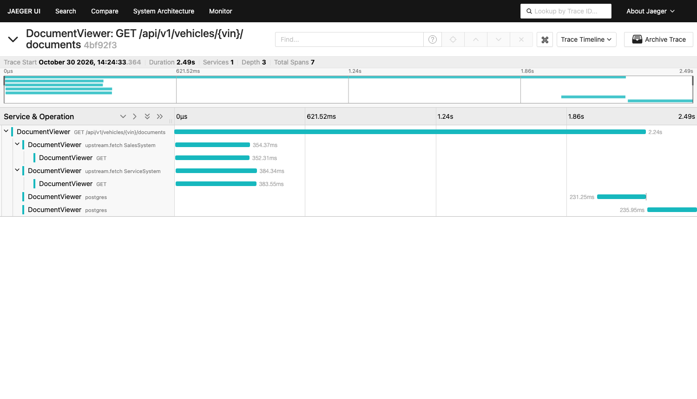

# README: chạy, cấu hình, xem nó suy giảm

**Bản tiếng Việt** · Keyloop Technical Assessment — Scenario D · Tác giả: Pham Gia Khiem

| | |
|---|---|
| **Bản gốc tiếng Anh** | [`README.md`](../../README.md) — **đây là bản thẩm quyền** |
| **Mục lục bộ tiếng Việt** | [`tai-lieu-tieng-viet.md`](../tai-lieu-tieng-viet.md) |
| **Nội dung** | Chạy nó — quickstart, cấu hình, API, bộ test, tường thuật AI |

> Nếu bản tiếng Việt và bản tiếng Anh khác nhau, **bản tiếng Anh là bản đúng**. Tên lớp,
> tên file, tên test, khóa cấu hình và khối code giữ nguyên tiếng Anh vì chúng là định
> danh trong mã nguồn.
>
> Các tham chiếu dạng **§I.x**, **§III.x**… trỏ sang phần tương ứng trong bộ tài liệu này:
> I = thiết kế, II = tour mã nguồn, III = tra cứu, IV = README, V = nhật ký review,
> VI = prompt, VII = phán quyết, VIII = plan. Mục lục ở link trên.

---

Tài liệu của một chiếc xe nằm ở hai hệ thống nguồn phát triển độc lập nhau. Service này
trả lời **một câu hỏi bằng một request**: *cho một VIN, xe này có những tài liệu nào, và
mỗi tài liệu đến từ đâu?*

Nó fan-out tới cả hai hệ thống **song song**, chuẩn hóa hai hình dạng payload không liên
quan gì nhau về một mô hình duy nhất, và — **phần quan trọng nhất** — vẫn hoạt động khi
một trong hai hệ thống không hoạt động.

| | |
|---|---|
| **Tầng đã hiện thực** | Backend: RESTful API + database bền vững |
| **Tầng để stub** | Client: [`openapi.json`](../../openapi.json) đã commit, [`requests.http`](../../requests.http), ví dụ cURL bên dưới |
| **Stack** | .NET 9 (`net9.0`), ASP.NET Core Minimal APIs, EF Core + Npgsql trên Supabase PostgreSQL, Polly v8, Serilog, OpenTelemetry |
| **Test** | 108 — 65 unit, 43 integration (xUnit, Shouldly, NSubstitute, WireMock.Net, Testcontainers) |

---

## IV.1. Quickstart

### Yêu cầu cài trước

- [.NET SDK 9.0](https://dotnet.microsoft.com/download/dotnet/9.0) — `dotnet --version`
  phải in ra `9.0.x`
- Docker (cho hai mock upstream service, và cho integration test)
- Một database Supabase hoặc PostgreSQL — **không bắt buộc**, xem §IV.2.2

### Chạy

```bash
# 1. Khởi động hai hệ thống nguồn đã mock (cổng 5101 và 5102)
docker compose up -d --build

# 2. Chạy API (cổng 5080)
dotnet run --project src/DocumentViewer.Api --urls http://localhost:5080
```

```bash
# 3. Hỏi nó một câu
curl -s http://localhost:5080/api/v1/vehicles/1HGCM82633A004352/documents | jq
```

Anh sẽ thấy **bảy tài liệu** — bốn từ hệ thống Sales, ba từ hệ thống Service — mỗi cái
gắn `sourceSystem` của nó, và `"partial": false`.

### Test

```bash
dotnet test
```

Integration test **tự khởi động** container PostgreSQL dùng-một-lần qua Testcontainers và
các stub upstream của chính nó qua WireMock.Net, nên chúng cần Docker nhưng **không cần**
tài khoản Supabase và **không cần** `docker compose up`. Dự kiến khoảng **ba phút**: có
vài test cố ý chờ hết timeout, và các integration test collection **chạy tuần tự có chủ
ý** (xem §IV.5).

---

## IV.2. Cấu hình

Mọi thứ đều cấu hình được; **không cần cấu hình gì** để chạy demo.

| Thiết lập | Mặc định | Nó làm gì |
|---|---|---|
| `Upstreams:SalesSystem:BaseAddress` | `http://localhost:5101` | Hệ thống nguồn Sales |
| `Upstreams:ServiceSystem:BaseAddress` | `http://localhost:5102` | Hệ thống nguồn Service |
| `Upstreams:CircuitBreakerMinimumThroughput` | `5` | Số lời gọi cần có trong cửa sổ lấy mẫu trước khi một breaker **được phép** mở |
| `ConnectionStrings:Default` | *(không có)* | Database lúc runtime. Supabase: **transaction pooler**, cổng `6543` |
| `ConnectionStrings:Migrations` | *(không có)* | Chỉ cho migration. Supabase: kết nối **direct/session**, cổng `5432` |
| `HealthChecks:DatabaseTimeoutMs` | `5000` | Readiness chờ database bao lâu |
| `OTEL_EXPORTER_OTLP_ENDPOINT` | *(không có)* | Set để export trace và metric; nếu không, chúng ra console |

### IV.2.1 Kết nối một database

Hai connection string, **vì chúng không thể thay thế cho nhau**: pooler chế độ
transaction của Supabase (`6543`) là đúng cho runtime nhưng **không hỗ trợ** các tính
năng mức session mà migration của EF Core cần, nên migration dùng kết nối trực tiếp
(`5432`).

Cấp chúng qua biến môi trường — **tuyệt đối không commit**:

```bash
export ConnectionStrings__Default='Host=…pooler.supabase.com;Port=6543;Database=postgres;Username=…;Password=…;Ssl Mode=Require'
export ConnectionStrings__Migrations='Host=…pooler.supabase.com;Port=5432;Database=postgres;Username=…;Password=…;Ssl Mode=Require'

dotnet tool restore
dotnet ef database update \
  --project src/DocumentViewer.Infrastructure \
  --startup-project src/DocumentViewer.Api
```

Sau đó `/health/ready` trả `200`, và nhánh stale-cache fallback bên dưới **trở nên sống**.

### IV.2.2 Chạy không có database

**Được hỗ trợ, và là mặc định.** Không có connection string, service vẫn trả lời truy vấn
tài liệu **y như cũ** — nó chỉ đơn giản là không có cache và không ghi audit trail, và
`/health/ready` nói rõ điều đó trong khi **vẫn trả `200`**. Readiness nghĩa là *"tôi làm
được việc của tôi"*, và không có cache thì nó vẫn làm được.

---

## IV.3. API

```
GET /api/v1/vehicles/{vin}/documents
```

| Kết cục | Status |
|---|---|
| Ít nhất một nguồn cho ra tài liệu (sống hoặc cache) | `200` — `partial: true` nếu có nguồn nào không phải `ok` |
| VIN không hợp lệ (độ dài, ký tự `I`/`O`/`Q` bị cấm, check digit ISO 3779) | `400` + `ProblemDetails` |
| Mọi nguồn đều lỗi và không có gì trong cache | `503` + `Retry-After: 30` |
| VIN hợp lệ, không có tài liệu ở đâu cả | `200` với `documents: []` — **không phải** `404` |

```json
{
  "vin": "1HGCM82633A004352",
  "retrievedAt": "2026-10-31T07:42:11.183Z",
  "partial": true,
  "documents": [
    {
      "id": "service:91001",
      "sourceSystem": "ServiceSystem",
      "documentType": "JobCard",
      "title": "Job card #91001 — annual service",
      "issuedAt": "2026-03-15T00:00:00+00:00",
      "sizeBytes": 148213,
      "downloadUrl": "https://service.mock/docs/91001"
    }
  ],
  "sources": [
    { "system": "SalesSystem",   "status": "ok",     "documentCount": 4, "durationMs": 182 },
    { "system": "ServiceSystem", "status": "stale",  "documentCount": 3, "durationMs": 5004,
      "error": { "reason": "Timeout", "message": "…" } }
  ]
}
```

`status` là `ok` (sống), `stale` (nguồn lỗi; tài liệu từ cache được phục vụ thay thế) hoặc
`failed` (nguồn lỗi và không có gì trong cache). Trả `200` cho kết quả một phần thay vì
`5xx` là một **quyết định có chủ ý**, được biện giải ở §I.5.1.

Health: `/health/live` (tiến trình) · `/health/ready` (database) · `/health/upstream`
(tham khảo, không bao giờ fail). OpenAPI ở `/openapi/v1.json`; file
[`openapi.json`](../../openapi.json) đã commit là **hợp đồng cho client**.

### IV.3.1 Bộ request mẫu

[`requests.http`](../../requests.http) phủ mọi đường đi; dưới đây là cùng các lời gọi đó bằng
cURL:

```bash
BASE=http://localhost:5080
VIN=1HGCM82633A004352

# đường đi thuận lợi — cả hai nguồn
curl -s "$BASE/api/v1/vehicles/$VIN/documents" | jq '{partial, count: (.documents|length), sources: [.sources[] | {system, status}]}'

# VIN không hợp lệ (check digit bị sửa) -> 400
curl -s -o /dev/null -w '%{http_code}\n' "$BASE/api/v1/vehicles/1HGCM82633A004353/documents"

# VIN hợp lệ nhưng không có tài liệu -> 200 và danh sách rỗng
curl -s "$BASE/api/v1/vehicles/WAUZZZ8V1JA003421/documents" | jq '.documents | length'

# correlation: gửi id của chính mình và nhận lại đúng nó
curl -s -D- -o /dev/null -H 'X-Correlation-Id: my-trace-123' "$BASE/api/v1/vehicles/$VIN/documents" | grep -i correlation
```

---

## IV.4. Xem nó suy giảm

Đây là **toàn bộ điểm chính** của scenario, nên nó là một tính năng hạng nhất chứ không
phải thứ chỉ để mô tả bằng văn xuôi. Cả hai mock upstream đều expose một công tắc chaos.
**Mọi con số dưới đây đều được ĐO, không phải ước lượng.**

```bash
BASE=http://localhost:5080
VIN=1HGCM82633A004352
show() { curl -s "$BASE/api/v1/vehicles/$VIN/documents" \
  | jq -c '{partial, count:(.documents|length), sources:[.sources[]|{system,status,reason:.error.reason}]}'; }
```

**Một hệ thống chết — hệ thống kia vẫn chạy.**

```bash
curl -s -XPOST localhost:5102/admin/chaos -H 'content-type: application/json' -d '{"mode":"fail"}'
show
# 200 · partial: true · 4 tài liệu · Sales "ok", Service "failed" (HttpError)
# Nếu có database kết nối, Service sẽ là "stale" và tài liệu cache của nó
# được đưa vào, thành 7 tài liệu thay vì 4.
```

**Circuit breaker, nhìn thấy được.** Gọi tiếp và nguồn đang lỗi sẽ **không còn được liên
hệ nữa**:

```bash
for i in 1 2 3 4 5 6; do show; done
# lý do đổi từ "HttpError" sang "CircuitOpen", và các lời gọi đó trả về
# trong vài milli giây — breaker đang từ chối tiêu 5 giây cho một hệ thống nó biết đã chết
```

**Cả hai hệ thống chết — giờ nó thành thật về việc thất bại.**

```bash
curl -s -XPOST localhost:5101/admin/chaos -H 'content-type: application/json' -d '{"mode":"fail"}'
curl -s -o /dev/null -w '%{http_code} retry-after=%header{retry-after}\n' "$BASE/api/v1/vehicles/$VIN/documents"
# 503 retry-after=30
```

**Chậm chứ không hỏng — ngân sách timeout giữ vững.** Phải reset trước và cho các breaker
đủ 15 giây để đóng lại, không thì anh sẽ **đo breaker thay vì đo timeout**:

```bash
for p in 5101 5102; do curl -s -XPOST localhost:$p/admin/chaos -H 'content-type: application/json' -d '{"mode":"normal"}'; done
sleep 16
curl -s -XPOST localhost:5102/admin/chaos -H 'content-type: application/json' -d '{"mode":"slow","delayMs":8000}'
time show
# ~5,9 giây, không phải 8 · partial: true · Service "failed" (Timeout)
# Ngân sách toàn request là 6 giây và nó giữ vững: một nguồn chậm không thể
# giữ response quá mốc đó, và bốn tài liệu của Sales vẫn tới.
```

**Một bản ghi xấu không đầu độc cả nguồn.**

```bash
curl -s -XPOST localhost:5102/admin/chaos -H 'content-type: application/json' -d '{"mode":"normal"}'
sleep 16
curl -s -XPOST localhost:5102/admin/chaos -H 'content-type: application/json' -d '{"mode":"garbage"}'
show
# 200 · partial: false · Service "ok" với 0 tài liệu
```

`garbage` trả về JSON **đúng cú pháp** nhưng bản ghi của nó **thiếu tiêu đề**. Normaliser
bỏ qua bản ghi đó và nguồn **vẫn báo `ok`** — đây là [giả định #7](#i10-các-giả-định): một
bản ghi không dùng được **không phải lý do** để làm thất bại cả một hệ thống nguồn. JSON
**thực sự không parse được** là một kết cục khác (`InvalidPayload`) và được phủ bởi test
`Malformed_upstream_payload_reports_InvalidPayload_not_500`.

```bash
# trả mọi thứ về bình thường
for p in 5101 5102; do curl -s -XPOST localhost:$p/admin/chaos -H 'content-type: application/json' -d '{"mode":"normal"}'; done
```

`mode` nhận `normal`, `slow` (kèm `delayMs`), `fail` (`503`) hoặc `garbage`.

> **Ghi chú của người dịch:** mục này từng là nguồn của defect **I-13** — bản nháp đầu
> tiên được viết từ *ý định thiết kế* chứ không phải từ *đầu ra đo được*, và khi chạy thật
> thì ra `0,04s` + `CircuitOpen` thay vì `~5s`, còn bước `garbage` báo `ok` chứ không phải
> `InvalidPayload`. Xem §V.I-13.

---

## IV.5. Bộ test

```bash
dotnet test                                                   # tất cả
dotnet test tests/DocumentViewer.UnitTests                    # 65, ~5 giây
dotnet test tests/DocumentViewer.IntegrationTests             # 43, ~2 phút 45
dotnet test --filter FullyQualifiedName~Resilience            # các luật độ tin cậy
```

| Nhóm | Số lượng | Nó ghim điều gì |
|---|---|---|
| `VinTests` | 13 | Độ dài, ký tự `I`/`O`/`Q` bị cấm, check digit ISO 3779 (gồm cả nhánh `X` khi số dư là 10), đầu vào có khoảng trắng và chữ thường, và việc **một `Vin` không thể bị format thô vào một dòng log** |
| Normaliser | 18 | Kilobyte so với byte, epoch-millis so với ISO date, URL lồng so với phẳng, giá trị enum lạ **được giữ** thay vì bị bỏ, bản ghi lỗi định dạng **bị bỏ qua** thay vì throw, và một kích thước quá lớn để biểu diễn được báo là **không biết** thay vì thành số âm |
| `DocumentSourceClientTests` | 12 | Mọi thất bại upstream map sang đúng `UpstreamFailureReason`, và response body **bị giới hạn cả về kích thước lẫn thời gian** |
| `NpgsqlConnectionHardeningTests` | 8 | Các mặc định về giữ pool ấm và connect-timeout được áp dụng, và **không bao giờ ghi đè** giá trị người vận hành đã set |
| `DocumentAggregationServiceTests` | 14 | Merge, sắp xếp với null xuống cuối, cờ partial, stale fallback, **một source throw không làm mất kết quả của source song song**, tính song song, lệnh ghi cache sống lâu hơn request, và một database bị treo **không thể** ném đi tài liệu của một nguồn khỏe mạnh |
| `VehicleDocumentsEndpointTests` | 9 | Map status và `ProblemDetails` |
| Persistence | 12 | Round-trip, hết hạn, upsert đồng thời, audit, và việc một database không với tới được hoặc vắng mặt **không bao giờ** làm vỡ một lệnh đọc |
| `ObservabilityTests` | 10 | Truyền correlation, **hai span upstream chồng lấn**, không VIN thô trong bất kỳ dòng log nào, ngữ nghĩa health-check, client hủy request, và một guard rằng các stub **thực sự trả về tài liệu** |
| `UpstreamResilienceTests` | 10 | Các luật độ tin cậy ở bảng dưới |
| `TimeoutAccountingTests` | 1 | Một timeout toàn request **được đếm và được ghi audit** — đúng cái kết cục mà người dùng không nhận được gì lại là cái cần ghi lại nhất |
| `OpenApiContractTests` | 1 | Mọi property mà hợp đồng đã commit đánh dấu `required` đều **thực sự có** trong một response thật |

**Ba điều về bộ test này là có chủ ý và đáng để người review chú ý:**

**Test về tính song song thực sự ĐO.** Yêu cầu #2 nói backend phải gọi cả hai hệ thống
song song. **Không có gì ngoài một cái đồng hồ chứng minh được điều đó**, nên cả hai stub
đều delay một giây và toàn request phải xong trong **dưới 1,6 giây** — gọi tuần tự sẽ mất
ít nhất hai giây.

**Các test database trỏ vào một hố đen.** Một cổng đóng bị từ chối ngay lập tức, nên nó
**không chứng minh được gì** về timeout. Các test này trỏ database vào một `TcpListener`
**nhận kết nối rồi không bao giờ trả lời** — đó mới là hình ảnh của một managed pooler
đang lạnh, nhìn từ phía client.

**Integration collection KHÔNG chạy song song.** Có năm test khẳng định về thời gian trôi
qua. Khi chạy cùng các test class khác, tranh chấp CPU đã đẩy một upstream **cố ý khỏe
mạnh** vượt quá timeout 2 giây mỗi lần thử, và bộ test fail trên một `503` **hoàn toàn
đúng**. Khẳng định về độ trễ và chạy song song **không đi cùng nhau được**;
`xunit.runner.json` tắt nó đi.

### IV.5.1 Các luật độ tin cậy, và test giữ từng luật

| Luật | Giá trị | Test |
|---|---|---|
| Timeout mỗi lần thử | 2 s | `One_upstream_timing_out_returns_200_partial_within_the_total_budget` |
| Tổng mỗi upstream | 5 s | như trên |
| Toàn request | 6 s | như trên |
| Retry, chỉ lỗi tạm thời | 2 lần, lũy thừa + jitter | `Transient_500_is_retried_and_succeeds_on_the_second_attempt` |
| Không bao giờ retry `4xx` khác | — | `Client_error_responses_are_never_retried(404, 400)` |
| Circuit breaker, mỗi upstream một cái | tỉ lệ 0,5 / 30 s / 15 s | `Repeated_failures_open_the_circuit_and_subsequent_calls_fail_fast` |
| Các breaker bị cô lập với nhau | — | `Open_circuit_on_one_source_does_not_affect_the_other_source` |
| Giới hạn kích thước body upstream | 4 MiB | `Reports_a_body_that_never_stops_arriving_as_an_invalid_payload` |
| Ngân sách đọc body upstream | 2 s | `Reports_a_body_that_trickles_past_its_budget_as_a_timeout` |
| TTL của cache | 15 phút | `Get_returns_null_for_expired_entry` |
| Thất bại không bao giờ được cache | — | `Failed_source_results_are_never_written_to_cache` |

---

## IV.6. Observability

Serilog ghi JSON có cấu trúc ra stdout. Mỗi dòng thuộc phạm vi một request đều mang
`CorrelationId` và `TraceId`, và nơi nào liên quan thì mang `SourceSystem` cùng `VinHash`.
(Các dòng lúc khởi động, warm-up pool và ghi audit nền **không thuộc về request nào** nên
không mang cả hai.)

**VIN được coi là dữ liệu cá nhân.** **Không dòng log nào chứa một VIN.** Log mang
`VinHash` (12 hex đầu của SHA-256) cộng sáu ký tự cuối — đủ để bộ phận hỗ trợ đối chiếu
một khiếu nại mà không biến kho log thành kho PII. VIN đầy đủ **chỉ** tồn tại trong bảng
`search_audit`, nằm sau kiểm soát truy cập của database. `Vin.ToString()` trả về **dạng
đã che**, nên một lần lỡ nội suy chuỗi không thể làm lộ nó, và có một test khẳng định
không dòng log nào chứa VIN thô **kể cả trên nhánh suy giảm** — nơi đã từng phát hiện một
logger retry của thư viện thứ ba làm lộ nó **bên trong một object `Uri`**.

OpenTelemetry export trace và metric; một request sinh ra một span cha với **hai span
upstream ngang hàng** có khoảng thời gian chồng lấn, đó là bằng chứng rõ ràng nhất có thể
có rằng fan-out là thật:



Sáu metric dưới meter `DocumentViewer`: thời lượng tổng hợp, thời lượng và kết quả upstream
theo từng hệ thống, số lượng response một phần, kết cục tra cache, và trạng thái circuit.
Bộ đếm response-một-phần là cái mà **một hiện thực ngây thơ không thể sinh ra được** — nó
chỉ đo được vì kết quả một phần **được mô hình hóa** chứ không bị ném đi.

---

## IV.7. Tường thuật cộng tác với AI

**GenAI viết phần lớn code trong repo này.** Câu hỏi thú vị **không phải** là nó có làm
được hay không — nó làm được — mà là **người kỹ sư điều khiển nó có phân biệt được đầu ra
ĐÚNG với đầu ra NGHE CÓ LÝ hay không**. Dưới đây là bản ghi trung thực, bao gồm cả những
chỗ AI sai và cách những chỗ đó bị bắt.

Bản ghi đầy đủ ở **Phần V, VI và VII** của tài liệu này.

### IV.7.1 Chiến lược: không bao giờ hỏi code trước

Mỗi giai đoạn yêu cầu mô hình **trích xuất**, **chấm điểm**, **tấn công**, hoặc **biện
giải** — và chỉ sau đó mới **sản xuất**. Code sinh ra trước khi bài toán được chốt là code
sẽ phải ném đi.

1. **Trích xuất, không diễn giải.** Phân tích đề bài thành các yêu cầu, giữ **tách biệt**
   tiêu chí nghiệm thu của từng scenario với các yêu cầu xuyên suốt trong "The Challenge
   Structure". Chính sự tách biệt đó làm cho bước 3 trở nên khả thi.
2. **Chấm điểm các phương án theo một rubric tường minh** — độ phức tạp hiện thực, nguy cơ
   phình phạm vi, và mỗi scenario để lại bao nhiêu chất liệu cho một tài liệu thiết kế.
   Scenario A có độ sâu kỹ thuật hơn, nhưng bài toán concurrency của nó **rất dễ ship sai
   một cách tinh vi**; còn các lo ngại về độ tin cậy của Scenario D là **nội tại** chứ
   không phải gắn thêm vào.
3. **Tấn công chính lựa chọn của mình.** *"Đọc lại Phần 2 theo kiểu đối kháng. Scenario D
   KHÔNG thỏa mãn được điều gì về mặt cấu tạo?"* Prompt này sinh ra **phát hiện giá trị
   nhất của cả giai đoạn thiết kế**: một database bền vững là **bắt buộc** cho bài nộp
   backend, mà Scenario D lại là tổng hợp chỉ-đọc thuần **không sinh ra dữ liệu của riêng
   nó**. Nó định hình lại thiết kế và trở thành giả định #1.
4. **Tấn công chính thiết kế của mình.** *"Đây là thiết kế fan-out. Tìm bug."* → ra defect
   `Task.WhenAll` đã nói ở trên.
5. **Biện giải mọi công nghệ, kể cả những cái bị loại.** Việc **bắt buộc** phải nêu một
   phương án bị loại cho **từng dòng** của bảng công nghệ là thứ làm lộ ra vấn đề licence
   của FluentAssertions và câu hỏi integration test nên trỏ vào đâu.
6. **Tài liệu thiết kế, rồi plan, rồi mới code.** Mô hình hiện thực **dựa trên một đặc tả
   và một plan theo từng task mà tôi sở hữu**, thay vì tự bịa ra trong lúc làm. Mọi task
   đều test-first, với test đỏ **được xem thấy** trước khi phần hiện thực tồn tại.

### IV.7.2 Kiểm chứng: đầu ra của AI thực sự được kiểm thế nào

- **Mọi task đều chạy đỏ-sang-xanh.** Một test xanh ngay khoảnh khắc nó được viết ra
  **không chứng minh được gì**.
- **Bộ test được chạy đối chiếu với THỰC TẾ, không chỉ đối chiếu với chính nó.** Đây là
  nơi những phát hiện nghiêm trọng xuất hiện — xem §IV.7.3.
- **Mọi test đều bị chất vấn bằng một câu hỏi: *thay đổi gì ở production sẽ làm test này
  fail?*** Một test readiness **không trả lời được** và đã bị viết lại (I-9).
- **Mọi lệch khỏi plan đều được ghi thành phán quyết**, kèm giá phải trả nếu nó sai, trong
  sổ ở **Phần VII**.

### IV.7.3 AI đã sai những gì

Một tuyển chọn tiêu biểu; danh sách đầy đủ ở **Phần V** (D-1…D-7 giai đoạn thiết kế,
I-1…I-15 giai đoạn hiện thực).

| # | AI sinh ra gì | Đã đổi thành gì | Vì sao nó quan trọng |
|---|---|---|---|
| D-3 | `await Task.WhenAll(sales, service)` | `UpstreamResult<T>`; thất bại thành một giá trị trả về | Ném lại lỗi đầu tiên và **ném đi kết quả đã hoàn thành của task song song** — phá vỡ kết quả một phần, và **chỉ phá khi một upstream chết** |
| D-4 | FluentAssertions trong test stack | Shouldly | FluentAssertions v8 không còn miễn phí cho mục đích thương mại. **Một dependency không thể ship được thì không phải là dependency** |
| D-5 | Một `5xx`/`207` cho kết quả một phần | `200` + `partial` + `sources[]` theo từng nguồn | Nhiều client **bỏ luôn body khi nhận `5xx`**, ném đi chính những tài liệu mà service đã lấy được thành công |
| I-1 | `dotnet add package … --no-restore`, để lại `Version="*"` trôi nổi | Ghim phiên bản `9.0.*` | Một wildcard đã phân giải ra một package **chỉ dành cho `net10.0`** và làm vỡ build; nó cũng làm build không tái lập được |
| I-3 | `AddHttpClient<IDocumentSource, T>()` với mặc định của `AddStandardResilienceHandler()` | Đặt tên cho từng pipeline; `Retry.Delay` 200 ms; breaker throughput cấu hình được | Registration không tên khóa **cả hai** client dưới `IDocumentSource`, dùng chung **một base address và một circuit breaker** — phá hủy chính sự cô lập theo upstream mà thiết kế đặt lên. Mặc định retry delay 2 giây còn làm lần retry thứ hai **không thể xảy ra** trong ngân sách 5 giây |
| I-6 | Chỉ log `VinHash`, với một Serilog enricher làm sạch các property dạng string | Enricher được mở rộng để **đệ quy** qua `ScalarValue`/`StructureValue`/`SequenceValue`/`DictionaryValue`, cộng một span processor tương ứng | Logger retry của Polly lưu URL gửi đi dưới dạng **object `Uri`**, không phải string, nên VIN thô **lọt vào log** — **trên nhánh suy giảm**, tức đúng lúc người ta đi đọc log |
| I-8 | Một hiện thực hoàn chỉnh, toàn xanh, 73 test | Warm-up pool; tách lệnh ghi khỏi token của request; ngân sách readiness thực thi bằng cách đua | Đối chiếu với **Supabase thật**, nhánh stale-cache **đã chết** và readiness trả `503`. Lệnh ghi cache chạy trên cancellation token của request, mà token đó bị hủy ngay khi response được gửi, nên **không có gì từng được cache**. Testcontainers kết nối trong dưới một milli giây, nên **không test nào có thể thấy được** |
| I-9 | Một test readiness trỏ vào một cổng đóng | Một `TcpListener` hố đen, cộng một test với ngân sách rộng rãi | Test đó **xanh cả trước VÀ sau** bản fix. **Một test không thể fail còn tệ hơn là không có test**: nó báo cáo một sự an toàn mà nó chưa từng kiểm tra |
| I-11 | `AddDocumentSources` đọc `Upstreams:*:BaseAddress` lúc đăng ký | Phân giải từ `IServiceProvider` cho mỗi client | Nó chụp lại `appsettings.json` và **âm thầm phớt lờ mọi nguồn cấu hình sau đó** — nên một lần triển khai đặt địa chỉ upstream qua biến môi trường sẽ bị bỏ qua |

### IV.7.4 Bài học đáng giữ lại

**Một bộ test toàn xanh chỉ mô tả cái môi trường mà bộ test đó đang chạy trong đó.** Bảy
mươi ba test đã xanh, endpoint demo đúng, và **tính năng tiêu biểu nhất của scenario đã
chết ở production**, bởi vì PostgreSQL trong một container cục bộ trả lời trong dưới một
milli giây, còn một managed pooler liên vùng thì không. Phát hiện I-8 đến từ việc **chạy
thứ này đối chiếu với hạ tầng thật và đọc log** — không phải từ việc viết thêm test. Những
test được viết **sau đó** giữ cho nó không hồi quy; chúng **không thể** tìm ra nó.

Hệ quả là cách AI được dùng tốt nhất: **không phải như một cái máy sinh code để rồi đi
review diff, mà như một đối thủ được chỉ thẳng vào chính các quyết định của mình**, với
mọi câu trả lời được kiểm chứng đối chiếu với một thứ gì đó thật.

---

## IV.8. Những gì cố ý không làm

Là **lựa chọn, không phải thiếu sót** — mỗi thứ kèm lý lẽ ở §I.9: xác thực và phân quyền
(thuộc về gateway), tải nội dung tài liệu (một bài toán khác với đặc tính bảo mật khác),
phân trang (hàng chục tài liệu mỗi xe, không phải hàng nghìn), loại trùng giữa các nguồn
(một tài liệu ở cả hai hệ thống **thực sự là** hai bản ghi, và yêu cầu #3 đòi mỗi cái phải
rõ nguồn), và frontend (đề bài yêu cầu một tầng, và yêu cầu #2 gọi tên backend).
