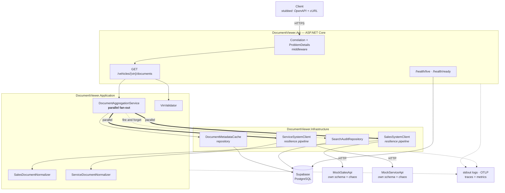
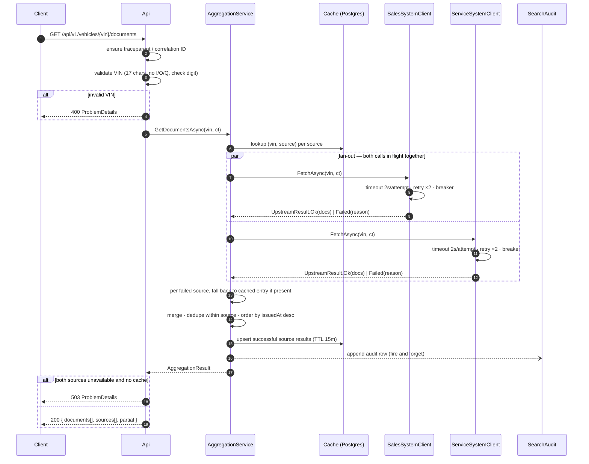
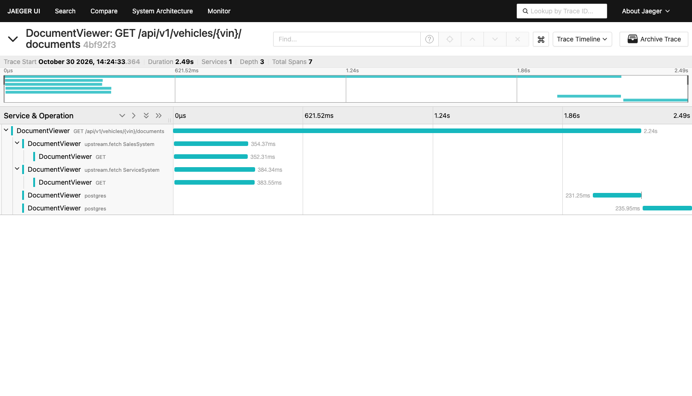

# Tài liệu thiết kế hệ thống

**Bản tiếng Việt** · Keyloop Technical Assessment — Scenario D · Tác giả: Pham Gia Khiem

| | |
|---|---|
| **Bản gốc tiếng Anh** | [`system-design.md`](../../docs/system-design.md) — **đây là bản thẩm quyền** |
| **Mục lục bộ tiếng Việt** | [`tai-lieu-tieng-viet.md`](../tai-lieu-tieng-viet.md) |
| **Nội dung** | Vì sao — kiến trúc, đánh đổi, 11 giả định, 6 phạm vi loại trừ |

> Nếu bản tiếng Việt và bản tiếng Anh khác nhau, **bản tiếng Anh là bản đúng**. Tên lớp,
> tên file, tên test, khóa cấu hình và khối code giữ nguyên tiếng Anh vì chúng là định
> danh trong mã nguồn.
>
> Các tham chiếu dạng **§I.x**, **§III.x**… trỏ sang phần tương ứng trong bộ tài liệu này:
> I = thiết kế, II = tour mã nguồn, III = tra cứu, IV = README, V = nhật ký review,
> VI = prompt, VII = phán quyết, VIII = plan. Mục lục ở link trên.

---

## I.1. Phát biểu bài toán

Tài liệu của một chiếc xe tại đại lý bị phân mảnh trong **hai hệ thống nguồn** phát
triển độc lập nhau:

- **Sales System** — đơn mua (purchase order), hợp đồng tài chính (finance agreement),
  giấy tờ đăng ký (registration paperwork).
- **Service System** — phiếu công việc (job card), biên bản kiểm tra (inspection
  report), yêu cầu bảo hành (warranty claim).

Hiện tại người dùng phải đăng nhập cả hai hệ thống, tìm kiếm ở cả hai, rồi **tự ghép kết
quả trong đầu**.

Service này cung cấp **một request, một câu trả lời**: cho một VIN, trả về toàn bộ tài
liệu của xe đó từ cả hai hệ thống dưới dạng **một danh sách hợp nhất duy nhất**, mỗi
phần tử ghi rõ nó đến từ nguồn nào.

### Tiêu chí nghiệm thu (lấy từ đề bài)

| # | Yêu cầu | Được thỏa mãn ở đâu |
|---|---|---|
| 1 | Tìm kiếm hợp nhất theo VIN | `GET /api/v1/vehicles/{vin}/documents` (§I.5) |
| 2 | Backend gọi **song song** tới hai API ngoài đã được mock | `DocumentAggregationService` (§I.4.2), được chứng minh bằng một test đo thời gian (§I.8) |
| 3 | Một danh sách hợp nhất, mỗi tài liệu chỉ rõ nguồn | Trường `sourceSystem` trên mỗi tài liệu + metadata `sources[]` (§I.5.2) |

---

## I.2. Các nguyên tắc thiết kế

Đề bài yêu cầu khả năng mở rộng (scalability), hiệu năng (performance), độ tin cậy
(reliability), khả năng bảo trì (maintainability) và khả năng quan sát (observability).
Những từ đó được chuyển thành **bốn nguyên tắc cụ thể** mà mọi quyết định trong tài liệu
này đều có thể truy ngược về:

1. **Một câu trả lời suy giảm vẫn tốt hơn không có câu trả lời nào.** Một nguồn chết
   không được phép làm endpoint trở nên vô dụng. Kết quả một phần (partial result) là
   một **kết cục được mô hình hóa tường minh**, hạng nhất — chứ không bao giờ là một
   exception lọt ra ngoài.
2. **Người gọi không bao giờ phải đoán.** Nếu dữ liệu thiếu, không đầy đủ, hay đã cũ,
   response nói rõ điều đó **theo từng nguồn**. Client tự quyết định cách trình bày.
3. **Hệ thống upstream là không đáng tin và bị cô lập.** Mỗi upstream có ngân sách
   timeout riêng, chính sách retry riêng, circuit breaker riêng. Một lỗi không thể lan
   ngang sang nguồn khác.
4. **Mọi request đều giải thích được sau khi đã xảy ra.** Một correlation ID duy nhất
   buộc chặt dòng log của API, hai span upstream, dòng audit trong DB và các metric lại
   với nhau.

---

## I.3. Kiến trúc



### I.3.1 Trách nhiệm từng thành phần

| Thành phần | Trách nhiệm | **Cố ý KHÔNG** chịu trách nhiệm |
|---|---|---|
| **DocumentViewer.Api** | Biên HTTP. Định tuyến, bind, validate VIN, map kết cục → status code, phát `ProblemDetails` theo RFC 9457, expose OpenAPI + health. | Mọi hiểu biết về việc có bao nhiêu upstream, hay chúng lỗi kiểu gì. |
| **DocumentViewer.Application** | Nghiệp vụ: fan-out song song tới mọi source đã đăng ký, thu cả thành công **lẫn** thất bại, merge, sắp xếp, quyết định cờ `partial`. | HTTP, SQL, retry, serialisation. |
| **DocumentViewer.Domain** | `Vin` (value object), `VehicleDocument`, `SourceSystem`, `UpstreamResult<T>`. **Không phụ thuộc gì cả.** | Bất cứ thứ gì có biên I/O. |
| **DocumentViewer.Infrastructure** | `HttpClient` có kiểu cho từng upstream kèm resilience pipeline; normalizer theo từng nguồn; EF Core cho cache + audit. | Quyết định một kết quả một phần **có nghĩa là gì**. |
| **MockSalesApi** / **MockServiceApi** | Đóng thế hai hệ thống nguồn thật, mỗi cái có hình dạng payload **thực sự khác nhau**, cộng một endpoint chaos để tiêm độ trễ và lỗi theo yêu cầu. | Giống thật ở mức nào khác ngoài hình dạng dữ liệu và hành vi lỗi. |

Hai mock được triển khai như **tiến trình HTTP thật**, không phải fake in-process. Đó là
một cái giá phải trả có chủ ý: chỉ có như vậy thì fan-out song song, timeout và circuit
breaker mới được thực thi qua socket thật, thay vì thử trên một stub **không thể chậm
được**.

### I.3.2 Vì sao chia như vậy

Bốn project thay vì một là tương xứng ở đây vì **một lý do duy nhất**: `Application` phụ
thuộc vào abstraction `IDocumentSource`, không phụ thuộc `HttpClient`. Chính điều đó làm
cho "thêm hệ thống nguồn thứ ba" chỉ còn là việc đăng ký thêm một client, và làm cho các
luật xử lý lỗi một phần có thể unit-test được mà không cần mạng.

---

## I.4. Luồng dữ liệu

### I.4.1 Vòng đời một request



### I.4.2 Fan-out song song — và cái bẫy nằm trong đó

Cách hiện thực ngây thơ **sai** theo một kiểu âm thầm phá hủy yêu cầu #3:

```csharp
// SAI — nếu một trong hai task fault, WhenAll ném lại exception
// và kết quả đã lấy được thành công của nguồn còn lại bị mất trắng.
var results = await Task.WhenAll(sales, service);
```

Vì vậy mọi lời gọi source đều được bọc lại sao cho **thất bại là một giá trị trả về,
không phải một exception**:

```csharp
public abstract record UpstreamResult<T>
{
    public sealed record Ok(T Value, TimeSpan Duration)             : UpstreamResult<T>;
    public sealed record Failed(UpstreamFailure Reason, TimeSpan Duration) : UpstreamResult<T>;
}
```

`IDocumentSource.FetchAsync` bắt exception tại biên của chính nó và trả về `Failed`. Với
thiết kế đó, `Task.WhenAll` **không bao giờ có thể throw**, và bộ tổng hợp luôn nhìn
thấy đúng một kết cục cho mỗi nguồn. Test đo thời gian ở §I.8 là thứ **chứng minh** hai
lời gọi thực sự chồng lấn nhau, chứ không phải chỉ *trông như* đồng thời.

### I.4.3 Cache fallback và trạng thái từng nguồn

Cache được khóa theo **từng cặp `(vin, sourceSystem)`**, không phải theo từng request.
Chính điều này cho phép: trong **cùng một response**, nguồn khỏe được phục vụ dữ liệu
sống, còn nguồn đang bệnh được phục vụ từ cache. Mỗi nguồn báo một trong ba trạng thái:

| `status` | Ý nghĩa | Có ghi cache? |
|---|---|---|
| `ok` | Lấy dữ liệu sống thành công | Có, TTL 15 phút |
| `stale` | Lấy sống thất bại, đã phục vụ bằng dữ liệu cache | Không |
| `failed` | Lấy sống thất bại và **không** có dữ liệu cache | Không |

**Thất bại thì KHÔNG BAO GIỜ được cache.** Cache một thất bại sẽ biến một cú hụt hơi một
giây của upstream thành **một sự cố mười lăm phút**.

---

## I.5. Hợp đồng API

### I.5.1 Endpoint

```
GET /api/v1/vehicles/{vin}/documents
```

| Kết cục | Status | Ghi chú |
|---|---|---|
| Ít nhất một nguồn cho ra dữ liệu (sống hoặc cache) | `200` | `partial: true` khi có bất kỳ nguồn nào không phải `ok` |
| VIN không hợp lệ | `400` | `ProblemDetails`, `type: .../invalid-vin` |
| Tất cả các nguồn đều `failed` | `503` | Có set header `Retry-After` |
| VIN hợp lệ nhưng không có tài liệu ở đâu cả | `200` | `documents: []` — **không phải 404**; xe có thể hợp lý là không có tài liệu nào |

Việc trả `200` cho kết quả một phần thay vì `5xx` là **quyết định API trung tâm** của
thiết kế này. Đề bài không chỉ định điều đó. Lý do: mục tiêu của người dùng là **xem
những tài liệu đang có**, và một `5xx` sẽ khiến phần xử lý lỗi của client **ném đi chính
dữ liệu mà nó đã nhận được thành công**. Khối `sources[]` tồn tại để lựa chọn này không
làm client mất một chút thông tin nào.

### I.5.2 Response

```json
{
  "vin": "1HGCM82633A004352",
  "retrievedAt": "2026-10-29T10:42:11.183Z",
  "partial": true,
  "documents": [
    {
      "id": "sales:PO-88213",
      "sourceSystem": "SalesSystem",
      "documentType": "PurchaseOrder",
      "title": "Purchase order PO-88213",
      "issuedAt": "2026-03-04T00:00:00Z",
      "sizeBytes": 148213,
      "downloadUrl": "https://sales.mock/documents/PO-88213"
    }
  ],
  "sources": [
    { "system": "SalesSystem",   "status": "ok",     "documentCount": 4, "durationMs": 182 },
    { "system": "ServiceSystem", "status": "failed", "documentCount": 0, "durationMs": 5004,
      "error": { "reason": "Timeout", "message": "Total request timeout of 5s elapsed" } }
  ]
}
```

`id` được đặt tiền tố theo nguồn (`sales:`, `service:`) vì hai hệ thống **cấp định danh
độc lập nhau** và không gian khóa của chúng có thể trùng.

### I.5.3 Sự khác biệt schema giữa hai upstream

Việc chuẩn hóa (normalisation) chỉ có ý nghĩa nếu hai upstream **thực sự bất đồng**. Hai
mock được xây để bất đồng:

| Trường hợp nhất | Sales System | Service System |
|---|---|---|
| định danh | `documentId` (string, `"PO-88213"`) | `id` (số nguyên, `88213`) |
| loại | `docType` (`"PURCHASE_ORDER"`) | `category` (`"job-card"`) |
| tiêu đề | `description` | `name` |
| ngày phát hành | `createdDate` (`"2026-03-04"`, ISO date, giờ địa phương của đại lý) | `timestamp` (epoch **milli giây**, UTC) |
| kích thước | `fileSizeKb` (kilobyte) | `bytes` |
| liên kết | `url` | `links.self` (lồng nhau) |
| phong bì dữ liệu | `{ "documents": [...] }` | `{ "data": { "items": [...] }, "meta": {...} }` |

Mỗi dòng khác biệt là **một bug chuẩn hóa đang chờ xảy ra** — và mỗi dòng đều được
unit-test theo từng normalizer ở Task 3: kilobyte so với byte, epoch-millis so với ISO
date, phong bì lồng nhau, và giá trị enum lạ thì map về `Unknown` chứ không throw.

---

## I.6. Lựa chọn công nghệ

| Lựa chọn | Vì sao | Phương án đã cân nhắc, và vì sao không chọn |
|---|---|---|
| **.NET 9** (`net9.0`) + ASP.NET Core Minimal APIs | Khớp stack doanh nghiệp của Keyloop, và là SDK được ghim cho bài này (9.0.320). Minimal APIs giữ biên HTTP nhỏ đủ để đọc hết trên một màn hình. **Tình trạng hỗ trợ, nói rõ có chủ ý:** .NET 9 là bản STS, hiện đang maintenance, **hết hạn hỗ trợ 2026-11-10**. Một service production sẽ nhắm **.NET 10 (LTS, hỗ trợ tới 11/2028)**; không có gì trong thiết kế này phụ thuộc phiên bản, nên việc chuyển chỉ là **đổi một dòng `TargetFramework`** trong `Directory.Build.props` rồi chạy lại bộ test. | MVC controller — nhiều nghi thức hơn mức một endpoint cần. .NET Framework 4.8 — chỉ Windows và đã đóng băng. .NET Core 3.1 — hết hỗ trợ từ 12/2022, và không có Minimal APIs, `Microsoft.Extensions.Http.Resilience` hay các package OpenTelemetry hiện tại, nên §I.7 và §I.8 sẽ không thể làm được như thiết kế. |
| **`IHttpClientFactory`** + typed client | Quản lý đúng vòng đời socket/DNS; là đường may đúng chuẩn để gắn policy riêng cho từng upstream. | `static HttpClient` — không cô lập policy theo upstream, DNS bị cũ. |
| **`Microsoft.Extensions.Http.Resilience`** (Polly v8) | Timeout, retry và circuit breaker gộp thành một pipeline khai báo cho từng client, kèm telemetry sẵn có. | Tự viết `CancellationTokenSource` + vòng lặp — nhận đủ bug, không được metric nào. |
| **Supabase PostgreSQL** + EF Core / Npgsql | Postgres có quản lý, không cần Docker cục bộ để chạy app; engine SQL thật nên schema và index là trung thực. | SQLite — chạy được mọi nơi, nhưng câu chuyện index và concurrency mất tính tin cậy. |
| **Serilog** → JSON có cấu trúc ra stdout | Hệ thống thu log tiêu thụ JSON; stdout là hợp đồng của container. | `ILogger` console mặc định — không cấu trúc, không truy vấn được. |
| **OpenTelemetry** (trace + metric, OTLP) | Trung lập nhà cung cấp; instrumentation cho ASP.NET Core / HttpClient / Npgsql có sẵn; hai span upstream song song **trở nên nhìn thấy được**. | Chỉ dùng metric — sẽ không cho thấy fan-out, mà đó lại là toàn bộ điểm chính của scenario. |
| **xUnit + Shouldly + NSubstitute** | Chuẩn mực, nhanh. Chọn Shouldly thay vì FluentAssertions vì licence v8 của FluentAssertions không còn miễn phí cho mục đích thương mại — **một dependency không thể ship được thì không phải là dependency**. | FluentAssertions — rủi ro licence. |
| **WireMock.Net** (integration test) | Cho phép test dàn dựng một upstream chậm hoặc hỏng một cách tất định, đúng thứ cần để chứng minh các luật resilience. | Gọi thẳng mock service thật từ test — không tất định, không tiêm lỗi được. |
| **Testcontainers for PostgreSQL** | Integration test có Postgres thật cho mỗi lần chạy, không phụ thuộc mạng tới Supabase và không bị flaky vì state dùng chung. | Test trên Supabase — chậm, cần mạng, và một test lỗi có thể làm hỏng dữ liệu demo. |
| **Hai mock service độc lập** | Fan-out, timeout và breaker được thực thi qua socket thật, và có thể tiêm độ trễ/lỗi **ngay trong lúc demo**. | Fake in-process — không thể chậm, không thể "chết một nửa". |

---

## I.7. Chiến lược observability

### I.7.1 Logging

Serilog ghi JSON có cấu trúc ra stdout. Mỗi dòng đều mang `CorrelationId`, `TraceId`,
`SpanId`, và — nơi nào liên quan — `SourceSystem` cùng `VinHash`.

Một middleware correlation sẽ tôn trọng `traceparent` (chuẩn W3C) hoặc
`X-Correlation-Id` từ request vào, tự sinh nếu không có, truyền tiếp xuống cả hai lời
gọi upstream qua một `DelegatingHandler`, và dội lại trên response. Nhờ đó **một ID duy
nhất** nối dòng log của API, hai span upstream, dòng audit và bản ghi của chính client.

**VIN là dữ liệu cá nhân** — nó định danh một chiếc xe và trên thực tế là cả chủ xe.
**Không dòng log nào chứa VIN thô.** Log mang `VinHash` (12 hex đầu của SHA-256) cộng 6
ký tự cuối, đủ để bộ phận hỗ trợ đối chiếu một khiếu nại mà không biến kho log thành kho
PII. Bảng `SearchAudit` giữ VIN đầy đủ, vì ở đó nó là **bản ghi nghiệp vụ** và nằm sau
cơ chế kiểm soát truy cập của database.

Mức log: `Information` cho một dòng "request đã xong" mỗi request; `Warning` cho một
nguồn bị suy giảm; `Error` **chỉ** cho những lỗi mà service này phải chịu trách nhiệm —
một upstream timeout là **vận hành bình thường**, không phải lỗi, và báo động vì nó sẽ
huấn luyện đội on-call phớt lờ cảnh báo.

### I.7.2 Metric

Phát qua một `Meter` tên `DocumentViewer` qua OTLP.

| Metric | Loại | Tag | Câu hỏi nó trả lời |
|---|---|---|---|
| `documentviewer.aggregation.duration` | histogram | `outcome` | Chúng ta có nằm trong SLO độ trễ p95 không? |
| `documentviewer.upstream.duration` | histogram | `system` | Hệ thống nguồn nào đang chậm? |
| `documentviewer.upstream.result` | counter | `system`, `status` | Hệ thống nào không đáng tin, và theo kiểu nào? |
| `documentviewer.response.partial` | counter | — | Người dùng nhận câu trả lời không đầy đủ với tần suất nào? |
| `documentviewer.cache.lookup` | counter | `result` | Cache có đáng với độ phức tạp nó mang lại không? |
| `documentviewer.circuit.state` | gauge | `system` | Có breaker nào đang mở không? |

`documentviewer.response.partial` là metric quan trọng nhất, và cũng là metric mà **một
hiện thực ngây thơ không thể sinh ra được**: nó chỉ đo được vì kết quả một phần được mô
hình hóa tường minh, thay vì bị ném đi dưới dạng exception.

### I.7.3 Tracing

Một `ActivitySource` cho mỗi tầng. Một request sinh ra một span cha cùng **hai span
upstream ngang hàng** có khoảng thời gian chồng lấn — biểu đồ waterfall của trace là
bằng chứng rõ ràng nhất có thể có rằng yêu cầu #2 thực sự được thỏa mãn, và một ảnh chụp
nó nên nằm trong bài nộp.



### I.7.4 Health check

| Endpoint | Kiểm tra gì | Ai dùng |
|---|---|---|
| `/health/live` | tiến trình còn sống | chính sách restart của container |
| `/health/ready` | Postgres có với tới được | việc đưa/rút instance khỏi load balancer |
| `/health/upstream` | cả hai upstream, **chỉ để tham khảo** | chỉ dashboard |

`/health/ready` **cố ý loại trừ các upstream**. Nếu không, việc cả hai hệ thống nguồn
chết sẽ rút **mọi instance** của service này khỏi vòng phục vụ — và service sẽ ngừng
phục vụ chính những tài liệu trong cache mà nó vẫn hoàn toàn đủ sức phục vụ. Readiness
nghĩa là "tôi làm được việc của tôi", và với cache nóng cùng kết quả một phần, nó làm
được.

Cùng lý lẽ đó dẫn tới một phân biệt thứ hai, được thêm vào trong lúc hiện thực: một
database **vắng mặt do cấu hình** báo `Healthy` kèm ghi chú rằng persistence đã tắt, vì
chạy không có cache và audit là **một cấu hình được hỗ trợ** và service vẫn trả lời được
truy vấn tài liệu. Một database **đã được cấu hình nhưng không với tới được** thì báo
`Unhealthy`. Ngân sách readiness là cấu hình được (`HealthChecks:DatabaseTimeoutMs`, mặc
định 5 giây) và được thực thi bằng cách **đua (race) probe** chứ không phải hủy nó —
Npgsql không quan sát cancellation token một cách đáng tin trong lúc đang mở kết nối vật
lý, nên một ngân sách dựa trên cancel đã bị **âm thầm phớt lờ** khi chạy thật với
Supabase.

### I.7.5 Mục tiêu mức dịch vụ (SLO)

| SLO | Mục tiêu | Đo từ |
|---|---|---|
| Khả dụng của endpoint tổng hợp (không `5xx`) | ≥ 99,9% | `aggregation.duration{outcome}` |
| Độ trễ p95 | < 1,5 s | `aggregation.duration` |
| Request được phục vụ đầy đủ (không partial) | ≥ 99% | `response.partial` ÷ tổng |

Khả dụng được định nghĩa trên hành vi của **chính service này**, không phải của các
upstream: trả về một kết quả một phần đã được tài liệu hóa **được tính là thành công**.
Đó là lúc thiết kế trả lãi — SLO chỉ có thể phát biểu theo cách này vì sự suy giảm là
một kết cục được mô hình hóa.

---

## I.8. Độ tin cậy và hiệu năng

### I.8.1 Ngân sách timeout

| Phạm vi | Ngân sách |
|---|---|
| Mỗi lần thử, mỗi upstream | 2 s |
| Tổng cho mỗi upstream, gồm cả retry | 5 s |
| Toàn bộ request | 6 s |

Tổng cho mỗi upstream **nhỏ hơn** ngân sách toàn request, nên một nguồn bệnh không thể
bắt giữ response làm con tin; và vì hai lời gọi là đồng thời, **nguồn chậm nhất quyết
định độ trễ, không phải tổng hai nguồn**.

### I.8.2 Chính sách retry

Hai lần retry, backoff lũy thừa có jitter, **chỉ** với các điều kiện tạm thời
(`5xx`, `408`, `429`, timeout, lỗi socket). `4xx` **không bao giờ** được retry — một
`404` nghĩa là xe đó không tồn tại trong hệ thống ấy, và retry chỉ nhân tải lên một
upstream vốn đang trả lời **đúng**.

### I.8.3 Circuit breaker

Một breaker **cho mỗi upstream**: tỉ lệ lỗi 50% trong cửa sổ 30 giây, mở 15 giây. Khi
một breaker đang mở, nguồn đó **fail nhanh** vào nhánh cache-fallback, nên một hệ thống
nguồn bệnh chỉ tốn ~0 ms thay vì 5 giây. Dùng chung state giữa hai breaker sẽ cho phép
một hệ thống lỗi làm suy giảm hệ thống kia — **sự cô lập chính là điểm chính**.

### I.8.4 Lưu trữ bền vững

```
search_audit                           document_metadata_cache
  id            bigserial PK             vin             varchar(17)  ┐ PK
  vin           varchar(17)              source_system   smallint     ┘
  correlation_id varchar(128)                    payload         jsonb
  searched_at   timestamptz              document_count  int
  duration_ms   int                      fetched_at      timestamptz
  partial       boolean                  expires_at      timestamptz
  source_report jsonb

  idx (vin, searched_at desc)            idx (expires_at)  -- cho job dọn cache (chưa làm; xem §I.9)
```

**Vì sao lại cần database.** Đề bài yêu cầu một database bền vững, nhưng Scenario D là
tổng hợp chỉ-đọc — nó **không sinh ra dữ liệu hiển nhiên nào**. Thay vì thêm một bảng
cho có, hai bảng được chọn mỗi bảng trả lời một câu hỏi thật:

- `search_audit` — ai đã xem tài liệu của xe nào, lúc nào, và họ có nhận được câu trả
  lời đầy đủ hay không. Việc truy cập bản ghi phương tiện là thứ **phải kiểm toán được**
  trong bán lẻ ô tô, và bảng này cũng là **bản ghi bền vững duy nhất về sự suy giảm mà
  người dùng thực sự nhìn thấy**.
- `document_metadata_cache` — làm cho hành vi cache-fallback ở §I.4.3 trở nên khả thi và
  giảm tải lặp lại lên các hệ thống nguồn.

Đây là một giả định, được ghi lại ở §I.10.

Việc ghi audit là **fire-and-forget** nằm trong `try/catch` riêng: observability không
bao giờ được là nguyên nhân làm request của người dùng thất bại. Pooler chế độ
transaction của Supabase (cổng **6543**) được dùng lúc runtime; migration của EF Core
chạy qua kết nối trực tiếp (**5432**), vì pooler không hỗ trợ các tính năng mức session
mà migration cần.

**Ba quyết định hiện thực mà mục này ban đầu không lường tới**, tất cả đều do chạy thật
với một pooler có quản lý thay vì một container cục bộ:

1. **Luôn giữ một kết nối nóng.** `NpgsqlConnectionHardening` điền
   `Minimum Pool Size=1`, `Connection Idle Lifetime=300` và `Timeout=15` vào những chỗ
   người vận hành chưa set, và một `DatabaseWarmupService` mở một kết nối ngay sau khi
   khởi động. Không có điều này, **thao tác database đầu tiên** phải trả toàn bộ cái giá
   bắt tay TLS + tra cứu tenant của pooler + SASL — **tính bằng giây**, qua liên
   vùng — trong khi mọi ngân sách theo thao tác dưới đây được thiết kế như thể nó tính
   bằng milli giây.
2. **Đọc và ghi có ngân sách khác nhau.** Một lần đọc cache nằm trên đường đi của
   response và được **1500 ms**, quá đó thì "cache miss" là một câu trả lời chấp nhận
   được. Một lần ghi cache xảy ra **sau** response và được **8 giây**, vì nó phải có khả
   năng hoàn tất trên một kết nối lạnh. Ghi audit cũng được 8 giây.
3. **Các lệnh ghi KHÔNG dùng cancellation token của request.** Token đó bị hủy **ngay
   khoảnh khắc response được gửi đi**. Truyền nó vào một lệnh ghi cache có nghĩa là một
   lệnh ghi liên vùng **luôn bị hủy giữa lúc bắt tay**, nên cache **vĩnh viễn rỗng** và
   nhánh stale-fallback ở §I.4.3 là **code không thể chạm tới** — trong khi **mọi test
   vẫn xanh**, bởi vì một container PostgreSQL cục bộ kết nối trong dưới một milli giây.
   Việc xử lý cache còn được cấp thêm một ngân sách **1 giây trên đường đi của
   response**, quá đó thì phần đọc hoàn tất và phần ghi tự chạy nốt: một database nhận
   kết nối rồi **không bao giờ trả lời** không được phép giữ lệnh đọc của người dùng.

### I.8.5 Hướng mở rộng quy mô

API không giữ state theo request, nên nó mở rộng ngang được phía sau một load balancer.
Các điểm nghẽn tiếp theo, theo thứ tự chúng sẽ xuất hiện: bảng cache (→ Redis, cùng một
interface repository), lượng ghi audit (→ ghi theo lô hoặc outbox), và rate limit của
upstream (→ bulkhead giới hạn đồng thời theo từng nguồn, vốn là phần mở rộng tự nhiên
của các pipeline theo nguồn đã có).

---

## I.9. Phạm vi loại trừ (Non-Goals)

Những thứ **cố ý** nằm ngoài phạm vi, và vì sao — đây là **lựa chọn**, không phải thiếu
sót:

| Không làm | Vì sao |
|---|---|
| Xác thực / phân quyền | Không nằm trong tiêu chí nghiệm thu. Trong production việc này thuộc API gateway; thiết kế không bị ảnh hưởng khi thêm vào. |
| Proxy / tải nội dung tài liệu | Đề bài yêu cầu một **danh sách** tài liệu. Truyền byte là bài toán khác với các đặc tính tin cậy và bảo mật khác. |
| Phân trang | Số tài liệu mỗi xe là **hàng chục**, không phải hàng nghìn. Thêm bây giờ là đầu cơ; phong bì response đã chừa chỗ cho nó. |
| Loại trùng giữa các nguồn | Một tài liệu có ở cả hai hệ thống **thực sự là** hai bản ghi ở hai hệ thống, và yêu cầu #3 đòi mỗi phần tử phải rõ nguồn. Gộp chúng lại sẽ **phá hủy thông tin**. Loại trùng chỉ xảy ra **trong cùng một nguồn**, theo ID ngoài. |
| Frontend | Đề bài yêu cầu một tầng; backend là nơi phần thực chất của Scenario D nằm (yêu cầu #2 gọi tên backend một cách tường minh). Client được stub bằng hợp đồng OpenAPI và ví dụ cURL. |
| Thao tác ghi lên tài liệu | Chỉ-đọc theo định nghĩa của scenario. |

---

## I.10. Các giả định

Đề bài có nói rằng yêu cầu có thể nhập nhằng. Dưới đây là **từng chỗ nhập nhằng đã tìm
ra, và quyết định đã chọn**:

| # | Chỗ nhập nhằng | Quyết định | Lý do |
|---|---|---|---|
| 1 | Yêu cầu database bền vững, nhưng scenario không lưu gì | `search_audit` + `document_metadata_cache` | Cả hai trả lời câu hỏi vận hành thật, thay vì tồn tại chỉ để thỏa yêu cầu (§I.8.4). |
| 2 | Status code khi **một** nguồn lỗi | `200` + `partial: true` + `sources[]` theo từng nguồn | Mục tiêu của người dùng là những tài liệu **đang có**; `5xx` sẽ khiến client ném đi dữ liệu tốt (§I.5.1). |
| 3 | Status code khi **cả hai** lỗi | `503` + `Retry-After` | Không có gì được giao, và tình trạng là tạm thời. |
| 4 | VIN hợp lệ nhưng không có tài liệu | `200` với `documents: []` | Xe tồn tại; "không có tài liệu" là một câu trả lời hợp lệ, không phải tài nguyên bị thiếu. |
| 5 | VIN có phải dữ liệu cá nhân? | Coi là PII | Từ VIN tới chủ xe là một bước rất ngắn. Hash trong log, giá trị đầy đủ chỉ nằm trong bảng audit có kiểm soát truy cập (§I.7.1). |
| 6 | Cùng một tài liệu ở cả hai hệ thống | **Không** loại trùng giữa các nguồn | Yêu cầu #3 đòi biết nguồn của từng tài liệu; gộp lại sẽ mất điều đó. |
| 7 | Loại tài liệu lạ từ upstream | Map về `Unknown`, **vẫn trả tài liệu đó** | Bỏ một tài liệu chỉ vì không nhận ra loại của nó còn tệ hơn là trả nó ra với loại "chưa biết". |
| 8 | Phục vụ dữ liệu cache cũ khi upstream lỗi | Cho phép, gắn cờ `status: "stale"` | Tài liệu cũ vẫn hữu ích; nhưng **âm thầm** trình bày chúng như dữ liệu mới thì không. |
| 9 | Kiểm tra check-digit của VIN | Có thực thi (vị trí 9, loại trừ `I`/`O`/`Q`) | Chặn một lỗi gõ ngay ở biên rẻ hơn hai vòng gọi upstream để rồi chẳng nhận được gì. |
| 10 | Phiên bản runtime | Xây trên .NET 9 (`net9.0`), kèm lộ trình chuyển LTS ghi ở §I.6 | .NET 9 hết hỗ trợ 2026-11-10. Ghi lại ràng buộc này cùng con đường một dòng sang .NET 10 LTS tốt hơn là để người review tự phát hiện. |
| 11 | Readiness khi **không** cấu hình database | `Healthy`, kèm ghi chú persistence đã tắt | Chạy không cache và audit là cấu hình được hỗ trợ và service vẫn làm được việc của nó; §I.7.4 định nghĩa readiness là **năng lực**, không phải **kiểm kê**. Một database đã cấu hình mà không với tới được thì **vẫn fail** readiness. |

---

## I.11. GenAI trong giai đoạn thiết kế

GenAI được dùng như một **cộng sự thiết kế** trong suốt giai đoạn này, theo một nguyên
tắc đơn giản: **AI đề xuất, kỹ sư quyết định.** Mọi đầu ra dưới đây đều được chấp nhận,
từ chối hoặc viết lại một cách có chủ ý.

**1. Trích xuất yêu cầu và chọn scenario.** Đề bài được phân tích và cả bốn scenario
được chấm điểm theo một rubric tường minh có chủ ý — độ phức tạp hiện thực, nguy cơ phình
phạm vi, và mỗi scenario để lại bao nhiêu chất liệu để bàn trong tài liệu này. Scenario A
(bộ lập lịch) đạt điểm cao nhất về độ sâu kỹ thuật nhưng mang theo một bài toán
concurrency và phân bổ tài nguyên **rất dễ ship sai một cách tinh vi**, mà đó lại chính
là chỗ người review sẽ chọc vào. Scenario D đạt điểm tốt nhất về **tín hiệu trên mỗi đơn
vị công sức**: hiện thực vừa phải, và những lo ngại về độ tin cậy mà đề bài hỏi tới là
**nội tại** của nó chứ không phải gắn thêm vào. Sự đánh đổi đó là phán đoán quyết định,
và nó là của tôi, không phải của mô hình.

**2. Làm lộ ra một yêu cầu bị chôn vùi.** AI được yêu cầu đọc lại Phần 2 theo kiểu
**đối kháng** và báo cáo bất cứ yêu cầu nào mà Scenario D **không tự nhiên thỏa mãn**.
Nó tìm ra đúng cái quan trọng: *"phải dùng một database bền vững"* là bắt buộc với một
bài nộp backend, mà Scenario D lại là tổng hợp chỉ-đọc thuần, **không có gì để lưu**.
Phát hiện duy nhất đó đã định hình lại §I.8.4 và sinh ra giả định #1. Mô hình chỉ ra
khoảng trống; còn việc **chọn audit + cache** thay vì một bảng cho có — và có thể biện
giải vì sao mỗi bảng đáng tồn tại — là một quyết định thiết kế.

**3. Review đối kháng chính thiết kế của tôi.** Bản nháp fan-out được đưa cho mô hình
kèm một chỉ thị duy nhất: **tìm chế độ lỗi**. Nó phát hiện rằng `Task.WhenAll` ném lại
exception đầu tiên và **ném đi kết quả đã hoàn thành của task song song** — điều này sẽ
âm thầm phá vỡ hành vi kết quả một phần mà cả §I.2 được xây trên đó, theo một cách **chỉ
lộ ra khi một upstream thực sự chết**. Thiết kế `UpstreamResult<T>` ở §I.4.2 là câu trả
lời trực tiếp cho lần review đó, và các test về thời gian cùng lỗi một phần tồn tại để
bản sửa ấy không thể hồi quy.

**4. Những phương án đã nêu ra và bị loại.** Cuộc đối thoại thiết kế sinh ra nhiều ứng
viên hơn số còn sống sót. Một message queue giữa API và các upstream **bị loại**: đây là
một lệnh đọc đồng bộ, và queue sẽ thêm độ trễ cùng bề mặt vận hành mà không đem lại lợi
ích. Cache cả response lỗi bên cạnh response thành công **bị loại**: nó biến một cú hụt
hơi một giây của upstream thành một sự cố mười lăm phút. Đưa upstream vào
`/health/ready` **bị loại** vì lý do nêu ở §I.7.4 — nó sẽ rút instance khỏi vòng phục vụ
trong khi chúng vẫn còn phục vụ được tài liệu từ cache. Mỗi phương án đều được ghi lại
kèm lý lẽ, để người review có thể **tranh luận với phán đoán** thay vì phải đoán nó là
gì.

**5. Những gì GenAI KHÔNG được phép quyết.** Hợp đồng API, ngữ nghĩa status code, ngân
sách timeout, cách xử lý VIN như PII, và từng dòng trong §I.10 đều là **quyết định kỹ
thuật** được ghi lại kèm lý lẽ, để người review có thể không đồng ý với **lập luận** chứ
không chỉ với **đầu ra**.

Phần tường thuật tương đương cho giai đoạn **hiện thực** — bao gồm các defect cụ thể do
AI sinh ra bị bắt trong review — nằm trong `README.md` của repo.

---

## I.12. Cấu trúc repository

```
KeyloopDocumentViewer.sln
├─ src/
│  ├─ DocumentViewer.Api/              biên HTTP, DI, middleware, OpenAPI, health
│  ├─ DocumentViewer.Application/      tổng hợp, normalizer, validate VIN
│  ├─ DocumentViewer.Infrastructure/   HTTP client + resilience, EF Core, cache, audit
│  └─ DocumentViewer.Domain/           Vin, VehicleDocument, SourceSystem, UpstreamResult
├─ mocks/
│  ├─ MockSalesApi/                    minimal API — schema Sales + endpoint chaos
│  └─ MockServiceApi/                  minimal API — schema Service + endpoint chaos
├─ tests/
│  ├─ DocumentViewer.UnitTests/        VIN, normalizer, luật tổng hợp
│  └─ DocumentViewer.IntegrationTests/ upstream WireMock + Postgres Testcontainers
├─ docs/
│  ├─ system-design.md                 tài liệu thiết kế (bản gốc tiếng Anh)
│  ├─ tai-lieu-tieng-viet.md           tài liệu này
│  └─ ai-collaboration/                prompt và ghi chú review
├─ openapi.json                        sinh tự động, đã commit — hợp đồng cho client stub
├─ requests.http                       bộ request chạy được ngay
└─ README.md                           build / run / test + tường thuật cộng tác với AI
```
